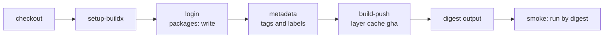

# Lesson 13. Building and Publishing an Image

**Mission link:** The mission says to build, publish and reference a container image by digest. For a service, the image is the artifact: the one thing built once and run in every environment. A registry keeps it past the 90 days an artifact lives in a run, and its digest is the name that cannot be moved.
**Primary source:** [Docs: "GitHub Actions", Docker Docs](https://docs.docker.com/build/ci/github-actions/)
**Prerequisites:** [Lesson 5](0005-actions-expressions-and-outputs.md), [Lesson 8](0008-caching.md), [Lesson 11](0011-artifacts.md), [Lesson 12](0012-versioning-a-build.md), [Artifact](../GLOSSARY.md), [Build once](../GLOSSARY.md), [Digest](../GLOSSARY.md), [Cache](../GLOSSARY.md), [Dockerfile sheet](../../containers/reference/dockerfile.md)

## Warm-up

1. ▢ Why can an artifact not be the long-term home of a release, and what holds things for longer?

<details markdown="1"><summary>Check</summary>

An artifact is stored with its run, expires after its retention period (90 days by default) and is deleted with the run (lesson 11). A container registry or a release page keeps something until someone deletes it, which is where this lesson publishes.

</details>

2. ▢ The `version` that lesson 12 computes is `0.1.0+58.9f3e1aa`. What does it identify, and what does it not?

<details markdown="1"><summary>Check</summary>

It identifies the commit and the run, so a person can find the source. It does not identify the bytes, since two builds of one commit can differ. The digest does that, which is why this lesson carries both.

</details>

3. ▢ What does a cache promise about correctness, and how does that apply to a Docker layer cache?

<details markdown="1"><summary>Check</summary>

Nothing: a cache may be missing or stale at any time and must only ever make a run faster (lesson 8). A layer cache is the same. A build with a cold cache has to produce a working image, only more slowly.

</details>

## Know this

### The image is the artifact

The practice service gets a `Dockerfile` beside `app.py`. Writing a good one is the containers track's job, and the [Dockerfile sheet](../../containers/reference/dockerfile.md) is where the cache and reproducibility rules live. This one is enough to run the service:

```dockerfile
FROM python:3.13-slim
WORKDIR /app
COPY requirements.txt .
RUN pip install --no-cache-dir -r requirements.txt
COPY app.py .
ARG APP_VERSION=dev
ENV APP_VERSION=$APP_VERSION
EXPOSE 8000
CMD ["flask", "--app", "app", "run", "--host", "0.0.0.0", "--port", "8000"]
```

`requirements.txt` is copied and installed before `app.py`, so a change to the code does not invalidate the dependency layer. `APP_VERSION` arrives as a build argument and becomes the environment variable that `GET /version` returns.

### One job builds, tags, pushes and reports the digest

Docker provides official actions for each step ([Docs](https://docs.docker.com/build/ci/github-actions/)), and GitHub's own guide for publishing to the GitHub Container Registry uses the same set ([Docs](https://docs.github.com/en/actions/how-tos/use-cases-and-examples/publishing-packages/publishing-docker-images)). Append these jobs to the `ci.yml` of lesson 12:

```yaml
  image:
    needs: build
    runs-on: ubuntu-latest
    permissions:
      contents: read
      packages: write
    outputs:
      digest: ${{ steps.push.outputs.digest }}
    steps:
      - uses: actions/checkout@v7
      - uses: docker/setup-buildx-action@v4
      - name: Log in to GitHub Container Registry
        if: ${{ github.event_name != 'pull_request' }}
        uses: docker/login-action@v4
        with:
          registry: ghcr.io
          username: ${{ github.actor }}
          password: ${{ secrets.GITHUB_TOKEN }}
      - name: Work out tags and labels
        id: meta
        uses: docker/metadata-action@v6
        with:
          images: ghcr.io/${{ github.repository }}
          tags: |
            type=sha
            type=ref,event=branch
      - name: Build, and push unless this is a pull request
        id: push
        uses: docker/build-push-action@v7
        with:
          context: .
          push: ${{ github.event_name != 'pull_request' }}
          tags: ${{ steps.meta.outputs.tags }}
          labels: ${{ steps.meta.outputs.labels }}
          build-args: APP_VERSION=${{ needs.build.outputs.version }}
          cache-from: type=gha
          cache-to: type=gha,mode=max

  smoke:
    needs: image
    if: ${{ github.event_name == 'push' }}
    runs-on: ubuntu-latest
    permissions:
      packages: read
    steps:
      - uses: docker/login-action@v4
        with:
          registry: ghcr.io
          username: ${{ github.actor }}
          password: ${{ secrets.GITHUB_TOKEN }}
      - name: Run the pushed image by digest and call it
        env:
          DIGEST: ${{ needs.image.outputs.digest }}
        run: |
          image="ghcr.io/${GITHUB_REPOSITORY,,}@${DIGEST}"
          docker run -d --name app -p 8000:8000 "$image"
          curl --fail --silent --show-error --retry 10 --retry-connrefused --retry-delay 1 -w '\n' http://localhost:8000/healthz
          curl --fail --silent --show-error -w '\n' http://localhost:8000/version
```

```console
ok
0.1.0+58.9f3e1aa
```

`build-push-action` exposes the pushed image's digest as its `digest` output, and the job re-exports it so `smoke`, and later the deploy jobs, can run exactly what was pushed. The retry flags on the first `curl` wait for the container to start, so the check does not depend on a fixed `sleep`, which is the kind of timing guess lesson 9 warned about.



### Permissions and the registry

The job pushes with the `GITHUB_TOKEN`, so it needs `packages: write`. Because a `permissions` block sets everything it does not list to `none`, the `image` job also lists `contents: read` for `checkout` ([Docs](https://docs.github.com/en/actions/reference/workflows-and-actions/workflow-syntax)). Lesson 14 goes through why.

Facts about GitHub Container Registry that cause most first-publish trouble ([Docs](https://docs.github.com/en/packages/working-with-a-github-packages-registry/working-with-the-container-registry)):

- The default visibility of a newly published package is private. Public packages can be pulled anonymously, and you change visibility in the package's settings.
- Publishing from a workflow with the `GITHUB_TOKEN` links the package to the repository that holds the workflow automatically, and the package then inherits that repository's access.
- The `GITHUB_TOKEN` will not have permission to push if you earlier pushed a package of the same name from your machine without connecting it to the repository. Connect it, or give the repository access under the package's Actions access.
- Image names must be lowercase, and a GitHub user name may not be. `docker/metadata-action` lowercases the image name and replaces invalid characters in tags ([Docs](https://github.com/docker/metadata-action)), which is why the push is safe but the `smoke` job lowercases `GITHUB_REPOSITORY` itself with `${GITHUB_REPOSITORY,,}`.

### Tags move, digests do not

`metadata-action` turns the event into tags. With `type=sha` and `type=ref,event=branch`, a push of commit `9f3e1aa` to `main` produces `sha-9f3e1aa` and `main`. A pull request would produce `pr-<number>` with `type=ref,event=pr`, and the `latest` tag appears by default only for Git tags and semver patterns.

|Reference|Example|Can it change?|
|---|---|---|
|Branch tag|`ghcr.io/octocat/ci-cd-practice:main`|Yes, every push to `main` moves it|
|Commit tag|`ghcr.io/octocat/ci-cd-practice:sha-9f3e1aa`|It names a commit, but a tag can be pushed again to different content|
|Digest|`ghcr.io/octocat/ci-cd-practice@sha256:4f1c...`|No, the digest is a hash of the content|

A deploy that says `:main` runs whatever `main` pointed at when the pull happened, which may not be the build that was tested if two merges land close together. A deploy that says `@sha256:...` runs one exact image. This is why every later stage receives the digest and the tag is for people. The containers track's [container security sheet](../../containers/reference/container-security.md) covers pinning by digest from the consumer's side.

### Caching layers

`cache-from: type=gha` and `cache-to: type=gha,mode=max` store BuildKit layers in the GitHub Actions cache, and `mode=max` exports the layers of every stage, not only the final image ([Docs](https://docs.docker.com/build/ci/github-actions/cache/)). Docker labels the exporter experimental, and its own examples set up Buildx with `setup-buildx-action` first. Exporting needs write access to the Actions cache, so a workflow that has only read access should keep `cache-from` and omit `cache-to`. Whatever the cache does, the image must come out right without it, and the instruction order in the Dockerfile is what decides how much of it can be reused.

A pull request builds the image too, because a Dockerfile that no longer builds should fail the pull request, but it does not push: `push` is false for the `pull_request` event, and the login step is skipped.

## Practice

1. ▢ Which reference can never point to different content?

    - a) The tag main on that image
    - b) The tag sha-9f3e1aa on that image
    - c) The tag latest on that image
    - d) The sha256 digest of that image

<details markdown="1"><summary>Check</summary>

**d)** A digest is a hash of the content, so a different image has a different digest. (a) moves with every push to `main`. (b) names a commit, but nothing stops the tag being pushed again to other content. (c) is the most mobile of all.

</details>

2. ▢ Write the `permissions` block and the login step for a job that pushes to `ghcr.io` with no secret of your own.

<details markdown="1"><summary>Hint</summary>

The credential is the `GITHUB_TOKEN`, and the user name is whoever started the run. Remember that listing one permission zeroes the rest.

</details>

<details markdown="1"><summary>Check</summary>

```yaml
permissions:
  contents: read
  packages: write
steps:
  - uses: actions/checkout@v7
  - uses: docker/login-action@v4
    with:
      registry: ghcr.io
      username: ${{ github.actor }}
      password: ${{ secrets.GITHUB_TOKEN }}
```

`packages: write` allows the push, and `contents: read` is kept for `checkout` because the block removes every permission it does not name. No stored password is needed, which is the point of using the token.

</details>

3. ▢ Predict, then run. Push a commit to `main` and let the workflow finish, then push a second commit and let it finish. Pull `main` and the first commit's SHA tag, and compare their digests. What do you expect?

    ```console
    $ docker pull ghcr.io/octocat/ci-cd-practice:main
    $ docker pull ghcr.io/octocat/ci-cd-practice:sha-9f3e1aa
    ```

<details markdown="1"><summary>Hint</summary>

One of the two tags was written twice, and the other was written once. Which is which?

</details>

<details markdown="1"><summary>Check</summary>

The two pulls report different digests:

```text
main: Pulling from octocat/ci-cd-practice
Digest: sha256:b19a7c0e55d42c3f6a1e8d90b27f43d1c5e6a8f09b3d2c4e7a1f5069d8c3b2a1
Status: Downloaded newer image for ghcr.io/octocat/ci-cd-practice:main

sha-9f3e1aa: Pulling from octocat/ci-cd-practice
Digest: sha256:4f1c2d83a69e0b57c1d4e8f2a3b6097c5d1e4f8a2b3c6d9e0f1a4b7c8d2e5f31
Status: Downloaded newer image for ghcr.io/octocat/ci-cd-practice:sha-9f3e1aa
```

`main` moved to the second commit's image, while `sha-9f3e1aa` still resolves to the first. The first image is not gone: its `sha-` tag still resolves to it. Tags are labels that move, and a digest does not.

</details>

4. ▢ Debug this. Login succeeds, then the push fails.

    ```yaml
      image:
        runs-on: ubuntu-latest
        permissions:
          contents: read
        steps:
          - uses: actions/checkout@v7
          - uses: docker/login-action@v4
            with:
              registry: ghcr.io
              username: ${{ github.actor }}
              password: ${{ secrets.GITHUB_TOKEN }}
          - uses: docker/build-push-action@v7
            with:
              context: .
              push: true
              tags: ghcr.io/octocat/ci-cd-practice:main
    ```

    ```console
    ERROR: failed to build: failed to solve: failed to push ghcr.io/octocat/ci-cd-practice:main: unexpected status from POST request to https://ghcr.io/v2/octocat/ci-cd-practice/blobs/uploads/: 403 Forbidden
    ```

<details markdown="1"><summary>Hint</summary>

The login only proves who the token belongs to. Read the job's `permissions` for what the token may do.

</details>

<details markdown="1"><summary>Check</summary>

The token has `contents: read` and nothing else, so it cannot write packages, and the registry answers 403 at the first upload. Add `packages: write` to the job's `permissions`. If the 403 persists after that, check the second cause from Know this: an earlier push of the same package name that was never connected to the repository.

</details>

5. ▢ The deploy job runs `docker run ghcr.io/octocat/ci-cd-practice:main` after the image job. Two pull requests merge a minute apart. What can go wrong, and what do you pass to the deploy job instead?

<details markdown="1"><summary>Check</summary>

The first run's deploy can pull the image from the second merge, because `main` already moves, so what is deployed is not what that run tested. Pass `needs.image.outputs.digest` and run `ghcr.io/octocat/ci-cd-practice@<digest>`, so the deploy runs exactly the image this run pushed regardless of what the tag points to by then.

</details>

## Real-world reps

- [ ] In `ci-cd-practice`, add the `Dockerfile`, then the `image` and `smoke` jobs, and push to `main`. Read the `digest` the `push` step reports, open the repository's Packages page, and find the same digest next to the `main` and `sha-` tags.
- [ ] On the package's page, check its visibility and that it is linked to the repository. Make it public, pull it from a machine that is not logged in to the registry, and confirm anonymous pulls work.
- [ ] Tomorrow: without notes, write the permissions block that lets a job push to `ghcr.io`, say which of tag and digest can move, and explain why a deploy should receive the digest from the build job and not look the tag up later.

## Going further

- [Artifacts and Versioning](../reference/artifacts-and-versioning.md)
- [Docs: "GitHub Actions", Docker Docs](https://docs.docker.com/build/ci/github-actions/)
- [Docs: "Cache management with GitHub Actions", Docker Docs](https://docs.docker.com/build/ci/github-actions/cache/)
- [Docs: "Publishing Docker images", GitHub](https://docs.github.com/en/actions/how-tos/use-cases-and-examples/publishing-packages/publishing-docker-images)
- [Repository: docker/metadata-action](https://github.com/docker/metadata-action)
- [Dockerfile: Instructions, Cache Rules, Multi-Stage Patterns and Reproducibility](../../containers/reference/dockerfile.md)
- [Resources](../RESOURCES.md)

---

Not landing? Reread the primary source at the top, since this lesson compresses it and compression is where understanding leaks. Check the [glossary](../GLOSSARY.md) for any term that felt slippery.

If the lesson itself is unclear rather than the material, that is a defect: [open an issue](https://github.com/TokenCemetery/teach/issues).
