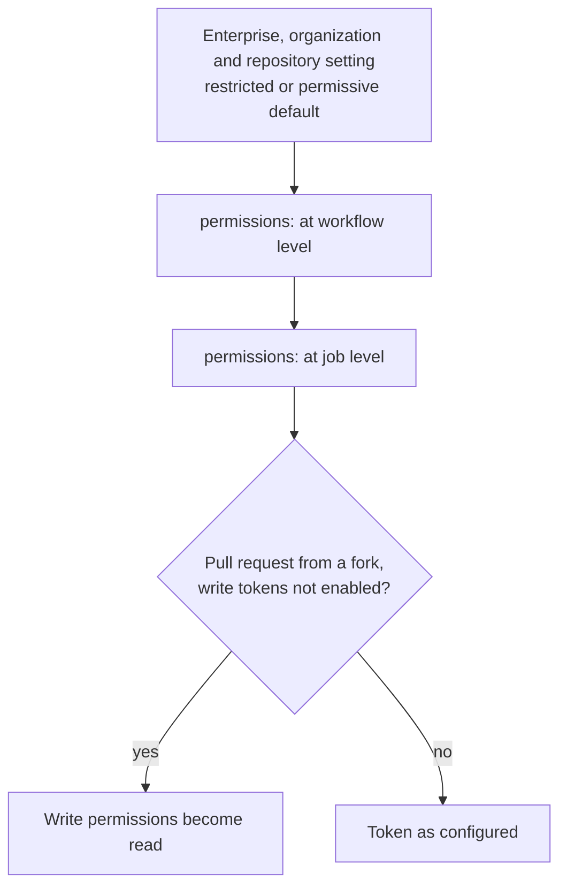

# Lesson 14. Secrets and the GITHUB_TOKEN

**Mission link:** The mission says to give a pipeline the access it needs and no more. Every workflow already holds two kinds of credential: the secrets you stored, which last until you rotate them, and the token GitHub mints for each job, which lasts for the job. Both are least-privilege problems, and both are easy to leave wide open.
**Primary source:** [Docs: "GITHUB_TOKEN", GitHub](https://docs.github.com/en/actions/concepts/security/github_token)
**Prerequisites:** [Lesson 4](0004-jobs-steps-and-runners.md), [Lesson 5](0005-actions-expressions-and-outputs.md), [Lesson 13](0013-building-and-publishing-an-image.md), [Secret](../GLOSSARY.md), [GitHub token](../GLOSSARY.md), [Expression](../GLOSSARY.md), [Runner](../GLOSSARY.md)

## Warm-up

1. ▢ The `image` job in lesson 13 lists `contents: read` and `packages: write`. Why list `contents: read` when the job only pushes an image?

<details markdown="1"><summary>Check</summary>

Because a `permissions` block sets every permission it does not name to `none`, and `actions/checkout` needs `contents: read` to fetch the code. Listing one permission changes the rest, which this lesson explains.

</details>

2. ▢ When is a `${{ ... }}` expression in a `run` script replaced by its value: before the step starts, or while the shell runs it?

<details markdown="1"><summary>Check</summary>

Before the step runs. GitHub Actions evaluates the expression and substitutes the result into the script text (the glossary's definition, and lesson 5), so the shell never sees the expression, only what it expanded to. That matters when the value is a secret.

</details>

3. ▢ What does a GitHub-hosted runner keep from one job to the next?

<details markdown="1"><summary>Check</summary>

Nothing. Each job gets a fresh virtual machine (lesson 4), so a file a job writes is gone with it. A self-hosted runner can keep state, which is why the choice affects where secrets may safely be written.

</details>

## Know this

### Where secrets live

A secret is an encrypted value stored in a repository, an environment or an organization, and a workflow can read it only if the workflow names it ([Docs](https://docs.github.com/en/actions/concepts/security/secrets)).

|Level|Who can read it in a workflow|Use it for|
|---|---|---|
|Repository|Every workflow in the repository|Values the whole pipeline needs|
|Environment|Only jobs that enter that environment, and for an environment with required reviewers, only after approval|Production credentials (lesson 17)|
|Organization|Repositories the secret's access policy allows|One value shared by many repositories|

Create one from the repository settings under Secrets and variables, Actions, or with the GitHub CLI ([Docs](https://docs.github.com/en/actions/how-tos/write-workflows/choose-what-workflows-do/use-secrets)):

```console
$ gh secret set DEMO_SECRET
? Paste your secret: ********
✓ Set Actions secret DEMO_SECRET for octocat/ci-cd-practice
$ gh secret set --env production REGISTRY_PASSWORD
$ gh secret list
```

The prompt keeps the value out of your shell history, which a value typed on the command line would not be.

### How a job receives one

A step asks for a secret by name, as an input or an environment variable. Prefer the environment variable for anything that goes into a script ([Docs](https://docs.github.com/en/actions/how-tos/write-workflows/choose-what-workflows-do/use-secrets)):

```yaml
- name: Call the API
  env:
    API_KEY: ${{ secrets.API_KEY }}
  run: ./call-api --key-from-env API_KEY
```

The rules that surprise people:

- A secret that was never set evaluates to an empty string, not an error.
- A secret cannot be referenced directly in an `if:` condition. Put it in a job-level `env` and test the variable.
- Except for the `GITHUB_TOKEN`, secrets are not passed to the runner when a workflow is triggered from a forked repository. They are also not passed automatically to reusable workflows, and are not available to runs triggered by Dependabot events.
- Anyone with write access to the repository can read every repository secret, because they can change a workflow to print it ([Docs](https://docs.github.com/en/actions/reference/security/secure-use)). A secret limits what a workflow can do, not what a maintainer can learn.

### What masking misses

The runner redacts the exact value of every secret a job uses when it appears in the log, and replaces it with `***`. The docs call this a convenience, not a guarantee, because many transformations of a value no longer match ([Docs](https://docs.github.com/en/actions/concepts/security/secrets)):

|Case|What happens|
|---|---|
|The secret printed as it is|Redacted|
|A transformed copy: reversed, Base64, URL-encoded, split|Not redacted, since it is a different string. Register the new value with `::add-mask::VALUE`|
|A value derived from a secret, such as a JWT signed with a private key|Not redacted until you register it|
|A secret stored as a JSON, XML or YAML blob|Redaction relies on an exact match, so use one secret per sensitive value|
|A secret the job never used|Not redacted, because only secrets within the current job are known to the runner|

If a secret does reach a log, deleting the log and rotating the secret are both required, since redaction happens on the runner and the value may already have been seen ([Docs](https://docs.github.com/en/actions/reference/security/secure-use)). Rotating is what makes it safe again. The longer a secret lives, the longer a leak stays useful, which is lesson 15's argument for not storing cloud keys at all.

### The GITHUB_TOKEN

At the start of each job GitHub creates a unique `GITHUB_TOKEN`. It is an installation access token of the GitHub App that GitHub installs on your repository when you enable Actions, limited to the repository that holds the workflow ([Docs](https://docs.github.com/en/actions/concepts/security/github_token)). It expires when the job finishes or at its effective maximum lifetime, which is up to 6 hours on GitHub-hosted runners because a job there cannot run longer. It is available as `secrets.GITHUB_TOKEN` and as the `github.token` context.

That last sentence has a consequence. An action can read `github.token` even when the workflow never passed the token to it ([Docs](https://docs.github.com/en/actions/tutorials/authenticate-with-github_token)). Every action you use inherits whatever the token can do, so the token's permissions are the cap on what a compromised action can do to the repository.

### Setting permissions

Which permissions the token starts with comes from a setting, and the workflow can only narrow or adjust it from there ([Docs](https://docs.github.com/en/actions/reference/workflows-and-actions/workflow-syntax)):



|Setting|What the token starts with|
|---|---|
|Restricted|Read access to `contents` and `packages` only|
|Permissive|Read and write access to all permissions|

The setting lives under the repository's Settings, Actions, General, Workflow permissions ([Docs](https://docs.github.com/en/repositories/managing-your-repositorys-settings-and-features/enabling-features-for-your-repository/managing-github-actions-settings-for-a-repository)), and a more restrictive choice at the organization level disables the permissive option in its repositories. Check yours instead of assuming. The workflow then adjusts it with `permissions`:

```yaml
permissions:
  contents: read

jobs:
  test:
    runs-on: ubuntu-latest
    steps:
      - uses: actions/checkout@v7
      - run: pytest

  image:
    needs: test
    runs-on: ubuntu-latest
    permissions:
      contents: read
      packages: write
    steps:
      - uses: actions/checkout@v7
      # login, metadata and build-push steps as in lesson 13
```

|Form|Meaning|
|---|---|
|`permissions: {contents: read}`|Only `contents: read`. Every permission not listed is `none`|
|`permissions: read-all` or `write-all`|Read or write for every permission|
|`permissions: {}`|No permissions at all|
|A job-level `permissions`|Replaces the workflow-level block for that job|

Each permission takes `read`, `write` or `none`, and `write` includes `read`. The ones this course meets are `contents`, `packages` (lesson 13), `id-token` (lesson 15, write only), `issues`, `pull-requests`, `deployments` and `attestations` (lesson 24). Start the workflow at the least you can, usually `contents: read`, and grant more to the one job that needs it. The secure use reference recommends exactly this: default to read access for repository contents and raise it per job.

Two behaviours follow from the design. A run from a fork's pull request gets read-only permissions unless an administrator enabled sending write tokens. And events caused by the `GITHUB_TOKEN`, such as a push it makes, do not start new workflow runs, except `workflow_dispatch` and `repository_dispatch`, which prevents recursive runs ([Docs](https://docs.github.com/en/actions/concepts/security/github_token)).

## Practice

1. ▢ Which statement about masking is correct?

    - a) Redaction matches the exact value, so transformed copies slip through
    - b) Redaction hides every secret that any single job could print
    - c) Redaction covers values derived from a secret by the runner
    - d) Redaction applies safely to JSON blobs stored as one secret

<details markdown="1"><summary>Check</summary>

**a)** The runner looks for the exact secret string, so a reversed, encoded or derived copy is a different string and is printed. (b) is wrong because only secrets the job used are known to the runner. (c) is wrong because a derived value, such as a signed JWT, must be registered with `::add-mask::`. (d) is wrong because structured data makes the exact match unlikely, so each sensitive value should be its own secret.

</details>

2. ▢ `ci.yml` has a `test` job that checks out the code and runs `pytest`, and an `image` job that pushes to `ghcr.io`. Write the `permissions` so that `test` has the least access and `image` has only what it needs.

<details markdown="1"><summary>Hint</summary>

Set a default for the whole workflow, then override in the one job that needs more. Remember what a job-level block does to the workflow-level one.

</details>

<details markdown="1"><summary>Check</summary>

```yaml
permissions:
  contents: read

jobs:
  test:
    runs-on: ubuntu-latest
    # inherits contents: read
  image:
    runs-on: ubuntu-latest
    permissions:
      contents: read
      packages: write
```

The workflow-level block gives every job read access to the code and nothing else. `image` replaces it, so it names `contents: read` again beside `packages: write`. Leaving `contents: read` out of `image` would break its `checkout`.

</details>

3. ▢ Predict, then run. Create a repository secret named `DEMO_SECRET` with the made-up value `practice-value-123`, never a real credential, and run this workflow by hand. What do the three lines show?

    ```yaml
    name: masking-demo
    on: workflow_dispatch
    jobs:
      demo:
        runs-on: ubuntu-latest
        steps:
          - env:
              DEMO_SECRET: ${{ secrets.DEMO_SECRET }}
            run: |
              echo "raw: $DEMO_SECRET"
              echo "reversed: $(echo "$DEMO_SECRET" | rev)"
              echo "base64: $(printf '%s' "$DEMO_SECRET" | base64)"
    ```

<details markdown="1"><summary>Hint</summary>

Redaction looks for one exact string. Ask whether each line prints that string or a different one.

</details>

<details markdown="1"><summary>Check</summary>

```text
raw: ***
reversed: 321-eulav-ecitcarp
base64: cHJhY3RpY2UtdmFsdWUtMTIz
```

Only the first line is redacted. The reversed and encoded copies are different strings and appear in full, and anyone can reverse them back. Delete `DEMO_SECRET` and the workflow afterwards. With a real secret you would delete the log and rotate the value.

</details>

4. ▢ Debug this. The job should open an issue when the nightly check fails. It fails with a 403, even though `GH_TOKEN` is set.

    ```yaml
    permissions:
      contents: read

    jobs:
      report:
        runs-on: ubuntu-latest
        steps:
          - name: Open an issue
            env:
              GH_TOKEN: ${{ github.token }}
            run: gh api --method POST "repos/$GITHUB_REPOSITORY/issues" -f title="Nightly check failed"
    ```

    ```console
    gh: Resource not accessible by integration (HTTP 403)
    ```

<details markdown="1"><summary>Hint</summary>

The token is valid. Read the `permissions` block for what it was allowed to do.

</details>

<details markdown="1"><summary>Check</summary>

The token authenticated but lacks the permission to create an issue: the block grants only `contents: read`, and everything unlisted is `none`. Add `issues: write` to the job, not to the whole workflow if other jobs do not need it:

```yaml
    permissions:
      contents: read
      issues: write
```

Switching the repository setting to permissive would also make the call succeed, and would give every job in every workflow that access, which is the wrong fix.

</details>

5. ▢ A contributor opens a pull request from a fork. The `docker login` step fails with an empty password, using `${{ secrets.REGISTRY_PASSWORD }}`. Is this a bug in the workflow, and how should it be handled?

<details markdown="1"><summary>Check</summary>

It is the designed behaviour: secrets other than the `GITHUB_TOKEN` are not passed to runs triggered from a fork, and the token itself is read-only there, so the secret evaluates to an empty string. Do not weaken it to make the run pass. A pull request does not need to push an image: build it without pushing and skip the login, as lesson 13 does with `github.event_name != 'pull_request'`. Why enabling secrets for forks is dangerous is lesson 16.

</details>

## Real-world reps

- [ ] Open the repository's Settings, Actions, General and find Workflow permissions. Note whether the default is restricted or permissive, set it to restricted in `ci-cd-practice`, add `permissions: contents: read` at the top of `ci.yml` with the `packages: write` override on `image`, and confirm the run still passes.
- [ ] In a project you work on, run `gh secret list` and write next to each name what it grants, who could read it, and whether it is a long-lived cloud key that lesson 15 could replace.
- [ ] Tomorrow: without notes, say what happens to the token's other permissions when a block names one, name two things the token cannot do on a fork's pull request, and explain why masking cannot be the only protection for a secret.

## Going further

- [Pipeline Security](../reference/pipeline-security.md)
- [Docs: "GITHUB_TOKEN", GitHub](https://docs.github.com/en/actions/concepts/security/github_token)
- [Docs: "Use GITHUB_TOKEN for authentication in workflows", GitHub](https://docs.github.com/en/actions/tutorials/authenticate-with-github_token)
- [Docs: "Secrets", GitHub](https://docs.github.com/en/actions/concepts/security/secrets)
- [Docs: "Using secrets in GitHub Actions", GitHub](https://docs.github.com/en/actions/how-tos/write-workflows/choose-what-workflows-do/use-secrets)
- [Docs: "Secure use reference", GitHub](https://docs.github.com/en/actions/reference/security/secure-use)
- [Resources](../RESOURCES.md)

---

Not landing? Reread the primary source at the top, since this lesson compresses it and compression is where understanding leaks. Check the [glossary](../GLOSSARY.md) for any term that felt slippery.

If the lesson itself is unclear rather than the material, that is a defect: [open an issue](https://github.com/TokenCemetery/teach/issues).
