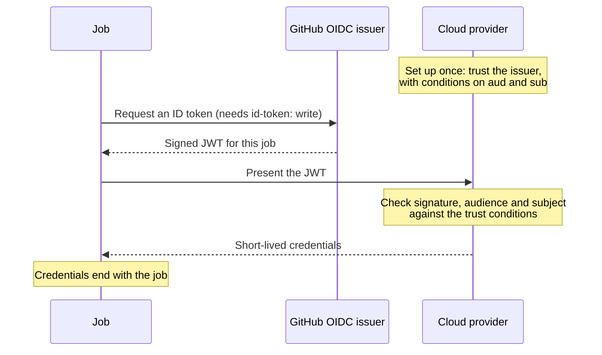

# Lesson 15. OIDC Instead of Long-Lived Keys

**Mission link:** The mission says to give a pipeline cloud access without long-lived keys. A key stored as a secret works until it leaks, and then it works for whoever holds it. With OIDC federation the cloud trusts GitHub to say which workflow is asking, so there is no key to store, rotate or leak.
**Primary source:** [Docs: "OpenID Connect", GitHub](https://docs.github.com/en/actions/concepts/security/openid-connect)
**Prerequisites:** [Lesson 3](0003-triggers-and-events.md), [Lesson 14](0014-secrets-and-the-github-token.md), [OIDC federation](../GLOSSARY.md), [Secret](../GLOSSARY.md), [GitHub token](../GLOSSARY.md), [Event](../GLOSSARY.md)

## Warm-up

1. ▢ A cloud access key sits in a repository secret and its log output is masked. Name two reasons it is still a risk.

<details markdown="1"><summary>Check</summary>

It lives until someone rotates it, so a leak stays useful for as long as the key does, and anyone with write access to the repository can change a workflow to read it (lesson 14). Masking only hides the exact value in logs and does neither of those things.

</details>

2. ▢ A workflow sets `permissions: {contents: read}`. What does the job's token get for `id-token`?

<details markdown="1"><summary>Check</summary>

`none`. A `permissions` block sets every permission it does not name to `none` (lesson 14), so a job that needs `id-token: write` has to name it.

</details>

3. ▢ What does `GITHUB_REF` look like for a `pull_request` run, and which commit does `GITHUB_SHA` hold?

<details markdown="1"><summary>Check</summary>

`GITHUB_REF` is `refs/pull/<number>/merge`, and `GITHUB_SHA` is the last merge commit on that merge branch, not the tip of the author's branch (lesson 3). The token you are about to meet reports these same facts about the run.

</details>

## Know this

### Trust instead of a key

OIDC federation is a trust relationship between a cloud provider and GitHub's OpenID Connect issuer. Nothing secret is stored in GitHub. Each job can ask GitHub for a short-lived ID token, a signed JSON web token whose claims say which repository, branch, event and environment the run belongs to, and the cloud exchanges it for short-lived credentials if the claims satisfy the conditions you configured ([Docs](https://docs.github.com/en/actions/concepts/security/openid-connect)).



The docs name the benefits: no cloud secrets to duplicate in GitHub, authorization decided by the cloud's own tools, and credentials that are valid for a single job and then expire. Compare the two models:

|Question|Long-lived key as a secret|OIDC|
|---|---|---|
|What is stored in GitHub|The key|Nothing|
|How long is a leak useful|Until someone rotates the key|The credential ends with the job|
|What limits who can use it|Whoever can read the secret|Conditions on the token's claims|
|Who rotates it|You, on a schedule you must remember|Nobody, since every run gets a new one|

### Asking for the token

A job can fetch a token only if its permissions include `id-token: write`. That permission does not grant write access to anything else, it only allows requesting and using the OIDC token ([Docs](https://docs.github.com/en/actions/reference/security/oidc)). Grant it to the one job that needs it, not the workflow:

```yaml
permissions: {}

jobs:
  deploy:
    runs-on: ubuntu-latest
    permissions:
      id-token: write
      contents: read
```

Official login actions, such as `aws-actions/configure-aws-credentials` for AWS and the Azure login action, make the request and the exchange for you. Underneath, the runner provides two environment variables, `ACTIONS_ID_TOKEN_REQUEST_URL` and `ACTIONS_ID_TOKEN_REQUEST_TOKEN`, and the request is an authenticated call to that URL with an `audience` parameter appended ([Docs](https://docs.github.com/en/actions/reference/security/oidc)). The ID token is a credential. Treat it like a secret: never print it, and decode only its payload when you need to look inside.

### What the token says

These claims matter most for trust decisions ([Docs](https://docs.github.com/en/actions/reference/security/oidc)):

|Claim|Meaning|
|---|---|
|`iss`|The issuer, `https://token.actions.githubusercontent.com`|
|`aud`|The audience. By default the URL of the repository owner, such as an organization. Cloud login actions set their own, for example `sts.amazonaws.com`|
|`sub`|The subject, assembled from the run's metadata. The main condition to test|
|`repository`, `repository_owner`|Which repository, and whose|
|`ref`, `ref_type`|The Git ref that triggered the run, and whether it is a branch or tag|
|`event_name`|The event that started the run|
|`environment`|The environment the job entered, if any|
|`job_workflow_ref`|For a reusable workflow, the path of the called workflow|
|`exp`, `iat`, `nbf`|When the token expires, was issued, and becomes valid|

### The subject claim

The default `sub` is a fixed pattern, and which pattern depends on the run ([Docs](https://docs.github.com/en/actions/reference/security/oidc)):

|The run|Subject|
|---|---|
|A job that enters an environment|`repo:octo-org/octo-repo:environment:production`|
|A `pull_request` event, when the job has no environment|`repo:octo-org/octo-repo:pull_request`|
|A branch, when the job has no environment and the event is not a pull request|`repo:octo-org/octo-repo:ref:refs/heads/main`|
|A tag, under the same conditions|`repo:octo-org/octo-repo:ref:refs/tags/v0.1.0`|

A colon inside any metadata value is written `%3A`. So the environment, when there is one, wins over the branch: a deploy job that enters `production` has a subject that no longer names the branch, which is why a trust policy for production names the environment and relies on the environment's deployment branch rules (lesson 17) to restrict branches.

The docs also describe an immutable subject format that adds the numeric owner and repository IDs, `repo:OWNER@OWNER-ID/REPO@REPO-ID:ref:refs/heads/main`. Repositories created after July 15, 2026 use it by default, older repositories keep the previous format unless they opt in, and renaming or transferring a repository also moves it to the new format. The reason is that a name can be recycled by a different owner and the same string would then match a stranger's repository. So the subject you must write into a trust policy is the one your repository really produces, and you find out by looking, which is the exercise below.

### Writing the trust condition

The cloud side is a policy. The docs insist that you define at least one condition, so that untrusted repositories cannot request access tokens for your cloud resources. This AWS trust policy accepts one environment of one repository, with the audience the official action uses ([Docs](https://docs.github.com/en/actions/how-tos/secure-your-work/security-harden-deployments/oidc-in-aws)):

```json
{
  "Version": "2012-10-17",
  "Statement": [
    {
      "Effect": "Allow",
      "Principal": {
        "Federated": "arn:aws:iam::123456123456:oidc-provider/token.actions.githubusercontent.com"
      },
      "Action": "sts:AssumeRoleWithWebIdentity",
      "Condition": {
        "StringEquals": {
          "token.actions.githubusercontent.com:aud": "sts.amazonaws.com",
          "token.actions.githubusercontent.com:sub": "repo:octo-org/octo-repo:environment:production"
        }
      }
    }
  ]
}
```

`StringEquals` accepts exactly one subject. The AWS guide also shows `StringLike` with `repo:octo-org/octo-repo:*`, which allows any branch, pull request merge branch or environment of that repository to assume the role. A pattern that matches more subjects lets more workflows in, so a wildcard on a role that can change production is a decision, not a convenience.

The optional last step in the workflow then looks like this, with the role in your own account:

```yaml
      - uses: aws-actions/configure-aws-credentials@v6
        with:
          role-to-assume: arn:aws:iam::123456123456:role/ci-cd-practice-deploy
          aws-region: us-east-1
      - run: aws sts get-caller-identity
```

OIDC removes the stored key. It does not make a workflow safe by itself: any job whose claims match the condition receives the role, so the conditions are the access control, and untrusted code that runs in a matching job gets the credentials (lesson 16).

## Practice

1. ▢ What does `id-token: write` let a job do?

    - a) Create deployments through the repository's REST API
    - b) Fetch an OIDC token for this job
    - c) Write to the cloud account it names
    - d) Read and write every secret in scope

<details markdown="1"><summary>Check</summary>

**b)** It allows the job to request and use its OIDC token and nothing else. (a) is `deployments: write`. (c) is decided by the cloud's trust policy and the role's permissions, not by this setting. (d) is not a permission that exists.

</details>

2. ▢ Write the `Condition` block of an AWS trust policy that lets only jobs entering the `production` environment of `octo-org/octo-repo` assume the role, for a repository that uses the older subject format.

<details markdown="1"><summary>Hint</summary>

Two conditions: the audience the official action uses, and a subject for an environment. Use `StringEquals`.

</details>

<details markdown="1"><summary>Check</summary>

```json
"Condition": {
  "StringEquals": {
    "token.actions.githubusercontent.com:aud": "sts.amazonaws.com",
    "token.actions.githubusercontent.com:sub": "repo:octo-org/octo-repo:environment:production"
  }
}
```

For a repository on the immutable format, the subject would carry the IDs: `repo:octo-org@123456/octo-repo@456789:environment:production`. A job with no environment would have a different subject and be refused, which is the point.

</details>

3. ▢ Predict, then run. Add this workflow to `ci-cd-practice`, run it with Run workflow on `main`, then open a pull request from a branch and let it run again. Which three lines differ between the two runs?

    ```yaml
    name: oidc-claims
    on:
      workflow_dispatch:
      pull_request:

    permissions: {}

    jobs:
      claims:
        runs-on: ubuntu-latest
        permissions:
          id-token: write
        steps:
          - name: Show the claims in this job's ID token
            run: |
              python3 - <<'PY'
              import base64, json, os, urllib.request
              url = os.environ["ACTIONS_ID_TOKEN_REQUEST_URL"] + "&audience=sts.amazonaws.com"
              request = urllib.request.Request(url, headers={"Authorization": "bearer " + os.environ["ACTIONS_ID_TOKEN_REQUEST_TOKEN"]})
              token = json.load(urllib.request.urlopen(request))["value"]
              payload = token.split(".")[1]
              payload += "=" * (-len(payload) % 4)
              claims = json.loads(base64.urlsafe_b64decode(payload))
              for key in ["iss", "aud", "sub", "repository", "ref", "event_name", "environment", "runner_environment"]:
                  print(f"{key}: {claims.get(key, '(not in this token)')}")
              PY
    ```

<details markdown="1"><summary>Hint</summary>

The step prints only claims, never the token itself. Compare the pull request row of the subject table with the branch row, and recall lesson 3 for the `ref` of a pull request.

</details>

<details markdown="1"><summary>Check</summary>

For the manual run on `main`:

```text
iss: https://token.actions.githubusercontent.com
aud: sts.amazonaws.com
sub: repo:octocat@1234567/ci-cd-practice@7654321:ref:refs/heads/main
repository: octocat/ci-cd-practice
ref: refs/heads/main
event_name: workflow_dispatch
environment: (not in this token)
runner_environment: github-hosted
```

For the pull request run, `sub` ends in `:pull_request` instead of `:ref:refs/heads/main`, `ref` becomes `refs/pull/1/merge` and `event_name` becomes `pull_request`. Your numbers differ, and a repository created before the immutable format took effect shows `repo:octocat/ci-cd-practice:...` without the IDs. The script never prints the token: it keeps it in memory, and only decoded claims reach the log.

</details>

4. ▢ Debug this. The cloud login step is fine in the cloud's own tests, but the job stops immediately.

    ```yaml
    permissions:
      contents: read

    jobs:
      claims:
        runs-on: ubuntu-latest
        steps:
          - run: python3 request_token.py
    ```

    ```console
    KeyError: 'ACTIONS_ID_TOKEN_REQUEST_URL'
    ```

<details markdown="1"><summary>Hint</summary>

The script reads two environment variables. Ask where they come from, and what the `permissions` block did to the one that provides them.

</details>

<details markdown="1"><summary>Check</summary>

The runner only sets `ACTIONS_ID_TOKEN_REQUEST_URL` and `ACTIONS_ID_TOKEN_REQUEST_TOKEN` for a job whose token has `id-token: write`, and the block above leaves `id-token` at `none`. Add `id-token: write` to this job's `permissions`, next to `contents: read`.

</details>

5. ▢ Debug this. A repository created under the immutable subject format has a role whose trust policy was copied from an older repository. The login step fails.

    ```json
    "token.actions.githubusercontent.com:sub": "repo:octocat/ci-cd-practice:ref:refs/heads/main"
    ```

    ```console
    Error: Could not assume role with OIDC: Not authorized to perform sts:AssumeRoleWithWebIdentity
    ```

<details markdown="1"><summary>Hint</summary>

Run the claims workflow from this lesson on `main` and compare its `sub` with the policy character by character.

</details>

<details markdown="1"><summary>Check</summary>

The policy is written in the older subject format, but a repository created under the immutable format produces `repo:octocat@1234567/ci-cd-practice@7654321:ref:refs/heads/main`, so the strings differ and the cloud refuses. Copy the subject the claims workflow printed into the policy. The error does not name the condition that failed, which is why printing the real claims is the quickest diagnosis.

</details>

6. ▢ A trust policy allows `StringLike` on `repo:octo-org/*`. Who can assume the role, and what would you change?

<details markdown="1"><summary>Check</summary>

Any workflow in any repository of the organization, on any branch, pull request or environment, including repositories created tomorrow, can assume it. Narrow it to one repository, and for a role that deploys, to the environment: `repo:octo-org/octo-repo:environment:production` with `StringEquals`. Then branch rules on that environment decide which code can reach it.

</details>

## Real-world reps

- [ ] Run the `oidc-claims` workflow on `main` and on a pull request in `ci-cd-practice`. Write down the `sub` of each and check whether your repository uses the older or the immutable format. Optional, if you have a cloud account: create a role that trusts only the `sub` you recorded, add the login step from this lesson, and delete the role afterwards.
- [ ] List the cloud keys your team stores as secrets, using `gh secret list` on a project you work on. For one of them, write down which provider and role would replace it and which `sub` the trust condition would test.
- [ ] Tomorrow: without notes, draw the five steps of the OIDC exchange, say which permission a job needs to request the token, and write the subject for a job that enters `production`.

## Going further

- [Pipeline Security](../reference/pipeline-security.md)
- [Docs: "OpenID Connect", GitHub](https://docs.github.com/en/actions/concepts/security/openid-connect)
- [Docs: "OpenID Connect reference", GitHub](https://docs.github.com/en/actions/reference/security/oidc)
- [Docs: "Configuring OpenID Connect in Amazon Web Services", GitHub](https://docs.github.com/en/actions/how-tos/secure-your-work/security-harden-deployments/oidc-in-aws)
- [Resources](../RESOURCES.md)

---

Not landing? Reread the primary source at the top, since this lesson compresses it and compression is where understanding leaks. Check the [glossary](../GLOSSARY.md) for any term that felt slippery.

If the lesson itself is unclear rather than the material, that is a defect: [open an issue](https://github.com/TokenCemetery/teach/issues).
