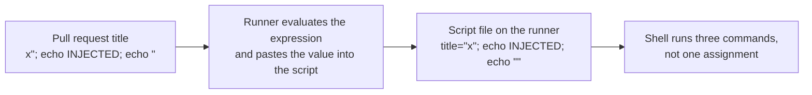

# Lesson 16. Untrusted Input

**Mission link:** The mission says no path for untrusted input should reach a pipeline's secrets or cloud access. Lessons 14 and 15 shrank what a stolen token can do. This lesson closes the other half: the ways an outsider's text or code gets to run inside your jobs in the first place.
**Primary source:** [Docs: "Script injections", GitHub](https://docs.github.com/en/actions/concepts/security/script-injections)
**Prerequisites:** [Lesson 3](0003-triggers-and-events.md), [Lesson 5](0005-actions-expressions-and-outputs.md), [Lesson 14](0014-secrets-and-the-github-token.md), [Lesson 15](0015-oidc-instead-of-long-lived-keys.md), [Script injection](../GLOSSARY.md), [Secret](../GLOSSARY.md), [Expression](../GLOSSARY.md), [GitHub token](../GLOSSARY.md)

## Warm-up

1. ▢ In a step with `run: echo "${{ github.event.pull_request.title }}"`, what happens to the `${{ }}` part, and when?

<details markdown="1"><summary>Check</summary>

The runner evaluates the expression and pastes its value into the step's text before the shell starts ([Script injections](https://docs.github.com/en/actions/concepts/security/script-injections)). The shell never sees an expression, only whatever characters the title contained. Hold that thought: it is the whole vulnerability.

</details>

2. ▢ Lesson 14 said masking redacts a secret that is printed verbatim. Why does that not protect a secret from a script an attacker controls?

<details markdown="1"><summary>Check</summary>

Masking matches the exact value in the log. Code that runs in the job can print the secret reversed, encoded or split in two, or send it to a server and never print it. Masking is a guard against accidents, not against an author who means harm.

</details>

3. ▢ In lesson 15's OIDC token, which claim does a cloud's trust policy check to restrict access to one branch or one environment?

<details markdown="1"><summary>Check</summary>

The subject claim, `sub`, for example `repo:octo-org/octo-repo:ref:refs/heads/main` for a branch, or `repo:octo-org/octo-repo:environment:Production` when the job references an environment ([OIDC reference](https://docs.github.com/en/actions/reference/security/oidc)). The claim is only as trustworthy as the code that was allowed to run in that job, which is what this lesson is about.

</details>

## Know this

### Text that becomes code

GitHub calls a value untrusted when an outsider can choose its content. The docs say attackers can put their own content into the `github` context, and that names ending in `body`, `default_branch`, `email`, `head_ref`, `label`, `message`, `name`, `page_name`, `ref` and `title` should be treated as potentially untrusted, such as `github.event.issue.title` and `github.event.pull_request.body` ([Script injections](https://docs.github.com/en/actions/concepts/security/script-injections)). Branch names and email addresses count too, because they are flexible: the docs give `zzz";echo${IFS}"hello";#` as a valid branch name and a possible attack vector.

The danger is the order of events. In a `run` step, expressions are evaluated first and the result is written into a temporary shell script, which the shell then executes. A value containing a quote and a semicolon is not data any more, it is shell syntax.



The vulnerable shape is an expression placed straight into script text:

```yaml
- name: Check PR title
  run: |
    title="${{ github.event.pull_request.title }}"
    echo "Title length: ${#title}"
```

Whoever can open a pull request, or edit its title, writes part of your script. In a public repository that is anyone with an account.

### The fix: an environment variable, or an action input

The docs recommend two fixes ([Secure use reference](https://docs.github.com/en/actions/reference/security/secure-use)). For an inline script, assign the expression to an intermediate environment variable and read the variable in the shell:

```yaml
- name: Check PR title
  env:
    TITLE: ${{ github.event.pull_request.title }}
  run: |
    echo "Title length: ${#TITLE}"
```

The value is placed in the process environment, not in the script text, so it is never parsed as shell. The docs also suggest double quoting shell variables to avoid word splitting. The other fix is to pass the value to an action as an input, `with: title: ${{ github.event.pull_request.title }}`, because an action receives it as an argument and no shell script is generated from it.

Two limits. An expression in `if:` or `with:` is not pasted into a shell, so it is not this bug. And the environment variable protects only the substitution: a script that later runs `eval "$TITLE"` or builds a command from it brings the bug back.

### Fork code and `pull_request_target`

Injection is text. The second path is code: a fork's pull request carries its own files, including the `Makefile`, test files and dependencies your job may run. GitHub's defaults assume you may not trust that code.

|Event|Which workflow file runs|Token and secrets|
|---|---|---|
|`pull_request` from a fork|The one in the pull request's merge commit|Read-only `GITHUB_TOKEN`, no other secrets|
|`pull_request_target`|The one on the base repository's default branch|The base repository's token and secrets|

The first row is from [Events that trigger workflows](https://docs.github.com/en/actions/reference/workflows-and-actions/events-that-trigger-workflows): with the exception of `GITHUB_TOKEN`, secrets are not passed to a run triggered from a fork, and the token is read-only. The second row exists so automation, such as labelling a fork's pull request, can have write access. By default it is safe, because only trusted default-branch code runs.

The attack is called a pwn request. A workflow on `pull_request_target` checks out the fork's head and then runs something from it ([Securely using pull_request_target](https://docs.github.com/en/actions/reference/security/securely-using-pull_request_target)):

```yaml
# INSECURE: an example of what not to write
on:
  pull_request_target:
jobs:
  test:
    runs-on: ubuntu-latest
    steps:
      - uses: actions/checkout@v7
        with:
          ref: ${{ github.event.pull_request.head.sha }}
      - run: pytest
```

The checkout alone runs nothing. `pytest` does: it loads test files and configuration from the fork, with the base repository's secrets and write token in the environment. The docs list the same mistake in other shapes: checking out the merge ref, pointing `repository:` at the fork, and fetching the code with `git fetch` or `gh pr checkout` and then running it. They also note it is not unique to this event: any privileged event that runs untrusted code has the problem, and a `workflow_run` workflow should treat artifacts from another run as untrusted data, since they may come from a fork.

Defences that exist now, from the same page:

- `actions/checkout` refuses to check out a fork's pull request head from a `pull_request_target` or `workflow_run` workflow unless the step sets `allow-unsafe-pr-checkout: true`. The name is meant to stand out in review.
- `pull_request_target` runs have read-only access to the default branch's cache scope, to limit cache poisoning.
- GitHub is adding a default Actions event policy that blocks `pull_request_target` in public repositories. The page describes it as in evaluate mode before enforcement, so read the page for its state when you rely on it.

The better habit is not to need the escape hatch. Run fork code with `pull_request`, which has no secrets to steal. Keep `pull_request_target` for jobs that never execute the pull request's files, such as adding a label.

On a public repository, also avoid self-hosted runners for pull requests from strangers: the secure use reference says they should almost never be used for public repositories, since they keep state between jobs (lesson 4).

## Practice

1. ▢ A workflow runs `echo "New issue: ${{ github.event.issue.title }}"` in a `run` step. Which change closes the injection?

    - a) Wrap the expression in single quotes
    - b) Pass it through an env variable
    - c) Strip quotes from it with sed
    - d) Add set -e to the script

<details markdown="1"><summary>Check</summary>

**b)** The value then lives in the environment, and the script text contains only `"$ISSUE_TITLE"` or similar. (a) is defeated by a title that contains a single quote. (c) runs after the substitution, so the injected text is already part of the script. (d) changes what happens on a failing command, not what the shell parses.

</details>

2. ▢ Which of these three steps can run attacker-chosen shell commands when the pull request title is hostile?

    ```yaml
    - uses: some-owner/lint-title@v2
      with:
        title: ${{ github.event.pull_request.title }}
    - if: startsWith(github.event.pull_request.title, 'wip')
      run: echo "work in progress"
    - run: echo "Title is ${{ github.event.pull_request.title }}"
    ```

<details markdown="1"><summary>Check</summary>

Only the third. The first hands the title to an action as an input, and the second evaluates the title as a string inside the expression engine and never pastes it into a script. The third pastes it into a shell script, which is the injection. Expressions are not dangerous in general: it is a `run` body that is built from untrusted text.

</details>

3. ▢ Predict, then run. In your own `ci-cd-practice` repository (the throwaway one, never someone else's), add `.github/workflows/title-demo.yml`, push it to `main`, then open a pull request from a branch and give it the title `x"; echo INJECTED; echo "`. What does the `Check title` step print, and what does it show in the log's first line?

    ```yaml
    name: Title demo
    on:
      pull_request:
        types: [opened, edited]
    permissions:
      contents: read
    jobs:
      check:
        runs-on: ubuntu-latest
        steps:
          - name: Check title
            run: |
              title="${{ github.event.pull_request.title }}"
              echo "Title length: ${#title}"
    ```

<details markdown="1"><summary>Hint</summary>

Write out the script after substitution. Where does the title's first double quote end the assignment, and how many commands are left on that line?

</details>

<details markdown="1"><summary>Check</summary>

```text
Run title="x"; echo INJECTED; echo ""
  echo "Title length: ${#title}"
  shell: /usr/bin/bash -e {0}
INJECTED

Title length: 1
```

The quote in the title closes the assignment, so the line is three commands: `title="x"`, `echo INJECTED` and `echo ""`. The word `INJECTED` appears because your title ran as shell code, and the length is 1 because `title` holds only `x`. The payload is harmless on purpose, but `echo` could have been any command, with that job's token and secrets in reach. If the log looks different, compare the first `Run` line with the script above: that line is the substituted script, and it is where you see the injection.

</details>

4. ▢ Now fix the demo. Change the step to use an intermediate environment variable, push it, then edit the pull request's title to a new value, so the `edited` event runs it again. What do the log and the printed length look like?

<details markdown="1"><summary>Hint</summary>

The expression moves to an `env:` key on the step, and the script reads `${#TITLE}`. The substituted text in the log is now an `env:` block, not part of the script.

</details>

<details markdown="1"><summary>Check</summary>

```yaml
- name: Check title
  env:
    TITLE: ${{ github.event.pull_request.title }}
  run: |
    echo "Title length: ${#TITLE}"
```

```text
Run echo "Title length: ${#TITLE}"
  shell: /usr/bin/bash -e {0}
  env:
    TITLE: x"; echo INJECTED; echo "
Title length: 25
```

The same hostile title is now only a 25 character string: `INJECTED` is no longer printed on its own line, and it shows only inside the `env:` listing. The shell was handed a script that does not contain the title.

</details>

5. ▢ Debug this. A maintainer wants CI to run on pull requests from forks and says: "I used `pull_request_target`, so forks can use our `DEPLOY_TOKEN` secret to run integration tests". What is wrong with the workflow below, and what should change?

    ```yaml
    on:
      pull_request_target:
    jobs:
      integration:
        runs-on: ubuntu-latest
        steps:
          - uses: actions/checkout@v7
            with:
              ref: ${{ github.event.pull_request.head.sha }}
              allow-unsafe-pr-checkout: true
          - run: ./run-integration-tests.sh
            env:
              DEPLOY_TOKEN: ${{ secrets.DEPLOY_TOKEN }}
    ```

<details markdown="1"><summary>Hint</summary>

Who wrote `run-integration-tests.sh` in the checked-out tree, and whose secret is in the environment when it runs?

</details>

<details markdown="1"><summary>Check</summary>

It is a pwn request. The checkout takes the fork's files, and the next step executes a script from them with the secret in its environment, so the pull request's author can read `DEPLOY_TOKEN` by editing that script. The `allow-unsafe-pr-checkout` input turns off the protection built into `actions/checkout`, which is why its name is meant to stand out. Run the tests on `pull_request`, where a fork gets no secrets, and make them work without `DEPLOY_TOKEN` (a stub or a test double). If a privileged step is truly needed, run it in a separate workflow that never executes fork files, and gate it on a maintainer's decision rather than on the pull request's own contents.

</details>

6. ▢ A label bot uses `pull_request_target`, does no checkout, and has this step. Is it safe, and why or why not?

    ```yaml
    - run: gh pr edit "${{ github.event.pull_request.number }}" --add-label "${{ github.event.pull_request.title }}"
      env:
        GH_TOKEN: ${{ secrets.GITHUB_TOKEN }}
    ```

<details markdown="1"><summary>Check</summary>

No. The workflow never runs fork files, so there is no pwn request, but the pull request title is pasted into the script text, which is script injection, and the step runs with the base repository's write token. Move the title to an `env:` variable and use `"$TITLE"`, and add a `permissions:` block giving the token only `pull-requests: write`. The pull request number is a number GitHub assigns, so it is not the risk here, but putting it in the environment as well costs nothing and makes the rule easy to audit: no `${{ }}` inside any `run` body.

</details>

## Real-world reps

- [ ] In your throwaway `ci-cd-practice` repository, finish practice items 3 and 4, then close the pull request and delete `title-demo.yml`. Never try the payload against a repository you do not own, even harmlessly.
- [ ] Search the workflows of a repository you work on, read-only, for `${{ github.` and `${{ github.event.` inside `run:` bodies. For each hit, write down whether an outsider can choose the value, using the suffix list from the docs, and mark any `pull_request_target` or `workflow_run` workflow.
- [ ] Tomorrow: without notes, write the three-line rule that prevents script injection, name five context suffixes the docs call untrusted, and explain in a sentence why `pull_request_target` plus a checkout of the fork's head is dangerous but `pull_request` is not.

## Going further

- [Pipeline Security](../reference/pipeline-security.md)
- [Docs: "Script injections", GitHub](https://docs.github.com/en/actions/concepts/security/script-injections)
- [Docs: "Secure use reference", GitHub](https://docs.github.com/en/actions/reference/security/secure-use)
- [Docs: "Securely using pull_request_target", GitHub](https://docs.github.com/en/actions/reference/security/securely-using-pull_request_target)
- [Article: "Keeping your GitHub Actions and workflows secure Part 1: Preventing pwn requests", GitHub Security Lab](https://securitylab.github.com/resources/github-actions-preventing-pwn-requests/)
- [Article: "Keeping your GitHub Actions and workflows secure Part 2: Untrusted input", GitHub Security Lab](https://securitylab.github.com/resources/github-actions-untrusted-input/)
- [Resources](../RESOURCES.md)

---

Not landing? Reread the primary source at the top, since this lesson compresses it and compression is where understanding leaks. Check the [glossary](../GLOSSARY.md) for any term that felt slippery.

If the lesson itself is unclear rather than the material, that is a defect: [open an issue](https://github.com/TokenCemetery/teach/issues).
