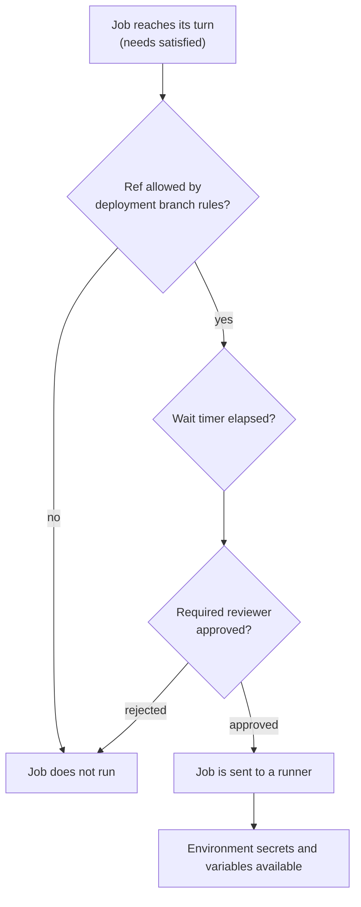

# Lesson 17. Environments and Approvals

**Mission link:** The mission says to gate deployments with environments and approvals. A pipeline that can deploy to production whenever any job asks is one typo or one hostile branch away from an incident, so the gate has to live outside the workflow file that wants to pass through it.
**Primary source:** [Docs: "Deployment environments", GitHub](https://docs.github.com/en/actions/concepts/workflows-and-actions/deployment-environments)
**Prerequisites:** [Lesson 10](0010-making-a-pipeline-fast.md), [Lesson 14](0014-secrets-and-the-github-token.md), [Lesson 15](0015-oidc-instead-of-long-lived-keys.md), [Lesson 16](0016-untrusted-input.md), [Environment](../GLOSSARY.md), [Secret](../GLOSSARY.md), [Concurrency group](../GLOSSARY.md), [Job](../GLOSSARY.md)

## Warm-up

1. ▢ Lesson 14 stored a secret at the repository level. Name one reason to store it on an environment instead.

<details markdown="1"><summary>Check</summary>

An environment secret is available only to jobs that reference that environment, and only after the environment's protection rules pass ([Deployments and environments](https://docs.github.com/en/actions/reference/workflows-and-actions/deployments-and-environments)). A repository secret is available to every job in the repository that names it, with no gate in front of it.

</details>

2. ▢ In lesson 15, a job asked for an OIDC token and the cloud checked its `sub` claim. What does `sub` look like when the job references an environment?

<details markdown="1"><summary>Check</summary>

`repo:ORG-NAME/REPO-NAME:environment:ENVIRONMENT-NAME`, for example `repo:octo-org/octo-repo:environment:Production` ([OIDC reference](https://docs.github.com/en/actions/reference/security/oidc)). A trust policy that requires the environment form means a job that never entered the protected environment cannot get the credentials, even if it asks.

</details>

3. ▢ Lesson 16 showed a fork's code running with your secrets. If a job referenced an environment with a deployment branch rule for `main`, could a job started by a fork's pull request deploy to it?

<details markdown="1"><summary>Check</summary>

No. The rule is matched against the run's `GITHUB_REF`, and a pull request event runs on a `refs/pull/N/merge` ref, which `main` does not match ([Deployments and environments](https://docs.github.com/en/actions/reference/workflows-and-actions/deployments-and-environments)). The branch rule is a second wall behind the one lesson 16 built.

</details>

## Know this

### What an environment is

An environment is a named deployment target, such as `staging` or `production`, with its own protection rules, secrets and variables ([Deployment environments](https://docs.github.com/en/actions/concepts/workflows-and-actions/deployment-environments)). A job enters one with the `environment` key. Each job can reference a single environment, and the name can be a string or an expression.

```yaml
jobs:
  deploy-staging:
    runs-on: ubuntu-latest
    environment: staging
    steps:
      - run: echo "deploying"
```

The sentence that matters is this one from the docs: any protection rules configured for the environment must pass before a job referencing the environment is sent to a runner, and the job can access the environment's secrets only after it is sent to a runner. So a rule is not a step in your job. It decides whether the job exists on a runner at all.



When the job does run, GitHub records a deployment for the environment, which appears in the repository's deployment history. Setting `deployment: false` in the environment mapping uses an environment's secrets and variables without creating a deployment record, and protection rules such as reviewers still apply ([Deploying with GitHub Actions](https://docs.github.com/en/actions/how-tos/deploy/configure-and-manage-deployments/control-deployments)).

### The protection rules

All of these are set in the repository's Settings, under Environments, by a repository owner or an administrator. The rules and their limits come from [Deployments and environments](https://docs.github.com/en/actions/reference/workflows-and-actions/deployments-and-environments) and [Managing environments for deployment](https://docs.github.com/en/actions/how-tos/deploy/configure-and-manage-deployments/manage-environments).

|Rule|What it does|Limits and defaults|
|---|---|---|
|Required reviewers|Holds a job until a named person or team approves|Up to 6 users or teams, at least read access, one approval is enough|
|Prevent self-review|The person who started the deployment cannot approve it|Off unless you select it|
|Wait timer|Delays the job after it is triggered|1 to 43,200 minutes (30 days), and the wait is not billed|
|Deployment branches and tags|Only matching refs may deploy|No restriction, protected branches only, or selected name patterns|
|Allow administrators to bypass|Lets an admin force pending jobs through|On by default, can be switched off|
|Custom protection rules|A GitHub App approves using an outside system|In public preview, at most 6 rules enabled on one environment|

Four details are easy to get wrong:

- **Deployment branch patterns match the whole ref.** The rule is matched against `GITHUB_REF`, and wildcards do not match `/`. A rule `release/*` allows `release/1.0` and not `release/2024/hotfix`, for which you need `release/*/*`. Branch and tag patterns are configured separately, so a branch rule does not allow a tag.
- **Protected branches only means branches with a protection rule.** If no branch in the repository has a protection rule, all branches may deploy.
- **Self-review.** A reviewer who triggered the run can approve it unless Prevent self-review is on. With it on, a one-person repository cannot approve its own deploys at all.
- **Approval releases the job as written.** Once approved, the job runs with the environment's secrets, so a reviewer should read what the job will do, not only click through.

### Environment secrets and variables

Secrets stored in an environment are available only to jobs that reference it, and a job waiting for approval cannot read them until a reviewer approves. Variables stored in an environment are plain configuration, not encrypted, and are reachable only through the `vars` context. The usual use is one name with a different value per environment, so the workflow file is identical and only the environment changes:

```yaml
- name: Show target
  env:
    TARGET: ${{ vars.TARGET_NAME }}
    NOTE: ${{ secrets.DEPLOY_NOTE }}
  run: |
    echo "target=${TARGET}"
    echo "note length=${#NOTE}"
```

Self-hosted runners are not isolated by environments: the docs say jobs there do not run in an isolated container even when they use environments, so environment secrets need the same care as repository secrets.

### Environments you did not create

This one is a trap. Running a workflow that references an environment that does not exist creates it, with no protection rules and no secrets, and anyone who can edit workflows can cause that; only repository admins can then configure it ([Managing environments for deployment](https://docs.github.com/en/actions/how-tos/deploy/configure-and-manage-deployments/manage-environments)). A typo such as `prodution` therefore does not fail. It deploys straight through an unprotected environment of its own.

### What your plan gives you

Verified on the pages cited above: environments, environment secrets and deployment protection rules are available in public repositories on all current plans. In a public repository on a GitHub Free account you can therefore use required reviewers, wait timers, deployment branches and tags, the administrator bypass setting, custom protection rules, environment secrets and environment variables. This is why the track's practice repository is public.

In private or internal repositories you need GitHub Pro, Team or Enterprise for environments, environment secrets and deployment branches. On Free, Pro and Team plans, the docs say wait timers, required reviewers, the administrator bypass setting and custom rules are available only for public repositories. If you make a Free repository private, its configured rules and environment secrets are ignored.

### One deployment at a time

Environments pair with concurrency groups from lesson 10. The deployment docs suggest using concurrency so that an environment has at most one deployment in progress at a time. A deploy job usually wants `cancel-in-progress: false`: by default a newly queued run replaces a pending one in the group, and `true` would also cancel a deploy that is already running.

```yaml
concurrency:
  group: deploy-production
  cancel-in-progress: false
```

## Practice

1. ▢ A job references `production`, which has a required reviewer. When can the job read `secrets.DEPLOY_NOTE` from that environment?

    - a) As soon as the run starts
    - b) After every protection rule has passed
    - c) Only after the previous job succeeds
    - d) Only after someone reruns the job

<details markdown="1"><summary>Check</summary>

**b)** The job is not sent to a runner until the rules pass, and the secret reaches the job only after that. (a) describes a repository secret, which has no gate. (c) is what `needs` controls, and it is a separate mechanism that does not release environment secrets. (d) confuses approval with a rerun: approving releases the waiting job, no rerun is involved.

</details>

2. ▢ Write the settings for a `production` environment that meets all four requirements: either of two named people may approve, the person who started a deploy cannot approve it, only `main` may deploy, and an administrator cannot skip the approval.

<details markdown="1"><summary>Check</summary>

Required reviewers: the two people (or a team that contains them). Prevent self-review: selected. Deployment branches and tags: Selected branches and tags, with a branch rule for `main`. Allow administrators to bypass configured protection rules: deselected. Only one of the listed reviewers has to approve, so "both must approve" is not available as a setting: if you need two approvals, enforce that at merge time instead.

</details>

3. ▢ Predict, then run. In `ci-cd-practice` create two environments, `staging` with no rules and `production` with yourself as a required reviewer (leave Prevent self-review off). Give each a variable `TARGET_NAME` (`staging-target`, `production-target`) and a secret `DEPLOY_NOTE` (`staging-key`, `production-key`). Add this `deploy.yml`, push it to `main`, and watch the run. What state is each job in a few seconds after the push, and what do the two jobs print once everything has run?

    ```yaml
    name: Deploy
    on:
      push:
        branches: [main]
    permissions:
      contents: read
    jobs:
      staging:
        runs-on: ubuntu-latest
        environment: staging
        steps:
          - name: Show target
            env:
              TARGET: ${{ vars.TARGET_NAME }}
              NOTE: ${{ secrets.DEPLOY_NOTE }}
            run: |
              echo "target=${TARGET}"
              echo "note length=${#NOTE}"
      production:
        needs: staging
        runs-on: ubuntu-latest
        environment: production
        steps:
          - name: Show target
            env:
              TARGET: ${{ vars.TARGET_NAME }}
              NOTE: ${{ secrets.DEPLOY_NOTE }}
            run: |
              echo "target=${TARGET}"
              echo "note length=${#NOTE}"
    ```

<details markdown="1"><summary>Hint</summary>

`needs` runs the jobs in order, and a protection rule decides whether the second job is ever sent to a runner. Count the characters in each secret value.

</details>

<details markdown="1"><summary>Check</summary>

The `staging` job finishes within a minute or so. The `production` job then waits, with a review request on the run page and a Review deployments button, and no runner is used for it. After you select `production`, choose Approve and deploy and confirm, it runs:

```text
staging:     target=staging-target     note length=11
production:  target=production-target  note length=14
```

(The two lines appear in each job's log, shown side by side here.) The same file produced different values because each job entered a different environment. The lengths are 11 and 14 because `staging-key` and `production-key` have that many characters, and the length is printed so the log shows something without relying on masking. If you choose Reject instead, the production job does not run and the workflow run fails.

</details>

4. ▢ Debug this. A teammate pasted the workflow below into `ci-cd-practice`. The run deployed to production within seconds, with no approval request, although `production` has a required reviewer. Why?

    ```yaml
    jobs:
      production:
        runs-on: ubuntu-latest
        environment: prodution
        steps:
          - run: echo "deploying to production"
    ```

<details markdown="1"><summary>Hint</summary>

Open Settings, then Environments, and read the list of names.

</details>

<details markdown="1"><summary>Check</summary>

The environment name is spelled `prodution`. A workflow that references an environment that does not exist creates it, with no protection rules and no secrets, so the job ran against a new unprotected environment and the real `production` was never involved. Fix the name, delete the stray environment, and consider reading the list of environments in review the way you read a list of secrets. This is also why the gate belongs to repository administrators: anyone who can edit a workflow can invent an environment, but not configure it.

</details>

5. ▢ A deployment branch rule says `release/*`. Which of these may deploy: the branch `release/1.0`, the branch `release/2024/hotfix`, the tag `release/1.0`?

<details markdown="1"><summary>Check</summary>

Only the branch `release/1.0`. The pattern is matched against `GITHUB_REF` and wildcards do not match `/`, so `release/2024/hotfix` needs a rule `release/*/*`. Name patterns for branches and tags are configured separately, so a branch rule says nothing about the tag. Remember too that the check is on the ref the run started from, which is why a rule for `refs/pull/*/merge` would let pull request runs deploy and should not be added.

</details>

6. ▢ A company has a private repository on a GitHub Team plan and wants production deploys to need a manager's approval. Can it use an environment's required reviewers, and what should it do about the gate?

<details markdown="1"><summary>Check</summary>

Not on that plan. The docs limit required reviewers on Free, Pro and Team plans to public repositories, although Team can create environments, secrets and deployment branches for private repositories. The gate has to come from elsewhere, for example a protected `main` that requires an approving review before merge, plus a deploy workflow that only runs from `main`. That moves the approval to the merge, which is a weaker control than approving the run, and the team should say so rather than call it equivalent.

</details>

## Real-world reps

- [ ] In `ci-cd-practice`, finish practice item 3. Then add a deployment branch rule for `main` to `production`, add `workflow_dispatch:` under `on:` in `deploy.yml`, push a branch named `feature/gate-test`, run the workflow on that branch from the Actions tab, and read what the run shows for the `production` job.
- [ ] Open Settings, then Environments, for a repository you work on, and write down each environment with its rules and secrets. Mark any environment with no rule at all that something deploys to.
- [ ] Tomorrow: without notes, list the six protection rules, say which two you would turn on first for production and why, and explain what happens when a workflow names an environment that does not exist.

## Going further

- [Deployments](../reference/deployments.md)
- [Docs: "Deployment environments", GitHub](https://docs.github.com/en/actions/concepts/workflows-and-actions/deployment-environments)
- [Docs: "Managing environments for deployment", GitHub](https://docs.github.com/en/actions/how-tos/deploy/configure-and-manage-deployments/manage-environments)
- [Docs: "Deployments and environments", GitHub](https://docs.github.com/en/actions/reference/workflows-and-actions/deployments-and-environments)
- [Docs: "Deploying with GitHub Actions", GitHub](https://docs.github.com/en/actions/how-tos/deploy/configure-and-manage-deployments/control-deployments)
- [Resources](../RESOURCES.md)

---

Not landing? Reread the primary source at the top, since this lesson compresses it and compression is where understanding leaks. Check the [glossary](../GLOSSARY.md) for any term that felt slippery.

If the lesson itself is unclear rather than the material, that is a defect: [open an issue](https://github.com/TokenCemetery/teach/issues).
