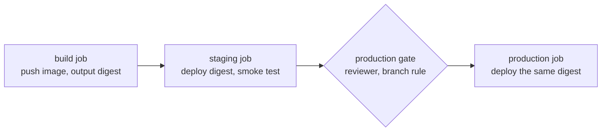

# Lesson 18. Promotion Between Environments

**Mission link:** The mission says to produce one versioned artifact and promote that same artifact through environments. Staging is only evidence about production if the thing running in production is byte for byte the thing staging ran, and the only part allowed to change between them is configuration.
**Primary source:** [Docs: "Deployments and environments", GitHub](https://docs.github.com/en/actions/reference/workflows-and-actions/deployments-and-environments)
**Prerequisites:** [Lesson 5](0005-actions-expressions-and-outputs.md), [Lesson 12](0012-versioning-a-build.md), [Lesson 13](0013-building-and-publishing-an-image.md), [Lesson 16](0016-untrusted-input.md), [Lesson 17](0017-environments-and-approvals.md), [Promotion](../GLOSSARY.md), [Build once](../GLOSSARY.md), [Digest](../GLOSSARY.md), [Environment](../GLOSSARY.md)

## Warm-up

1. ▢ Why can an image tag such as `1.4.2` or `main` not be trusted to name the same bytes tomorrow?

<details markdown="1"><summary>Check</summary>

A tag is a movable label: anyone with push access to the repository can point it at a different image, and a rebuild that pushes the same tag does exactly that. A digest is a hash of the content, so it cannot be moved to different content (lesson 13, [Digest](../GLOSSARY.md)).

</details>

2. ▢ A build job needs to hand the digest it just pushed to two later jobs. Which two keys do you write, and where?

<details markdown="1"><summary>Check</summary>

The step that pushes gets an `id` and exposes the value through its outputs, the job maps it under `outputs:`, and later jobs list the build in `needs` and read `${{ needs.build.outputs.digest }}` (lesson 5). Without the job-level `outputs:` mapping, a later job sees an empty string, not an error.

</details>

3. ▢ In lesson 17, a job references `production` with a required reviewer. Where is the job while it waits, and what does it hold?

<details markdown="1"><summary>Check</summary>

It has not been sent to a runner, so it holds no machine and cannot read the environment's secrets. It is released when a reviewer approves ([Deployment environments](https://docs.github.com/en/actions/concepts/workflows-and-actions/deployment-environments)).

</details>

## Know this

### Promote, do not rebuild

Promotion is deploying an artifact that has already passed one environment to the next, by its digest or version, without rebuilding it ([Promotion](../GLOSSARY.md)). Jez Humble's list of deployment pipeline patterns puts the reason first: only build packages once, so the thing deployed is the same thing tested throughout the pipeline, and if a deployment fails you can rule the package out as the cause ([Continuous Delivery: patterns](https://continuousdelivery.com/implementing/patterns/)). The same page adds two practices this lesson uses: deploy the same way to every environment, and smoke test every deployment.

Rebuilding in the production job fails that test in quiet ways. A base image tag may have moved, a dependency without an exact pin may have resolved differently, and a build may embed a timestamp. Staging then tested one artifact and production runs another, and nothing in the logs says so. The fix is structural: one job builds and publishes, and every deploy job receives the same digest.



### What may differ: configuration

The artifact is identical in every environment, so everything that differs has to be supplied from outside it. In GitHub Actions that is the environment's variables (the `vars` context) for plain values and its secrets for sensitive ones ([Deployments and environments](https://docs.github.com/en/actions/reference/workflows-and-actions/deployments-and-environments)). Both are readable only by jobs that reference the environment, which is why the same line, `${{ vars.LOG_LEVEL }}`, yields `debug` in staging and `info` in production.

|May differ per environment|Must be the same in every environment|
|---|---|
|Log level, feature flag defaults|The image digest, therefore the code|
|Connection strings and credentials (as secrets)|The versions of every dependency inside the image|
|Replica count, resource limits|The way the deploy is performed|
|Hostnames and URLs|The build that produced it|

A value baked into the image at build time, such as a database host, breaks the arrangement: you would need one image per environment. The rule of thumb is that if changing a value requires a new build, it is not configuration.

### One workflow, three jobs

The workflow below builds once and deploys the result to two environments. The `build` job publishes the image tagged with the commit and outputs its digest. `staging` and `production` each start a throwaway kind cluster inside the job with `helm/kind-action`, so no cloud account is needed, and deploy the digest by reference, `image@digest`. The `build` job is lesson 13's `image` job in compact form, with the image name lowercased by hand instead of through `docker/metadata-action`.

```yaml
name: Release
on:
  push:
    branches: [main]
permissions:
  contents: read

jobs:
  build:
    runs-on: ubuntu-latest
    permissions:
      contents: read
      packages: write
    outputs:
      image: ${{ steps.name.outputs.image }}
      digest: ${{ steps.push.outputs.digest }}
    steps:
      - uses: actions/checkout@v7
      - id: name
        run: echo "image=ghcr.io/${GITHUB_REPOSITORY,,}" >> "$GITHUB_OUTPUT"
      - uses: docker/login-action@v4
        with:
          registry: ghcr.io
          username: ${{ github.actor }}
          password: ${{ secrets.GITHUB_TOKEN }}
      - uses: docker/setup-buildx-action@v4
      - id: push
        uses: docker/build-push-action@v7
        with:
          context: .
          push: true
          tags: ${{ steps.name.outputs.image }}:${{ github.sha }}

  staging:
    needs: build
    runs-on: ubuntu-latest
    environment: staging
    permissions:
      contents: read
      packages: read
    steps:
      - uses: helm/kind-action@v1
      - name: Deploy the digest
        env:
          IMAGE: ${{ needs.build.outputs.image }}
          DIGEST: ${{ needs.build.outputs.digest }}
          LOG_LEVEL: ${{ vars.LOG_LEVEL }}
          REGISTRY_USER: ${{ github.actor }}
          REGISTRY_TOKEN: ${{ secrets.GITHUB_TOKEN }}
        run: |
          kubectl create secret docker-registry ghcr --docker-server=ghcr.io --docker-username="$REGISTRY_USER" --docker-password="$REGISTRY_TOKEN"
          kubectl patch serviceaccount default -p '{"imagePullSecrets":[{"name":"ghcr"}]}'
          kubectl create deployment web --image="${IMAGE}@${DIGEST}"
          kubectl set env deployment/web APP_VERSION="${GITHUB_SHA::7}" LOG_LEVEL="$LOG_LEVEL"
          kubectl rollout status deployment/web --timeout=120s
      - name: Smoke test and report
        run: |
          kubectl port-forward deployment/web 8000:8000 &
          sleep 3
          curl --fail --silent http://localhost:8000/healthz
          echo
          kubectl get deployment web -o jsonpath='{.spec.template.spec.containers[0].image}{"\n"}'
          kubectl exec deployment/web -- printenv APP_VERSION LOG_LEVEL

  production:
    needs: [build, staging]
    runs-on: ubuntu-latest
    environment: production
    permissions:
      contents: read
      packages: read
    steps:
      - uses: helm/kind-action@v1
      - name: Deploy the digest
        env:
          IMAGE: ${{ needs.build.outputs.image }}
          DIGEST: ${{ needs.build.outputs.digest }}
          LOG_LEVEL: ${{ vars.LOG_LEVEL }}
          REGISTRY_USER: ${{ github.actor }}
          REGISTRY_TOKEN: ${{ secrets.GITHUB_TOKEN }}
        run: |
          kubectl create secret docker-registry ghcr --docker-server=ghcr.io --docker-username="$REGISTRY_USER" --docker-password="$REGISTRY_TOKEN"
          kubectl patch serviceaccount default -p '{"imagePullSecrets":[{"name":"ghcr"}]}'
          kubectl create deployment web --image="${IMAGE}@${DIGEST}"
          kubectl set env deployment/web APP_VERSION="${GITHUB_SHA::7}" LOG_LEVEL="$LOG_LEVEL"
          kubectl rollout status deployment/web --timeout=120s
      - name: Smoke test and report
        run: |
          kubectl port-forward deployment/web 8000:8000 &
          sleep 3
          curl --fail --silent http://localhost:8000/healthz
          echo
          kubectl get deployment web -o jsonpath='{.spec.template.spec.containers[0].image}{"\n"}'
          kubectl exec deployment/web -- printenv APP_VERSION LOG_LEVEL
```

Reading it closely:

- `${GITHUB_REPOSITORY,,}` lowercases the name, because registry image names must be lowercase and a user name may not be. The tag is the commit SHA for traceability, and the digest is what is deployed.
- Every value that comes from an expression reaches the shell through `env:`, as lesson 16 requires. Here the values are not attacker controlled, but a workflow with one unsafe line teaches the next editor to add another.
- The deploy script is the same in both jobs. Only `environment:` differs, and with it the values behind `vars.LOG_LEVEL`. This is "deploy the same way to every environment" from Humble's list, and it is what makes a successful staging run evidence about the production run.
- A package first published from a workflow with the `GITHUB_TOKEN` is private and is linked to the repository automatically, so workflows in that repository can read it. The deploy jobs pull it with the `GITHUB_TOKEN` and `packages: read` through an image pull secret ([Working with the Container registry](https://docs.github.com/en/packages/working-with-a-github-packages-registry/working-with-the-container-registry)). The smoke test uses the `/healthz` endpoint the practice service has had since lesson 2, and the Dockerfile from lesson 13 is assumed to serve on port 8000: change the port if yours differs.
- The two kind clusters exist only for the life of their jobs. Real staging and production persist, so the second deploy would be an update of a running Deployment, not a creation. The thing this exercise shows is the part that is the same either way: the same digest string reaching both.

### Promoting later, from a recorded digest

Promotion does not have to be in the same run as the build. A common second shape is a manual `workflow_dispatch` that takes the digest staging already passed as an input and deploys exactly that to production. The input is typed by a person, so it is untrusted text under lesson 16's rule: it goes in through `env:` and gets validated before use.

```yaml
on:
  workflow_dispatch:
    inputs:
      digest:
        description: Digest staging already passed, sha256 then a colon and 64 hex characters
        required: true
jobs:
  promote:
    runs-on: ubuntu-latest
    environment: production
    steps:
      - name: Check the input is a digest
        env:
          DIGEST: ${{ inputs.digest }}
        run: |
          [[ "$DIGEST" =~ ^sha256:[0-9a-f]{64}$ ]] || { echo "Not a digest"; exit 1; }
```

Lesson 20 reuses this shape for rollback, since promoting an older digest is the same operation.

## Practice

1. ▢ Which way of choosing the image for the production deploy keeps the promise that production runs what staging tested?

    - a) Tag it latest and pull latest
    - b) Pull the tag matching the commit
    - c) Pull the digest the build printed
    - d) Rebuild from the same commit again

<details markdown="1"><summary>Check</summary>

**c)** A digest names content and cannot be moved. (a) names whatever was pushed last, which may be a later build. (b) is traceable but still a movable tag, since a rebuild or a manual push can repoint it. (d) produces a new artifact: the same commit does not give the same bytes when a base image tag or an unpinned dependency has changed.

</details>

2. ▢ Sort these into "may differ between staging and production" and "must not": the log level, the compiled application code, the database connection string, the version of Flask inside the image, the replica count.

<details markdown="1"><summary>Check</summary>

May differ: log level, connection string (as a secret), replica count. Must not differ: the compiled code and the Flask version, both of which are inside the artifact. If a value you wanted to change needs a rebuild, either it is not configuration or the image is reading it at build time instead of at start.

</details>

3. ▢ Predict, then run. Create the `staging` and `production` environments from lesson 17 if you have not, give each a variable `LOG_LEVEL` (`debug` in staging, `info` in production), and make sure `production` still has you as a required reviewer. Add `release.yml` to `ci-cd-practice` and push. In the `Smoke test and report` steps of both jobs, which lines of output are identical, and which differ?

<details markdown="1"><summary>Hint</summary>

One build job produced one digest. The jobs differ in which environment they entered, and the commit is the same for both.

</details>

<details markdown="1"><summary>Check</summary>

Staging:

```text
ok
ghcr.io/octocat/ci-cd-practice@sha256:13360e8b7eed5cc515fdfffd51adf99c3bdb063b76719305cb1adc98509e3297
a1b2c3d
debug
```

Production, after you approve it:

```text
ok
ghcr.io/octocat/ci-cd-practice@sha256:13360e8b7eed5cc515fdfffd51adf99c3bdb063b76719305cb1adc98509e3297
a1b2c3d
info
```

The image reference, with its digest, and `APP_VERSION` are identical, because both jobs were handed the same build output and the same commit. Only `LOG_LEVEL` differs, because each job read the `vars` of its own environment. (Your owner name, digest and short SHA differ.) If the two image lines are not identical, a job is building or tagging for itself: look for a `build-push-action` outside the `build` job.

</details>

4. ▢ Debug this. A teammate "simplified" the pipeline so each job builds its own image. Both runs were green on the same commit, yet production behaved differently from staging. What do the logs show, and what is the fix?

    ```console
    staging    Pushed ghcr.io/octocat/ci-cd-practice@sha256:5a0d83c6b4e1f7a29d3c8e6f1b407a52c9e8d1f36b7a4c05e2d9f8b13a6c7e40
    production Pushed ghcr.io/octocat/ci-cd-practice@sha256:c91e47b2d05a8f3e6b1c7d4a92f0e58b3a6d1c9f7e24b085a3d6c1f9e7b2480d
    ```

<details markdown="1"><summary>Hint</summary>

Compare the two digests and ask what the word "built" means in "staging tested the build".

</details>

<details markdown="1"><summary>Check</summary>

The digests differ, so staging tested one artifact and production shipped another from the same commit. The build is not a pure function of the commit: a base image tag moved, a dependency resolved to a newer release, or the build embedded the time. Restore the single `build` job, output the digest, and have both deploy jobs use `needs.build.outputs.digest`. Then a failure in production can be compared with staging knowing the code is identical, which is the point of Humble's "only build packages once".

</details>

5. ▢ A push to `main` at 09:00 starts a run, and the production job waits for approval. At 12:00 `main` has moved on by three more pushes, each with its own run. You approve the 09:00 run. Which digest reaches production, and what should the team do about the older runs still waiting?

<details markdown="1"><summary>Check</summary>

The digest built by the 09:00 run, because that run's `build` job output is what its production job was handed. Approving an old run deploys an old build, possibly after a newer one has already been promoted. Put production in a concurrency group with `cancel-in-progress: false` (lesson 17), which replaces a pending run with the newest instead of letting stale ones queue, and read the commit on the run before you approve.

</details>

6. ▢ Write the step that validates a `workflow_dispatch` input named `digest` before a promotion job uses it, given that it must look like `sha256:` followed by 64 hexadecimal characters. Why does the input go through `env:` first?

<details markdown="1"><summary>Check</summary>

```yaml
- name: Check the input is a digest
  env:
    DIGEST: ${{ inputs.digest }}
  run: |
    [[ "$DIGEST" =~ ^sha256:[0-9a-f]{64}$ ]] || { echo "Not a digest"; exit 1; }
```

The input is text a person typed. Pasted into the script with `${{ }}` it would be script injection (lesson 16), and the check would run too late to matter. In the environment variable it is just a string, and the pattern then proves it is the right shape before it reaches `kubectl` or a registry call.

</details>

## Real-world reps

- [ ] Finish practice item 3 in `ci-cd-practice`, then open the run's deployment history for `staging` and `production` (the Environments list on the repository's main page) and confirm both point at the same run.
- [ ] Pick a service you work on and write down, in two lines, how its production artifact is produced: is it the build that passed staging, or a new one? Where would you read its digest or version from, today, for the thing running in production?
- [ ] Tomorrow: without notes, draw the three jobs of the release workflow, name what flows between them, and list two things that may differ per environment and two that must not.

## Going further

- [Deployments](../reference/deployments.md)
- [Docs: "Deployments and environments", GitHub](https://docs.github.com/en/actions/reference/workflows-and-actions/deployments-and-environments)
- [Site: "Continuous Delivery: patterns", Jez Humble](https://continuousdelivery.com/implementing/patterns/)
- [Docs: "Working with the Container registry", GitHub](https://docs.github.com/en/packages/working-with-a-github-packages-registry/working-with-the-container-registry)
- [Packaging](../../kubernetes/reference/packaging.md), the manifests a deploy job applies
- [Resources](../RESOURCES.md)

---

Not landing? Reread the primary source at the top, since this lesson compresses it and compression is where understanding leaks. Check the [glossary](../GLOSSARY.md) for any term that felt slippery.

If the lesson itself is unclear rather than the material, that is a defect: [open an issue](https://github.com/TokenCemetery/teach/issues).
