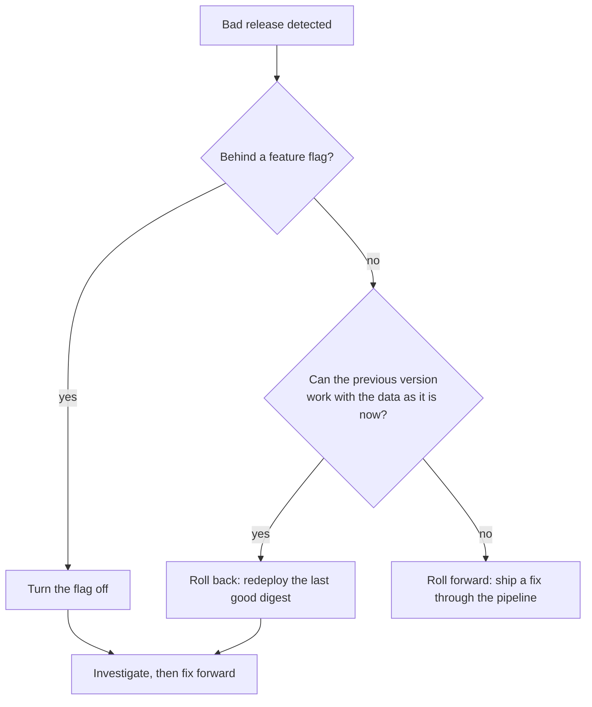

# Lesson 20. Rollback and Roll Forward

**Mission link:** The mission ends with rolling back when a bad release gets out. A strategy from lesson 19 limits how many users see a bad version, and this lesson is how you stop them seeing it: undo it in minutes when undoing is safe, fix it forward when it is not, and keep some changes switchable without a deploy at all.
**Primary source:** [Article: "Feature Toggles (aka Feature Flags)", Pete Hodgson](https://martinfowler.com/articles/feature-toggles.html)
**Prerequisites:** [Lesson 12](0012-versioning-a-build.md), [Lesson 18](0018-promotion-between-environments.md), [Lesson 19](0019-deployment-strategies.md), [Rollback](../GLOSSARY.md), [Roll forward](../GLOSSARY.md), [Feature flag](../GLOSSARY.md), [Digest](../GLOSSARY.md), [Build once](../GLOSSARY.md)

## Warm-up

1. ▢ Lesson 18 promoted a digest to production by hand through `workflow_dispatch`. Which input did the run take, and why was it put in `env:` before use?

<details markdown="1"><summary>Check</summary>

The digest of the image to deploy. It is text a person typed, so under lesson 16's rule it reaches the shell through an environment variable and is validated against the `sha256:` plus 64 hexadecimal characters pattern first. Redeploying an old digest, which is this lesson's rollback, is the same workflow with an older value.

</details>

2. ▢ In a blue-green deployment, what is the rollback, and what does it need to still exist?

<details markdown="1"><summary>Check</summary>

Pointing the router or Service back at the previous side. It needs that side to still be running at full size, which is the capacity cost lesson 19 listed. Once the idle side is retired, rollback becomes a deploy.

</details>

3. ▢ Lesson 12 gave every build an identity traceable to its commit. Name one reason that matters at 3 a.m. during an incident.

<details markdown="1"><summary>Check</summary>

You can answer "what is running now, and what was running before it" from the version alone, and you can find the last good one without guessing. A rollback needs a name for its target, and the digest or version recorded for each deployment is that name.

</details>

## Know this

### Rollback is a deploy of an old artifact

The glossary defines a rollback as returning an environment to the last version known to be good, by redeploying that version's artifact ([Rollback](../GLOSSARY.md)). Because lesson 12 built once and lesson 18 deployed by digest, the old artifact already exists, was already tested, and is named exactly. Rolling back is the same deploy path with an older digest, and nothing is rebuilt.

That is different from reverting in Git. A `git revert` creates a new commit, which goes through build, tests and promotion as a new version. Reverting is a way to roll forward, and it is slow when you are bleeding. Jez Humble lists "optimize for resilience" among the principles of low-risk releases: accept that failures happen and plan to restore service as rapidly as possible ([Continuous Delivery: patterns](https://continuousdelivery.com/implementing/patterns/)). A rollback is the fastest restore the pipeline has, and it only works if you recorded what the last good version was.

There are two places a rollback can be driven from:

|From|How|Strength|Weakness|
|---|---|---|---|
|The pipeline|Rerun the deploy with the last good digest|Same path as every deploy, the record stays truthful|Needs the digest to hand|
|The cluster|`kubectl rollout undo deployment/web`|One command, no inputs|Uses the cluster's history, not the pipeline's|

`kubectl rollout undo` goes back to the previous revision, or to one named with `--to-revision`. The Kubernetes docs say a revision is created only when the pod template changes, so scaling does not add one, and that rolling back restores only the pod template, nothing else in the Deployment ([Deployments](https://kubernetes.io/docs/concepts/workloads/controllers/deployment/#rolling-back-a-deployment)). The number of old ReplicaSets kept is `revisionHistoryLimit`, which defaults to 10, and once an old ReplicaSet is deleted you cannot roll back to it. The cluster's view can also drift from the pipeline's: after an undo, the repository and the deployment history still say the bad version is current. Lesson 22 returns to this, because a GitOps agent would reapply the bad version.

### Failing a deploy, and rolling back automatically

A deploy step should fail when the rollout fails. `kubectl rollout status` returns a non-zero exit code if the Deployment exceeds its progress deadline, `progressDeadlineSeconds`, or if you pass `--timeout` and it expires. The Kubernetes docs also describe `rollout undo` printing `deployment.apps/NAME rolled back`. Combine them in a workflow, and note that a step after a failure runs only if it asks to: `if` conditions with no status check function get `success()` added, so a rollback step needs `failure()`, plus any extra condition, to run ([Evaluate expressions](https://docs.github.com/en/actions/reference/workflows-and-actions/expressions#failure-with-conditions)).

```yaml
- name: Deploy
  id: deploy
  run: |
    kubectl set image deployment/web '*='"$IMAGE_WITH_DIGEST"
    kubectl rollout status deployment/web --timeout=60s
- name: Roll back
  if: ${{ failure() && steps.deploy.conclusion == 'failure' }}
  run: |
    kubectl rollout undo deployment/web
    kubectl rollout status deployment/web --timeout=120s
```

The job still ends red, correctly: a deployment that had to be undone failed, and a green run would hide that. The rollback step only restores service. Someone still has to find out why.

### When rollback is the wrong tool

A rollback puts the old code back. It does not put the old data back. The old version is safe only if it can still work with everything the new one did while it ran:

- **A schema change that old code cannot use.** Version 2 renames a column, the migration runs, version 2 fails, and the rolled-back version 1 now queries a column that does not exist. Lesson 21 shows how to order changes so every version works against the schema.
- **Data written in a new format** that the old code cannot read, or messages already consumed from a queue.
- **Effects outside your system**: emails sent, payments captured, a third party notified.

In these cases you roll forward: ship a new version with the fix, through the pipeline. The glossary calls this the choice when rolling back would break data or contracts that have already moved on ([Roll forward](../GLOSSARY.md)). Humble's other principle helps: small batches make the forward fix small, and with tens of lines changed, root cause analysis and restoring service become much easier ([Continuous Delivery: patterns](https://continuousdelivery.com/implementing/patterns/)).



Rolling back first and investigating after is the usual instinct, because stopping the harm comes before understanding it. Treat that as judgment, not a law: if the rollback itself is risky (the data cases above), the cost goes the other way.

### Separating deploy from release

Humble's list also includes decoupling deployment and release: separate the technical decision to deploy from the business decision to launch a feature, with dark launching and feature toggles as the usual patterns ([Continuous Delivery: patterns](https://continuousdelivery.com/implementing/patterns/)). A feature flag, in the glossary's words, is a runtime switch that separates deploying a change from releasing it. The new code ships turned off. Releasing it, and withdrawing it, is a configuration change that takes seconds and needs no deploy.

Hodgson sorts flags into four categories: release, experiment, ops and permissioning toggles. Two matter for this lesson:

- **Release toggles** let unfinished or untested paths ship as latent code that may never be turned on. They are transitional: Hodgson says they should generally not stay much longer than a week or two.
- **Ops toggles** let operators disable or degrade a feature quickly in production, and a few long-lived ones act as kill switches that shed non-vital functionality under load.

Flags are not free. The article's section on carrying cost says each one adds conditional logic and a testing burden, and recommends treating flags as inventory to keep low, with a removal task added when a release toggle is created, or an expiry date. Two further costs belong to the pipeline. Flipping a flag changes production without passing through your pipeline, so it needs its own access control and a record of who changed what. And a flag does not cover a change that cannot hide behind a branch in code, such as a dependency upgrade or a schema change.

## Practice

1. ▢ Which action is a rollback, as this track defines it?

    - a) Revert the commit and rebuild it
    - b) Redeploy the last good image digest
    - c) Patch the bug and ship quickly
    - d) Turn the feature flag back off

<details markdown="1"><summary>Check</summary>

**b)** A rollback redeploys the artifact that was last known to be good, with nothing rebuilt. (a) creates a new version that has to pass the whole pipeline, so it is a roll forward. (c) is also a roll forward. (d) is a release control: it may fix the incident, but the old artifact was not redeployed.

</details>

2. ▢ A deploy job runs `kubectl rollout status deployment/web --timeout=60s` and the new pods sit in `ImagePullBackOff`. What does the step do, and what does the workflow need so that a later step undoes the release?

<details markdown="1"><summary>Check</summary>

The step exits non-zero when the timeout expires, so the step fails and the job would fail. A later step skips by default, because an `if` without a status check function gets `success()`. Give the rollback step `if: ${{ failure() && steps.deploy.conclusion == 'failure' }}` (and an `id` on the deploy step) so that it runs after the failure and only after that step's failure.

</details>

3. ▢ Predict, then run. Add `rollback-lab.yml` to `ci-cd-practice` and run it with the image reference from lesson 18. The script deploys two replicas of the good image, "releases" a version whose tag does not exist, rolls back the first way, releases the bad version again, then rolls back by redeploying the recorded digest. What does the end of each phase print?

    ```yaml
    name: Rollback lab
    on:
      workflow_dispatch:
        inputs:
          image:
            description: Image reference with its digest, from lesson 18
            required: true
    permissions:
      contents: read
      packages: read
    jobs:
      lab:
        runs-on: ubuntu-latest
        steps:
          - uses: helm/kind-action@v1
          - name: Run the lab
            env:
              IMAGE: ${{ inputs.image }}
              REGISTRY_USER: ${{ github.actor }}
              REGISTRY_TOKEN: ${{ secrets.GITHUB_TOKEN }}
            run: |
              [[ "$IMAGE" =~ ^ghcr\.io/[a-z0-9._/-]+@sha256:[0-9a-f]{64}$ ]] || { echo "Not an image digest"; exit 1; }
              kubectl create secret docker-registry ghcr --docker-server=ghcr.io --docker-username="$REGISTRY_USER" --docker-password="$REGISTRY_TOKEN"
              kubectl patch serviceaccount default -p '{"imagePullSecrets":[{"name":"ghcr"}]}'
              kubectl create deployment web --image="$IMAGE" --replicas=2
              kubectl rollout status deployment/web --timeout=120s
              BAD="${IMAGE%@*}:does-not-exist"
              current() { kubectl get deployment web -o jsonpath='{.spec.template.spec.containers[0].image}{"\n"}'; }
              echo "== release 1: a version whose image does not exist"
              kubectl set image deployment/web "*=$BAD"
              kubectl rollout status deployment/web --timeout=45s || echo "== rollout failed"
              kubectl get deployment web
              echo "== rollback with rollout undo"
              kubectl rollout undo deployment/web
              kubectl rollout status deployment/web --timeout=120s
              current
              echo "== release 2: the bad version again"
              kubectl set image deployment/web "*=$BAD"
              kubectl rollout status deployment/web --timeout=45s || echo "== rollout failed"
              echo "== rollback by redeploying the recorded digest"
              kubectl set image deployment/web "*=$IMAGE"
              kubectl rollout status deployment/web --timeout=120s
              current
              kubectl get deployment web
    ```

<details markdown="1"><summary>Hint</summary>

The default rolling update never removes a working pod before its replacement is ready, so the service keeps its two replicas while the bad release is stuck. Both rollbacks end on the same image string.

</details>

<details markdown="1"><summary>Check</summary>

```text
== release 1: a version whose image does not exist
== rollout failed
NAME   READY   UP-TO-DATE   AVAILABLE   AGE
web    2/2     1            2           58s
== rollback with rollout undo
deployment.apps/web rolled back
deployment "web" successfully rolled out
ghcr.io/octocat/ci-cd-practice@sha256:13360e8b7eed5cc515fdfffd51adf99c3bdb063b76719305cb1adc98509e3297
== release 2: the bad version again
== rollout failed
== rollback by redeploying the recorded digest
deployment "web" successfully rolled out
ghcr.io/octocat/ci-cd-practice@sha256:13360e8b7eed5cc515fdfffd51adf99c3bdb063b76719305cb1adc98509e3297
NAME   READY   UP-TO-DATE   AVAILABLE   AGE
web    2/2     2           2           2m
```

(The `rollout status` progress lines and the exact columns vary by `kubectl` version, and your digest will differ.) With two replicas and the default limits of 25%, `maxUnavailable` rounds down to 0 and `maxSurge` rounds up to 1, so the stuck release added one pod that cannot pull its image and left both good pods serving: `AVAILABLE` stays at 2 throughout. Both rollbacks finish on the identical image reference, which is the point: the cluster history and the recorded digest agree here because nothing else changed. In a real incident the second form is the one that works when the cluster's history has been lost or the pipeline's record is what you trust.

</details>

4. ▢ Debug this. The deploy step failed, the rollout never completed, and users saw errors for ten minutes, yet the "Roll back" step shows as skipped in the run. Why, and what is the fix?

    ```yaml
    - name: Deploy
      id: deploy
      run: |
        kubectl set image deployment/web '*='"$IMAGE_WITH_DIGEST"
        kubectl rollout status deployment/web --timeout=60s
    - name: Roll back
      if: steps.deploy.conclusion == 'failure'
      run: kubectl rollout undo deployment/web
    ```

<details markdown="1"><summary>Hint</summary>

What does GitHub add to an `if` that contains no status check function?

</details>

<details markdown="1"><summary>Check</summary>

An `if` with no status check function gets `success()` added automatically, so the step is skipped once an earlier step has failed, whatever the second condition says. The condition has to include `failure()`: `if: ${{ failure() && steps.deploy.conclusion == 'failure' }}`. The ten minutes were the cost of a rollback path that was never rehearsed. Run a deliberately failing deploy in staging so the first test of the rollback is not production.

</details>

5. ▢ Version 2 renamed the column `name` to `full_name` in a migration that has already run. It fails under load, the team rolls back to version 1, and the logs now show this. What happened, and is rolling back again a fix?

    ```console
    ERROR:  column "name" does not exist at character 8
    STATEMENT:  SELECT name FROM customers WHERE id = $1
    ```

<details markdown="1"><summary>Hint</summary>

A rollback restores code. Which part of the system did it leave as version 2 made it?

</details>

<details markdown="1"><summary>Check</summary>

The rollback put version 1 back, and version 1 still reads `name`, but the schema is as version 2 left it. Rolling back again changes nothing. The way out is forward: ship a version that works against the new schema, or a deliberate change that restores the old column, written with care since data may already be in the new one. The way to avoid the whole situation is to never make a change the previous version cannot survive, by adding the new column first and removing the old one in a later deploy (lesson 21).

</details>

6. ▢ A team has a recommendations panel behind a release flag, and it turns out to be expensive under load. They want to switch it off during a sale next month, and in future. Which category from Hodgson's article fits, and what should the team put in place so the flag does not become a liability?

<details markdown="1"><summary>Check</summary>

An ops toggle, and in particular a long-lived kill switch, which the article illustrates with disabling a recommendations panel under heavy load. The release flag has done its job and should be retired, and the kill switch is a separate, deliberate flag. Keep the inventory short, document who may flip it, and record each flip, since a flag change alters production without going through the pipeline. Test both states, because the article names the testing burden as part of the carrying cost.

</details>

## Real-world reps

- [ ] Finish practice item 3. Then add the `Roll back` step from this lesson to a deploy workflow of your own in `ci-cd-practice`, deploy a bad image on purpose, and confirm the step runs and the job still ends red.
- [ ] For a service you run, write down where the last good version is recorded and how long it would take, today, to redeploy it. Then write down the most recent change that touched data, and whether the previous version could have run against it.
- [ ] Tomorrow: without notes, draw the rollback or roll forward decision from memory, give two reasons a rollback can be the wrong tool, and name the two flag categories this lesson used.

## Going further

- [Deployments](../reference/deployments.md)
- [Article: "Feature Toggles (aka Feature Flags)", Pete Hodgson](https://martinfowler.com/articles/feature-toggles.html)
- [Site: "Continuous Delivery: patterns", Jez Humble](https://continuousdelivery.com/implementing/patterns/)
- [Docs: "Deployments", Kubernetes](https://kubernetes.io/docs/concepts/workloads/controllers/deployment/#rolling-back-a-deployment)
- [Book chapter: "Release Engineering", Site Reliability Engineering, Google](https://sre.google/sre-book/release-engineering/)
- [Workloads](../../kubernetes/reference/workloads.md), rollouts and `rollout undo` in the cluster
- [Resources](../RESOURCES.md)

---

Not landing? Reread the primary source at the top, since this lesson compresses it and compression is where understanding leaks. Check the [glossary](../GLOSSARY.md) for any term that felt slippery.

If the lesson itself is unclear rather than the material, that is a defect: [open an issue](https://github.com/TokenCemetery/teach/issues).
