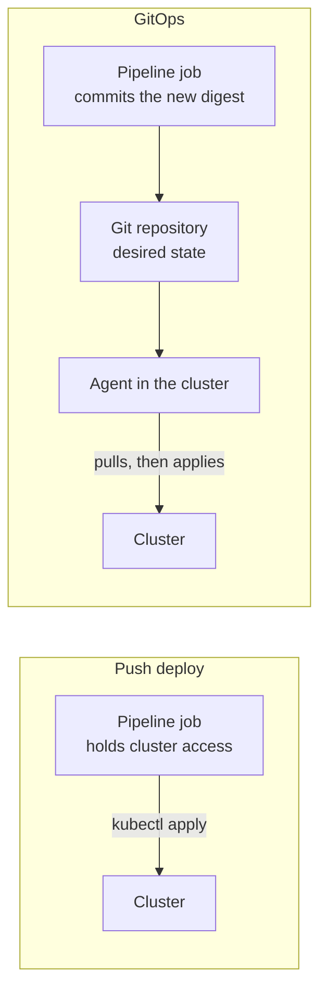

# Lesson 22. Push Deploys and GitOps

**Mission link:** The mission says to choose between a push deploy and GitOps. Every deploy so far was a push: a job holding cluster access ran a command. GitOps moves that access and that command into the cluster, and leaves the pipeline with one job, recording what should be running. Choosing well means knowing what each model does to credentials, to drift, and to the rollback of lesson 20.
**Primary source:** [Site: "OpenGitOps Principles", OpenGitOps, CNCF](https://opengitops.dev/)
**Prerequisites:** [Lesson 15](0015-oidc-instead-of-long-lived-keys.md), [Lesson 18](0018-promotion-between-environments.md), [Lesson 20](0020-rollback-and-roll-forward.md), [GitOps](../GLOSSARY.md), [Promotion](../GLOSSARY.md), [Rollback](../GLOSSARY.md), [Digest](../GLOSSARY.md)

## Warm-up

1. ▢ Lesson 15 replaced a stored cloud key with OIDC. What is the credential's lifetime, and what decides who may obtain it?

<details markdown="1"><summary>Check</summary>

It lasts as long as the job, and the conditions in the cloud's trust policy decide, mainly on the `sub` claim, which names the repository and the branch or environment. Nothing is stored in GitHub (lesson 15).

</details>

2. ▢ Lesson 18 promoted to production by digest. What is the one thing allowed to differ between staging and production?

<details markdown="1"><summary>Check</summary>

Configuration: variables, secrets, replica counts and hostnames. The image digest and the deploy procedure must be identical (lesson 18).

</details>

3. ▢ Lesson 20 said a rollback is a deploy of an old artifact and named two places to drive it from. What were they?

<details markdown="1"><summary>Check</summary>

The pipeline, by rerunning the deploy with the last good digest, and the cluster, with `kubectl rollout undo`. The cluster's history can disagree with the pipeline's record, which this lesson returns to.

</details>

## Know this

### Two directions

A **push deploy** is what lessons 17 to 20 did: a job in the pipeline holds credentials for the target, runs `kubectl` or `helm`, and the change arrives because the pipeline sent it. **GitOps**, in the glossary's words, delivers changes by committing the desired state of an environment to Git, where an agent running in that environment pulls it and reconciles toward it continuously ([GitOps](../GLOSSARY.md)).



The OpenGitOps project states four principles for the desired state of a GitOps-managed system ([OpenGitOps Principles](https://opengitops.dev/)):

|Principle|What it says|
|---|---|
|Declarative|The desired state is expressed declaratively|
|Versioned and immutable|It is stored so that immutability and versioning are enforced and the full history is kept|
|Pulled automatically|Software agents pull the desired state from the source|
|Continuously reconciled|Agents continuously observe actual state and attempt to apply the desired state|

The last two are what separate GitOps from "manifests in Git, applied by a pipeline". Without an agent that pulls and keeps reconciling, the repository is only a record.

### What an agent does

Two widely used agents show the shape. Argo CD detects differences between the manifests in Git and the live state, and can sync them automatically. Its docs name the effect on pipelines: with automated sync, CI/CD pipelines no longer need direct access to the Argo CD API server, because the pipeline makes a commit and push to the Git repository with the changes to the manifests ([Argo CD: automated sync](https://argo-cd.readthedocs.io/en/stable/user-guide/auto_sync/)). Flux describes a Source that defines where the desired state lives and is checked for changes on a defined interval, and reconciliation as ensuring a given state matches a desired state defined elsewhere ([Flux: Core Concepts](https://fluxcd.io/flux/concepts/)).

Argo CD's defaults show where the model gives you control and where it does not ([Argo CD: automated sync](https://argo-cd.readthedocs.io/en/stable/user-guide/auto_sync/)):

- Automated sync acts only on an application that is `OutOfSync`, and the interval between checks is set by `timeout.reconciliation`, which defaults to 120 seconds with up to 60 seconds of jitter, so a commit is picked up within about 3 minutes unless a webhook tells it sooner.
- By default, automated sync does not delete resources that disappeared from Git. Pruning is an opt-in, `prune: true`.
- By default, changes made directly to the live cluster do not trigger a sync. Reverting them is the opt-in `selfHeal: true`.
- Rollback cannot be performed against an application with automated sync enabled.

That last line changes lesson 20. With a pull model, the rollback is a commit: set the last good digest in Git, and the agent deploys it. It is the same artifact, redeployed, but the path is slower and the history is better, since the repository records who restored what and when.

### What changes for credentials

In a push deploy the runner needs a path to the cluster's API server and a credential the cluster accepts. Lesson 15 reduced the credential to a short-lived one issued per job, and the access it grants is still the access a compromised workflow gets. In a pull model the credential that can change the cluster lives inside it, with the agent. The pipeline needs only the right to write to the repository that holds the desired state. That is a smaller, better understood permission, with one catch: a `GITHUB_TOKEN` is limited to the repository that contains the workflow ([GITHUB_TOKEN](https://docs.github.com/en/actions/concepts/security/github_token)), so if the manifests live in a separate repository, the job needs a different credential to push there, and that credential now decides what reaches production.

|Question|Push deploy|GitOps|
|---|---|---|
|Who can change the cluster|Whatever credential the job gets|The agent, from what is in Git|
|What does the pipeline hold|Cluster access, short-lived with OIDC|Write access to the desired-state repository|
|A manual change in the cluster|Stays until the next deploy touches it|Detected as drift, and reverted if self-heal is on|
|The record of what should run|The last pipeline run|The repository, with its history|
|Feedback to the pipeline|The deploy step fails or passes|Needs the agent's status, or a notification|
|Rollback|Redeploy an old digest|Commit an old digest|

### Drift

Drift is the live state differing from the declared one: someone runs `kubectl scale` during an incident, or edits a Deployment by hand. A push deploy cannot see it, because the pipeline only acts when a commit arrives. When the next deploy runs, what happens depends on the field. Kubernetes docs describe the merge `kubectl apply` performs: a field in the configuration file whose live value differs is set back to the file's value, and a field the file does not mention keeps its live value ([Declarative management of objects](https://kubernetes.io/docs/tasks/manage-kubernetes-objects/declarative-config/)). So a hand-made change is silently reverted if the manifest names that field, and silently kept if it does not. `kubectl diff` exits with status 1 when it finds differences, so a scheduled pipeline can detect drift without an agent, but it is a check you must build.

### Choosing

GitOps is not the more advanced version of a push deploy. It is a different trade:

- It earns its cost with many clusters or environments, with a strong need to know that live state matches Git, and where keeping cluster credentials out of the CI system matters.
- It costs a component to run and upgrade in every cluster, a second place for configuration to live, a delay between a commit and a change, and a need to solve secrets in Git and status feedback.
- A push deploy is the simpler answer for one service on one or two environments, and OIDC (lesson 15) plus environment approvals (lesson 17) already make it reasonably safe.

This track teaches GitOps only as far as choosing it. Operating Argo CD or Flux is outside its scope, and the docs linked here are where to go next.

## Practice

1. ▢ In a GitOps setup, what is the last thing the pipeline does to deploy a new version?

    - a) Runs the apply command directly against the live cluster
    - b) Commits the new image digest to the desired-state repository
    - c) Calls the agent's API to start a manual sync
    - d) Restarts the agent so it reads the repository again

<details markdown="1"><summary>Check</summary>

**b)** The pipeline records what should run and the agent does the rest. (a) is a push deploy. (c) is possible but is exactly the direct access that automated sync is meant to make unnecessary. (d) is not part of any deploy.

</details>

2. ▢ Which two of the four OpenGitOps principles does a pipeline that commits manifests and then runs `kubectl apply` fail to meet, and why?

<details markdown="1"><summary>Check</summary>

"Pulled automatically" and "continuously reconciled". The pipeline pushes, and nothing observes the cluster between commits, so drift stays unnoticed. It does meet "declarative" and "versioned and immutable" if the manifests are in Git. It is infrastructure as code with a push deploy, which the glossary lists as a different thing from GitOps.

</details>

3. ▢ Predict, then run. This workflow starts a kind cluster in the job, deploys a manifest, scales it by hand, checks for drift, and deploys the same manifest again. What does each phase print?

    ```yaml
    name: Drift lab
    on: workflow_dispatch
    permissions:
      contents: read
    jobs:
      lab:
        runs-on: ubuntu-latest
        steps:
          - uses: helm/kind-action@v1
          - name: Run the lab
            run: |
              cat > web.yaml <<'EOF'
              apiVersion: apps/v1
              kind: Deployment
              metadata:
                name: web
              spec:
                replicas: 2
                selector:
                  matchLabels:
                    app: web
                template:
                  metadata:
                    labels:
                      app: web
                  spec:
                    containers:
                      - name: web
                        image: nginx:1.27
              EOF
              replicas() { echo "replicas: $(kubectl get deployment web -o jsonpath='{.spec.replicas}')"; }
              echo "== push deploy 1"
              kubectl apply -f web.yaml
              kubectl rollout status deployment/web --timeout=120s
              replicas
              echo "== someone scales by hand"
              kubectl scale deployment/web --replicas=5
              replicas
              echo "== does a check notice?"
              kubectl diff -f web.yaml > /dev/null && code=0 || code=$?
              echo "diff exit code: $code"
              echo "== push deploy 2, same manifest"
              kubectl apply -f web.yaml
              replicas
    ```

<details markdown="1"><summary>Hint</summary>

The manifest names `replicas`, and `kubectl apply` sets a field that the file names back to the file's value. `kubectl diff` exits with 1 when differences exist.

</details>

<details markdown="1"><summary>Check</summary>

```text
== push deploy 1
deployment.apps/web created
deployment "web" successfully rolled out
replicas: 2
== someone scales by hand
deployment.apps/web scaled
replicas: 5
== does a check notice?
diff exit code: 1
== push deploy 2, same manifest
deployment.apps/web configured
replicas: 2
```

The deploy that nobody changed repaired the drift, but only because it happened to run and because the manifest names `replicas`. Between the scale and the second deploy nothing in the pipeline knew, which is the difference an agent with self-heal removes: it would have reverted the scale on its own, without a commit.

</details>

4. ▢ A team runs Argo CD with automated sync. After a bad release an engineer runs `kubectl rollout undo` in production, and a few minutes later the bad version is running again. Explain, and say what they should have done.

<details markdown="1"><summary>Check</summary>

The Git repository still names the bad digest, so the live cluster is `OutOfSync` with it, and the agent reconciles toward Git. With self-heal on, a change made directly in the cluster is reverted. The rollback has to be a commit that sets the last good digest, or a revert of the commit that introduced the bad one. If the incident needs it faster, the team can disable automated sync for the application first, and then must remember to restore it.

</details>

5. ▢ A team with one service on two environments is deciding whether to adopt GitOps. They have OIDC to their cloud and production approvals. Give one reason to adopt it and one reason to wait.

<details markdown="1"><summary>Check</summary>

For: the repository becomes the record of what runs, and drift made by hand during incidents is detected. Against: an agent to install, secure and upgrade, a second repository or path for configuration, a polling delay, and secrets and status feedback to solve, in return for protections the team already has from OIDC and approvals. Either answer is defensible if it names what the team gains and pays.

</details>

## Real-world reps

- [ ] In `ci-cd-practice`, add the workflow from practice item 3 and run it from the Actions tab. Check the log against your prediction, then add the line `kubectl label deployment/web owner=ada` after the scale step and `kubectl get deployment web --show-labels` after the second deploy. Predict whether the label survives, then check it against the map-field table in the Kubernetes [declarative management page](https://kubernetes.io/docs/tasks/manage-kubernetes-objects/declarative-config/).
- [ ] Open the [Argo CD automated sync page](https://argo-cd.readthedocs.io/en/stable/user-guide/auto_sync/) and write down the three defaults that decide what the agent will and will not do on its own, as in the list above.
- [ ] Tomorrow: without notes, name the four OpenGitOps principles, say which two make a deploy pull-based, and give the one credential change GitOps makes for the pipeline.

## Going further

- [Deployments](../reference/deployments.md)
- [Site: "OpenGitOps Principles", OpenGitOps, CNCF](https://opengitops.dev/)
- [Docs: "Argo CD", Argo Project](https://argo-cd.readthedocs.io/en/stable/)
- [Docs: "Core Concepts", Flux](https://fluxcd.io/flux/concepts/)
- [Packaging](../../kubernetes/reference/packaging.md), the manifests a deploy job or an agent applies
- [Resources](../RESOURCES.md)

---

Not landing? Reread the primary source at the top, since this lesson compresses it and compression is where understanding leaks. Check the [glossary](../GLOSSARY.md) for any term that felt slippery.

If the lesson itself is unclear rather than the material, that is a defect: [open an issue](https://github.com/TokenCemetery/teach/issues).
