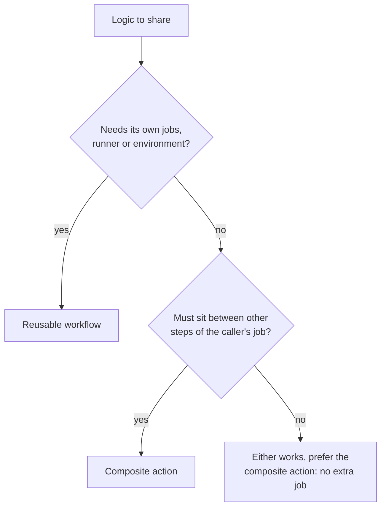

# Lesson 25. Reusable Workflows and Composite Actions

**Mission link:** The mission says to scale pipelines across repositories with reusable workflows and composite actions. Ten repositories with a copied deploy workflow have ten places to fix a bug and ten ways to drift apart. GitHub gives two units of sharing, one that holds whole jobs and one that holds steps, and picking the wrong one is the usual reason a shared pipeline later cannot do what a team needs.
**Primary source:** [Docs: "Reusing workflow configurations", GitHub](https://docs.github.com/en/actions/concepts/workflows-and-actions/reusing-workflow-configurations)
**Prerequisites:** [Lesson 5](0005-actions-expressions-and-outputs.md), [Lesson 14](0014-secrets-and-the-github-token.md), [Lesson 23](0023-pinning-what-the-pipeline-runs.md), [Reusable workflow](../GLOSSARY.md), [Composite action](../GLOSSARY.md), [Action](../GLOSSARY.md), [Job](../GLOSSARY.md), [Step](../GLOSSARY.md)

## Warm-up

1. ▢ How does a value computed in one job reach another job, and what happens if the producing job forgets to map it?

<details markdown="1"><summary>Check</summary>

A step writes `name=value` to `GITHUB_OUTPUT`, the job maps it under `outputs:`, and the later job lists the first in `needs` and reads `needs.<job>.outputs.<name>` (lesson 5). Without the job-level mapping, the later job sees an empty string, not an error.

</details>

2. ▢ In lesson 14, which setting decides what the `GITHUB_TOKEN` starts with, and where does the workflow narrow it?

<details markdown="1"><summary>Check</summary>

The repository, organization or enterprise setting for workflow permissions, restricted or permissive. The workflow narrows it with `permissions:` at the workflow level or on a job, and a job-level block replaces the workflow-level one for that job (lesson 14).

</details>

3. ▢ Lesson 23 pinned `uses:` lines to a full SHA. Which kinds of reference does that cover besides actions?

<details markdown="1"><summary>Check</summary>

Reusable workflows from other repositories, which carry the same risk. The secure use reference says the principles for third-party actions apply to third-party workflows too, so a call should name a full SHA rather than a tag or branch that can move.

</details>

## Know this

### Two units of sharing

Both mechanisms stop you copying YAML, and they differ in what the unit contains ([Reusing workflow configurations](https://docs.github.com/en/actions/concepts/workflows-and-actions/reusing-workflow-configurations)).

A **reusable workflow** is a whole workflow file, with jobs, that other workflows call as a job. A **composite action** is a bundle of steps that runs as one step inside a caller's job.

|Question|Reusable workflow|Composite action|
|---|---|---|
|What is it|A YAML file in `.github/workflows` that declares `on: workflow_call`|A directory or repository with an `action.yml`|
|Where does it run|Its own jobs, on runners it chooses with its own `runs-on`|Inside the caller's job, on the caller's runner|
|Called from|A job, with `uses:` and no `steps`|A step, with `uses:`|
|Can contain jobs|Yes|No, only steps|
|Log|Every job and step is logged separately|One step in the caller's log, however many steps it holds|
|Secrets|Takes secrets as declared inputs, or `secrets: inherit`|The docs' comparison says it cannot use secrets, so pass them in as inputs|
|Steps before and after|Not possible, you can only add jobs with `needs`|Normal steps can come before and after|
|Nesting|Up to ten levels of workflows|Up to ten composite actions in one workflow|
|Marketplace|Cannot be published|Can be published|

That table already says which to choose. If the logic needs its own runner, several jobs, an `environment`, or secrets, it is a reusable workflow. If it is a handful of steps that sit between other steps of the caller's job, such as "set up Python and install the dependencies", it is a composite action.



### A reusable workflow

The file opts in with `workflow_call`, and declares inputs, secrets and outputs ([Reuse workflows](https://docs.github.com/en/actions/how-tos/reuse-automations/reuse-workflows)):

```yaml
# .github/workflows/greet.yml
name: Greet
on:
  workflow_call:
    inputs:
      who:
        required: true
        type: string
    outputs:
      message:
        value: ${{ jobs.say.outputs.message }}
jobs:
  say:
    runs-on: ubuntu-latest
    outputs:
      message: ${{ steps.make.outputs.message }}
    steps:
      - id: make
        env:
          WHO: ${{ inputs.who }}
          WORKFLOW: ${{ github.workflow }}
        run: echo "message=hello $WHO from $WORKFLOW" >> "$GITHUB_OUTPUT"
```

The caller uses it in a job. The reference is `./.github/workflows/greet.yml` for the same repository, where the called workflow comes from the same commit as the caller, or `owner/repo/.github/workflows/file.yml@ref` for another one, where the ref can be a SHA, a release tag or a branch. The docs call the SHA the safest option for stability and security.

```yaml
jobs:
  first:
    uses: ./.github/workflows/greet.yml
    with:
      who: practice
  second:
    needs: first
    runs-on: ubuntu-latest
    steps:
      - env:
          MESSAGE: ${{ needs.first.outputs.message }}
        run: echo "$MESSAGE"
```

Rules that surprise people, all from the [reusable workflows reference](https://docs.github.com/en/actions/reference/workflows-and-actions/reusable-workflows) and the how-to:

- **The calling job takes a short list of keywords.** `name`, `uses`, `with`, `secrets`, `strategy`, `needs`, `if`, `concurrency`, `permissions` and `cache-mode`. There is no `runs-on`, `steps`, `env` or `environment` on a job that calls a workflow. Put `environment` on a job inside the called workflow.
- **The `github` context is the caller's.** `github.workflow` is the caller's name, and `actions/checkout` in a called workflow checks out the caller's repository, not the one that holds the called workflow.
- **Runners and billing follow the caller.** A called workflow cannot use GitHub-hosted runners from its own repository.
- **Secrets are not inherited by default.** Pass them by name with `secrets:`, or with `secrets: inherit` when caller and called are in the same organization or enterprise. They are passed only to the workflow called directly, so in a chain A to B to C, C gets A's secret only if B passes it on. A secret the caller does not pass resolves to an empty string with no error. Marking it `required: true` in `on.workflow_call.secrets` makes the run fail when the caller omits it, though it does not check that the value is non-empty.
- **Permissions can only go down.** The `GITHUB_TOKEN` permissions in a called workflow can be the same as the caller's or more restrictive, never wider, and the same holds down a chain. Without `permissions` on the calling job, the called workflow gets the default permissions.
- **Environment variables do not cross.** An `env` set at workflow level in the caller is not visible in the called workflow, and the reverse. Pass data with inputs and outputs. `GITHUB_ENV` cannot pass anything to the caller's steps either, since the call is a job, not a step.
- **Limits.** Ten levels of workflows, meaning the top-level caller plus up to nine called levels, no loops, and at most 50 unique reusable workflows called from one workflow file, nested ones included.
- **Access.** A called workflow in a private repository needs that repository's Actions access policy to allow the callers, and a caller in a public repository can only use public ones.
- **Reruns.** If the reference is not a SHA, rerunning all jobs uses the workflow from the reference as it is now, while rerunning failed jobs uses the commit of the first attempt.

### A composite action

The unit is an `action.yml` whose `runs.using` is `composite`, with a list of steps. Every `run` step in it must name its `shell` ([Creating a composite action](https://docs.github.com/en/actions/tutorials/create-actions/create-a-composite-action)):

```yaml
# .github/actions/hello/action.yml
name: Hello
description: Print a greeting
inputs:
  who:
    description: Who to greet
    required: true
outputs:
  message:
    description: The greeting
    value: ${{ steps.make.outputs.message }}
runs:
  using: composite
  steps:
    - id: make
      shell: bash
      env:
        WHO: ${{ inputs.who }}
      run: echo "message=hello $WHO" >> "$GITHUB_OUTPUT"
    - shell: bash
      run: echo "composite action done"
```

```yaml
jobs:
  use-it:
    runs-on: ubuntu-latest
    steps:
      - uses: actions/checkout@3d3c42e5aac5ba805825da76410c181273ba90b1 # v7.0.1
      - id: hello
        uses: ./.github/actions/hello
        with:
          who: practice
      - env:
          MESSAGE: ${{ steps.hello.outputs.message }}
        run: echo "$MESSAGE"
```

A local composite action lives in the repository, so the job must check the repository out first, or `./.github/actions/hello` does not exist on the runner. Inside the composite action the values are the caller's: it runs on the caller's runner with the caller's `GITHUB_TOKEN`, so a composite action you did not write has the same reach as any action (lesson 23). The injection rule of lesson 16 applies to its inputs: the tutorial passes `inputs.who-to-greet` through an `env:` entry, as the example above does.

### Versions and who calls what

A shared unit is a dependency of every caller, and an edit to the file everyone references changes all of them at once. Callers that name `@main` get the change immediately, and callers that name a SHA or a release tag get it when they move. Lesson 29 is about changing a shared workflow without breaking callers. One point to hold here: reference a unit from outside your organization by SHA (lesson 23).

Sharing has a security use too. GitHub's docs say artifact attestations reach SLSA Build Level 3 when the build runs in a reusable workflow that many repositories share, because it isolates the build from the calling workflow (lesson 24).

## Practice

1. ▢ Which of these can a reusable workflow contain that a composite action cannot?

    - a) Several jobs on different runners
    - b) Several steps with shell scripts
    - c) Several inputs with default values
    - d) Several outputs read by steps

<details markdown="1"><summary>Check</summary>

**a)** A composite action holds only steps, and they run inside the caller's job on its runner. Reusable workflows hold jobs, each with its own `runs-on`. Both can have inputs with defaults and outputs, and both can run shell scripts.

</details>

2. ▢ For each case, pick a reusable workflow or a composite action and say why. (a) Six jobs in one repository each repeat the same four steps to set up Python and install dependencies. (b) Twelve services need the same sequence of build, a staging deploy with the `staging` environment, and a production deploy with the `production` environment.

<details markdown="1"><summary>Check</summary>

(a) A composite action. The four steps run inside each job beside that job's own steps, and no job or environment is involved. (b) A reusable workflow. It needs several jobs in order, and each deploy job names its own `environment` inside the called workflow, which a composite action cannot do. The services pass an image digest and the repository's configuration as inputs, and secrets by name or with `secrets: inherit`.

</details>

3. ▢ Predict, then run. In `ci-cd-practice`, add `.github/workflows/greet.yml`, `.github/actions/hello/action.yml` and the caller below as `call-greet.yml`, push, and run the caller from the Actions tab. What does the `second` job print, and how many steps does the log of the `use-it` job show for the composite action?

    ```yaml
    name: Call greet
    on: workflow_dispatch
    jobs:
      first:
        uses: ./.github/workflows/greet.yml
        with:
          who: practice
      second:
        needs: first
        runs-on: ubuntu-latest
        steps:
          - env:
              MESSAGE: ${{ needs.first.outputs.message }}
            run: echo "$MESSAGE"
      use-it:
        runs-on: ubuntu-latest
        steps:
          - uses: actions/checkout@3d3c42e5aac5ba805825da76410c181273ba90b1 # v7.0.1
          - id: hello
            uses: ./.github/actions/hello
            with:
              who: practice
          - env:
              MESSAGE: ${{ steps.hello.outputs.message }}
            run: echo "$MESSAGE"
    ```

<details markdown="1"><summary>Hint</summary>

In a called workflow the `github` context belongs to the caller. For the log, compare what the docs say a composite action shows against what a reusable workflow shows.

</details>

<details markdown="1"><summary>Check</summary>

```text
second:   hello practice from Call greet
use-it:   hello practice
```

The `second` job prints the reusable workflow's output with the caller's name, `Call greet`, because `github.workflow` inside a called workflow is the name of the caller. In the log of `use-it` the composite action appears as one step, `Run ./.github/actions/hello`, and the two steps inside it are not logged separately, while the reusable workflow's `say` job is shown with its own steps under `first / say`. If you remove the `actions/checkout` step, the job fails because the local action path does not exist on the runner.

</details>

4. ▢ Debug this. A shared deploy workflow works when run from its own repository and fails when a service repository calls it. Name the cause and the fix.

    ```yaml
    # service repository
    jobs:
      deploy:
        uses: example-org/shared/.github/workflows/deploy.yml@3d3c42e5aac5ba805825da76410c181273ba90b1
    ```

    ```console
    $ curl --fail --silent -H "Authorization: Bearer $DEPLOY_KEY" https://deploy.example.com/api/rollout
    curl: (22) The requested URL returned error: 401
    ```

<details markdown="1"><summary>Hint</summary>

Reread what the docs say about secrets reaching a called workflow, and what an unset secret evaluates to.

</details>

<details markdown="1"><summary>Check</summary>

The caller never passes `DEPLOY_KEY`, and secrets are not passed to a called workflow automatically, so `${{ secrets.DEPLOY_KEY }}` evaluates to an empty string and the request is sent without a valid key. Pass it with `secrets:` in the calling job, or `secrets: inherit` because both repositories are in the same organization. Declare it in `on.workflow_call.secrets` with `required: true`, so that a caller that forgets it fails the run immediately instead of reaching the API with an empty key.

</details>

5. ▢ A reusable workflow called with `permissions: {contents: read}` has a job that asks for `packages: write` to push an image. What do the docs say about this, and where do you fix it?

<details markdown="1"><summary>Check</summary>

The `GITHUB_TOKEN` permissions in a called workflow can be the same as the caller's or more restrictive, never elevated, so the called job cannot gain `packages: write` the caller did not grant. The fix is in the calling job: grant `packages: write` there, on the one job that calls the workflow, and keep the called workflow's own block no wider than what it needs.

</details>

## Real-world reps

- [ ] In `ci-cd-practice`, run practice item 3 and compare the log with your prediction. Then change the caller to use `uses: ./.github/workflows/greet.yml` with no `with:` and read the error before putting the input back.
- [ ] Move the setup steps of your `ci.yml` jobs (setup-python and `pip install -r requirements.txt`) into a composite action under `.github/actions`, call it from each job, and confirm the run is green.
- [ ] Tomorrow: without notes, name the five differences between a reusable workflow and a composite action in the docs' comparison, and state what is allowed to go down and what cannot go up through a call.

## Going further

- [Pipelines at Scale](../reference/pipelines-at-scale.md)
- [Docs: "Reusing workflow configurations", GitHub](https://docs.github.com/en/actions/concepts/workflows-and-actions/reusing-workflow-configurations)
- [Docs: "Reuse workflows", GitHub](https://docs.github.com/en/actions/how-tos/reuse-automations/reuse-workflows)
- [Docs: "Reusable workflows reference", GitHub](https://docs.github.com/en/actions/reference/workflows-and-actions/reusable-workflows)
- [Docs: "Creating a composite action", GitHub](https://docs.github.com/en/actions/tutorials/create-actions/create-a-composite-action)
- [Resources](../RESOURCES.md)

---

Not landing? Reread the primary source at the top, since this lesson compresses it and compression is where understanding leaks. Check the [glossary](../GLOSSARY.md) for any term that felt slippery.

If the lesson itself is unclear rather than the material, that is a defect: [open an issue](https://github.com/TokenCemetery/teach/issues).
