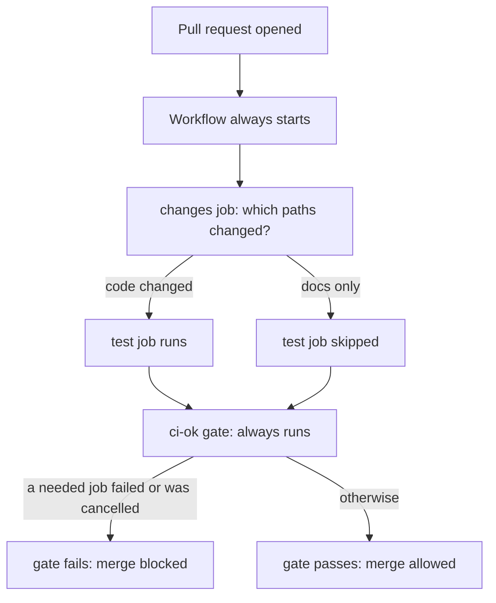

# Lesson 26. Monorepos and Path Filters

**Mission link:** The mission says to scale pipelines across monorepos without making them slower or flakier. Running only what a change touches is the obvious win, and the way most teams first do it silently turns one required check into a merge blocker. Knowing where that trap sits is the difference between a fast pipeline and a stuck repository.
**Primary source:** [Docs: "Troubleshooting required status checks", GitHub](https://docs.github.com/en/pull-requests/how-tos/merge-and-close-pull-requests/troubleshooting-required-status-checks)
**Prerequisites:** [Lesson 3](0003-triggers-and-events.md), [Lesson 4](0004-jobs-steps-and-runners.md), [Lesson 25](0025-reusable-workflows-and-composite-actions.md), [Event](../GLOSSARY.md), [Job](../GLOSSARY.md), [Required status check](../GLOSSARY.md), [Reusable workflow](../GLOSSARY.md)

## Warm-up

1. ▢ A workflow runs on `pull_request`. Which commit does it check out and test, and where do you find the head commit of the branch instead?

<details markdown="1"><summary>Check</summary>

It tests the pull request's merge commit, so `GITHUB_SHA` is the last merge commit of the pull request merge branch. The head commit of the branch is `github.event.pull_request.head.sha` ([events reference](https://docs.github.com/en/actions/reference/workflows-and-actions/events-that-trigger-workflows), lesson 3).

</details>

2. ▢ Job `deploy` has `needs: test`, and `test` fails. What happens to `deploy`, and which one-line change makes it run anyway?

<details markdown="1"><summary>Check</summary>

`deploy` is skipped, along with every job further down the chain. Adding `if: ${{ always() }}` to `deploy` makes it run whatever `test` did ([`needs`](https://docs.github.com/en/actions/reference/workflows-and-actions/workflow-syntax), lesson 4). Keep that in mind: it matters again below.

</details>

3. ▢ A reusable workflow and a composite action both share logic. Which one can hold several jobs, and which one runs inside the caller's job?

<details markdown="1"><summary>Check</summary>

A reusable workflow holds whole jobs and runs them on its own runners. A composite action is a list of steps that run in the caller's job on the caller's runner (lesson 25).

</details>

## Know this

### Why filter at all

A monorepo keeps several services, or a service and its documentation, in one repository. If every pull request runs every test, a one-line change to a README waits for the whole suite, and the slowest service sets everyone's wait. A **path filter** starts a workflow only when the changed files match. The `push` and `pull_request` events accept `paths` and `paths-ignore` ([triggering a workflow](https://docs.github.com/en/actions/how-tos/write-workflows/choose-when-workflows-run/trigger-a-workflow)):

```yaml
on:
  pull_request:
    paths:
      - 'services/api/**'
      - '!services/api/docs/**'
```

The rules that surprise people, all from that page:

- **Order matters.** A negative pattern (`!`) after a positive match excludes the path, and a positive pattern after a negative one includes it again. A pattern with `!` needs at least one pattern without it, and `paths` and `paths-ignore` cannot be used together for the same event.
- **Filters combine with AND.** If a trigger has both `branches` and `paths`, the workflow runs only when both are satisfied.
- **Pull requests and pushes compare differently.** GitHub builds the changed-file list with a three-dot diff for pull requests and a two-dot diff for pushes.
- **Path filters are not evaluated for pushes of tags.** A tag push ignores them.
- **Some cases always run.** A push of more than 1,000 commits, or a diff that times out, runs the workflow regardless of the filter.

### The trap: a filtered workflow never reports

Now add branch protection that requires a check named `test`. A pull request that changes only `README.md` never starts the workflow, so no job named `test` ever reports. The documentation is direct about the result: if a workflow is skipped by path filtering, branch filtering or a commit message, its checks stay in a "Pending" state and block merging, and the merge box shows "Waiting for status to be reported". Its advice is to avoid requiring workflows that can be skipped.

The two skip causes behave in opposite ways, and the table on the same page is worth knowing by heart:

|Cause|What the required check does|
|---|---|
|The whole workflow is skipped by a path, branch or commit-message filter|Stays pending, merging is blocked|
|A job is skipped by an `if` condition|Reports success, merging is allowed|
|A job `needs` a job that failed|The dependent job is skipped and may not block merging|

The last row is the second trap. A skipped job counts as a pass: the [status checks page](https://docs.github.com/en/pull-requests/collaborating-with-pull-requests/collaborating-on-repositories-with-code-quality-features/about-status-checks) says a skipped job reports "Success" and will not prevent a merge, even if it is a required check, and [branch protection](https://docs.github.com/en/repositories/configuring-branches-and-merges-in-your-repository/managing-protected-branches/about-protected-branches) accepts a required check with a successful, skipped or neutral status.

### The fix: always run a cheap workflow, filter its jobs

Move the decision from the workflow to the jobs, and require one job that always reports.



```yaml
name: ci

on:
  pull_request:

jobs:
  changes:
    runs-on: ubuntu-latest
    outputs:
      code: ${{ steps.diff.outputs.code }}
    steps:
      - uses: actions/checkout@v7
        with:
          fetch-depth: 0
      - id: diff
        env:
          BASE_SHA: ${{ github.event.pull_request.base.sha }}
          HEAD_SHA: ${{ github.event.pull_request.head.sha }}
        run: |
          if git diff --name-only "$BASE_SHA...$HEAD_SHA" | grep -qv '^docs/'; then
            echo "code=true" >> "$GITHUB_OUTPUT"
          else
            echo "code=false" >> "$GITHUB_OUTPUT"
          fi

  test:
    needs: changes
    if: needs.changes.outputs.code == 'true'
    runs-on: ubuntu-latest
    steps:
      - uses: actions/checkout@v7
      - uses: actions/setup-python@v7
        with:
          python-version: "3.12"
      - run: pip install -r requirements.txt
      - run: pytest

  ci-ok:
    needs: [changes, test]
    if: ${{ always() }}
    runs-on: ubuntu-latest
    steps:
      - name: Fail if a needed job failed or was cancelled
        if: ${{ contains(needs.*.result, 'failure') || contains(needs.*.result, 'cancelled') }}
        run: exit 1
```

Read it as three decisions. The workflow has no `paths` filter, so it always starts and the required check always reports. `changes` computes the answer and passes it through an output (lesson 5), and the SHAs reach the script through `env`, not through `${{ }}` inside `run`, so a branch name can never become shell code (lesson 16). `ci-ok` is the **only** check you require. It needs `always()`, because without it a failed `test` would skip `ci-ok`, a skipped job reports success, and the failure would merge. Each upstream result is `success`, `failure`, `cancelled` or `skipped` ([`needs` context](https://docs.github.com/en/actions/reference/workflows-and-actions/contexts)), and `skipped` is fine: a docs-only change should pass.

Two smaller notes. Requiring one stable gate instead of every job also stops you from having to edit the branch rule whenever a job is added, renamed or put behind a condition. And if the repository uses a merge queue, a workflow that reports a required check must also trigger on `merge_group`, because that event is separate from `pull_request` and `push` ([troubleshooting page](https://docs.github.com/en/pull-requests/how-tos/merge-and-close-pull-requests/troubleshooting-required-status-checks)).

This is a judgment about tooling as well as a fact about GitHub. A hand-written `git diff` is enough for one condition. A repository with many services usually wants a maintained changed-files action or a build tool that understands the dependency graph. What would change the answer: a few services and one gate, keep the script. Dozens of services with shared libraries, a path filter cannot know that `libs/auth` changes `api`, so you need something that does.

## Practice

1. ▢ `ci.yml` has `on: pull_request: paths-ignore: ['docs/**']`, and the job `test` is a required check. A pull request changes only `docs/notes.md`. What do you see?

    - a) The check shows skipped and merging is allowed
    - b) The check stays pending and merging is blocked
    - c) The check fails fast and merging is blocked
    - d) The check never appears and merging is allowed

<details markdown="1"><summary>Check</summary>

**b)** The whole workflow is skipped by a path filter, so its checks stay pending and the merge box waits for a status that never comes. (a) describes a job skipped by an `if`, which is a different row of the table. (c) invents a failure: nothing ran. (d) is wrong because a required check that has not reported blocks the merge.

</details>

2. ▢ Predict, then run. In `ci-cd-practice`, create a ruleset on the default branch that requires the check `test` (run the workflow once first: the docs say a required check must have completed successfully in the repository during the past seven days). Then, on a branch, change only `docs/notes.md` in a workflow that has `paths-ignore: ['docs/**']`, open a pull request, and look at the merge box. What does it say, and what does the Actions tab show for that commit?

<details markdown="1"><summary>Hint</summary>

Think about which of the two things, the workflow run or the job named `test`, is skipped, and whether anything can report under that name.

</details>

<details markdown="1"><summary>Check</summary>

The Actions tab shows no run for the pull request's commit at all, and the merge box waits on the required check with "Waiting for status to be reported" (the docs' wording; the exact label may differ slightly). Nothing is failing, so nothing can be fixed by re-running: the workflow was never started. The cure is a change to the workflow, which the next item does.

</details>

3. ▢ A teammate adds the gate job from this lesson but leaves out `if: ${{ always() }}`. A change breaks a test. What does `ci-ok` report, and can the pull request merge?

<details markdown="1"><summary>Hint</summary>

Look at the third row of the table: what happens to a job that `needs` a failed job?

</details>

<details markdown="1"><summary>Check</summary>

`test` fails, so `ci-ok`, which needs it, is skipped. A skipped job reports success, and a required check with a skipped status is accepted, so the pull request can merge with a failing test. With `if: ${{ always() }}` the gate runs, sees `failure` in `needs.*.result`, and exits 1. The gate is only as good as its explicit failure condition.

</details>

4. ▢ A release workflow runs on `push` with `tags: ['v*']` and `paths: ['services/api/**']`. You push the tag `v2.4.0` on a commit that changed nothing under `services/api`. Does the workflow run, and what is the general lesson?

<details markdown="1"><summary>Check</summary>

It runs, because path filters are not evaluated for pushes of tags. The general lesson is to read the page for the event you are using rather than assume a filter means the same thing everywhere. A filter that guards a release against stray changes needs a different mechanism, such as a condition inside the job.

</details>

5. ▢ Write the `paths` list for `pull_request` that runs a workflow for anything under `services/api` except Markdown files anywhere below it, and say what changes if you put the negative pattern first.

<details markdown="1"><summary>Check</summary>

```yaml
paths:
  - 'services/api/**'
  - '!services/api/**/*.md'
```

Order matters: a negative pattern after a positive match excludes it. With the `!` pattern first, nothing has matched yet, so it excludes nothing, and the positive pattern then includes every file again, Markdown included.

</details>

6. ▢ A monorepo has `api`, `web` and a shared `libs/auth`. A pull request changes only `libs/auth`. The `api` workflow filters on `services/api/**`. What goes wrong, and which two ways of fixing it cost what?

<details markdown="1"><summary>Check</summary>

The `api` tests do not run, although `api` depends on `libs/auth`, so a break reaches `main` unseen. Fix one: add `libs/auth/**` to the `api` filter, which is cheap and has to be remembered for every new dependency. Fix two: let a build tool compute affected projects from the dependency graph, which stays correct but is one more tool to run and keep current. This is the judgment the lesson ends on, not a documented default.

</details>

## Real-world reps

- [ ] In `ci-cd-practice`, do practice item 2 for real and keep the stuck pull request. Then replace `ci.yml` with the gate version above, push, and watch the same pull request: the docs-only change should pass with `test` skipped, and a branch with a deliberately failing test should be blocked by `ci-ok`.
- [ ] Open the `.github/workflows` folder of a public monorepo you use. List which workflows use `paths`, then open the repository's rules (anyone with read access can see the active rulesets) and note whether any check they require could be skipped by those filters.
- [ ] Tomorrow: without notes, write the three rows of the skip table and the three decisions in the gate workflow, then say why `always()` is on the gate and what its explicit failure condition looks for.

## Going further

- [Pipelines at Scale](../reference/pipelines-at-scale.md)
- [Docs: "Troubleshooting required status checks", GitHub](https://docs.github.com/en/pull-requests/how-tos/merge-and-close-pull-requests/troubleshooting-required-status-checks)
- [Docs: "Triggering a workflow", GitHub](https://docs.github.com/en/actions/how-tos/write-workflows/choose-when-workflows-run/trigger-a-workflow)
- [Docs: "About protected branches", GitHub](https://docs.github.com/en/repositories/configuring-branches-and-merges-in-your-repository/managing-protected-branches/about-protected-branches)
- [Resources](../RESOURCES.md)

---

Not landing? Reread the primary source at the top, since this lesson compresses it and compression is where understanding leaks. Check the [glossary](../GLOSSARY.md) for any term that felt slippery.

If the lesson itself is unclear rather than the material, that is a defect: [open an issue](https://github.com/TokenCemetery/teach/issues).
