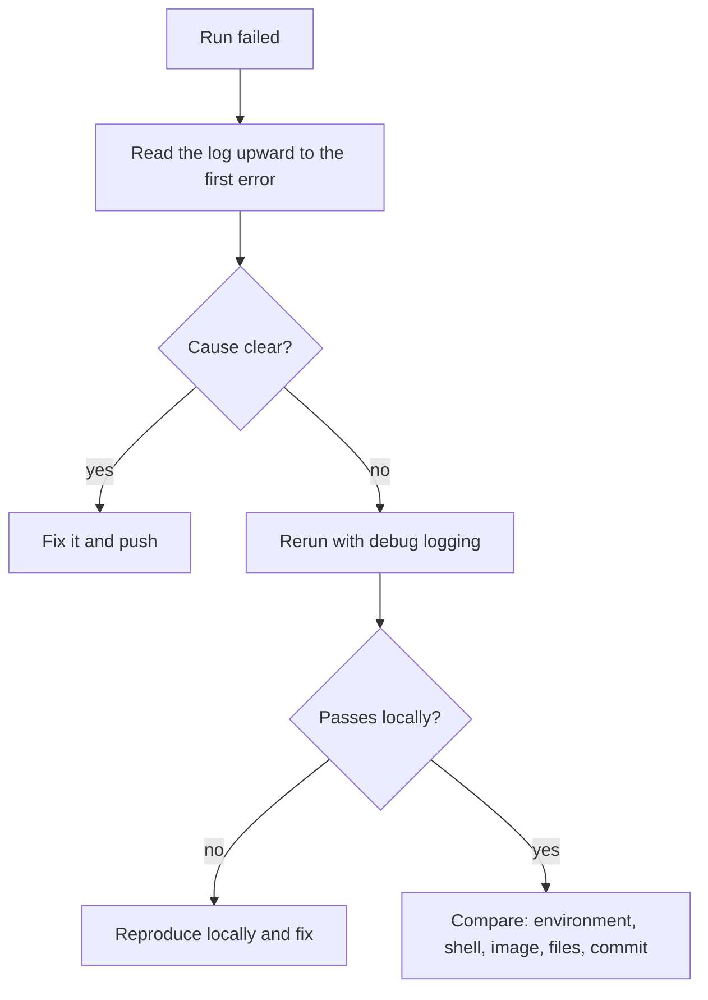

# Lesson 27. Debugging a Pipeline

**Mission link:** The mission ends with finding why a pipeline fails only on the runner, because every pipeline eventually does. The skill is not knowing a trick for each error. It is a fixed order of questions that narrows a failure without pushing guesses one commit at a time.
**Primary source:** [Docs: "Enabling debug logging", GitHub](https://docs.github.com/en/actions/how-tos/monitor-workflows/enable-debug-logging)
**Prerequisites:** [Lesson 4](0004-jobs-steps-and-runners.md), [Lesson 5](0005-actions-expressions-and-outputs.md), [Lesson 9](0009-flaky-tests.md), [Lesson 14](0014-secrets-and-the-github-token.md), [Runner](../GLOSSARY.md), [Step](../GLOSSARY.md), [Expression](../GLOSSARY.md), [Flaky test](../GLOSSARY.md), [Secret](../GLOSSARY.md)

## Warm-up

1. ▢ What does a GitHub-hosted runner start each job with, and what do the steps of one job share?

<details markdown="1"><summary>Check</summary>

Each job gets a fresh virtual machine, so nothing from an earlier job or run is there unless you cache or download it. The steps of one job run in order on that machine and share its file system and environment (lesson 4).

</details>

2. ▢ A secret is stored as `s3cr3t-value`. A step prints it base64-encoded. Does the log show it?

<details markdown="1"><summary>Check</summary>

Yes. Masking replaces the stored value as it is written. A transformed copy is a different string, so it is not masked (lesson 14). That is why debugging by printing environment variables is dangerous.

</details>

3. ▢ A job fails, you press "Re-run", and it passes. What have you learned about the cause?

<details markdown="1"><summary>Check</summary>

Almost nothing. The failure may be a flaky test, a dependency on timing, or something that differs between runners. A passing rerun is a reason to look for the cause, not a fix (lesson 9).

</details>

## Know this

### Read the log before you change anything

Most failures say what they are. Open the failed run: failed steps are expanded for you, each step shows how long it took, and you can copy a permalink to a line to share it ([using workflow run logs](https://docs.github.com/en/actions/how-tos/monitor-workflows/use-workflow-run-logs)). Three habits save time:

- **Read upward from the failing line.** The last error is often a symptom. The first error is the cause.
- **Search only works on expanded steps**, so expand the ones you want searched before you use the search box. To read the whole run offline, download the log archive. After a partial re-run, the archive holds only the jobs that were re-run, so you may need the archive of an earlier attempt for the rest.
- **From a terminal**, `gh run view --job JOB_ID --log-failed` prints only the failed steps' logs.

Then open **Set up job** and its **Runner Image** section. It names the image version and links to the exact list of software installed on the runner that ran your job ([hosted runners](https://docs.github.com/en/actions/concepts/runners/github-hosted-runners)). When something passes locally and fails here, this is the first thing to compare.

### Turn on more logging, for one run

If the log is not enough, ask for more. Two switches, both documented on the primary source:

|You want|Set|What you get|
|---|---|---|
|More detail from steps|`ACTIONS_STEP_DEBUG` to `true`|Extra debug lines in the step logs, for example how each `if` was evaluated|
|How the runner behaved|`ACTIONS_RUNNER_DEBUG` to `true`|Two extra files, the runner process log and the worker process log, in the `runner-diagnostic-logs` folder of the log archive|

Each is a secret or a variable in the repository that holds the workflow. If both exist, the secret wins. You rarely need to create either: anyone who can run a workflow can tick **Enable debug logging** when re-running it, or run `gh run rerun RUN_ID --failed --debug` ([re-running workflows](https://docs.github.com/en/actions/how-tos/manage-workflow-runs/re-run-workflows-and-jobs)). That is the better habit, because a repository-wide switch makes every run noisy until someone remembers to remove it.

Inside a debug run, the runner sets `RUNNER_DEBUG=1`, and the `runner.debug` context holds it, so your own steps can print extra detail only then ([variables](https://docs.github.com/en/actions/reference/workflows-and-actions/variables)). The most useful debug lines show how an expression was evaluated. This is an abridged example of why a step with `if: github.ref == 'refs/heads/main'` did not run on a pull request:

```text
##[debug]Evaluating condition for step: 'Deploy'
##[debug]Evaluating: (success() && (github.ref == 'refs/heads/main'))
##[debug]Expanded: (true && ('refs/pull/12/merge' == 'refs/heads/main'))
##[debug]Result: false
```

The `Expanded` line is the answer: the event was a pull request, so `github.ref` was the merge ref. No amount of staring at the YAML shows you that.

### It passes on my machine

The pipeline runs your commands on a different computer, so the question is always what differs. Work down this list, cheapest first:

|Difference|Why it bites|How to check|
|---|---|---|
|Environment variables|Your shell has variables a fresh runner lacks. `CI` is always `true` on the runner, so code that branches on it takes the other path ([default variables](https://docs.github.com/en/actions/reference/workflows-and-actions/variables))|Run locally with a clean environment, such as `env -i PATH="$PATH" python -m pytest`|
|Shell flags|A `run` step with no `shell:` uses `bash -e {0}`. Only `shell: bash` adds `-o pipefail`, so a pipeline that pipes `pytest` into `tee` can pass while `pytest` failed ([workflow syntax](https://docs.github.com/en/actions/reference/workflows-and-actions/workflow-syntax))|Read the step's first log line, which shows the exact command|
|Tool versions|`ubuntu-latest` is a moving label, and the `-latest` images are the latest stable ones, not always the newest operating system ([hosted runners](https://docs.github.com/en/actions/reference/runners/github-hosted-runners))|Compare the **Runner Image** list with your versions|
|Files|The runner has a clean checkout: no untracked files, no local caches, no build output you forgot to commit|`git clone` the repository into an empty directory and run there|
|Which commit|A pull request run tests the merge commit, not your branch tip (lesson 3)|Merge the base branch locally and test that|
|Secrets|A fork pull request receives none, so steps that need them see empty values|Check the event and the `secrets` you reference|

Two tools sit around the run. [actionlint](https://github.com/rhysd/actionlint) checks a workflow file before you push: it type-checks `${{ }}` expressions and checks the scripts in `run` with shellcheck and pyflakes, so it catches a mistyped property or a quoting bug without a run. [act](https://github.com/nektos/act) runs workflows locally by starting containers through the Docker API. A container is not the hosted runner's virtual machine, so treat a local pass under `act` as a hint, not as proof.



## Practice

1. ▢ You need the runner's own process and worker logs, not extra lines in the steps. Which setting do you add?

    - a) Set ACTIONS_STEP_DEBUG to true
    - b) Set ACTIONS_RUNNER_DEBUG to true
    - c) Set RUNNER_DEBUG to true
    - d) Set ACTIONS_LOG_LEVEL to debug

<details markdown="1"><summary>Check</summary>

**b)** `ACTIONS_RUNNER_DEBUG` adds the runner process log and the worker process log to the log archive. (a) turns on extra step-level detail instead. (c) is set by the runner itself when debug logging is on, so setting it does nothing useful. (d) is not a setting this documentation lists.

</details>

2. ▢ Predict, then run. In `ci-cd-practice`, on a branch, break one assertion in `test_app.py`, and change the test step to `run: pytest | tee test.log` with no `shell:` key. Push. Does the step pass or fail, and what changes when you add `shell: bash`?

<details markdown="1"><summary>Hint</summary>

A pipeline's exit status is the status of its last command. Which flags does the default shell run with, and which does `shell: bash` add?

</details>

<details markdown="1"><summary>Check</summary>

The step passes, with the failing test visible in its output. The default shell is `bash -e {0}`, with no `pipefail`, so the pipeline's status is that of `tee`, which succeeded. With `shell: bash` the command becomes `bash --noprofile --norc -eo pipefail {0}`, the pipeline takes `pytest`'s failing status, and the step fails. A green check that hides a red test is worse than a red one.

</details>

3. ▢ This test passes on your machine and fails on the runner. Find the difference and fix it without editing the workflow.

    ```python
    def test_version(client):
        expected = os.environ["APP_VERSION"]
        assert client.get("/version").get_data(as_text=True) == expected
    ```

    ```text
    E       KeyError: 'APP_VERSION'
    ```

<details markdown="1"><summary>Hint</summary>

What does your shell have set that a fresh virtual machine does not?

</details>

<details markdown="1"><summary>Check</summary>

`APP_VERSION` is exported in your own shell and absent on the runner. The test reads ambient state it never sets. Fix the test, not the pipeline: use `monkeypatch.setenv("APP_VERSION", "1.2.3")` and compare against `"1.2.3"`, so it passes anywhere. Setting `env:` in the workflow would also pass, but the next developer with a clean shell hits the same failure. Reproduce this class of failure locally with `env -i PATH="$PATH" python -m pytest`.

</details>

4. ▢ A deploy step was skipped on a push to `main` and nobody knows why. The condition is `if: github.ref == 'refs/heads/main' && github.event_name == 'push'`. Which two things do you do, in order?

<details markdown="1"><summary>Hint</summary>

One action gets you the evaluation of the condition, and the other tells you which event started the run.

</details>

<details markdown="1"><summary>Check</summary>

First, re-run the job with debug logging (`gh run rerun RUN_ID --failed --debug` or the checkbox) and read the `Expanded:` line of the condition, which shows the values it compared. Second, open the run's summary to see which event started it. A run started by `workflow_dispatch` or a tag push has a different `github.ref` or event name, so the skip would be correct. Debug logs answer "what did the expression see", which the YAML cannot.

</details>

5. ▢ Match each symptom to the first tool: (1) a workflow file with a mistyped context property, (2) a step skipped for no visible reason, (3) a test that passes locally and fails on the runner.

<details markdown="1"><summary>Check</summary>

(1) actionlint, which type-checks expressions before any run. (2) A re-run with debug logging, and the `Expanded:` line. (3) A comparison of environments: the **Runner Image** list, `env`, shell flags and a clean clone, with a clean-environment local run to reproduce.

</details>

6. ▢ A colleague proposes adding `ACTIONS_STEP_DEBUG` as a repository variable "so we always have logs". State the cost and the better habit.

<details markdown="1"><summary>Check</summary>

Every run becomes longer and noisier, which hides the line you need, and the switch is easy to forget. The better habit is to re-run the one failing run with **Enable debug logging**, or `--debug` from `gh`, and leave the repository setting off. Debug output is still log output, so the limits of masking from lesson 14 apply to it as to any other.

</details>

## Real-world reps

- [ ] Do practice item 2 in `ci-cd-practice`, then add `shell: bash` and watch the step go red. Keep the broken pull request open until you have seen both results.
- [ ] Re-run any failed run in the practice repository with `gh run rerun RUN_ID --failed --debug`, download its log archive, and find the `runner-diagnostic-logs` folder and one `Expanded:` line.
- [ ] Install actionlint by the method in its README and run it against your `ci.yml`. Then introduce one typo in a context property name and see what it reports before you push anything.
- [ ] Tomorrow: without notes, write the order you debug a run that passes locally and fails on the runner, and the six differences from the table.

## Going further

- [Pipelines at Scale](../reference/pipelines-at-scale.md)
- [Docs: "Enabling debug logging", GitHub](https://docs.github.com/en/actions/how-tos/monitor-workflows/enable-debug-logging)
- [Docs: "Using workflow run logs", GitHub](https://docs.github.com/en/actions/how-tos/monitor-workflows/use-workflow-run-logs)
- [Docs: "Re-running workflows and jobs", GitHub](https://docs.github.com/en/actions/how-tos/manage-workflow-runs/re-run-workflows-and-jobs)
- [Repository: actionlint](https://github.com/rhysd/actionlint)
- [Repository: act](https://github.com/nektos/act)
- [Resources](../RESOURCES.md)

---

Not landing? Reread the primary source at the top, since this lesson compresses it and compression is where understanding leaks. Check the [glossary](../GLOSSARY.md) for any term that felt slippery.

If the lesson itself is unclear rather than the material, that is a defect: [open an issue](https://github.com/TokenCemetery/teach/issues).
