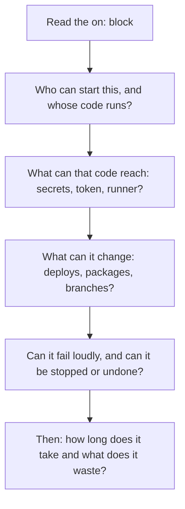

# Lesson 28. Reviewing a Pipeline

**Mission link:** The mission ends with reviewing someone else's pipeline by naming what will fail, slow down or leak first. A review that says "this feels insecure" gets argued with. A review that names who can do what, and what it costs, gets fixed. This is the first lesson of the judgment stage, and it uses nearly everything before it.
**Primary source:** [Docs: "Secure use reference", GitHub](https://docs.github.com/en/actions/reference/security/secure-use)
**Prerequisites:** [Lesson 10](0010-making-a-pipeline-fast.md), [Lesson 14](0014-secrets-and-the-github-token.md), [Lesson 16](0016-untrusted-input.md), [Lesson 23](0023-pinning-what-the-pipeline-runs.md), [Lesson 26](0026-monorepos-and-path-filters.md), [GitHub token](../GLOSSARY.md), [Script injection](../GLOSSARY.md), [Pin](../GLOSSARY.md), [Required status check](../GLOSSARY.md)

## Warm-up

1. ▢ A workflow sets `permissions: contents: read` and nothing else. Which other permissions does the `GITHUB_TOKEN` have?

<details markdown="1"><summary>Check</summary>

None. If you specify the access for any permission, all the ones you do not specify are set to `none` ([workflow syntax](https://docs.github.com/en/actions/reference/workflows-and-actions/workflow-syntax), lesson 14).

</details>

2. ▢ A step runs `echo "${{ github.event.pull_request.title }}"`. Who controls the title, and what is the standard way to stop it becoming shell code?

<details markdown="1"><summary>Check</summary>

Anyone who can open a pull request controls it. Put the expression in an intermediate environment variable and read it as `"$TITLE"` in the script, so the shell sees data, not text it parses ([secure use](https://docs.github.com/en/actions/reference/security/secure-use), lesson 16).

</details>

3. ▢ Why is `uses: some-org/some-action@v3` not a pin, and what is?

<details markdown="1"><summary>Check</summary>

A tag can be moved to different code, as happened in the `tj-actions/changed-files` compromise. A pin is a full-length commit SHA, written with the version as a comment so that Dependabot can propose updates (lesson 23).

</details>

## Know this

### A review is a list of costs

A useful review comment has four parts: **what is there** (a line number), **who or what can exploit it**, **what it costs**, and **the cheapest fix**. Add whether it blocks the merge. "Secrets look risky" has none of the four. "Line 9 puts the registry token in the environment of every step, including a third-party action that tracks a branch, so a change in that action can read and send the token" has all of them, and the author can agree or disagree with a specific claim.

Facts and judgment are different, and a good review marks which is which. That a tag can move is a fact. That a missing cache is worth fixing in this pull request is judgment, and the author may reasonably say no.

### What to look at, in what order

Review in order of what cannot be undone. A leaked secret stays leaked, a failed deploy is loud and recoverable, and a slow pipeline is quiet and fixable next week. That ordering is judgment: it rests on blast radius. What would change it: a repository with no secrets, no deployments and no write token has little to leak, and slowness may be its biggest cost.



|Lens|Question|Fact it rests on|
|---|---|---|
|Leak|Does `pull_request_target` or `workflow_run` check out code from a fork or pull request?|Those triggers are privileged, and used with an untrusted checkout they expose the repository to compromise ([secure use](https://docs.github.com/en/actions/reference/security/secure-use))|
|Leak|Does untrusted text reach a `run` script through `${{ }}`?|Use an intermediate environment variable instead ([secure use](https://docs.github.com/en/actions/reference/security/secure-use))|
|Leak|Is there a `permissions` block, and is it the least the job needs?|Anyone with write access can read every repository secret, so credentials should have the least privilege ([secure use](https://docs.github.com/en/actions/reference/security/secure-use))|
|Leak|Is each secret scoped to the one step that needs it?|A workflow-level `env` reaches every step, including third-party actions (judgment from least privilege)|
|Leak|Is every third-party action pinned to a full-length commit SHA?|A tag or branch can move ([secure use](https://docs.github.com/en/actions/reference/security/secure-use), lesson 23)|
|Leak|Is a self-hosted runner used in a public repository?|They should almost never be used there, because any user can open a pull request ([secure use](https://docs.github.com/en/actions/reference/security/secure-use))|
|Fail|Can a failing test stop the pipeline? Does anything swallow failures?|`continue-on-error` stops a failure from failing the job ([workflow syntax](https://docs.github.com/en/actions/reference/workflows-and-actions/workflow-syntax))|
|Fail|Is the deploy gated by a condition and an environment?|Lessons 17 and 18|
|Fail|Can a required check be skipped and block, or skip and pass?|Lesson 26|
|Fail|Is there a `timeout-minutes`, and a concurrency group where runs can overlap?|A job's default timeout is 360 minutes ([workflow syntax](https://docs.github.com/en/actions/reference/workflows-and-actions/workflow-syntax), lesson 10)|
|Slow|Is the dependency cache keyed on the lockfile, and are independent jobs parallel?|Lessons 8 and 10|

Tools see syntax and a few patterns, not intent. [actionlint](https://github.com/rhysd/actionlint) flags expression and script problems. [OpenSSF Scorecard](https://github.com/ossf/scorecard) scores Token-Permissions, Pinned-Dependencies and Dangerous-Workflow, among others. Run them, and then read the file yourself, because neither knows that a deploy should have been gated.

### The workflow under review

Here is a workflow a contributor wants merged. Line numbers matter in a review, so they are fixed: `name:` is line 1.

```yaml
name: build-and-ship

on:
  pull_request_target:
  push:
    branches: [main]

env:
  REGISTRY_TOKEN: ${{ secrets.REGISTRY_TOKEN }}

jobs:
  build:
    runs-on: self-hosted
    steps:
      - uses: actions/checkout@v7
        with:
          ref: ${{ github.event.pull_request.head.sha }}
      - uses: example-org/setup-tools@main
      - name: Announce
        run: echo "Building ${{ github.event.pull_request.title }}"
      - run: pip install -r requirements.txt
      - run: pytest
        continue-on-error: true

  deploy:
    needs: build
    runs-on: ubuntu-latest
    steps:
      - uses: actions/checkout@v7
      - run: ./deploy.sh production
        env:
          DEPLOY_KEY: ${{ secrets.DEPLOY_KEY }}
```

Assume the repository is public and `example-org/setup-tools` is an action you do not control. Nothing in it is a syntax error, which is the point: it parses, it runs, and it is dangerous.

## Practice

1. ▢ Review the workflow above. Write at most six findings in order of severity, each with the line number, who can exploit it, what it costs and the cheapest fix, and mark which ones block the merge.

<details markdown="1"><summary>Hint</summary>

Start at the `on:` block and ask whose code the first job runs. Then follow what that code can reach, then what the `deploy` job does, and only then look at speed.

</details>

<details markdown="1"><summary>Check</summary>

- **Finding 1, blocks.** Lines 4 and 15 to 17: `pull_request_target` runs with the base repository's secrets and a write-capable token, and the checkout takes the pull request's head, so an outsider's code (their `requirements.txt`, their tests) runs with that access. Fix: trigger on `pull_request` and delete the `ref:` line.
- **Finding 2, blocks.** Lines 25 to 32: `deploy` has no condition and no environment, so every `pull_request_target` event, from anyone, can deploy to production. Fix: `if: github.event_name == 'push' && github.ref == 'refs/heads/main'` and an `environment: production` with required reviewers.
- **Finding 3, blocks.** Line 20: the pull request title is expanded straight into a `run` script, so a title containing shell syntax runs on the runner. Fix: pass it through an `env:` variable.
- **Finding 4, blocks.** Line 13: `self-hosted` in a public repository, running findings 1 and 3, so attacker code lands on a machine that is not a clean virtual machine and can persist. Fix: `ubuntu-latest`.
- **Finding 5.** Lines 9 and 18: `REGISTRY_TOKEN` is in the environment of every step, including an action pinned to a moving branch. Fix: move the token to the one step that needs it, and pin the action to a full SHA.
- **Finding 6.** Line 23: `continue-on-error: true` on `pytest` means red tests never fail `build`, so `deploy` proceeds on a red build. Fix: delete it, and quarantine a flaky test properly (lesson 9).

Not blocking but worth saying: no `permissions` block (so the token gets the repository default), no `timeout-minutes` (default 360), no concurrency group, and no dependency cache. The order is judgment. A reviewer who puts finding 2 first has a good argument, since it needs no exploit at all.

</details>

2. ▢ Which finding do you put first in a review of that workflow?

    - a) No timeout set on the build job
    - b) A pull_request_target run checking out fork code
    - c) The runner label ubuntu-latest moves over time
    - d) No dependency cache for the pip install

<details markdown="1"><summary>Check</summary>

**b)** It hands a privileged token and the repository's secrets to code written by whoever opened the pull request, and that cannot be undone. (a) costs minutes of runner time in a bad case. (c) costs reproducibility, and the label is documented as the latest stable image. (d) costs a few minutes per run.

</details>

3. ▢ Predict, then run. Save the workflow above as `.github/workflows/review-me.yml` inside a scratch directory that is not the practice repository, and run `actionlint .github/workflows/review-me.yml`. Which of your findings does it report?

<details markdown="1"><summary>Hint</summary>

actionlint checks expressions, scripts and a set of known-unsafe patterns. Which of the findings is a property of a single expression rather than of the design?

</details>

<details markdown="1"><summary>Check</summary>

One finding, on line 20:

```text
.github/workflows/review-me.yml:20:33: "github.event.pull_request.title" is potentially untrusted. avoid using it directly in inline scripts. instead, pass it through an environment variable. (abridged) [expression]
```

The wording may differ by version. It does not mention the trigger, the self-hosted runner, the `@main` reference, the workflow-level secret or the missing gate on `deploy`. Those are choices about design and trust, which is what a human review is for.

</details>

4. ▢ Write the smallest change that closes the two findings a reviewer would block on first: the privileged trigger and the unconditional deploy.

<details markdown="1"><summary>Check</summary>

```diff
 on:
-  pull_request_target:
+  pull_request:
   push:
     branches: [main]
@@
       - uses: actions/checkout@v7
-        with:
-          ref: ${{ github.event.pull_request.head.sha }}
@@
   deploy:
     needs: build
+    if: github.event_name == 'push' && github.ref == 'refs/heads/main'
     runs-on: ubuntu-latest
+    environment: production
```

The cost to state out loud: with `pull_request`, a pull request from a fork no longer sees secrets, so any step that needs one fails there. That is the correct behaviour, and the build should not need a secret to run tests.

</details>

5. ▢ Rewrite this review comment so the author can act on it: "Please clean up the secrets, this looks insecure."

<details markdown="1"><summary>Check</summary>

For example: "Line 9 sets `REGISTRY_TOKEN` for the whole workflow, so every step sees it, including `example-org/setup-tools@main` on line 18, which tracks a branch. If that action changes or is compromised it can read and send the token. Move the token to the single step that pushes an image and pin the action to a full commit SHA. I would block on this because the token can publish images." It names the line, the actor, the cost, the fix and the stance.

</details>

6. ▢ The author replies: "It's a private repository, so a self-hosted runner is fine." What do you ask before you accept that?

<details markdown="1"><summary>Check</summary>

Who can open a pull request or fork the repository, and what the runner can reach. The secure use reference says self-hosted runners have no guarantee of ephemeral clean virtual machines and can be persistently compromised, and that you should be cautious on private and internal repositories too, since anyone who can fork and open a pull request, generally anyone with read access, can compromise the runner. Accept it if the runners are ephemeral, isolated, and hold nothing that matters. State that as the condition.

</details>

## Real-world reps

- [ ] Run practice item 3 and compare actionlint's output with your six findings. Write down which of your findings no tool reported.
- [ ] Review the workflow of a project you depend on, or one of your own older ones. Write three findings in the four-part form, each with a line number, and mark facts and judgment.
- [ ] Read the Token-Permissions, Pinned-Dependencies and Dangerous-Workflow sections of the Scorecard checks page and map each to one finding from this lesson.
- [ ] Tomorrow: without notes, write the order of the review lenses and one question for each, then the four parts of a good comment.

## Going further

- [Pipeline Review Checklist](../reference/pipeline-review-checklist.md)
- [Docs: "Secure use reference", GitHub](https://docs.github.com/en/actions/reference/security/secure-use)
- [Repository: OpenSSF Scorecard](https://github.com/ossf/scorecard)
- [Repository: actionlint](https://github.com/rhysd/actionlint)
- [Resources](../RESOURCES.md)

---

Not landing? Reread the primary source at the top, since this lesson compresses it and compression is where understanding leaks. Check the [glossary](../GLOSSARY.md) for any term that felt slippery.

If the lesson itself is unclear rather than the material, that is a defect: [open an issue](https://github.com/TokenCemetery/teach/issues).
