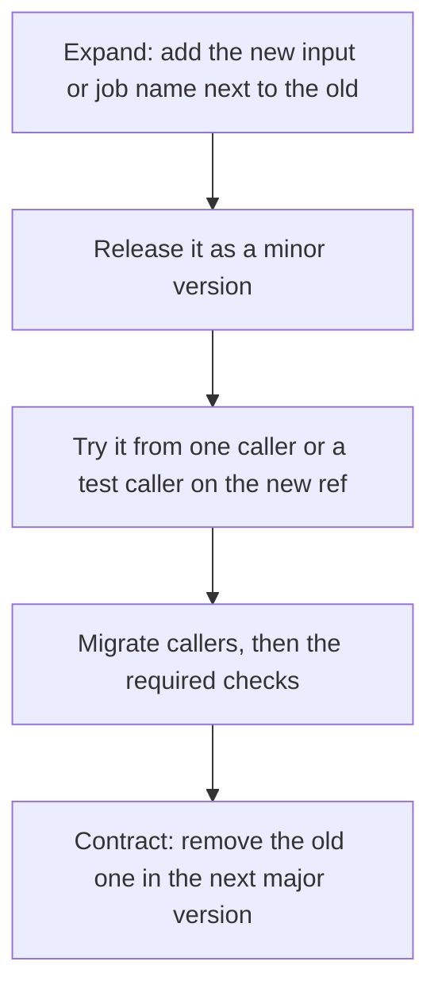

# Lesson 29. Changing a Shared Workflow

**Mission link:** The mission ends with changing a shared workflow or required check without breaking the teams that depend on it. The first time you edit a workflow that twenty repositories call, you learn that its inputs, its job names and its defaults are an interface, and that the people who call it cannot review your change before it lands on them.
**Primary source:** [Docs: "Reuse workflows", GitHub](https://docs.github.com/en/actions/how-tos/reuse-automations/reuse-workflows)
**Prerequisites:** [Lesson 12](0012-versioning-a-build.md), [Lesson 23](0023-pinning-what-the-pipeline-runs.md), [Lesson 25](0025-reusable-workflows-and-composite-actions.md), [Lesson 26](0026-monorepos-and-path-filters.md), [Reusable workflow](../GLOSSARY.md), [Required status check](../GLOSSARY.md), [Pin](../GLOSSARY.md)

## Warm-up

1. ▢ A caller uses `uses: owner/repo/.github/workflows/ci.yml@main`. When does an edit to that file on `main` reach the caller?

<details markdown="1"><summary>Check</summary>

On the caller's next run, with no change on the caller's side. A branch reference moves with every merge, so the caller runs whatever `main` holds at that moment (lesson 25).

</details>

2. ▢ Why is a tag such as `v3` less safe than a full commit SHA for a third-party action?

<details markdown="1"><summary>Check</summary>

Whoever controls the repository can move a tag to different code, and the `tj-actions/changed-files` compromise did exactly that. A full-length SHA identifies one commit (lesson 23).

</details>

3. ▢ A required check is skipped because its job has a false `if`. Does the pull request merge? Does the answer change if the whole workflow was skipped by a path filter?

<details markdown="1"><summary>Check</summary>

A job skipped by a condition reports success, so the pull request can merge. A workflow skipped by a path filter leaves its checks pending, so the merge is blocked (lesson 26).

</details>

## Know this

### A shared workflow is an interface

Callers depend on more than the YAML they wrote. They depend on the inputs and secrets the workflow accepts, the **names of its jobs** (because a required status check is matched by name, and the branch protection page warns that job names must be unique across workflows), and on its defaults. You cannot see all your callers, so treat every one of these as a promise. The table sorts common edits by what they do to callers:

|Change to the shared workflow|Effect on callers|Fact|
|---|---|---|
|Add an optional input with a `default` equal to today's behaviour|None|An input with no default is `""` for a string, `false` for a boolean and `0` for a number, so set the default on purpose ([workflow syntax](https://docs.github.com/en/actions/reference/workflows-and-actions/workflow-syntax))|
|Add a required input or secret|Callers that do not pass it break, or get an empty value|An omitted secret resolves to an empty string without an error unless the secret is `required: true` ([reuse workflows](https://docs.github.com/en/actions/how-tos/reuse-automations/reuse-workflows))|
|Remove or rename an input|Callers that still pass it fail|A caller that passes an input the called workflow does not specify gets an error ([workflow syntax](https://docs.github.com/en/actions/reference/workflows-and-actions/workflow-syntax))|
|Rename a job|Every required check with the old name stops reporting, so merges block|Required checks are matched by name ([about protected branches](https://docs.github.com/en/repositories/configuring-branches-and-merges-in-your-repository/managing-protected-branches/about-protected-branches))|
|Change a default: runner, language version, test command|No error, new behaviour for every caller at once|Judgment: the failure shows up as many red pull requests, not a message|
|Ask for more token permissions in the called workflow|Ignored or fails|The caller's permissions can only be downgraded, not elevated, by the called workflow ([reusable workflows reference](https://docs.github.com/en/actions/reference/workflows-and-actions/reusable-workflows))|

The job name deserves its own warning because the failure is not in the workflow that changed. Nothing errors. The caller's pull requests sit on "Waiting for status to be reported" because the name they require no longer exists. How the name looks in a pull request, with the caller's job and the called job joined, is something to read off your own run rather than assume.

### Versions: what the caller points at

A caller names the shared workflow with `{owner}/{repo}/.github/workflows/{file}@{ref}`, and the ref can be a SHA, a release tag or a branch name. If a release tag and a branch share a name, the tag wins. The documentation says the commit SHA is the safest option for stability and security ([reuse workflows](https://docs.github.com/en/actions/how-tos/reuse-automations/reuse-workflows)). `uses` accepts no expressions, so the ref is always written out.

|Ref|Moves when|Who carries the risk|
|---|---|---|
|`@main`|You merge|Every caller, immediately|
|`@v1`, a floating tag you move|You move the tag|Callers, when you decide|
|`@<full SHA>`|Never|The caller, who must update on purpose|

Publishing with [semantic versioning](https://semver.org/) gives the three refs a meaning: patch for a compatible fix, minor for compatible new behaviour, major for anything that breaks a caller. Keep an immutable tag for every release (`v1.4.2`), and a floating major tag (`v1`) that you move forward only for compatible releases. A breaking change gets `v2`, and `v1` stays where it is.

Reruns add a trap. When you re-run **all** jobs and the reference is not a SHA, the run uses the shared workflow at the specified reference. When you re-run **failed jobs or one job**, the run uses the same commit SHA as the first attempt ([reusable workflows reference](https://docs.github.com/en/actions/reference/workflows-and-actions/reusable-workflows)). So a fix you pushed to the shared workflow does not reach a "Re-run failed jobs".

### Carrying a breaking change through

Whatever the change, the pattern is the same one the database and API tracks teach: add the new thing beside the old one, move the callers, then remove the old one. Danilo Sato's [ParallelChange](https://martinfowler.com/bliki/ParallelChange.html) names it expand, migrate and contract. Applied to a shared workflow:



Renaming a job is the hard case, because the old name is also written in the branch rule. A safe order:

1. Add the new job to the shared workflow while keeping the old one, so both report. A required check can only be chosen once it has completed successfully in the repository during the past seven days ([troubleshooting page](https://docs.github.com/en/pull-requests/how-tos/merge-and-close-pull-requests/troubleshooting-required-status-checks)), so the new name must have run first.
2. Add the new check to the rule while the old one is still required. A check must pass on the latest commit, so a pull request opened before the change has no result under the new name and needs a new commit before it can merge. Say so in the announcement.
3. When the callers have moved to the new version, remove the old name from the rule.
4. Delete the old job in the next major version.

The cheapest rename is the one you do not make. A stable gate job (lesson 26) means callers require one name, `ci-ok`, and the jobs behind it can change freely. What would change that advice: a shared workflow with a single job and a single caller, where renaming and updating the rule is one afternoon.

## Practice

1. ▢ Which change to a shared workflow is safe for existing callers without any coordination?

    - a) Rename the job from test to unit-tests
    - b) Add a new required input called python-version
    - c) Add an optional input with today's default
    - d) Raise default Python from 3.11 to 3.13

<details markdown="1"><summary>Check</summary>

**c)** An optional input whose default equals the current behaviour changes nothing for a caller that does not pass it. (a) changes the check name, so merges block. (b) breaks callers that do not pass a required input. (d) changes the behaviour of every caller without an error, which is the quiet kind of break.

</details>

2. ▢ Predict, then run. Create a second public repository, `ci-cd-shared`, with the workflow below, and tag its first commit `v1` (`git tag v1 && git push origin v1`). In `ci-cd-practice`, add `shared-v1.yml` calling it `@v1` and `shared-main.yml` calling it `@main`, both with `with: python-version: "3.12"` (replace `your-user` with your GitHub user name). Then, in `ci-cd-shared`, rename the input to `python` on `main` and push, without moving `v1`. Trigger both callers. Which fails, and when does it fail?

    ```yaml
    name: python-test

    on:
      workflow_call:
        inputs:
          python-version:
            type: string
            default: "3.12"

    jobs:
      test:
        runs-on: ubuntu-latest
        steps:
          - uses: actions/checkout@v7
          - uses: actions/setup-python@v7
            with:
              python-version: ${{ inputs.python-version }}
          - run: pip install -r requirements.txt
          - run: pytest
    ```

    ```yaml
    name: shared-v1

    on: workflow_dispatch

    jobs:
      tests:
        uses: your-user/ci-cd-shared/.github/workflows/python-test.yml@v1
        with:
          python-version: "3.12"
    ```

<details markdown="1"><summary>Hint</summary>

Which commit of `ci-cd-shared` does each caller read, and what does the documentation say happens when a caller passes an input the called workflow does not define?

</details>

<details markdown="1"><summary>Check</summary>

`shared-main.yml` fails: it reads the renamed workflow, passes `python-version`, which no longer exists, and the run errors at the calling job, before any step of the shared workflow runs. `shared-v1.yml` keeps passing, because `v1` still points at the old commit. Move `v1` to the new commit (`git tag -f v1 && git push -f origin v1`) and trigger it again: now it fails too. That is the whole risk of a floating tag, and why a rename belongs in `v2`.

</details>

3. ▢ A caller pinned to `@main` fails because of a bug in the shared workflow. You push a fix to `main`, press **Re-run failed jobs**, and the run fails the same way. Why, and what do you press instead?

<details markdown="1"><summary>Hint</summary>

Think about which commit of the shared workflow a re-run of only the failed jobs reads.

</details>

<details markdown="1"><summary>Check</summary>

Re-running failed jobs uses the same commit SHA of the shared workflow as the first attempt, so it runs the buggy version again. **Re-run all jobs** reads the reference again, and picks up the fix. A caller pinned to a SHA needs a commit to update that SHA, which is the point of pinning.

</details>

4. ▢ Twelve repositories require the check `tests / test` produced by your shared workflow. You want the job called `unit-tests`. Write the order of steps that blocks no merge, and say what you would do instead if you could.

<details markdown="1"><summary>Check</summary>

Add `unit-tests` beside `test`, release it as a minor version, let it run so the new name exists, add the new check to each repository's rule while keeping the old one, move the callers to the new version, remove the old name from the rules, and delete `test` in the next major version. Tell the teams that pull requests opened earlier need a new commit to report the new name. Instead: keep the job name stable and have callers require a gate job that you never rename, so the interface a branch rule depends on is one name that does not change.

</details>

5. ▢ For each change to a shared workflow, name the version bump: (a) fix a typo in a step name, (b) add an optional input with a default, (c) remove an input, (d) change the default Python from 3.11 to 3.13.

<details markdown="1"><summary>Check</summary>

(a) patch, a step name is not a check name (a job name is). (b) minor. (c) major, because callers that pass the input will error. (d) a judgment call: no caller errors, but every caller's behaviour changes, so a careful maintainer treats it as major for callers on a floating tag, or ships the new default behind a new input and flips it in `v2`. Semantic versioning defines the categories. Whether (d) breaks a caller is something only you know about your callers.

</details>

6. ▢ A teammate wants to "just edit" the shared workflow on `main` because "it's a small fix". Name two questions you ask before agreeing.

<details markdown="1"><summary>Check</summary>

Which refs do the callers use, since any caller on `@main` receives the change on its next run, and does the edit touch an input, a secret, a job name or a default, since each is part of the interface. A third, if a required check could change: does the old check name keep reporting while the rules are moved.

</details>

## Real-world reps

- [ ] Do practice item 2 for real. When both callers are red, move `v1`, then fix forward by releasing `v2` with the rename and pointing one caller at it.
- [ ] In a repository you maintain, list its required checks (Settings, then Rules). For each name, find the workflow and job that produces it, and note who could change that file without telling you.
- [ ] Draft the announcement you would send to callers for the rename in practice item 4: what changes, by when, what they must do, and how they check they are safe.
- [ ] Tomorrow: without notes, write the rows of the "what callers depend on" table and the four-step order for renaming a required check.

## Going further

- [Pipelines at Scale](../reference/pipelines-at-scale.md)
- [Docs: "Reuse workflows", GitHub](https://docs.github.com/en/actions/how-tos/reuse-automations/reuse-workflows)
- [Docs: "Reusable workflows reference", GitHub](https://docs.github.com/en/actions/reference/workflows-and-actions/reusable-workflows)
- [Docs: "About protected branches", GitHub](https://docs.github.com/en/repositories/configuring-branches-and-merges-in-your-repository/managing-protected-branches/about-protected-branches)
- [Docs: "Troubleshooting required status checks", GitHub](https://docs.github.com/en/pull-requests/how-tos/merge-and-close-pull-requests/troubleshooting-required-status-checks)
- [Specification: "Semantic Versioning 2.0.0"](https://semver.org/)
- [Article: "ParallelChange", Danilo Sato](https://martinfowler.com/bliki/ParallelChange.html)
- [Resources](../RESOURCES.md)

---

Not landing? Reread the primary source at the top, since this lesson compresses it and compression is where understanding leaks. Check the [glossary](../GLOSSARY.md) for any term that felt slippery.

If the lesson itself is unclear rather than the material, that is a defect: [open an issue](https://github.com/TokenCemetery/teach/issues).
