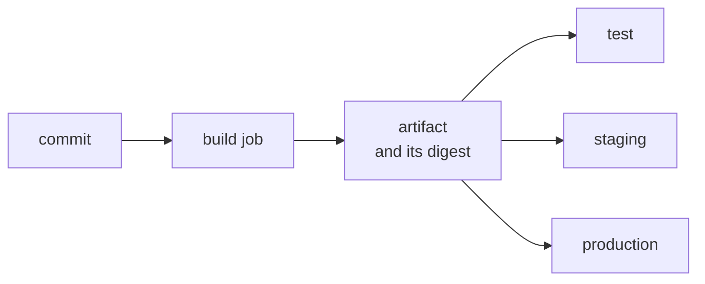

# Artifacts and Versioning: Artifacts, Version Schemes, Build Once, Image Tags and Digests

Stage 4 compressed for lookup. [Lesson 11](../lessons/0011-artifacts.md) covers artifacts and how they differ from caches, [lesson 12](../lessons/0012-versioning-a-build.md) build identity and building once, and [lesson 13](../lessons/0013-building-and-publishing-an-image.md) building, tagging and publishing an image and handing on its digest.

## Artifact or cache

|Question|Cache|Artifact|
|---|---|---|
|Purpose|Skip repeated work|Keep or hand over an output|
|Found by|Key and restore keys, across runs|Name inside a run, or a run ID|
|When missing|Regenerate and carry on|The consumer fails|
|Trust|Only ever faster, never changes the result|Is the result|
|Examples|`~/.cache/pip`, intermediate build output|Package, test report, binary|

If you are writing a fallback for a missing artifact, you wanted a cache. If a job fails without the file, you wanted an artifact.

## Upload and download

```yaml
- uses: actions/upload-artifact@v7
  with:
    name: package
    path: dist/ci-cd-practice.tar.gz
    if-no-files-found: error
    retention-days: 14

- uses: actions/download-artifact@v8
  with:
    name: package
```

|Rule|Detail|
|---|---|
|Order|A job downloads only what an earlier job in the run uploaded, so give it `needs`|
|Names|Unique within a run and immutable. Put the matrix value in the name|
|`overwrite: true`|Replaces the artifact and gives it a new ID|
|`if-no-files-found`|Defaults to `warn`. Use `error` when a later job depends on the file|
|Hidden files|Skipped unless `include-hidden-files: true`|
|Permissions|Zipping resets files to `644` and directories to `755`. Use a `tar` to keep them|
|Download with `name`|Extracted directly into `path`, default the workspace|
|Download without `name`|Every artifact, each in a subdirectory, unless `merge-multiple: true`|
|Other runs|Need `github-token` and `run-id`|
|Limit|500 artifacts per job|
|Outputs|`artifact-id` and `artifact-digest` (SHA-256), and the download checks the digest, `digest-mismatch` defaulting to `error`|
|Retention|90 days by default, `retention-days` between 1 and 90, capped by the repository, organization and enterprise setting|
|Deleting a run|Deletes its artifacts|

Keep a report after a failure with `if: ${{ !cancelled() }}`. For anything that must outlive the retention period, publish to a registry or a release.

GitLab CI: later-stage jobs download earlier artifacts by default, narrowed with `dependencies` or `needs`, and `artifacts:expire_in` sets expiry. Jenkins: `archiveArtifacts` stores files from a build.

## Version schemes

|Scheme|Example|Says|Does not say|
|---|---|---|---|
|Semantic version|`0.1.0`|What a change means to users: major, minor, patch|Which build or commit|
|Run number|`58`|Order within one workflow|Which commit, and is per workflow|
|Commit SHA|`9f3e1aa`|The exact source|Order or compatibility|
|Combined|`0.1.0+58.9f3e1aa`|Promise, order and source|Precedence: build metadata is ignored|
|Digest|`sha256:4f1c...`|The exact bytes|Anything a person can read|

- Build metadata is `+` and dot separated identifiers of ASCII letters, digits and hyphens. Two versions differing only in it have the same precedence.
- A Docker tag cannot contain `+`. Tags allow letters, digits, underscores, periods and dashes, up to 128 characters, and may not start with a period or dash.
- Keep the release number in a file a person edits in a reviewed change, and let the pipeline append the metadata.
- The version names the commit, the digest names the bytes. Carry both.

|Variable|Meaning|Changes on a re-run|
|---|---|---|
|`GITHUB_SHA`|Commit that triggered the run, depends on the event|No|
|`GITHUB_RUN_ID`|Unique per run in the repository|No|
|`GITHUB_RUN_NUMBER`|Count of runs of this workflow, from 1|No|
|`GITHUB_RUN_ATTEMPT`|Attempt of this run, from 1|Yes|
|`GITHUB_REF_NAME`|Short branch or tag name|No|

- For a `push`, `GITHUB_SHA` is the pushed commit. For a `pull_request`, it is the last merge commit of the merge branch, which exists only for that run. Ship only builds from a push to a deploy branch.
- `actions/checkout` fetches one commit. Anything that needs history, such as `git describe`, needs `fetch-depth: 0`.

## Build once



|Do|Do not|
|---|---|
|One job builds, uploads and reports the digest|Check out and build again for each stage|
|Later jobs download or pull that artifact and verify its digest|Rebuild on a tag to release|
|A tag names a commit whose artifact already exists, and a release promotes it|Treat equal versions as equal bytes|
|Pin tools and dependencies so the single build is repeatable (lesson 23)|Leave transitive dependencies free to move|

```console
$ echo "${EXPECTED}  ci-cd-practice.tar.gz" | sha256sum --check
ci-cd-practice.tar.gz: OK
```

## Image build and publish

|Step|Action|Notes|
|---|---|---|
|Builder|`docker/setup-buildx-action@v4`|Used by the Docker examples before a cache backend|
|Login|`docker/login-action@v4`|`registry: ghcr.io`, `username: ${{ github.actor }}`, `password: ${{ secrets.GITHUB_TOKEN }}`. Skip on pull requests|
|Tags and labels|`docker/metadata-action@v6`|Lowercases the image name and fixes invalid tag characters|
|Build and push|`docker/build-push-action@v7`|`push: ${{ github.event_name != 'pull_request' }}`, output `digest`|

```yaml
permissions:
  contents: read
  packages: write
```

|`metadata-action` tag|Produces|
|---|---|
|`type=sha`|`sha-9f3e1aa`, short SHA, or `format=long`|
|`type=ref,event=branch`|The branch name, slashes become `-`|
|`type=ref,event=pr`|`pr-<number>`|
|`type=semver,pattern={{version}}`|`1.2.3` from a `v1.2.3` Git tag|
|`latest`|Added by default only for Git tag and semver style tags|

## Tags and digests

|Reference|Form|Can it change|Use for|
|---|---|---|---|
|Branch tag|`ghcr.io/octocat/ci-cd-practice:main`|Yes, every push|People, local pulls|
|Commit tag|`ghcr.io/octocat/ci-cd-practice:sha-9f3e1aa`|Pushed again, yes|Finding the build of a commit|
|Digest|`ghcr.io/octocat/ci-cd-practice@sha256:4f1c...`|No|Every deploy and promotion|

```yaml
outputs:
  digest: ${{ steps.push.outputs.digest }}
# later job
env:
  DIGEST: ${{ needs.image.outputs.digest }}
run: docker run -d "ghcr.io/${GITHUB_REPOSITORY,,}@${DIGEST}"
```

## GitHub Container Registry facts

|Fact|Consequence|
|---|---|
|New packages are private by default|Pulls need a login until you make it public|
|Publishing with the `GITHUB_TOKEN` links the package to the workflow's repository|The package inherits that repository's access|
|A same-named package pushed earlier and never connected|The `GITHUB_TOKEN` is refused, connect it to the repository|
|Image names must be lowercase|Lowercase `GITHUB_REPOSITORY` yourself outside `metadata-action`|
|Push needs `packages: write`|A 403 on the upload means the permission is missing|
|Public packages|Pull anonymously|

## Layer cache

|Setting|Meaning|
|---|---|
|`cache-from: type=gha`|Read BuildKit layers from the Actions cache|
|`cache-to: type=gha,mode=max`|Write layers of all stages, not only the final image|
|Read-only cache access|Keep `cache-from`, drop `cache-to`|
|Status|Docker labels the exporter experimental|

Copy the dependency file and install before copying the code, so a code change does not invalidate the dependency layer. The image must build correctly with a cold cache.

## Sources

- [Docs: "Workflow artifacts", GitHub](https://docs.github.com/en/actions/concepts/workflows-and-actions/workflow-artifacts)
- [Docs: "Store and share data with workflow artifacts", GitHub](https://docs.github.com/en/actions/tutorials/store-and-share-data)
- [Docs: "Removing workflow artifacts", GitHub](https://docs.github.com/en/actions/how-tos/manage-workflow-runs/remove-workflow-artifacts)
- [Repository: actions/upload-artifact, GitHub](https://github.com/actions/upload-artifact)
- [Repository: actions/download-artifact, GitHub](https://github.com/actions/download-artifact)
- [Docs: "CI/CD YAML syntax reference", GitLab](https://docs.gitlab.com/ci/yaml/)
- [Docs: "Pipeline tour: Recording tests and artifacts", Jenkins](https://www.jenkins.io/doc/pipeline/tour/tests-and-artifacts/)
- [Book chapter: "Release Engineering", Site Reliability Engineering, Google](https://sre.google/sre-book/release-engineering/)
- [Specification: "Semantic Versioning 2.0.0"](https://semver.org/)
- [Docs: "Store information in variables", GitHub](https://docs.github.com/en/actions/reference/workflows-and-actions/variables)
- [Docs: "Re-running workflows and jobs", GitHub](https://docs.github.com/en/actions/how-tos/manage-workflow-runs/re-run-workflows-and-jobs)
- [Docs: "GitHub Actions", Docker Docs](https://docs.docker.com/build/ci/github-actions/)
- [Docs: "Cache management with GitHub Actions", Docker Docs](https://docs.docker.com/build/ci/github-actions/cache/)
- [Docs: "Publishing Docker images", GitHub](https://docs.github.com/en/actions/how-tos/use-cases-and-examples/publishing-packages/publishing-docker-images)
- [Docs: "Working with the Container registry", GitHub](https://docs.github.com/en/packages/working-with-a-github-packages-registry/working-with-the-container-registry)
- [Repository: docker/metadata-action](https://github.com/docker/metadata-action)
