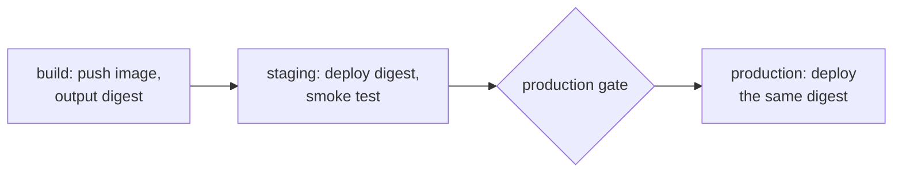
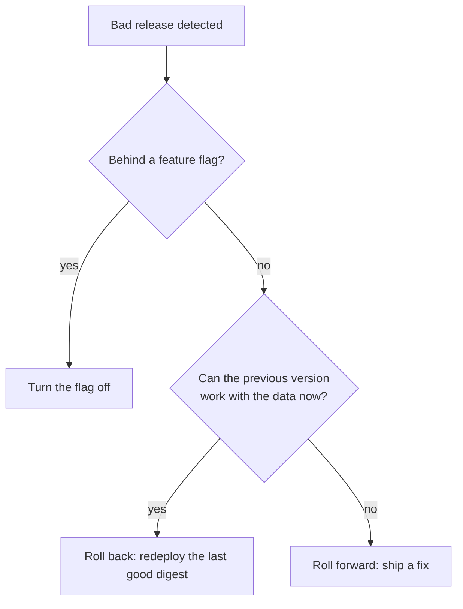

# Deployments: Environments, Promotion, Strategies, Rollback, Migrations and GitOps

Stages 6 and 7 compressed for lookup. [Lesson 17](../lessons/0017-environments-and-approvals.md) covers environments and approvals, [lesson 18](../lessons/0018-promotion-between-environments.md) promotion, [lesson 19](../lessons/0019-deployment-strategies.md) the four strategies, [lesson 20](../lessons/0020-rollback-and-roll-forward.md) rollback and roll forward, [lesson 21](../lessons/0021-database-migrations-in-a-deploy.md) migrations in a deploy, and [lesson 22](../lessons/0022-push-deploys-and-gitops.md) push deploys and GitOps.

## Environments

A job enters one with `environment: name`, or with a mapping of `name` and `url`. Each job references one. Protection rules must pass before the job is sent to a runner, and environment secrets are readable only after that.

|Rule|Behaviour|Limits and defaults|
|---|---|---|
|Required reviewers|One approval releases the job|Up to 6 users or teams, at least read access|
|Prevent self-review|The starter cannot approve|Off unless selected|
|Wait timer|Delays the job, not billed|1 to 43,200 minutes|
|Deployment branches and tags|Pattern matched against `GITHUB_REF`|`*` does not match `/`, branches and tags are separate rules|
|Allow administrators to bypass|Admin can start waiting jobs|On by default|
|Custom protection rules|A GitHub App decides|Public preview, at most 6 enabled per environment|

- A workflow that names a missing environment creates it, with no rules and no secrets. A typo is an unprotected deploy.
- `deployment: false` uses an environment's secrets and variables without recording a deployment. Reviewers and wait timers still apply.
- Environment variables are plain text in the `vars` context. Environment secrets are in `secrets`.
- Self-hosted runners are not isolated by environments.
- Pair the environment with `concurrency` and `cancel-in-progress: false`, so one deploy runs at a time and a running one is not cancelled.
- With OIDC, a job that references an environment has the subject `repo:ORG/REPO:environment:NAME`.

**Plans** (from the environment docs): environments, environment secrets and protection rules are available in public repositories on all current plans, so every rule above works on a public repository on GitHub Free. For private or internal repositories, environments, environment secrets and deployment branches need Pro, Team or Enterprise. On Free, Pro and Team, required reviewers, wait timers, the administrator bypass setting and custom rules are available only for public repositories.

## Promotion



|May differ per environment|Must be identical|
|---|---|
|Variables, secrets, replica counts, hostnames|The image digest and so the code and dependencies|
|Who approves, which branches may deploy|The deploy procedure|

- Build once, reference by digest (`image@sha256:...`), never by a movable tag.
- Pass the digest between jobs through job `outputs` and `needs`.
- Config comes from the environment's `vars` and `secrets`. If changing a value needs a build, it is not configuration.
- A manual promotion or rollback takes the digest as a `workflow_dispatch` input. Put it in `env:` and validate it: `^sha256:[0-9a-f]{64}$`.
- Approving an old run deploys that run's build, not the latest one on `main`.

## The four strategies

|Strategy|Spare capacity|Two versions at once|Rollback|Kubernetes|
|---|---|---|---|---|
|Recreate|None|No, with downtime|Redeploy, with downtime|`strategy.type: Recreate`|
|Rolling|Surge limit|Yes|Roll out the old version|`RollingUpdate`, `maxSurge`, `maxUnavailable`|
|Blue-green|A full copy|One side takes traffic|Switch back|Two Deployments, Service selector patch|
|Canary|A little|Yes|Send the share back|Stable and canary Deployments sharing a Service|

Rolling defaults are `maxUnavailable: 25%` (rounded down) and `maxSurge: 25%` (rounded up), and both cannot be 0. Available pods stay between `replicas - maxUnavailable` and `replicas + maxSurge`, and terminating pods are not counted, so the count can briefly exceed that.

```bash
kubectl patch service web -p '{"spec":{"selector":{"app":"web","slot":"green"}}}'
```

A canary needs an evaluation rule fixed before it starts:

- Compare the canary with the control. A 20% error rate on a 5% canary is about 1% overall, which whole-service monitoring can miss.
- Use a few metrics that track what users feel, such as request success and latency.
- Size and time it to see representative traffic.
- Decide the metric, threshold, duration and failure action first.

## Rollback and roll forward



|Action|What it is|
|---|---|
|Rollback|Redeploy the last good artifact. Nothing is rebuilt|
|Roll forward|Ship a new version with the fix, through the pipeline|
|`git revert`|A new commit, so a roll forward|
|`kubectl rollout undo`|Restores the previous pod template only, from `revisionHistoryLimit` (default 10) old ReplicaSets|

```yaml
- name: Roll back
  if: ${{ failure() && steps.deploy.conclusion == 'failure' }}
  run: kubectl rollout undo deployment/web
```

- A step after a failure needs `failure()` in its `if`, because `success()` is added when no status check function is present.
- The job should still end red after a rollback: the deploy failed.
- Rollback is unsafe when the schema or data has moved on in a way the old version cannot read, and for effects outside your system.
- Flags: release toggles are transitional (a week or two), ops toggles are short-lived or long-lived kill switches. Each flag costs conditional logic and testing, and a flip bypasses the pipeline, so control and record it.
- Rehearse the rollback in staging before you need it.

## Migrations in a deploy

During a rolling or canary deploy, two versions run against one schema. Expand and contract keeps that safe by splitting a change across deploys.

|Deploy|Schema|Code|
|---|---|---|
|Expand|Add the new shape beside the old, nullable or defaulted|Old code ignores it, new code writes both|
|Migrate|Backfill existing rows|New code reads the new shape|
|Contract|Remove the old shape, after no running version uses it|Old shape no longer referenced|

- A change that adds runs before the code that needs it. A change that removes runs after the last version that needs the old shape is gone.
- Blue-green does not remove the problem: the idle side shares the database, so schema changes still need to work for both versions.
- A rename is three deploys, not one. The lock behaviour of each statement is a database question: see the [SQL operating sheet](../../../programming/sql/reference/operating.md).

## Push deploys and GitOps

|Question|Push deploy|GitOps|
|---|---|---|
|Who applies the change|The pipeline runs `kubectl` or `helm` against the cluster|An agent in the cluster pulls the desired state from Git|
|Credentials|The pipeline holds cluster access, ideally by OIDC|The agent holds cluster access, the pipeline needs only write access to Git|
|Drift|Not noticed until the next deploy|Reconciled and reported continuously|
|Rollback|Redeploy an old digest|Revert or edit the commit that states the version|

- The OpenGitOps principles are declarative, versioned, pulled automatically and continuously reconciled.
- `kubectl rollout undo` against a GitOps-managed cluster is overwritten by the agent. Change Git.
- Argo CD and Flux are the two widely used agents.

## Sources

- [Docs: "Deployment environments", GitHub](https://docs.github.com/en/actions/concepts/workflows-and-actions/deployment-environments)
- [Docs: "Managing environments for deployment", GitHub](https://docs.github.com/en/actions/how-tos/deploy/configure-and-manage-deployments/manage-environments)
- [Docs: "Deployments and environments", GitHub](https://docs.github.com/en/actions/reference/workflows-and-actions/deployments-and-environments)
- [Docs: "Deploying with GitHub Actions", GitHub](https://docs.github.com/en/actions/how-tos/deploy/configure-and-manage-deployments/control-deployments)
- [Site: "Continuous Delivery: patterns", Jez Humble](https://continuousdelivery.com/implementing/patterns/)
- [Book chapter: "Canarying Releases", The Site Reliability Workbook, Google](https://sre.google/workbook/canarying-releases/)
- [Article: "BlueGreenDeployment", Martin Fowler](https://martinfowler.com/bliki/BlueGreenDeployment.html)
- [Article: "CanaryRelease", Danilo Sato](https://martinfowler.com/bliki/CanaryRelease.html)
- [Article: "Feature Toggles (aka Feature Flags)", Pete Hodgson](https://martinfowler.com/articles/feature-toggles.html)
- [Article: "ParallelChange", Danilo Sato](https://martinfowler.com/bliki/ParallelChange.html)
- [Site: "OpenGitOps Principles", OpenGitOps, CNCF](https://opengitops.dev/)
- [Docs: "Deployments", Kubernetes](https://kubernetes.io/docs/concepts/workloads/controllers/deployment/)
- [Workloads](../../kubernetes/reference/workloads.md), rollouts as a cluster feature
