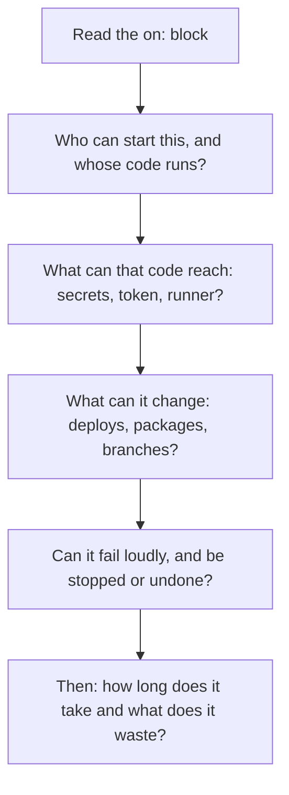

# Pipeline Review Checklist: Questions for Someone Else's Pipeline, and When the Usual Answer Is Wrong

Stage 10 compressed for lookup. [Lesson 28](../lessons/0028-reviewing-a-pipeline.md) covers reviewing a workflow by naming what will leak, fail or slow down, [lesson 29](../lessons/0029-changing-a-shared-workflow.md) changing what other teams depend on, and [lesson 30](../lessons/0030-when-the-usual-answer-is-wrong.md) saying when the usual answer is wrong and settling a dispute from the source.

## A finding has four parts

|Part|Example|
|---|---|
|Where|Line 9, `env: REGISTRY_TOKEN`|
|Who or what can exploit it|Any step, including a third-party action that tracks a branch|
|What it costs|The token can publish images if the action changes|
|Cheapest fix, and whether it blocks|Scope it to the one pushing step, pin the action to a SHA, blocks|

- Mark each finding as **fact** (a documented behaviour) or **judgment** (a weighing of cost). The author may decline a judgment.
- "This feels insecure" has none of the four parts, and cannot be agreed or disagreed with.

## Order of review

Leak first, then fail, then slow, because what cannot be undone comes first. That order is judgment. A repository with no secrets, no deployment and no write token may find slowness its biggest cost.

## Questions to ask

|Lens|Question|Rests on|
|---|---|---|
|Leak|Does `pull_request_target` or `workflow_run` check out fork or pull request code?|Those triggers are privileged, secure use reference|
|Leak|Does untrusted text reach a `run` script through `${{ }}`?|Use an intermediate environment variable, secure use reference|
|Leak|Is there a `permissions` block, and is it the least the job needs?|Specifying any permission sets the rest to `none`, workflow syntax|
|Leak|Is each secret scoped to the one step that needs it?|Judgment from least privilege|
|Leak|Is every third-party action pinned to a full-length commit SHA?|A tag or branch can move, secure use reference|
|Leak|Is a self-hosted runner used in a public repository?|Almost never, and be cautious in private ones, secure use reference|
|Fail|Can a failing test fail the job? Is anything swallowed by `continue-on-error`?|Workflow syntax|
|Fail|Is the deploy gated by a condition and an environment?|Lessons 17 and 18|
|Fail|Does the deploy build once and deploy a digest?|Lessons 12 and 18|
|Fail|Can a required check be skipped and block, or skip and pass?|Troubleshooting required status checks, lesson 26|
|Fail|Is there a way back: rollback, roll forward or a flag?|Lesson 20|
|Fail|Does a `timeout-minutes` exist, and does a concurrency group stop overlapping deploys?|Job timeout default is 360 minutes, workflow syntax|
|Slow|Is the dependency cache keyed on the lockfile?|Lesson 8|
|Slow|Are independent jobs parallel, and is the critical path short?|Lesson 10|
|Slow|Is the matrix as large as it needs to be?|Lesson 7|

## Tools see syntax, not intent

|Tool|Finds|Misses|
|---|---|---|
|actionlint|Expression types, shell script problems, untrusted input in `run`|Design choices: a privileged trigger, a self-hosted runner, a moving ref, a missing gate|
|OpenSSF Scorecard|Token-Permissions, Pinned-Dependencies, Dangerous-Workflow, among other checks|Whether a deploy should have been gated|

Run both, then read the file.

## When the usual answer is wrong

For each default: the case it was built for, how yours differs, what the alternative costs, and what would flip the answer.

|Usual answer|Wrong when|Instead|Cost|
|---|---|---|---|
|Continuous deployment of every passing change|Tests cannot see what breaks, rollback is expensive, a human approval is a real control, or the release channel is slow|Continuous delivery with a gate|Slower releases, larger batches|
|A canary with automatic analysis|Traffic is too low for a sample, there is no control or metric, versions cannot run together, or the risk is not in requests|Blue-green, a flag, or a rolling deploy with good checks|A second environment, or weaker evidence|
|`fail-fast: true` on a matrix|You need every leg's result|`fail-fast: false`|More minutes|
|`cancel-in-progress: true` everywhere|The group guards a deploy or the default branch|No cancel on deploys|A queue|
|`ubuntu-latest`|You need a reproducible build or a bisect|A named image like `ubuntu-24.04`|You move the label yourself|
|A workflow-level path filter on a required check|The check is required|Always run, filter jobs, require a gate|One extra cheap job|

## Settling a dispute

1. The **workflow syntax reference** for a key, its default and allowed values.
2. The **events, contexts and expressions references** for what an event delivers and what a context holds.
3. The **how-to page** for the feature.
4. A **ten-line experiment** on a throwaway run with `workflow_dispatch`.

Memory, a blog post and "everyone does it" are not sources. Write the claim so it can be false, then find the line.

|Claim|Settled by|
|---|---|
|`branches` or `paths` runs on either|Both filters must be satisfied|
|Default job timeout is 60 minutes|`jobs.<job_id>.timeout-minutes` defaults to 360|
|A job `needs` a skipped job still runs|Skipped needed jobs skip the dependent unless it uses a condition such as `always()`|
|A path filter looks at the last commit|Pull requests use a three-dot diff against where the branch last synced with the base|
|Path filters apply to tag pushes|They are not evaluated for pushes of tags|

## Sources

- [Docs: "Secure use reference", GitHub](https://docs.github.com/en/actions/reference/security/secure-use)
- [Docs: "Workflow syntax for GitHub Actions", GitHub](https://docs.github.com/en/actions/reference/workflows-and-actions/workflow-syntax)
- [Docs: "Troubleshooting required status checks", GitHub](https://docs.github.com/en/pull-requests/how-tos/merge-and-close-pull-requests/troubleshooting-required-status-checks)
- [Docs: "Triggering a workflow", GitHub](https://docs.github.com/en/actions/how-tos/write-workflows/choose-when-workflows-run/trigger-a-workflow)
- [Docs: "GitHub-hosted runners", GitHub](https://docs.github.com/en/actions/reference/runners/github-hosted-runners)
- [Repository: actionlint](https://github.com/rhysd/actionlint)
- [Repository: OpenSSF Scorecard](https://github.com/ossf/scorecard)
- [Article: "Continuous Delivery", Martin Fowler](https://martinfowler.com/bliki/ContinuousDelivery.html)
- [Book chapter: "Canarying Releases", The Site Reliability Workbook, Google](https://sre.google/workbook/canarying-releases/)
- [Guide: "DORA's software delivery metrics", DORA](https://dora.dev/guides/dora-metrics-four-keys/)
