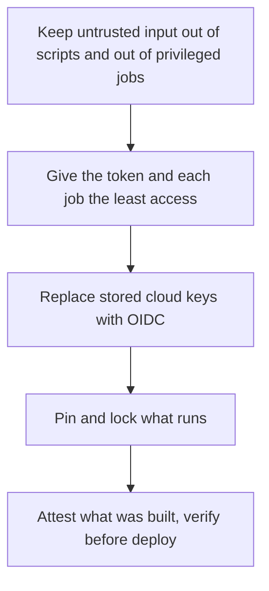

# Pipeline Security: Secrets, Token Permissions, OIDC, Untrusted Input, Pinning and Provenance

Stages 5 and 8 compressed for lookup. [Lesson 14](../lessons/0014-secrets-and-the-github-token.md) covers secrets and the `GITHUB_TOKEN`, [lesson 15](../lessons/0015-oidc-instead-of-long-lived-keys.md) OIDC, [lesson 16](../lessons/0016-untrusted-input.md) untrusted input, [lesson 23](../lessons/0023-pinning-what-the-pipeline-runs.md) pinning, and [lesson 24](../lessons/0024-provenance-and-sboms.md) provenance and SBOMs.

## The order of defence



Each layer assumes the one before it can fail. A compromised action still holds whatever token and secrets its job holds.

## Secrets

|Level|Readable by|Use for|
|---|---|---|
|Repository|Every workflow in the repository|Values the whole pipeline needs|
|Environment|Jobs that enter the environment, after approval if reviewers are required|Production credentials|
|Organization|Repositories the access policy allows|One value shared by many repositories|

- A step takes a secret by name, as an input or as an `env` value, and a script should read it from the environment.
- A secret that was never set is an empty string, not an error. A secret cannot be used directly in `if:`, so put it in a job-level `env` and test the variable.
- Secrets are not passed to runs triggered from a fork (except the `GITHUB_TOKEN`), to Dependabot-triggered runs, or automatically to reusable workflows.
- Anyone with write access can read every repository secret by changing a workflow. A secret limits what a workflow can do, not what a maintainer can learn.
- Masking redacts the exact value only. A transformed copy (Base64, reversed, split), a value derived from a secret, and a secret in a JSON blob are not redacted. Register a derived value with `::add-mask::VALUE`, and use one secret per sensitive value.
- A leaked secret needs two actions: delete the log and rotate the secret. Rotation is what makes it safe.
- Set one without shell history: `gh secret set NAME`, and `gh secret set --env production NAME` for an environment.

## The `GITHUB_TOKEN`

|Fact|Value|
|---|---|
|Created|At the start of each job, as an installation access token of the repository's GitHub App|
|Scope|The repository that holds the workflow, so a push to another repository needs another credential|
|Lifetime|Until the job ends or its effective maximum, up to 6 hours on GitHub-hosted runners|
|Available as|`secrets.GITHUB_TOKEN` and `github.token`, and an action can read `github.token` without being passed it|
|Events it causes|Do not start new runs, except `workflow_dispatch` and `repository_dispatch`|

|Setting or form|Effect|
|---|---|
|Restricted default|Read on `contents` and `packages` only|
|Permissive default|Read and write on everything|
|`permissions: {contents: read}`|Only that permission, every unlisted one is `none`|
|`permissions: {}`|No permissions|
|`read-all`, `write-all`|Read or write for every permission|
|Job-level `permissions`|Replaces the workflow-level block for that job|
|Fork pull request|Write permissions become read unless an admin enabled write tokens|

Start the workflow at `contents: read` and grant more to the one job that needs it. Permissions seen in this track: `contents`, `packages`, `id-token` (write only), `attestations`, `deployments`, `issues`, `pull-requests`, and `artifact-metadata` (the optional storage record for attested artifacts).

## OIDC

|Step|Detail|
|---|---|
|Job asks|Needs `id-token: write`, which grants nothing else|
|Request|Authenticated call to `ACTIONS_ID_TOKEN_REQUEST_URL` with an `audience` parameter, or a login action does it|
|Cloud checks|Signature, `aud` and `sub` (and any other claim) against the trust policy|
|Result|Credentials that end with the job|

|Run|Default `sub`|
|---|---|
|Job in an environment|`repo:OWNER/REPO:environment:NAME`|
|`pull_request`, no environment|`repo:OWNER/REPO:pull_request`|
|Branch, no environment|`repo:OWNER/REPO:ref:refs/heads/BRANCH`|
|Tag, no environment|`repo:OWNER/REPO:ref:refs/tags/TAG`|

- The environment wins over the branch in `sub`, so a production trust policy names the environment and relies on deployment branch rules.
- Define at least one condition. `StringEquals` takes one exact subject. A `StringLike` wildcard lets in every branch, pull request and environment it matches.
- `iss` is `https://token.actions.githubusercontent.com`. `aud` defaults to the owner's URL unless a login action sets its own.
- `job_workflow_ref` names a called reusable workflow, so a policy can require a specific shared workflow.
- GitHub also documents an immutable subject format with numeric owner and repository IDs. Check the `sub` your repository produces before writing the policy.
- Never print the raw ID token. Decode only the payload.
- OIDC removes the stored key. Any job whose claims match still receives the credentials, so untrusted code in a matching job gets them.

## Untrusted input

|Source|Treat as attacker text|
|---|---|
|`github.event.issue.title`, `.body`, `pull_request.title`, `.body`|Yes|
|`head_ref`, branch names, `ref`, commit `message`, author `email` and `name`|Yes|

|Mistake|Why it breaks|Fix|
|---|---|---|
|`run: echo "${{ github.event.pull_request.title }}"`|The expression is pasted into the script, so a quote and a semicolon become shell|`env: TITLE: ${{ ... }}` and read `"$TITLE"`, or pass it as an action input|
|`eval "$TITLE"` or building a command from it|The variable fix only protects the substitution|Never evaluate it|
|`pull_request_target` plus checkout of the fork's head, then running its code|Fork code runs with the base repository's secrets and write token|Run fork code on `pull_request`, and keep `pull_request_target` for jobs that never execute the PR's files|
|`workflow_run` that trusts artifacts|The artifact may come from a fork|Treat it as untrusted data|
|Self-hosted runners on a public repository|They keep state between jobs|Use GitHub-hosted runners|

|Event|Workflow that runs|Token and secrets|
|---|---|---|
|`pull_request` from a fork|The merge commit's|Read-only token, no secrets|
|`pull_request_target`|The default branch's|The base repository's token and secrets|

`actions/checkout` refuses to check out a fork's head from `pull_request_target` or `workflow_run` unless `allow-unsafe-pr-checkout: true` is set, and the name is meant to stand out in review. An expression in `if:` or `with:` is not pasted into a shell.

## Pinning and locking

|What runs|Movable|Pinned|
|---|---|---|
|An action|`actions/checkout@v7`|`actions/checkout@3d3c42e5aac5ba805825da76410c181273ba90b1 # v7.0.1`|
|A reusable workflow|`@v1`, `@main`|`@` followed by the full SHA|
|A Python package|`flask>=3`, or `==` alone|`==` with `--hash` lines, `pip install --require-hashes`|
|A base image|`python:3.13-slim`|`python@sha256:...`|

- Find a SHA: `git ls-remote --tags https://github.com/OWNER/REPO 'TAG*'`. An annotated tag lists a second line ending `^{}`, and that SHA is the commit.
- Use the full-length SHA, and check it is from the action's repository and not a fork.
- The repository setting **Require actions to be pinned to a full-length commit SHA** enforces it, including for actions authored by GitHub, though reusable workflows can still be referenced by tag.
- Dependabot keeps pins current: `package-ecosystem: "github-actions"`, `directory: "/"`, a `schedule.interval`. It updates the same-line `# vX.Y.Z` comment. Dependabot alerts exist only for actions that use semantic versioning, not for SHA-pinned ones.
- `pip-compile --generate-hashes requirements.in` writes every pin with its hashes. Hash mode applies to all requirements and all dependencies.
- Workflow dependency lockfiles (`.github/workflows/actions.lock`, `gh actions-lock`) record the commit of every action, transitive ones included, and are in public preview.
- The tj-actions/changed-files compromise (CVE-2025-30066, March 2025) moved version tags to a malicious commit that printed secrets into logs. A tag was not a pin, and every exposed secret had to be rotated.
- A pin protects against change, not against code that was bad when pinned. Review the first version and each update.

## Provenance and SBOMs

|SLSA v1.0 build level|Requirement|Protects against|
|---|---|---|
|L0|None|None|
|L1|Provenance showing how it was built|Mistakes|
|L2|Signed provenance from a hosted build platform|Tampering after the build|
|L3|Hardened build platform: runs isolated, signing secret out of reach of build steps|Tampering during the build|

|Item|Detail|
|---|---|
|Attestations alone|SLSA v1.0 Build L2|
|To reach L3|Build in a reusable workflow shared across repositories, which isolates the build from the caller|
|Availability|Public repositories on all current plans. Private and internal need GitHub Enterprise Cloud. Not on legacy plans|
|Public repository|Sigstore Public Good Instance, written to a public transparency log|
|Private repository|GitHub's Sigstore instance, no transparency log|

|Job permission|Needed for|
|---|---|
|`id-token: write`|Requesting the OIDC token the signing uses|
|`attestations: write`|Persisting the attestation|
|`contents: read`|Checkout|
|`packages: write`|An image pushed to the registry with `push-to-registry`|
|`artifact-metadata: write`|The optional storage record on the linked artifacts page|

```yaml
- uses: actions/attest@1e69f48acb82d1966a394da916b4c1698aa569d6 # v4.2.2
  with:
    subject-name: ghcr.io/OWNER/IMAGE
    subject-digest: ${{ steps.push.outputs.digest }}
    push-to-registry: true
```

- Use `sbom-path` for an SBOM attestation (SPDX or CycloneDX JSON). The action does not create the SBOM.
- `actions/attest-build-provenance` v4 is a wrapper on `actions/attest`, and new workflows should use `actions/attest`.
- `subject-name` has no tag. The subject is identified by its digest.

|Verify|Command|
|---|---|
|Image provenance|`gh attestation verify oci://ghcr.io/OWNER/IMAGE@sha256:... --repo OWNER/REPO`|
|A file|`gh attestation verify PATH --repo OWNER/REPO`|
|SPDX SBOM|Add `--predicate-type https://spdx.dev/Document/v2.3`|
|Pin the signer|`--signer-workflow OWNER/REPO/.github/workflows/FILE.yml`|
|Machine-readable|`--format json`, then `--jq`|

- Default predicate type is `https://slsa.dev/provenance/v1`, and `--owner` or `--repo` is required.
- Verify in the deploy job, before the apply. An unverified attestation has no security benefit.
- Verification proves identity, not safety. Only the certificate fields and timestamps cannot be forged by the workflow that made the attestation.
- Sign releases people will verify. Do not sign frequent test builds or individual files.

## Sources

- [Docs: "Secrets", GitHub](https://docs.github.com/en/actions/concepts/security/secrets)
- [Docs: "Using secrets in GitHub Actions", GitHub](https://docs.github.com/en/actions/how-tos/write-workflows/choose-what-workflows-do/use-secrets)
- [Docs: "GITHUB_TOKEN", GitHub](https://docs.github.com/en/actions/concepts/security/github_token)
- [Docs: "OpenID Connect", GitHub](https://docs.github.com/en/actions/concepts/security/openid-connect)
- [Docs: "OpenID Connect reference", GitHub](https://docs.github.com/en/actions/reference/security/oidc)
- [Docs: "Secure use reference", GitHub](https://docs.github.com/en/actions/reference/security/secure-use)
- [Docs: "Script injections", GitHub](https://docs.github.com/en/actions/concepts/security/script-injections)
- [Docs: "Keeping your actions up to date with Dependabot", GitHub](https://docs.github.com/en/code-security/dependabot/working-with-dependabot/keeping-your-actions-up-to-date-with-dependabot)
- [Docs: "Managing GitHub Actions settings for a repository", GitHub](https://docs.github.com/en/repositories/managing-your-repositorys-settings-and-features/enabling-features-for-your-repository/managing-github-actions-settings-for-a-repository)
- [Docs: "Workflow dependency lockfiles", GitHub](https://docs.github.com/en/actions/concepts/security/workflow-dependency-lockfiles)
- [Docs: "Secure installs", pip](https://pip.pypa.io/en/stable/topics/secure-installs/)
- [Advisory: tj-actions/changed-files, CISA](https://www.cisa.gov/news-events/alerts/2025/03/18/supply-chain-compromise-third-party-tj-actionschanged-files-cve-2025-30066-and-reviewdogaction)
- [Specification: "SLSA Security Levels", SLSA v1.0](https://slsa.dev/spec/v1.0/levels)
- [Docs: "Artifact attestations", GitHub](https://docs.github.com/en/actions/concepts/security/artifact-attestations)
- [Docs: "Using artifact attestations to establish provenance for builds", GitHub](https://docs.github.com/en/actions/how-tos/secure-your-work/use-artifact-attestations/use-artifact-attestations)
- [Repository: actions/attest, GitHub](https://github.com/actions/attest)
