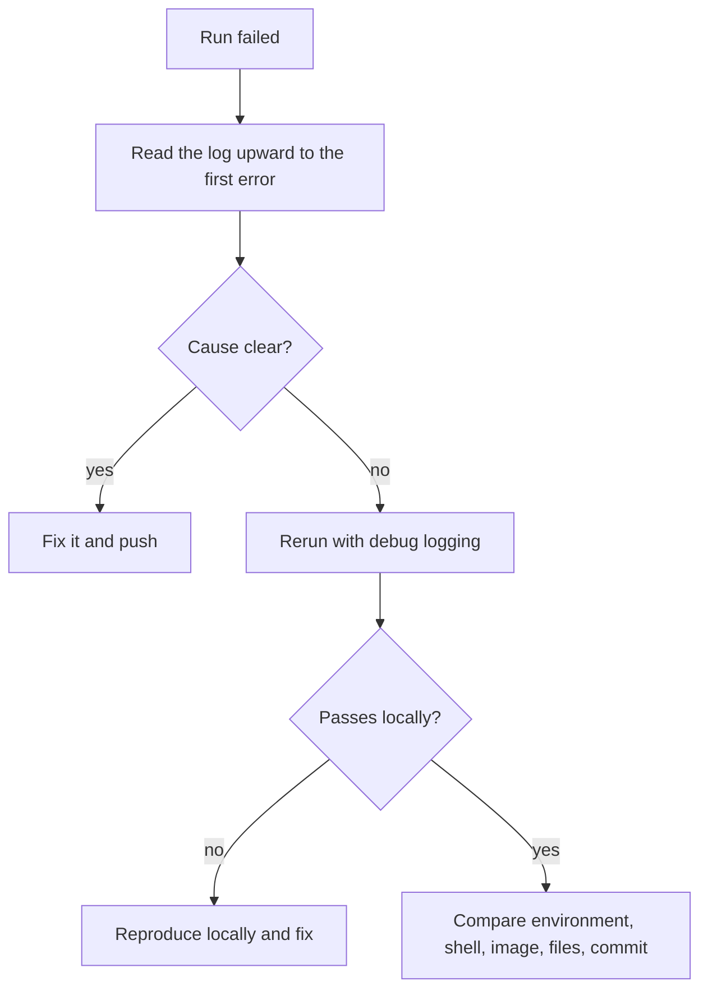

# Pipelines at Scale: Reuse, Path Filters, Required Checks and Debugging a Run

Stage 9 compressed for lookup, with the change rules from stage 10. [Lesson 25](../lessons/0025-reusable-workflows-and-composite-actions.md) covers sharing pipeline logic with a reusable workflow or a composite action, [lesson 26](../lessons/0026-monorepos-and-path-filters.md) path filters and the required checks they can strand, [lesson 27](../lessons/0027-debugging-a-pipeline.md) reading a log and debugging a run, and [lesson 29](../lessons/0029-changing-a-shared-workflow.md) changing a shared workflow without breaking its callers.

## Reusable workflow or composite action

|Question|Reusable workflow|Composite action|
|---|---|---|
|What is it|A workflow file triggered by `workflow_call`|An `action.yml` holding a list of steps|
|Called with|`uses` on a **job**, naming a workflow file and a ref|`uses` on a **step**, naming a repository or directory|
|Can hold jobs|Yes, several|No, steps only|
|Runs on|Its own runners, chosen by its jobs|The caller's runner, inside the caller's job|
|Log shows|Every job and step|One step in the caller's log|
|Secrets|Passed with `secrets` or inherited|The docs' comparison lists it as unable to use secrets|
|Nesting|Up to ten levels|Up to ten composite actions in one workflow|
|Reach for it when|A whole pipeline stage is shared, or the steps need a different machine|A few steps are repeated inside jobs|

- A caller cannot add steps to a job after calling a reusable workflow. Pass data out through its `outputs` and read them in a later job.
- Actions in a called workflow act as if part of the caller: `actions/checkout` checks out the **caller's** repository.
- Workflow-level `env` in the caller does not reach the called workflow. Use inputs, or `vars` set at repository, environment or organization level.
- A called workflow cannot raise the caller's `GITHUB_TOKEN` permissions, only lower them.
- Limits: up to ten levels of nesting, and up to 50 unique reusable workflows from one workflow file.

```yaml
on:
  workflow_call:
    inputs:
      python-version:
        type: string
        default: "3.12"
    secrets:
      registry-token:
        required: false
```

```yaml
jobs:
  tests:
    uses: your-user/ci-cd-shared/.github/workflows/python-test.yml@v1
    with:
      python-version: "3.12"
    secrets: inherit
```

## Referencing and changing a shared workflow

|Ref|Moves when|Notes|
|---|---|---|
|`@main`|Every merge|Callers get every change on their next run|
|`@v1`|You move the tag|Keep an immutable `v1.4.2` beside it|
|`@<full SHA>`|Never|Safest for stability and security, per the docs|

- A release tag beats a branch of the same name.
- **Re-run all jobs** reads the reference again. **Re-run failed jobs** or one job uses the same commit as the first attempt, so a fix on `main` does not reach it.
- `uses` takes no expressions, so the ref is always written out.

|Change to the shared workflow|Callers see|Version bump|
|---|---|---|
|Optional input with a default equal to today's behaviour|Nothing|Minor|
|Required input, or required secret|An error, or an empty value for a secret not marked required|Major|
|Remove or rename an input|An error from callers that still pass it|Major|
|Rename a job|Required checks with the old name stop reporting, merges block|Major, or never rename|
|Change a default (runner, language version)|New behaviour everywhere, no error|Judgment, often major|
|Ask for more token permissions|Ignored, the caller's permissions cap it|Not a change you can ship alone|

- An input with no default is `""`, `false` or `0` by type: set defaults on purpose.
- Order for a breaking change: add the new beside the old, release a minor, migrate callers, remove the old in the next major.
- Renaming a required check: add the new job, add its name to each rule while the old one stays, move callers, remove the old name, delete the old job.
- A check can be chosen as required only after it has completed successfully in the repository in the past seven days, and an open pull request needs a new commit to report a new name.

## Path filters

|Rule|Detail|
|---|---|
|Where|`paths` and `paths-ignore` on `push` and `pull_request`|
|Together|`paths` and `paths-ignore` cannot be used for the same event, use `!` inside `paths`|
|Order|A later `!` pattern excludes a path, a later positive pattern includes it again|
|A `!` pattern|Needs at least one pattern without `!`|
|With branches|`branches` and `paths` must both be satisfied|
|Tags|Path filters are not evaluated for pushes of tags|
|Diff|Three-dot for pull requests, two-dot for pushes|
|Always runs|A push of over 1,000 commits, or a diff that times out|

```yaml
on:
  pull_request:
    paths:
      - 'services/api/**'
      - '!services/api/docs/**'
```

- A filter cannot know that `libs/auth` changes `api`. List the dependency, or compute affected projects from a dependency graph.

## Required checks

|Cause|What the required check does|
|---|---|
|Whole workflow skipped by a path, branch or commit-message filter|Stays pending, merging is blocked ("Waiting for status to be reported")|
|Job skipped by an `if`|Reports success|
|Job `needs` a failed job|Skipped, and a skipped job reports success|

- A required check is matched by **name**. Keep job names unique across workflows, since a repeated name gives ambiguous results.
- A check must pass on the **latest commit**, and its status must be success, skipped or neutral.
- A check and a commit status with the same name must both pass.
- Only runs from `push`, `pull_request`, `pull_request_review`, `pull_request_target`, `deployment` and `deployment_status` produce checks that count. A merge queue needs the `merge_group` event.
- Fix for filtered workflows: always start the workflow, filter in the jobs, and require one gate job.

```yaml
ci-ok:
  needs: [changes, test]
  if: ${{ always() }}
  runs-on: ubuntu-latest
  steps:
    - if: ${{ contains(needs.*.result, 'failure') || contains(needs.*.result, 'cancelled') }}
      run: exit 1
```

- Without `always()` the gate is skipped when `test` fails, and a skipped gate reports success.
- A `needs.<job>.result` is `success`, `failure`, `cancelled` or `skipped`.

## Debugging a run



|Want|Do|
|---|---|
|One run's detail|Re-run with **Enable debug logging**, or `gh run rerun RUN_ID --failed --debug`|
|Step-level debug lines|`ACTIONS_STEP_DEBUG` set to `true`, as a secret or variable|
|Runner process and worker logs|`ACTIONS_RUNNER_DEBUG` set to `true`, files in `runner-diagnostic-logs` in the log archive|
|Only failed steps from a terminal|`gh run view --job JOB_ID --log-failed`|
|Image and tools on the runner|**Set up job**, then **Runner Image**, then **Included Software**|
|Debug-only steps|The `runner.debug` context, and `RUNNER_DEBUG=1` in the environment|

- If both a secret and a variable set a debug switch, the secret wins.
- Anyone who can run the workflow can enable debug logging for a re-run, and search only covers expanded steps.
- A partial re-run's log archive holds only the re-run jobs.

|Passes locally, fails on the runner|Check|
|---|---|
|Variables in your shell|`env -i PATH="$PATH" python -m pytest`, and remember `CI` is always `true` on the runner|
|Shell flags|A step with no `shell:` runs `bash -e {0}`, and only `shell: bash` adds `-o pipefail`|
|Tool versions|`ubuntu-latest` is a moving label, compare the Runner Image list|
|Files|A clean checkout has no untracked files or local caches|
|Which commit|A pull request run tests the merge commit|
|Secrets|A fork pull request gets none|

- [actionlint](https://github.com/rhysd/actionlint) catches expression and script errors before you push. [act](https://github.com/nektos/act) runs a workflow in containers, which are not the hosted runner.

## Sources

- [Docs: "Reusing workflow configurations", GitHub](https://docs.github.com/en/actions/concepts/workflows-and-actions/reusing-workflow-configurations)
- [Docs: "Reuse workflows", GitHub](https://docs.github.com/en/actions/how-tos/reuse-automations/reuse-workflows)
- [Docs: "Reusable workflows reference", GitHub](https://docs.github.com/en/actions/reference/workflows-and-actions/reusable-workflows)
- [Docs: "Creating a composite action", GitHub](https://docs.github.com/en/actions/tutorials/create-actions/create-a-composite-action)
- [Docs: "Triggering a workflow", GitHub](https://docs.github.com/en/actions/how-tos/write-workflows/choose-when-workflows-run/trigger-a-workflow)
- [Docs: "Workflow syntax for GitHub Actions", GitHub](https://docs.github.com/en/actions/reference/workflows-and-actions/workflow-syntax)
- [Docs: "Troubleshooting required status checks", GitHub](https://docs.github.com/en/pull-requests/how-tos/merge-and-close-pull-requests/troubleshooting-required-status-checks)
- [Docs: "About protected branches", GitHub](https://docs.github.com/en/repositories/configuring-branches-and-merges-in-your-repository/managing-protected-branches/about-protected-branches)
- [Docs: "About status checks", GitHub](https://docs.github.com/en/pull-requests/collaborating-with-pull-requests/collaborating-on-repositories-with-code-quality-features/about-status-checks)
- [Docs: "Enabling debug logging", GitHub](https://docs.github.com/en/actions/how-tos/monitor-workflows/enable-debug-logging)
- [Docs: "Using workflow run logs", GitHub](https://docs.github.com/en/actions/how-tos/monitor-workflows/use-workflow-run-logs)
- [Docs: "Re-running workflows and jobs", GitHub](https://docs.github.com/en/actions/how-tos/manage-workflow-runs/re-run-workflows-and-jobs)
- [Specification: "Semantic Versioning 2.0.0"](https://semver.org/)
- [Repository: actionlint](https://github.com/rhysd/actionlint)
- [Repository: act](https://github.com/nektos/act)
