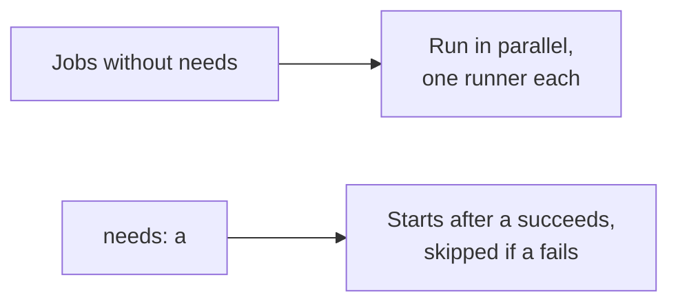

# Workflow Syntax: Triggers, Jobs, Steps, Expressions, Contexts and Outputs

Stages 1 and 2 compressed for lookup. [Lesson 1](../lessons/0001-what-ci-and-cd-promise.md) covers what CI and CD promise, [lesson 2](../lessons/0002-pipelines-as-code.md) pipelines as code, [lesson 3](../lessons/0003-triggers-and-events.md) triggers and events, [lesson 4](../lessons/0004-jobs-steps-and-runners.md) jobs, steps and runners, and [lesson 5](../lessons/0005-actions-expressions-and-outputs.md) actions, expressions and outputs.

## The three promises

|Practice|Promise|A person decides|
|---|---|---|
|Continuous integration|Every change merged to one mainline and proven by an automated build and test run, a broken build fixed at once|Nothing|
|Continuous delivery|Main is releasable at all times, deployable at the push of a button|When to push|
|Continuous deployment|Every passing change goes to production automatically|Nothing after the merge|

## File shape

```yaml
name: ci
on:
  push:
    branches: [main]
  pull_request:
jobs:
  test:
    runs-on: ubuntu-latest
    steps:
      - uses: actions/checkout@v7
      - run: pytest
```

- Files live in `.github/workflows/` and end in `.yml` or `.yaml`.
- A push runs the workflow files in the pushed commit, merged or not.
- The job ID (`test`) is also the check name a pull request shows.

## Events and the commit they run against

|Event|Fires when|`GITHUB_SHA`|`GITHUB_REF`|
|---|---|---|---|
|`push`|A commit or tag is pushed|Tip commit pushed|The updated ref|
|`pull_request`|Opened, synchronize, reopened by default|Last merge commit of the merge branch|`refs/pull/<n>/merge`|
|`schedule`|A cron time arrives|Last commit on the default branch|Default branch|
|`workflow_dispatch`|Manual or API|Last commit on the chosen ref|The chosen branch or tag|

- Branch tip of a pull request: `github.event.pull_request.head.sha`.
- No `pull_request` run while the pull request has a merge conflict.
- Several listed events each start their own run when they happen together.
- Events caused by `GITHUB_TOKEN` start no run, except `workflow_dispatch` and `repository_dispatch`.

## Filters

|Filter|Matches|Rule|
|---|---|---|
|`branches`, `branches-ignore`|Branch names, or the base branch for `pull_request`|Not both on one event|
|`tags`, `tags-ignore`|Tag names|Not both on one event|
|`paths`, `paths-ignore`|Changed files|Not evaluated for tag pushes|
|`types`|Activity types|Replaces the default list|

|Pattern|Matches|
|---|---|
|`*`|Zero or more characters, not `/`|
|`**`|Zero or more of any character, including `/`|
|`!pattern`|Excludes. Order matters, a later positive pattern includes again|

- Branch and path filters combine with AND.
- Only `branches` defined: tag pushes do not run. Neither defined: both run.
- A `!` pattern needs at least one positive pattern in the same list.
- Path diff: two-dot for pushes, three-dot for pull requests. A push of more than 1,000 commits always runs.
- A workflow skipped by a filter leaves its checks Pending, and a required check then blocks the merge.

## Schedule and manual runs

|Key|Facts|
|---|---|
|`schedule`|POSIX cron, five fields, UTC unless `timezone` is set, at most once every 5 minutes|
|Where|Only the default branch, and only if the file is on it|
|Public repository|Disabled after 60 days without activity|
|Timing|Can be delayed at busy moments, such as the start of the hour|
|`workflow_dispatch`|Button needs the file on the default branch. Inputs of type `string`, `boolean`, `choice`, `number` or `environment`, read from `inputs`|

## Jobs

|Key|Does|
|---|---|
|`jobs.<id>`|ID starts with a letter or `_`, then letters, digits, `-`, `_`|
|`name`|Display name only|
|`runs-on`|Runner label, or a list such as `[self-hosted, linux]`|
|`needs`|A job ID or list. A failed or skipped dependency skips the job, along the chain|
|`if`|Run the job only when true. `always()` lets it run after a failed dependency|
|`outputs`|Map of values for jobs that `need` this one, up to 1 MB per job and 50 MB per run|
|`timeout-minutes`|Default 360|
|`defaults.run`|Default `shell` and `working-directory` for `run` steps|
|`env`|Environment variables for every step|



- The run's wall-clock time is its longest chain of dependent jobs.
- Jobs share nothing but outputs, artifacts and caches.

## Steps

|Key|Does|
|---|---|
|`uses`|Runs an action: `owner/repo@ref`, `./path`, `docker://image:tag`|
|`with`|Inputs for the action|
|`run`|A shell command. Each `run` is a new process and shell, lines of one `run` share a shell|
|`id`|Name for `steps.<id>` to read|
|`if`|Run the step only when true. Default check is `success()`|
|`env`|Environment variables for this step|
|`shell`|See the table below|
|`working-directory`|Where the command runs|
|`continue-on-error`|`true` lets the job pass when this step fails|
|`timeout-minutes`|Maximum minutes for the step, at most 360|

|`shell`|Linux command|Pipe failure|
|---|---|---|
|Unset|`bash -e {0}`|Ignored|
|`bash`|`bash --noprofile --norc -eo pipefail {0}`|Fails the step|

## Runners

|Label|Runner|
|---|---|
|`ubuntu-latest`, `ubuntu-24.04`|Hosted Ubuntu, a fresh instance per job|
|`windows-latest`|Hosted Windows|
|`macos-latest`|Hosted, Apple hardware|
|`self-hosted` plus labels|A machine you run, not guaranteed clean between jobs|

- Standard hosted runners are free and unlimited for public repositories.
- A `-latest` label is the latest stable image GitHub provides, which moves over time.
- Self-hosted runners should almost never serve public repositories.

## Contexts

|Context|Holds|
|---|---|
|`github`|Event and run: `sha`, `ref`, `ref_name`, `event_name`, `event`, `workspace`|
|`env`, `vars`, `secrets`|Environment variables, configuration variables, secrets|
|`steps`|`outputs`, `outcome`, `conclusion` of earlier steps with an `id`|
|`needs`|`outputs` and `result` of directly needed jobs|
|`runner`|`os` and other runner facts|
|`matrix`, `inputs`|Matrix values, inputs of manual or reusable workflows|

- A missing property is an empty string, not an error.
- `needs` holds direct dependencies only.
- Runner variables such as `GITHUB_SHA` and `CI` exist only inside a running job. Contexts also work before a job reaches a runner.
- `outcome` is before `continue-on-error`, `conclusion` is after.

## Expressions

|Part|Available|
|---|---|
|Literals|`true`, `false`, `null`, numbers, strings in single quotes|
|Functions|`contains`, `startsWith`, `endsWith`, `format`, `join`, `toJSON`, `fromJSON`, `hashFiles`|
|Status|`success()`, `failure()`, `cancelled()`, `always()`|

- String comparison ignores case. Mixed types are coerced to numbers, `NaN` makes every relational comparison false.
- A step output is a string. Use `fromJSON()` to compare it as a number.
- In `if`, `${{ }}` is optional, but an expression starting with `!` must be wrapped or quoted.
- Prefer `if: ${{ !cancelled() }}` to `always()` for steps that must run after a failure.
- Secrets cannot be read directly in `if`. Copy them to an `env` value first.

## Passing values on

|Need|Use|Reaches|
|---|---|---|
|Later steps of this job|`echo "k=v" >> "$GITHUB_OUTPUT"` and `steps.<id>.outputs.k`, or `echo "K=v" >> "$GITHUB_ENV"`|This job|
|Another job|Job `outputs` and `needs.<job>.outputs.k`|Jobs that `need` it|
|A file|An artifact (lesson 11)|Any later job|

- `GITHUB_ENV` changes reach later steps, not the step that wrote them.
- Read values in a script through `env`, not by pasting `${{ }}` into the script.

## Equivalents in Jenkins and GitLab CI

|Idea|GitHub Actions|Jenkins (Declarative)|GitLab CI|
|---|---|---|---|
|File|`.github/workflows/*.yml`|`Jenkinsfile`|`.gitlab-ci.yml`|
|Where work runs|`runs-on`, fresh runner|`agent`, workspace may persist|Runner, Docker image from `image`|
|Order|Jobs parallel, `needs` orders|`stages` in sequence, `parallel` block|`stages` in sequence, jobs in a stage parallel, `needs` for a graph|
|Commands|`run` step|`sh` step inside `steps`|`script`|
|Start on a schedule|`schedule` event|`triggers { cron(...) }`|Pipeline schedules|
|Run conditionally|`if`|`when` in a stage|`rules`|

- Jenkins `agent` is what this track calls a runner.
- GitLab "stage" groups jobs, a GitHub job is closest to a GitLab job.

## Sources

- [Docs: "Understanding GitHub Actions", GitHub](https://docs.github.com/en/actions/get-started/understand-github-actions)
- [Docs: "Workflow syntax for GitHub Actions", GitHub](https://docs.github.com/en/actions/reference/workflows-and-actions/workflow-syntax)
- [Docs: "Events that trigger workflows", GitHub](https://docs.github.com/en/actions/reference/workflows-and-actions/events-that-trigger-workflows)
- [Docs: "Triggering a workflow", GitHub](https://docs.github.com/en/actions/how-tos/write-workflows/choose-when-workflows-run/trigger-a-workflow)
- [Docs: "Using jobs in a workflow", GitHub](https://docs.github.com/en/actions/how-tos/write-workflows/choose-what-workflows-do/use-jobs)
- [Docs: "Contexts reference", GitHub](https://docs.github.com/en/actions/reference/workflows-and-actions/contexts)
- [Docs: "Evaluate expressions in workflows and actions", GitHub](https://docs.github.com/en/actions/reference/workflows-and-actions/expressions)
- [Docs: "Passing information between jobs", GitHub](https://docs.github.com/en/actions/how-tos/write-workflows/choose-what-workflows-do/pass-job-outputs)
- [Article: "Continuous Integration", Martin Fowler](https://martinfowler.com/articles/continuousIntegration.html)
- [Docs: "Pipeline", Jenkins User Documentation](https://www.jenkins.io/doc/book/pipeline/)
- [Docs: "Pipeline Syntax", Jenkins User Documentation](https://www.jenkins.io/doc/book/pipeline/syntax/)
- [Docs: "CI/CD YAML syntax reference", GitLab](https://docs.gitlab.com/ci/yaml/)
