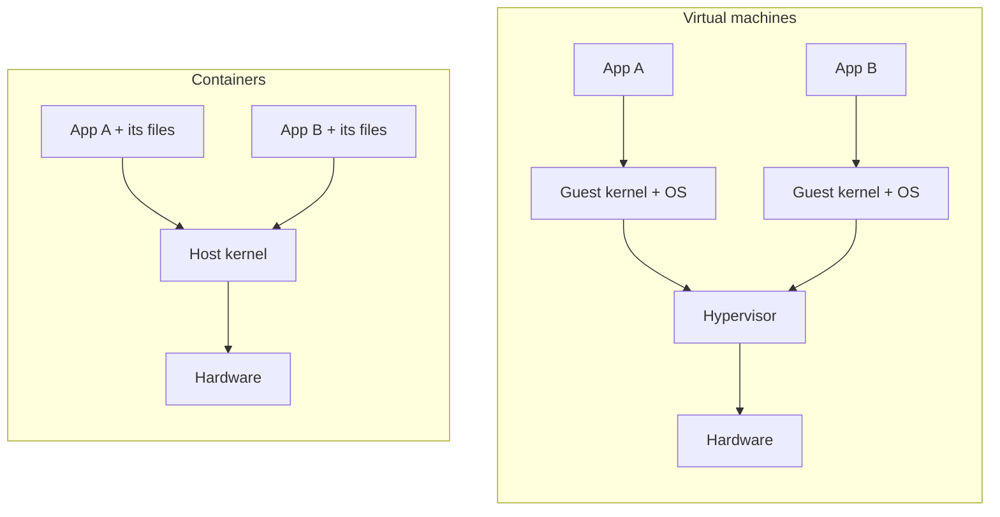

# Lesson 1. A Container Is a Process

**Mission link:** Everything later in this track, from signals to limits to debugging, follows from one fact: a container is a process on the host. Hold that model and the rest is detail.
**Primary source:** [Article: "What even is a container: namespaces and cgroups", Julia Evans, 2016](https://jvns.ca/blog/2016/10/10/what-even-is-a-container/)
**Prerequisites:** [Container](../GLOSSARY.md), [Namespace](../GLOSSARY.md), [Cgroup](../GLOSSARY.md)

## Know this

### A process with a restricted view

Start a container and look for it from the host:

```console
docker run -d --name web nginx:1.27
PID=$(docker inspect -f '{{.State.Pid}}' web)
ps -o pid,ppid,args -p "$PID"
```

```text
    PID    PPID COMMAND
  48213   48190 nginx: master process nginx -g daemon off;
```

The nginx master is a row in the host's process table with an ordinary PID. Nothing boots and no second operating system exists. A **container** is a process, or a tree of processes, that the kernel runs with three things set up around it:

- **Namespaces** change what the process can see: its own process IDs, hostname, network stack, mount table and more. [Lesson 2](0002-namespaces.md).
- **Cgroups** change what the process can use: a ceiling on memory, CPU and the number of processes. [Lesson 3](0003-cgroups.md).
- **A root filesystem** assembled from an image's layers replaces the files it sees at `/`. [Lesson 4](0004-images-and-layers.md).

The man page for `namespaces(7)` states the namespace idea in one line: a namespace wraps a global system resource so that processes inside see their own isolated instance of it, and changes to that resource are visible only to processes in the namespace ([namespaces(7)](https://man7.org/linux/man-pages/man7/namespaces.7.html)). The kernel has no object called "container". The word names the combination.

### One kernel, shared

Because the container is a host process, it makes system calls to the host's kernel. Run `uname -r` on a Linux host and again inside a container, and the two agree:

```console
uname -r
docker run --rm alpine uname -r
```

Both print the same release string. An image carries files, such as a shell, libraries and your application. It does not carry a kernel. "Ubuntu in a container" means Ubuntu's userland files running on whatever kernel the host has.

On a Mac, Docker Desktop runs containers inside a Linux virtual machine it manages, so the second command prints that virtual machine's kernel and the first prints something else. The model is unchanged: the containers still share one kernel, the virtual machine's.

### Containers against virtual machines

A virtual machine (VM) is a guest operating system with its own kernel, running on virtual hardware that a hypervisor provides. A container has no guest kernel and no virtual hardware.



| | Virtual machine | Container |
|---|---|---|
| Kernel | One per guest | The host's, shared |
| Isolation boundary | The hypervisor and virtual hardware | Kernel features: namespaces, cgroups, and others later in this track |
| Different kernel or OS family | Yes | No: a Linux container needs a Linux kernel |
| What a bug in the kernel exposes | Mostly one guest | Every container on the host |

The last row is a consequence of sharing, not a measurement: every container's system calls land in the same kernel, so a kernel flaw reachable from inside one container is reachable from all of them. That is why [stage 6](../README.md#the-arc) treats isolation as something to tighten, not something to assume.

### What the kernel records about it

The container's process shows the same facts as any other, plus its namespaces and cgroup:

```console
cat /proc/$PID/cgroup
ls -l /proc/$PID/ns
```

The first prints one line starting `0::` on a cgroup v2 host, a path whose name contains the container's ID. The second lists links such as `pid -> pid:[4026532410]`, each naming a namespace the process belongs to. Compare with `ls -l /proc/1/ns`: the numbers in brackets differ for every namespace the container has its own copy of ([namespaces(7)](https://man7.org/linux/man-pages/man7/namespaces.7.html), section on `/proc/pid/ns`).

Inside, the same process has a different view of itself:

```console
docker run --rm alpine ps
```

```text
PID   USER     TIME  COMMAND
    1 root      0:00 ps
```

It is PID 1 inside and a large PID from the host. Both are true at once, because a PID namespace gives the process a second set of numbers.

## Practice

1. ▢ After `docker run -d nginx`, which statement about the nginx master process is true?

    - a) The image supplies a kernel that boots inside it
    - b) The nginx master is an ordinary process on the host
    - c) A hypervisor gives it virtual hardware to run on
    - d) The daemon emulates every system call for the process

<details markdown="1"><summary>Check</summary>

b. A container is a process the host kernel runs, so the host's `ps` lists it. (a) is wrong because an image holds files, not a kernel. (c) describes a virtual machine, and there is no hypervisor in the path. (d) is wrong because the process makes its system calls directly to the host kernel; the daemon sets the process up and is not in the system call path.

</details>

2. ▢ Predict, then run on a Linux host. You start `docker run --rm -d alpine sleep 300`. Will `pgrep -a sleep` on the host list it, and what is its PID compared with the PID `docker exec` shows for it from inside?

<details markdown="1"><summary>Hint</summary>

Ask which kernel's process table `pgrep` reads, and how many PID namespaces the container has.

</details>

<details markdown="1"><summary>Check</summary>

Yes, it is listed, as something like `48377 sleep 300`, with a large PID. Inside the container the same process is PID 1, because it is the first process in the container's PID namespace. One process, two numbers. The host sees every container process in its own table, which is also why `kill <host PID>` from the host reaches it.

</details>

3. ▢ A teammate says: "Our image is built `FROM ubuntu:22.04`, so it can only run on Ubuntu hosts." What is wrong with that, and what does constrain where the image can run?

<details markdown="1"><summary>Check</summary>

The base image supplies Ubuntu's userland files: libraries, a shell, package metadata. The kernel is the host's, and any Linux kernel new enough for the programs inside can run them. What constrains the host is the kernel and the CPU architecture. An image built for linux/amd64 does not run on an arm64 host without emulation, and a Linux image needs a Linux kernel, which on a Mac is why Docker Desktop runs a Linux virtual machine.

</details>

4. ▢ Name the three ingredients that make a process a container and say, for each, whether it changes what the process sees or what it can use.

<details markdown="1"><summary>Check</summary>

Namespaces change what it sees: process IDs, hostname, network, mounts. Cgroups change what it can use: memory, CPU, process count. The root filesystem from the image layers changes which files it sees at `/`, so it also changes what it sees. A common slip is to say cgroups isolate. They limit and account for resources and hide nothing.

</details>

5. ▢ Two services run in separate containers on one Linux host. Service A triggers a bug in the kernel's network stack. Explain why service B may be affected, and why it would not be if A and B were in two virtual machines.

<details markdown="1"><summary>Check</summary>

Both containers make system calls to the one host kernel, so a flaw in its network code is shared state for both. In two virtual machines each guest has its own kernel, and the bug lives in A's guest kernel only. The hypervisor is the shared layer then, and it has a much smaller interface than the whole system call surface. The cost of the virtual machine is the second kernel to boot, patch and keep in memory.

</details>

## Real-world reps

- [ ] On a Linux machine, run `docker run -d --name web nginx:1.27`, then find its host PID with `docker inspect -f '{{.State.Pid}}' web` and print `ps -o pid,ppid,args -p <that PID>`. Write down the PPID's command with `ps -o args -p <ppid>`. Clean up with `docker rm -f web`.
- [ ] Run `uname -r` on the host and `docker run --rm alpine uname -r`. If they differ, work out why (on a Mac the answer is Docker Desktop's virtual machine).
- [ ] Tomorrow: without notes, write one sentence saying what a container is in kernel terms and name the three things around the process.

## Going further

- [Container Primitives](../reference/container-primitives.md)
- [Article: "What even is a container: namespaces and cgroups", Julia Evans, 2016](https://jvns.ca/blog/2016/10/10/what-even-is-a-container/)
- [Man page: namespaces(7), Linux man-pages project](https://man7.org/linux/man-pages/man7/namespaces.7.html)
- [Talk: "Containers From Scratch", Liz Rice, GOTO 2018](https://www.youtube.com/watch?v=8fi7uSYlOdc)
- [Resources](../RESOURCES.md)

---

Not landing? Reread the primary source at the top, since this lesson compresses it and compression is where understanding leaks. Check the [glossary](../GLOSSARY.md) for any term that felt slippery.

If the lesson itself is unclear rather than the material, that is a defect: [open an issue](https://github.com/TokenCemetery/teach/issues).
