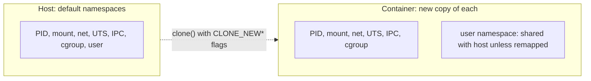

# Lesson 2. Namespaces

**Mission link:** A namespace is the first half of what a container is, so you need to say which resource each type hides, and what it leaves exposed, before you can reason about what a container can see of its host.
**Primary source:** [Man page: namespaces(7), Linux man-pages project](https://man7.org/linux/man-pages/man7/namespaces.7.html)
**Prerequisites:** [Lesson 1](0001-a-container-is-a-process.md), [Container](../GLOSSARY.md), [Namespace](../GLOSSARY.md), [PID 1](../GLOSSARY.md)

## Warm-up

1. ▢ Is the nginx master of a running container visible in the host's `ps`, and does it have the same PID on both sides?

<details markdown="1"><summary>Check</summary>

It is visible in the host's process table with an ordinary PID, because a container is a host process. Inside the container it is PID 1. The two numbers differ because the container has its own set of process IDs, which is what this lesson explains.

</details>

2. ▢ What does a container share with the host that a virtual machine does not share with its host?

<details markdown="1"><summary>Check</summary>

The kernel. A container makes system calls to the host kernel, and a virtual machine runs its own guest kernel on virtual hardware.

</details>

## Know this

### What a namespace is

A **namespace** gives a set of processes their own instance of one kind of global resource. Processes inside see the instance, and changes they make to it are invisible outside. Linux has eight types ([namespaces(7)](https://man7.org/linux/man-pages/man7/namespaces.7.html)):

| Type | `unshare` flag | Isolates | What a container gets from it |
|---|---|---|---|
| Mount | `--mount` | The mount table | Its own root filesystem and mounts |
| PID | `--pid` | Process IDs | Its own PID 1, and no view of host processes |
| Network | `--net` | Network devices, stacks, ports | Its own interfaces, routes and port space |
| UTS | `--uts` | Hostname and NIS domain name | Its own hostname |
| IPC | `--ipc` | System V IPC and POSIX message queues | Its own shared memory and queues |
| User | `--user` | User and group IDs | Root inside that is not root outside, when enabled |
| Cgroup | `--cgroup` | The cgroup root directory | A view of its own cgroup as the root |
| Time | `--time` | Boot and monotonic clocks | Its own offsets for those two clocks |

A namespace hides one thing and only that. A process in a new PID namespace still shares the host's network, files and users until it also gets those namespaces. A container is a process placed in several of them at once.

The kernel interface is three system calls: `clone(2)` creates a process in new namespaces, `unshare(2)` moves the calling process into new ones, and `setns(2)` joins an existing namespace. Every process has a directory `/proc/<pid>/ns/` with one link per namespace, and two processes share a namespace when the numbers in the links match. A namespace lives while a process is in it, or while a file descriptor or a bind mount refers to it ([namespaces(7)](https://man7.org/linux/man-pages/man7/namespaces.7.html), section on `/proc/pid/ns/`).

### Building a view with `unshare`

`unshare` runs a program in new namespaces ([unshare(1)](https://man7.org/linux/man-pages/man1/unshare.1.html)). These need root and a Linux shell. Each shows one namespace on its own.

UTS, the hostname:

```console
sudo unshare --uts sh -c 'hostname sandbox; hostname'
hostname
```

The first command prints `sandbox`. The second prints the host's real name: the change stayed inside the namespace.

Network, the whole stack:

```console
sudo unshare --net ip link
```

```text
1: lo: <LOOPBACK> mtu 65536 qdisc noop state DOWN mode DEFAULT group default qlen 1000
    link/loopback 00:00:00:00:00:00 brd 00:00:00:00:00:00
```

A new network namespace has only a loopback device, down. The host's interfaces are not there. [Lesson 14](0014-container-networking.md) connects one to the outside with a veth pair.

PID, which needs two extra options:

```console
sudo unshare --pid --fork --mount-proc sh -c 'echo $$; ps -e; true'
```

`--fork` makes `unshare` run the program as a child. The `unshare` process itself stays in the old PID namespace, and only its children land in the new one, so the program must be a child to become PID 1 ([unshare(1)](https://man7.org/linux/man-pages/man1/unshare.1.html): `--fork` "is useful when creating a new PID namespace"). `--mount-proc` mounts a fresh `/proc` and implies a new mount namespace. Both are needed because `ps` reads `/proc`, not the kernel's PID namespace directly. Without the new `/proc`, `ps` would list the host's processes even though the PID namespace is new. The shell prints `1`, and `ps -e` lists only the shell and `ps`. The trailing `true` is there because many shells replace themselves with the last command of `sh -c`, which would make `ps` itself PID 1.

Mount, the mount table:

```console
sudo unshare --mount sh -c 'mount -t tmpfs none /mnt && touch /mnt/inside && ls /mnt'
ls /mnt
```

The first prints `inside`. The second shows whatever was in `/mnt` before. `unshare` sets mount propagation to private by default, so the mount does not leak back to the host ([unshare(1)](https://man7.org/linux/man-pages/man1/unshare.1.html), `--propagation`).

User, the IDs, without root:

```console
unshare --user --map-root-user sh -c 'id -u; cat /proc/self/uid_map'
```

```text
0
         0       1000          1
```

Inside, you are UID 0. The map says UID 0 inside is UID 1000 outside (your own UID), for a range of 1. The kernel treats the process as root for operations on things the namespace owns, and as you for everything else. [user_namespaces(7)](https://man7.org/linux/man-pages/man7/user_namespaces.7.html) covers the mapping in full. This is how rootless mode starts a container with no host privileges. A system may restrict who can create user namespaces; if the command is refused, the other examples with `sudo` still work.

### A container's namespaces, side by side

Compare a container's links with the host's:

```console
docker run -d --name web nginx:1.27
PID=$(docker inspect -f '{{.State.Pid}}' web)
sudo readlink /proc/$PID/ns/pid /proc/1/ns/pid
```

```text
pid:[4026532410]
pid:[4026531836]
```

Different numbers mean different namespaces. A container usually has its own mount, PID, network, UTS, IPC and cgroup namespaces. Docker does not use a user namespace for a container unless `userns-remap` or rootless mode is turned on ([Docker: userns-remap](https://docs.docker.com/engine/security/userns-remap/)), so by default root in the container is UID 0 in the host's user namespace too, which matters in [stage 6](../README.md#the-arc). Also keep in mind what has no namespace at all: the kernel itself, and the wall-clock time, since the time namespace offsets only the boot and monotonic clocks.



## Practice

1. ▢ Which namespace gives a container its own hostname?

    - a) UTS
    - b) IPC
    - c) PID
    - d) Cgroup

<details markdown="1"><summary>Check</summary>

a. UTS isolates the hostname and the NIS domain name. IPC isolates System V IPC and message queues, PID isolates process IDs, and the cgroup namespace changes which cgroup appears as the root of the tree.

</details>

2. ▢ Predict, then run (needs root on Linux). What does each command print, and how do the two `ps` listings differ?

    ```console
    sudo unshare --pid --fork --mount-proc sh -c 'echo $$; ps -e; true'
    sudo unshare --pid --fork sh -c 'echo $$; ps -e | wc -l'
    ```

<details markdown="1"><summary>Hint</summary>

Both shells are PID 1 in a new PID namespace. Ask which `/proc` each `ps` reads.

</details>

<details markdown="1"><summary>Check</summary>

Both print `1` first: the shell is the first process in the new PID namespace, and `$$` is its PID there, not its host PID. The first `ps -e` lists two rows, the shell as PID 1 and `ps` as PID 2, because `--mount-proc` mounted a `/proc` that belongs to the new namespace. The second counts as many lines as the host has processes, a number in the hundreds on most machines, because without `--mount-proc` the old `/proc` is still mounted and `ps` reads it. A PID namespace and a `/proc` mount are separate things, and a container needs both to hide the host's processes.

</details>

3. ▢ Explain why `unshare --pid sh` without `--fork` does not make `sh` PID 1.

<details markdown="1"><summary>Check</summary>

`unshare` calls `unshare(2)`, which creates the new PID namespace for the process's future children, not for the process itself. A process cannot change its own PID. Without `--fork` the shell is exec'd in the same process and keeps its old PID. With `--fork`, `unshare` forks first, and the child is the first process in the new namespace, so it is PID 1.

</details>

4. ▢ You run `sudo unshare --net bash` and from inside it `curl https://example.com` fails to resolve the name. Is the network broken on the host? What does the new namespace contain, and what would you have to add?

<details markdown="1"><summary>Check</summary>

The host is fine. A new network namespace starts with only a loopback device, and it is down. There is no interface, no route and no DNS configuration pointing anywhere. To reach the outside you would create a veth pair, move one end into the namespace, give both ends addresses, bring them up, and add a default route plus NAT on the host. A container runtime does exactly this for every container, which is [lesson 14](0014-container-networking.md).

</details>

5. ▢ A container is started with its own mount, PID, network, UTS, IPC and cgroup namespaces, and no user namespace of its own. A process inside runs as UID 0 and calls `chown` on a file in a bind-mounted host directory. Which UID does the host see as the file's owner, and what does this say about the user namespace?

<details markdown="1"><summary>Check</summary>

UID 0. Without a separate user namespace, UID 0 inside is UID 0 outside, so the host sees files owned by real root. A user namespace would map container UID 0 to an unprivileged host UID, as the `uid_map` example above does. This is the reason root in a default container is more dangerous than it looks, and the reason rootless mode and `userns-remap` exist.

</details>

6. ▢ A coworker says, "Containers are isolated, so nothing in one can see the host's clock or kernel version." Using what you know of namespaces, say what is right and wrong with that.

<details markdown="1"><summary>Check</summary>

Partly wrong on both counts. Isolation exists only for the resources that have a namespace and have been enabled for the container. A container reports the host's kernel version through `uname -r` because there is one kernel. Wall-clock time is not namespaced at all, since the time namespace offsets only the boot and monotonic clocks. A container is hidden from other processes' PIDs, files, networks and hostnames, which is real isolation, and it is not a sandbox against the kernel.

</details>

## Real-world reps

- [ ] On a Linux machine with root, run each `unshare` example in this lesson once, and for each one write down which host fact stayed unchanged afterwards.
- [ ] Start two containers (`docker run -d --name a nginx:1.27` and `docker run -d --name b nginx:1.27`) and compare `sudo readlink /proc/<pid>/ns/net` for both and for PID 1. Write down which numbers match and which do not. Clean up with `docker rm -f a b`.
- [ ] Tomorrow: without notes, list the eight namespace types and, for each of mount, PID, network and UTS, say what a container sees inside it.

## Going further

- [Container Primitives](../reference/container-primitives.md)
- [Man page: namespaces(7), Linux man-pages project](https://man7.org/linux/man-pages/man7/namespaces.7.html)
- [Man page: unshare(1), Linux man-pages project](https://man7.org/linux/man-pages/man1/unshare.1.html)
- [Man page: user_namespaces(7), Linux man-pages project](https://man7.org/linux/man-pages/man7/user_namespaces.7.html)
- [Article: "Namespaces in operation, part 1", Michael Kerrisk, LWN.net, 2013](https://lwn.net/Articles/531114/)
- [Resources](../RESOURCES.md)

---

Not landing? Reread the primary source at the top, since this lesson compresses it and compression is where understanding leaks. Check the [glossary](../GLOSSARY.md) for any term that felt slippery.

If the lesson itself is unclear rather than the material, that is a defect: [open an issue](https://github.com/TokenCemetery/teach/issues).
