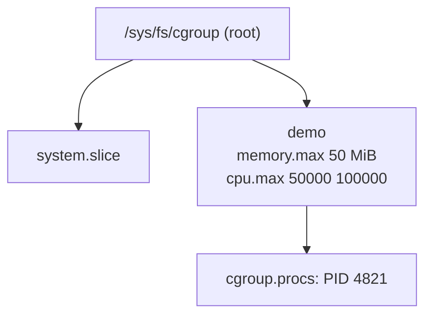

# Lesson 3. Cgroups

**Mission link:** Namespaces decide what a container sees. Cgroups decide what it can use, and every later limit, OOM kill and throttled request in this track is the kernel enforcing a number you can read from a file.
**Primary source:** [Docs: "Control Group v2", Linux kernel documentation](https://docs.kernel.org/admin-guide/cgroup-v2.html)
**Prerequisites:** [Lesson 1](0001-a-container-is-a-process.md), [Lesson 2](0002-namespaces.md), [Cgroup](../GLOSSARY.md), [OOM kill](../GLOSSARY.md), [Throttling](../GLOSSARY.md)

## Warm-up

1. ▢ Which two kernel mechanisms, besides the image's filesystem, make a process a container, and which one changes what the process sees?

<details markdown="1"><summary>Check</summary>

Namespaces and cgroups. Namespaces change what the process sees. Cgroups change what it can use.

</details>

2. ▢ Why does `unshare --pid --fork --mount-proc ps -e` list only a couple of processes, while the same command without `--mount-proc` lists the host's?

<details markdown="1"><summary>Check</summary>

`ps` reads `/proc`. `--mount-proc` mounts a `/proc` belonging to the new PID namespace, which shows only that namespace's processes. Without it the host's `/proc` is still mounted, so `ps` lists the host's processes even though the PID namespace is new.

</details>

3. ▢ In a default container, which user ID on the host does the container's root have, and why?

<details markdown="1"><summary>Check</summary>

UID 0, real root. Docker does not give the container a user namespace unless `userns-remap` or rootless mode is enabled, so IDs inside and outside are the same.

</details>

## Know this

### A hierarchy of groups with files for an interface

A **cgroup** is a node in a tree of process groups. A process belongs to exactly one cgroup, and the kernel can limit and account for the resources of everything in a node and its descendants. This workspace means cgroup v2, which has one tree for all controllers. Version 1 had a separate tree per controller ([cgroups(7)](https://man7.org/linux/man-pages/man7/cgroups.7.html)). To check which a host uses:

```console
stat -fc %T /sys/fs/cgroup
```

`cgroup2fs` means v2. `tmpfs` means v1, and the paths below differ.

The interface is the filesystem mounted at `/sys/fs/cgroup`. Creating a directory creates a cgroup, and every setting is a file ([Control Group v2](https://docs.kernel.org/admin-guide/cgroup-v2.html)):

| File | Meaning |
|---|---|
| `cgroup.procs` | PIDs in the cgroup. Write a PID to move a process in. |
| `cgroup.controllers` | Controllers available here: `cpu`, `memory`, `pids`, `io` and others. |
| `cgroup.subtree_control` | Controllers enabled for the children. Write `+memory` to enable one. |
| `memory.max` | Hard memory limit in bytes. Default `max`, meaning no limit. |
| `memory.current` | Memory in use now. |
| `memory.events` | Counters: `high`, `max`, `oom`, `oom_kill`. |
| `cpu.max` | `$MAX $PERIOD` in microseconds. Default `max 100000`. |
| `cpu.stat` | CPU use, plus `nr_throttled` and `throttled_usec`. |
| `pids.max` | Hard limit on processes. Default `max`. |

A controller must be enabled in the parent's `cgroup.subtree_control` before a child cgroup has its files. There is also the **no internal process constraint**: a non-root cgroup that has processes of its own cannot enable controllers for its children, so processes live in the leaves ([Control Group v2](https://docs.kernel.org/admin-guide/cgroup-v2.html), section "No Internal Process Constraint").

### Memory: what happens at the limit

`memory.max` is "the main mechanism to limit memory usage of a cgroup". When usage reaches it and cannot be reduced, the OOM killer is invoked inside the cgroup. A cgroup killed that way is an **OOM kill**: the process receives `SIGKILL`, so a container shows exit code 137 (128 plus signal 9).

`memory.high` is different: crossing it throttles the processes and puts them under heavy reclaim pressure, and "going over the high limit never invokes the OOM killer". Docker's `--memory` sets `memory.max`, not `memory.high`.

The kernel counts what happened in `memory.events`. After a kill, `oom_kill` is at least 1.

By hand, as root on a Linux host with cgroup v2:

```console
sudo mkdir /sys/fs/cgroup/demo
echo 52428800 | sudo tee /sys/fs/cgroup/demo/memory.max
echo 0 | sudo tee /sys/fs/cgroup/demo/memory.swap.max
sudo sh -c 'echo $$ > /sys/fs/cgroup/demo/cgroup.procs && exec python3 -c "x = b\"x\" * (200 * 1024 * 1024)"'
grep oom_kill /sys/fs/cgroup/demo/memory.events
```

The limit is 50 MiB, swap is off for this cgroup so pages cannot be pushed out of the way, and the process tries to hold 200 MiB. The shell reports `Killed`, and the last line prints `oom_kill 1`. If `memory.max` does not exist in `demo`, the memory controller is not enabled in the parent: write `+memory` to `/sys/fs/cgroup/cgroup.subtree_control` first.

### CPU: a quota in each period, not a speed

`cpu.max` holds a quota and a period, both in microseconds. `50000 100000` means the group may use up to 50 ms of CPU time in every 100 ms period, across all its threads together. When the quota is spent, the kernel pauses the group until the next period begins. That is **throttling**, and it shows up as latency, not as an error. `nr_throttled` in `cpu.stat` counts the periods in which it happened.

```console
echo "50000 100000" | sudo tee /sys/fs/cgroup/demo/cpu.max
sudo sh -c 'echo $$ > /sys/fs/cgroup/demo/cgroup.procs && exec sha256sum /dev/zero' &
sleep 5; grep -E 'nr_throttled|throttled_usec' /sys/fs/cgroup/demo/cpu.stat
```

A busy process on an otherwise idle machine is allowed half of one CPU, and both counters grow. Kill it with `sudo kill %1`, and remove the cgroup with `sudo rmdir /sys/fs/cgroup/demo`, which works only when no process remains in it.

### Process count

`pids.max` caps how many processes and threads the group may hold. Hitting it makes `fork` fail in the cgroup, and `pids.events` counts the times it did. This is what stops a fork bomb inside a container from taking the host.

### How Docker maps its flags

Docker writes these files for the container's cgroup ([Docker: resource constraints](https://docs.docker.com/engine/containers/resource_constraints/)):

| Docker flag | cgroup v2 file | Value for the flag |
|---|---|---|
| `--memory 256m` | `memory.max` | `268435456` |
| `--cpus 0.5` | `cpu.max` | `50000 100000` |
| `--pids-limit 100` | `pids.max` | `100` |

The documentation defines `--cpus` as equivalent to `--cpu-period=100000` plus a `--cpu-quota` of `cpus` times 100000. You can read the result from inside a container, because with a cgroup namespace the container's own cgroup appears as the root of `/sys/fs/cgroup`:

```console
docker run --rm --memory 256m --cpus 0.5 alpine sh -c 'cat /sys/fs/cgroup/memory.max /sys/fs/cgroup/cpu.max'
```

```text
268435456
50000 100000
```

Programs inside read these same files to size themselves, which is why [lesson 13](0013-resource-limits-in-practice.md) checks that the runtime sees the limit. Limits are not isolation: a cgroup hides nothing, and a process in one still sees the host's files and processes unless namespaces hide them.



## Practice

1. ▢ A cgroup has `memory.max` set to 100 MiB and a process in it keeps allocating. What does the kernel do when usage reaches the limit and nothing can be reclaimed?

    - a) Invokes the OOM killer inside that cgroup
    - b) Pauses the process until memory frees up
    - c) Raises the limit by one scheduling period
    - d) Swaps the whole cgroup out to disk

<details markdown="1"><summary>Check</summary>

a. The kernel documentation says that at `memory.max`, when usage cannot be reduced, the OOM killer is invoked in the cgroup. (b) describes throttling under `memory.high`, which never kills. (c) mixes memory with the CPU period, and limits are never raised by the kernel on its own. (d) is wrong because swap is a separate budget with its own limit, `memory.swap.max`, and a hard limit that could be met by swapping the group out would not be a limit.

</details>

2. ▢ Predict, then run (Linux host with cgroup v2). What does this print?

    ```console
    docker run --rm --memory 256m alpine cat /sys/fs/cgroup/memory.max
    ```

<details markdown="1"><summary>Hint</summary>

256 MiB in bytes is 256 times 1024 times 1024. Docker writes the number, not the suffix.

</details>

<details markdown="1"><summary>Check</summary>

`268435456`. `--memory 256m` becomes `memory.max` in the container's cgroup, and the cgroup namespace makes that cgroup the root the container sees. On a cgroup v1 host the file is not there at all, which is why `stat -fc %T /sys/fs/cgroup` comes first.

</details>

3. ▢ A container has `--cpus 0.5` and runs four busy threads. Roughly how much CPU time does the container get in each 100 ms period, and which `cpu.stat` field proves it was held back?

<details markdown="1"><summary>Check</summary>

At most 50 ms across all four threads together, not 50 ms each: `cpu.max` is `50000 100000`, a quota for the group. The four threads spend it in about 12.5 ms of wall time on four CPUs and are paused for the rest of the period. `nr_throttled` counts those periods, and `throttled_usec` the time spent paused. The slowdown looks like latency, and no error appears in the logs.

</details>

4. ▢ A container with a 512 MiB limit exits with code 137 and nothing in its logs. Say what the exit code tells you, which kernel file confirms it, and what that counter would read.

<details markdown="1"><summary>Check</summary>

137 is 128 plus 9, so the process was killed by `SIGKILL`. An OOM kill is the most likely sender: the kernel sends `SIGKILL` and the process never gets to log anything. `memory.events` in the container's cgroup confirms it, with `oom_kill` at 1 or more. The same code also comes from `docker kill` or from `docker stop` after its grace period, so the counter is what separates an OOM kill from a stop that timed out.

</details>

5. ▢ You want a build job to slow down when it uses too much memory, and not die. Which file would you set instead of `memory.max`, and what is the risk of relying on it alone?

<details markdown="1"><summary>Check</summary>

`memory.high`. Going over it throttles the processes and puts them under heavy reclaim, and it never invokes the OOM killer. The kernel documentation adds that under extreme conditions the limit can still be breached, and that it is meant for scenarios with an external process monitoring the group. Set alone, it does not guarantee a ceiling, so a hard `memory.max` above it is the backstop.

</details>

6. ▢ `mkdir /sys/fs/cgroup/job/child` succeeds, but `child/memory.max` does not exist. Name two things to check, one about the parent's controllers and one about its processes.

<details markdown="1"><summary>Check</summary>

First, whether `memory` is listed in `job/cgroup.subtree_control`: a child gets a controller's files only when the parent enables it for its subtree, and `memory` must also be listed in the parent's own `cgroup.controllers`. Second, whether `job` has processes of its own in `job/cgroup.procs`: under the no internal process constraint a non-root cgroup with processes cannot enable controllers for children, so the processes must move into a leaf first.

</details>

## Real-world reps

- [ ] On a Linux machine with cgroup v2 and root, run the memory example and print `memory.events`. Then raise `memory.max` to 300 MiB (314572800) and run the same line again. Write down what changed.
- [ ] Start `docker run -d --name capped --memory 128m --cpus 0.25 --pids-limit 50 alpine sleep 600` and read the three limit files from the host. The container's cgroup path is in `/proc/<pid>/cgroup`, found with `docker inspect -f '{{.State.Pid}}' capped`. Clean up with `docker rm -f capped`.
- [ ] Tomorrow: without notes, write the three cgroup files that cap memory, CPU and process count, what each does at its limit, and the exit code of a container killed for memory.

## Going further

- [Container Primitives](../reference/container-primitives.md)
- [Docs: "Control Group v2", Linux kernel documentation](https://docs.kernel.org/admin-guide/cgroup-v2.html)
- [Man page: cgroups(7), Linux man-pages project](https://man7.org/linux/man-pages/man7/cgroups.7.html)
- [Docs: "Resource constraints", Docker](https://docs.docker.com/engine/containers/resource_constraints/)
- [Resources](../RESOURCES.md)

---

Not landing? Reread the primary source at the top, since this lesson compresses it and compression is where understanding leaks. Check the [glossary](../GLOSSARY.md) for any term that felt slippery.

If the lesson itself is unclear rather than the material, that is a defect: [open an issue](https://github.com/TokenCemetery/teach/issues).
