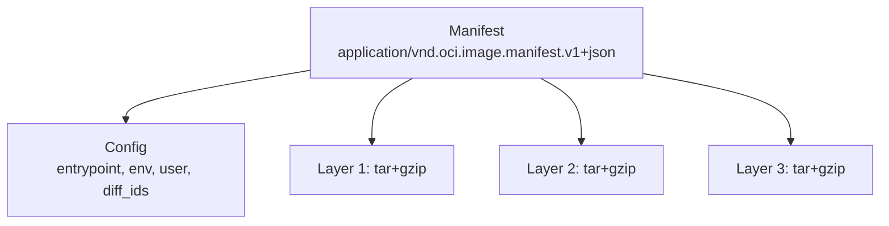

# Lesson 4. Images and Layers

**Mission link:** Every Dockerfile choice in stage 3 changes the layers in an image, so you need to read an image as the documents it is, and see why deleting a file in a later layer does not make it smaller.
**Primary source:** [Spec: OCI Image Manifest](https://github.com/opencontainers/image-spec/blob/main/manifest.md)
**Prerequisites:** [Lesson 1](0001-a-container-is-a-process.md), [Lesson 3](0003-cgroups.md), [Image](../GLOSSARY.md), [Manifest](../GLOSSARY.md), [Image config](../GLOSSARY.md), [Layer](../GLOSSARY.md), [Overlay filesystem](../GLOSSARY.md), [Digest](../GLOSSARY.md)

## Warm-up

1. ▢ Which file caps a cgroup's memory, and what exit code does a container show when the kernel kills it for crossing that cap?

<details markdown="1"><summary>Check</summary>

`memory.max`. The kernel sends `SIGKILL`, so the exit code is 137, which is 128 plus 9.

</details>

2. ▢ Which namespace lets a container have its own root filesystem, and why does the container still run on the host's kernel?

<details markdown="1"><summary>Check</summary>

The mount namespace gives it its own mount table, so `/` can be something other than the host's. The container is a host process, so its system calls go to the host kernel, and an image holds files and no kernel.

</details>

3. ▢ What is the difference between what a namespace does and what a cgroup does to a process?

<details markdown="1"><summary>Check</summary>

A namespace changes what the process sees of one global resource. A cgroup limits and accounts for what it uses, and hides nothing.

</details>

## Know this

### Three kinds of document

An **image** is a set of content-addressed files: a manifest, a config and layers. Each is identified by its **digest**, the hash of its bytes, in the form `sha256:` plus 64 hex digits. The [OCI Image Format Specification](https://github.com/opencontainers/image-spec/blob/main/spec.md) defines all of it.



The **manifest** names one image for one platform and lists the digest and size of its config and of each layer in order ([Image Manifest](https://github.com/opencontainers/image-spec/blob/main/manifest.md)). This is the example from the specification:

```json
{
  "schemaVersion": 2,
  "mediaType": "application/vnd.oci.image.manifest.v1+json",
  "config": {
    "mediaType": "application/vnd.oci.image.config.v1+json",
    "digest": "sha256:b5b2b2c507a0944348e0303114d8d93aaaa081732b86451d9bce1f432a537bc7",
    "size": 7023
  },
  "layers": [
    {
      "mediaType": "application/vnd.oci.image.layer.v1.tar+gzip",
      "digest": "sha256:9834876dcfb05cb167a5c24953eba58c4ac89b1adf57f28f2f9d09af107ee8f0",
      "size": 32654
    },
    {
      "mediaType": "application/vnd.oci.image.layer.v1.tar+gzip",
      "digest": "sha256:3c3a4604a545cdc127456d94e421cd355bca5b528f4a9c1905b15da2eb4a4c6b",
      "size": 16724
    }
  ]
}
```

Pulling an image starts by fetching its manifest, then each blob it names that is not already present. Because blobs are keyed by digest, two images that share a layer share it on disk and in the registry, and a layer is downloaded once.

The **image config** records how to run the image: `Entrypoint`, `Cmd`, `Env`, `User`, `WorkingDir`, exposed ports, and a `rootfs` object with `diff_ids`, the ordered list of the layers' uncompressed digests ([Image Configuration](https://github.com/opencontainers/image-spec/blob/main/config.md)). Two similar digests are easy to confuse. The manifest's layer digest is the hash of the stored blob, usually compressed. The `diff_id` in the config is the hash of the uncompressed tar, and the specification says explicitly not to mix them up. Docker prints the `diff_id` list:

```console
docker image inspect alpine:3.20 --format '{{json .RootFS}}'
```

The output is an object whose `Type` is `layers` and whose `Layers` is the list of `diff_id` values, first layer first.

A **layer** is a tar archive of filesystem changes: files added, changed or deleted, from one build step ([Layer Filesystem Changeset](https://github.com/opencontainers/image-spec/blob/main/layer.md)). A deletion is recorded as a whiteout, an empty file named `.wh.` plus the deleted file's name. Applying the layers in order, first to last, produces the image's root filesystem.

```console
docker history alpine:3.20
```

lists one row per step with its size and the instruction that made it. The tool [dive](https://github.com/wagoodman/dive) goes further and shows what each layer added.

### How the layers become one filesystem

The kernel merges the layers with the **overlay filesystem**. The read-only layers are the lower directories, stacked in order, and a writable directory sits on top as the upper. The merged view is what the container sees as `/` ([Overlay Filesystem](https://docs.kernel.org/filesystems/overlayfs.html)). Build the same thing by hand on a Linux host as root:

```console
mkdir -p ov/lower ov/upper ov/work ov/merged
echo from-lower > ov/lower/a.txt
echo keep > ov/lower/b.txt
sudo mount -t overlay overlay -o lowerdir=ov/lower,upperdir=ov/upper,workdir=ov/work ov/merged
echo changed > ov/merged/a.txt
rm ov/merged/b.txt
ls -l ov/upper
cat ov/lower/a.txt
```

```text
total 0
-rw-r--r-- 1 root root  8 ... a.txt
c--------- 1 root root 0, 0 ... b.txt
from-lower
```

Writing to `a.txt` copied it up into the upper directory first, which is **copy-on-write**, and the lower file is untouched. Deleting `b.txt` created a whiteout in the upper directory: a character device with device number 0/0, which hides the name in the lower one. The kernel documentation describes this encoding. Remove the mount with `sudo umount ov/merged`.

Layer tarballs encode deletions with `.wh.` files for portability, and overlayfs encodes them with that device, but the idea is the same. Docker stores layers on disk with a storage driver, `overlay2` on the classic image store, and with an overlayfs snapshotter on the containerd image store that fresh installations of Docker Engine 29.0 and later use by default ([Docker: storage drivers](https://docs.docker.com/engine/storage/drivers/)). `docker image inspect --format '{{.GraphDriver.Name}}' alpine:3.20` shows which one a host has.

### Why deleting does not shrink

A layer only adds. If `RUN rm /big` runs after `/big` was written, the earlier layer still holds all of `/big`, and the new layer holds a whiteout. The merged view has no `/big`, and the image still ships its bytes, so everyone who pulls it downloads and stores them. The fix is to never write the file into a layer that is kept: clean up in the same instruction that created the mess, or build in one stage and copy only the result into another ([lesson 9](0009-multi-stage-builds.md)). A secret written in one layer and removed in the next is still in the image, which [lesson 19](0019-secrets-signing-and-provenance.md) returns to.

## Practice

1. ▢ In an image's manifest, what does each entry under `layers` give?

    - a) The digest and size of one blob
    - b) The shell commands that built one layer
    - c) The file paths that one layer deletes
    - d) The entrypoint value that one layer defines

<details markdown="1"><summary>Check</summary>

a. A manifest is a list of descriptors: a media type, a digest and a size for the config and for each layer. The commands that built a layer are in the config's `history` (b). Deleted files are whiteout entries inside the layer tar (c). The entrypoint is in the config (d), not the manifest.

</details>

2. ▢ Predict, then run. A Dockerfile has these three lines. How does the final image's size compare with `alpine:3.20`, and what do the last two rows of `docker history` show?

    ```dockerfile
    FROM alpine:3.20
    RUN dd if=/dev/zero of=/big bs=1M count=50
    RUN rm /big
    ```

<details markdown="1"><summary>Hint</summary>

A layer records the changes of one step. What does the second `RUN` record, and what does the first one still contain?

</details>

<details markdown="1"><summary>Check</summary>

The image is about 50 MB larger than `alpine:3.20`. `docker history` shows the `dd` row at about 52 MB and the `rm` row near zero. The first layer holds the 50 MB file permanently, and the second only adds a small whiteout that hides it in the merged view. The file is gone from the container's `/` and still in the image.

</details>

3. ▢ Predict, then run the overlay example above. After `echo changed > ov/merged/a.txt`, what does `cat ov/lower/a.txt` print, and where did the new content go?

<details markdown="1"><summary>Check</summary>

`from-lower`. The write was copied up into the upper directory, so `ov/upper/a.txt` holds `changed` and the lower file is unchanged. This is why one set of read-only image layers can serve many containers: each container writes only into its own upper directory.

</details>

4. ▢ Which digest does the manifest list for a layer, which one is in the config's `diff_ids`, and how can one layer have two digests?

<details markdown="1"><summary>Check</summary>

The manifest lists the digest of the blob as stored, which is usually the gzip-compressed tar. The config's `diff_ids` list the digests of the uncompressed tars. They differ because compression changes the bytes: the same layer content has one `diff_id` and, per compression choice, a different blob digest. The specification warns against mixing them up.

</details>

5. ▢ Two images share their first three layers. A host that already has one of them pulls the other. What gets downloaded, and what is the manifest's role in deciding it?

<details markdown="1"><summary>Check</summary>

Only the blobs whose digests are not already present: the new manifest, the new config, and the layers after the shared three. The client reads the new manifest, compares each layer digest against what it has, and fetches the rest. Digests make the comparison exact, because the same digest always means the same bytes.

</details>

6. ▢ A reviewer says a Dockerfile is fine because it runs `rm -rf /var/cache/apt` as a separate step after `apt-get install`. Explain what that does and does not achieve, and what the instruction should look like instead.

<details markdown="1"><summary>Check</summary>

It removes the cache from the merged view of the final image, and the layer that wrote the cache still carries it, so the image is not smaller and everyone still pulls those bytes. The cleanup must happen in the same `RUN` instruction that created the files, so no layer ever contains them: `RUN apt-get update && apt-get install -y ... && rm -rf /var/lib/apt/lists/*` in one instruction. A multi-stage build avoids the problem by copying only the result into a fresh stage.

</details>

## Real-world reps

- [ ] Run `docker history alpine:3.20` and `docker image inspect alpine:3.20 --format '{{json .RootFS}}'`. Write down how many layers it has and the `diff_id` of the first.
- [ ] On a Linux machine with root, run the overlay example and list `ov/upper` before and after the delete. Write down what a deletion looks like in an upper directory.
- [ ] Tomorrow: without notes, name the three document types that make up an image, what each lists, and why a later `rm` cannot shrink an earlier layer.

## Going further

- [Container Primitives](../reference/container-primitives.md)
- [Spec: OCI Image Manifest](https://github.com/opencontainers/image-spec/blob/main/manifest.md)
- [Spec: OCI Image Configuration](https://github.com/opencontainers/image-spec/blob/main/config.md)
- [Spec: OCI Image Layer Filesystem Changeset](https://github.com/opencontainers/image-spec/blob/main/layer.md)
- [Docs: "Overlay Filesystem", Linux kernel documentation](https://docs.kernel.org/filesystems/overlayfs.html)
- [Docs: "Storage drivers", Docker](https://docs.docker.com/engine/storage/drivers/)
- [Resources](../RESOURCES.md)

---

Not landing? Reread the primary source at the top, since this lesson compresses it and compression is where understanding leaks. Check the [glossary](../GLOSSARY.md) for any term that felt slippery.

If the lesson itself is unclear rather than the material, that is a defect: [open an issue](https://github.com/TokenCemetery/teach/issues).
