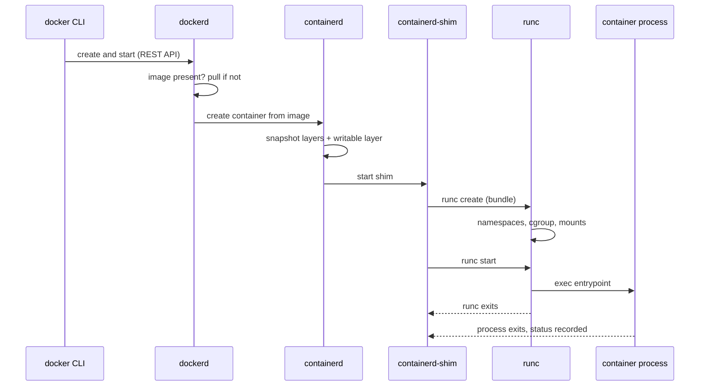

# Lesson 5. From Image to Running Container

**Mission link:** Every runtime problem later, a container that will not start, a process that ignores a signal, data that vanishes, sits somewhere between the image and the running process, so you need to know what happens in that gap and which layer owns each step.
**Primary source:** [Spec: OCI Runtime Specification](https://github.com/opencontainers/runtime-spec/blob/main/spec.md)
**Prerequisites:** [Lesson 3](0003-cgroups.md), [Lesson 4](0004-images-and-layers.md), [Container runtime](../GLOSSARY.md), [Writable layer](../GLOSSARY.md), [Copy-on-write](../GLOSSARY.md), [Entrypoint](../GLOSSARY.md)

## Warm-up

1. ▢ What are the three documents an image is made of, and what does each one list or record?

<details markdown="1"><summary>Check</summary>

A manifest, which lists the digest and size of the config and of each layer. A config, which records how to run the image (entrypoint, command, environment, user) and the layers' uncompressed `diff_ids`. And the layers, tar archives of filesystem changes.

</details>

2. ▢ A container writes to a file that exists in an image layer. Where does the new content go, and what happens to the image's layer?

<details markdown="1"><summary>Check</summary>

The file is copied up into the container's writable upper directory and changed there (copy-on-write). The image's layer is not touched, so many containers can share it.

</details>

3. ▢ A container is killed for crossing its memory limit. Which exit code does it show, and which file counts the event?

<details markdown="1"><summary>Check</summary>

137, because the kernel sent `SIGKILL` (128 plus 9). The `oom_kill` counter in `memory.events` in the container's cgroup counts it.

</details>

## Know this

### The stack under `docker run`

`docker run alpine echo hi` is one command and several programs. In a default Docker Engine install, the work passes down a stack, and each layer does one job:



- The **docker CLI** is a client. It sends a request to the daemon and prints the answer. If the CLI exits, a detached container keeps running.
- **dockerd** owns the Docker concepts: images, networks, volumes, and the merge of the image config with your flags.
- **containerd** is the high-level **container runtime**: it manages images, snapshots and the lifecycle of containers.
- **runc** is the low-level runtime. Given a bundle it creates the namespaces and cgroups and starts the process. It is the reference implementation of the OCI runtime specification ([runc](https://github.com/opencontainers/runc)).
- The **shim** stays as the container process's parent after `runc` exits, holds its output streams and collects its exit status.

This is Docker's arrangement, not the only one. Podman is [daemonless](https://docs.podman.io/en/latest/). What is standard is the contract at the bottom: the OCI runtime specification, which says what a runtime is handed and what it must do.

### What a runtime receives

The runtime is given a **bundle**: a directory with a `rootfs` and a `config.json`. The root filesystem is the image's layers merged by overlayfs with a writable layer on top ([lesson 4](0004-images-and-layers.md)). The `config.json` lists the process to run, its user, environment and working directory, the namespaces to create, the cgroup limits, the mounts and the capabilities ([Runtime Specification](https://github.com/opencontainers/runtime-spec/blob/main/spec.md)).

Where those values come from is the merge the daemon does. The image config supplies defaults, and the `docker run` line overrides them:

```console
docker run alpine echo hi
docker run --entrypoint /bin/sh alpine -c 'echo hi'
docker run --memory 64m --user 1000 --env MODE=test alpine env
```

`echo hi` replaces the image's `Cmd`, and `--entrypoint` replaces its `Entrypoint`. The flags `--memory` and `--user` become cgroup limits and a user in `config.json` ([docker container run](https://docs.docker.com/reference/cli/docker/container/run/)). The merged result is what the container is. `docker inspect` shows it:

```console
docker inspect --format '{{.Config.Entrypoint}} {{.Config.Cmd}} {{.State.Pid}}' <container>
```

### The lifecycle

The runtime specification defines four states and the operations between them ([Runtime Specification, lifecycle](https://github.com/opencontainers/runtime-spec/blob/main/runtime.md)):

| State | Meaning |
|---|---|
| `creating` | The runtime is building the environment |
| `created` | The environment exists and the container process has not run the program |
| `running` | The process has executed the user-specified program and has not exited |
| `stopped` | The process has exited |

`create` builds the namespaces, cgroup and mounts without running your program. `start` runs the program. `delete` removes what `create` made. That split is why a container can be in `created` and have all its isolation in place with no process executing.

Docker's own states are a longer list: `created`, `restarting`, `running`, `removing`, `paused`, `exited` and `dead` ([docker container ls](https://docs.docker.com/reference/cli/docker/container/ls/)). The commands line up with the runtime's:

| Command | What happens |
|---|---|
| `docker create` | Makes the container: ID, writable layer, merged config. Nothing runs. |
| `docker start` | Runs the entrypoint in the existing container. |
| `docker run` | `create` then `start`, pulling the image first if it is missing. |
| `docker stop` | Sends the stop signal, then `SIGKILL` after a grace period. |
| `docker rm` | Deletes the stopped container and its writable layer. |

A stopped container still exists. `docker ps -a` lists it with a status such as `Exited (0) 5 seconds ago`, and its logs and writable layer are intact until `docker rm`.

### The writable layer

Each container gets its own empty writable layer over the image's read-only layers. Every file it creates, changes or deletes lands there, and `docker diff` lists the changes:

```console
docker run --name w alpine sh -c 'echo extra >> /etc/motd; touch /new; rm /etc/issue'
docker diff w
```

Expect `A /new` (added), `C /etc/motd` (changed) and `D /etc/issue` (deleted), plus a change to the directory `/etc` and possibly entries for files the runtime mounts. The writable layer survives `stop` and `start`, because it belongs to the container. It does not survive `rm`: "the container's writable layer doesn't persist after the container is deleted" ([Docker: storage drivers](https://docs.docker.com/engine/storage/drivers/)). Anything that must outlive a container goes in a volume, which is [lesson 15](0015-volumes-and-state.md).

## Practice

1. ▢ In the OCI runtime lifecycle, which operation actually runs the program named in the container's configuration?

    - a) create
    - b) start
    - c) delete
    - d) state

<details markdown="1"><summary>Check</summary>

b. `create` builds the environment and must not run the user program, `start` runs it, `delete` removes what `create` made, and `state` only reports. The gap between `create` and `start` is the `created` state.

</details>

2. ▢ Predict, then run. What do the three paths show in `docker diff` after this command?

    ```console
    docker run --name w alpine sh -c 'echo extra >> /etc/motd; touch /new; rm /etc/issue'
    docker diff w
    ```

<details markdown="1"><summary>Hint</summary>

The letters are `A`, `C` and `D`. Ask whether each path existed in the image beforehand and what the command did to it.

</details>

<details markdown="1"><summary>Check</summary>

`/new` is `A`, because it did not exist in the image. `/etc/motd` is `C`, because it existed and was changed (copied up, then edited). `/etc/issue` is `D`, because it existed and was removed, which overlayfs records as a whiteout in the upper directory. `/etc` also appears as `C` because its contents changed. None of this touched the image: `docker run --rm alpine ls /new` fails.

</details>

3. ▢ Predict, then run. What does the last command print, and what would it print if the container had been removed and recreated?

    ```console
    docker run -d --name w alpine sleep 600
    docker exec w touch /new
    docker stop w && docker start w
    docker exec w ls /new
    ```

<details markdown="1"><summary>Hint</summary>

Stopping a container does not delete it. Which layer holds `/new`?

</details>

<details markdown="1"><summary>Check</summary>

It prints `/new`. The file is in the container's writable layer, which survives `stop` and `start`. After `docker rm -f w` and a fresh `docker run -d --name w alpine sleep 600`, `ls /new` fails with `No such file or directory`, because a new container gets a new empty writable layer.

</details>

4. ▢ You run a container detached with `docker run -d`, then close the terminal and stop the Docker CLI process. The container keeps running. Explain which part of the stack owns it.

<details markdown="1"><summary>Check</summary>

The CLI is only a client of the daemon, so ending it changes nothing. The container process is the child of the shim, which `containerd` started, and the daemon and `containerd` track it. A container is a host process owned by that chain, not by the shell that ran `docker run`.

</details>

5. ▢ A teammate says "`docker run` pulled the image and created the container, so the container is what holds the filesystem". Correct it using the layers in the stack.

<details markdown="1"><summary>Check</summary>

The image holds read-only layers, shared by every container made from it. The container adds one writable layer, and the merged view of the two is what the process sees as `/`. Pulling stores image layers and creating a container adds the writable one. So two containers from one image share the image's layers and differ only in their writable layers, configs and processes.

</details>

6. ▢ `docker ps -a` shows `Exited (0)` for a container you did not remove. A week later disk use is growing. Name what is taking space and the command that reclaims it, and say what you lose.

<details markdown="1"><summary>Check</summary>

The stopped containers' writable layers and logs remain until the container is removed. `docker rm <container>` deletes one, and `docker container prune` removes all stopped containers. You lose any data written only in the writable layer and the container's logs. Data that matters should be in a volume, and containers started for one-off tasks can use `docker run --rm`, which removes the container when it exits.

</details>

## Real-world reps

- [ ] Run `docker create --name c alpine echo hi`, then `docker ps -a` and note its status. Run `docker start -a c`, then `docker ps -a` again. Finish with `docker rm c`. Write down when the process existed.
- [ ] Run the `docker diff` example and note the three letters. Then `docker rm w`, run `docker run --rm alpine ls /new`, and write down why the file is gone.
- [ ] Tomorrow: without notes, list the five components between `docker run` and the process in order, say which one is the low-level runtime, and say which three states the OCI specification names after `creating`.

## Going further

- [Container Primitives](../reference/container-primitives.md)
- [Spec: OCI Runtime Specification](https://github.com/opencontainers/runtime-spec/blob/main/spec.md)
- [Repo: runc, Open Container Initiative](https://github.com/opencontainers/runc)
- [Docs: "docker container run", Docker CLI reference](https://docs.docker.com/reference/cli/docker/container/run/)
- [Docs: "Storage drivers", Docker](https://docs.docker.com/engine/storage/drivers/)
- [Resources](../RESOURCES.md)

---

Not landing? Reread the primary source at the top, since this lesson compresses it and compression is where understanding leaks. Check the [glossary](../GLOSSARY.md) for any term that felt slippery.

If the lesson itself is unclear rather than the material, that is a defect: [open an issue](https://github.com/TokenCemetery/teach/issues).
