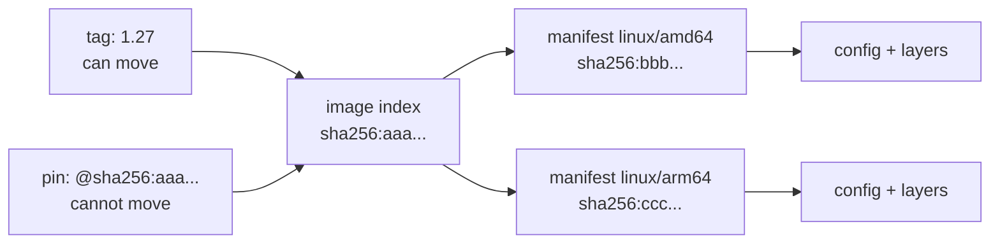

# Lesson 6. Registries, Tags and Digests

**Mission link:** "It worked in staging" only means something if production runs the same image, so you need to know which names can move under you and which cannot, and how to pull exactly the image that was tested.
**Primary source:** [Spec: OCI Distribution Specification](https://github.com/opencontainers/distribution-spec/blob/main/spec.md)
**Prerequisites:** [Lesson 4](0004-images-and-layers.md), [Lesson 5](0005-from-image-to-running-container.md), [Registry](../GLOSSARY.md), [Tag](../GLOSSARY.md), [Digest](../GLOSSARY.md), [Image index](../GLOSSARY.md)

## Warm-up

1. ▢ Which part of an image lists the digests of its layers, and which part lists the digests of the layers after they are uncompressed?

<details markdown="1"><summary>Check</summary>

The manifest lists the digest and size of each layer blob as stored, usually compressed. The image config lists the `diff_ids`, the digests of the uncompressed layer tars.

</details>

2. ▢ Two containers start from the same image. What do they share, and what is separate for each?

<details markdown="1"><summary>Check</summary>

They share the image's read-only layers. Each has its own writable layer, its own merged config, and its own process, namespaces and cgroup.

</details>

3. ▢ After `docker stop` a container still appears in `docker ps -a`. What state is it in, and what does `docker rm` then delete?

<details markdown="1"><summary>Check</summary>

It is stopped, shown as `Exited`. `docker rm` deletes the container and its writable layer, and the image's layers are left alone.

</details>

## Know this

### A registry serves content by name

A **registry** stores images and serves them over the HTTP API of the OCI Distribution Specification. A full reference has up to four parts, in this order:

```text
registry.example.com/team/web:1.4.2@sha256:9f86d081884c7d659a2feaa0c55ad015a3bf4f1b2b0b822cd15d6c15b0f00a08
```

- The registry host, `registry.example.com`.
- The repository path, `team/web`.
- The tag after a colon, `1.4.2`.
- The digest after an at sign, `sha256:9f86...`.

When a client leaves parts out, it fills in defaults: Docker treats `nginx` as `docker.io/library/nginx:latest`, which `docker pull nginx` prints back to you. `latest` is the tag used when none is given, and it is an ordinary tag. Nothing makes it the newest.

A pull is a handful of requests. The client asks for a manifest and then for each blob it does not have, using the paths the specification lists ([Distribution Specification](https://github.com/opencontainers/distribution-spec/blob/main/spec.md)):

| Request | Returns |
|---|---|
| `GET /v2/<name>/manifests/<tag-or-digest>` | The manifest, or an image index |
| `GET /v2/<name>/blobs/<digest>` | A layer or config blob |

The same endpoint takes either a tag or a digest. A tag must match `[a-zA-Z0-9_][a-zA-Z0-9._-]{0,127}`, so it is at most 128 characters.

### A tag is a name that can move

A **tag** is a human-readable pointer to a manifest, and a manifest "may have zero, one, or many tags referencing it" (Distribution Specification, terminology). Whoever can push to the repository can point a tag at different content at any time, and the next pull of that tag returns the new content. Publishers do this on purpose: a tag like `1.27` or `3.20` normally follows the patch releases, and `latest` follows whatever was pushed last under that name.

A **digest** is the hash of the content, `sha256:` plus 64 hex digits ([OCI descriptor](https://github.com/opencontainers/image-spec/blob/main/descriptor.md)). The registry key for a manifest is the hash of its bytes, so the same digest always means the same manifest, and so the same config and the same layers. When you request by digest, the client should check that what came back hashes to it: "clients SHOULD verify the returned manifest matches this digest" (Distribution Specification). A digest cannot be moved. It can only stop existing if the registry deletes the content.



### One name, several platforms

A tag often points not at a manifest but at an **image index**: a document that lists manifests, each tagged with a `platform` such as `linux/amd64` or `linux/arm64`, so one name works on every architecture ([OCI Image Index](https://github.com/opencontainers/image-spec/blob/main/image-index.md); built by [multi-platform builds](https://docs.docker.com/build/building/multi-platform/)). The client picks the manifest that matches the host. Two hosts pulling `nginx:1.27` can therefore receive different layers under the same name. See the index and its manifests with:

```console
docker buildx imagetools inspect nginx:1.27
```

It prints the name, the media type, the index digest, and one entry per platform with its own digest. The digest of the index is the same on every host. The digest of the manifest depends on the platform.

### Pulling exactly what was tested

Find the digest of what you have tested, and pin it:

```console
docker pull nginx:1.27
docker image inspect nginx:1.27 --format '{{index .RepoDigests 0}}'
```

The first prints a `Digest: sha256:...` line, and the second prints `nginx@sha256:...`, the same digest. Use that form wherever the image is run:

```console
REF=$(docker image inspect nginx:1.27 --format '{{index .RepoDigests 0}}')
docker pull "$REF"
```

In a Dockerfile, put the tag and then the digest in the `FROM` line, in the form `FROM nginx:1.27@sha256:` followed by the 64 hex digits you recorded. The digest is what decides what is pulled, and the tag documents which release it was.

The image ID from `docker images` is not this digest. It is a local identifier that the registry never sees, so never pin with it.

Pinning has a cost. A tag that follows patch releases brings security fixes without you doing anything, and a digest never changes, so a pinned image receives no fixes until someone chooses a new digest. A pin needs a routine for bumping it, which [lesson 23](0023-changing-a-base-image-others-depend-on.md) develops.

### Trying it against your own registry

A local registry is one container, and `localhost` is accepted without TLS:

```console
docker run -d --name reg -p 5000:5000 registry:2
printf 'FROM alpine:3.20\nRUN echo one > /v\n' | docker build -t localhost:5000/demo:v1 -
docker push localhost:5000/demo:v1
curl -sI -H 'Accept: application/vnd.oci.image.manifest.v1+json, application/vnd.oci.image.index.v1+json, application/vnd.docker.distribution.manifest.v2+json' localhost:5000/v2/demo/manifests/v1 | grep -i docker-content-digest
```

The last line prints the digest the registry holds for `v1`. The specification says a successful manifest response carries it in the `Docker-Content-Digest` header, and that the header is a convenience clients may ignore.

## Practice

1. ▢ Which of these always names exactly the same image content?

    - a) A version tag such as 1.27
    - b) The tag that is called latest
    - c) A sha256 digest of the manifest
    - d) The full registry and repository path

<details markdown="1"><summary>Check</summary>

c. A digest is the hash of the manifest's bytes, so it cannot name different content. (a) is a tag, and publishers move version tags to ship patch releases. (b) is the most mobile tag, and it is not even guaranteed to be newest. (d) names a repository, which holds many tags and digests.

</details>

2. ▢ Predict, then run (with the local registry above). After pushing `v1`, you build a different image, push it as `localhost:5000/demo:v1` again, and ask for the digest of `v1` a second time. Is it the same as the first? Does pulling `localhost:5000/demo` by the first digest still work?

    ```console
    printf 'FROM alpine:3.20\nRUN echo two > /v\n' | docker build -t localhost:5000/demo:v1 -
    docker push localhost:5000/demo:v1
    ```

<details markdown="1"><summary>Hint</summary>

The tag points at a manifest. The digest is the hash of one manifest's bytes. What did the second push change?

</details>

<details markdown="1"><summary>Check</summary>

The digest of `v1` is different, because the tag now points at a new manifest with a different config and layer. The pull by the first digest still works, because the old manifest is still stored. A registry with garbage collection may eventually remove manifests that no tag references, so keep the content you pin tagged somewhere. The experiment shows both halves: the tag moved, and the digest named the old content throughout.

</details>

3. ▢ A teammate builds on an arm64 laptop and pins `FROM nginx@sha256:<index digest>`. The server is amd64. Does the pin give both machines the same bytes?

<details markdown="1"><summary>Check</summary>

Both resolve the same index, so the pin is the same and each machine gets the manifest for its own platform. The platform manifests have different digests, with different layers, so the bytes are not the same across architectures, and the content on each is still fixed. To pin one platform exactly, take that manifest's digest from `docker buildx imagetools inspect`. Pinning the index is usually what you want, so the same Dockerfile builds on both.

</details>

4. ▢ A build that worked on Monday fails on Thursday. Nobody changed the Dockerfile, which starts `FROM node:20`. Give the most likely cause and the change that makes the build reproducible.

<details markdown="1"><summary>Check</summary>

The tag `node:20` moved: the publisher pushed a new patch release under it, so the same name now resolves to different content, and something in it, a library or a default, broke the build. Pin the base by digest, `FROM node:20@sha256:<digest>`, so the build is the same until someone chooses to change it, and bump the pin deliberately. The Dockerfile text did not change, and the input it names did.

</details>

5. ▢ Using the specification, describe what a client sends to pull `team/web@sha256:abc...` and what it should check before trusting the response.

<details markdown="1"><summary>Check</summary>

It sends `GET /v2/team/web/manifests/sha256:abc...`, with an `Accept` header for the manifest types it supports. If the answer is an index it picks the manifest for its platform and requests that, then fetches the config and the layer blobs with `GET /v2/team/web/blobs/<digest>`. The specification says that when the reference is a digest the client should verify that the returned manifest matches it, and the blobs it fetches can be checked against the digests the manifest lists in the same way.

</details>

6. ▢ A team pins every `FROM` by digest and does not touch the pins for a year. What did they gain, and what did they lose?

<details markdown="1"><summary>Check</summary>

They gained identical builds and a record of what ran. They lost every fix the base image's publisher shipped in the year, because a digest does not follow a tag. Known vulnerabilities in the base stay in every image built from it. The practice is sound only with a routine that moves the pin on purpose: a scheduled bump, a scan, a rebuild.

</details>

## Real-world reps

- [ ] Run `docker pull nginx:1.27`, then `docker buildx imagetools inspect nginx:1.27`. Write down the index digest and how many platforms it lists.
- [ ] Run the local registry example, push `v1` twice with different content, and write down both digests and which one `v1` now returns.
- [ ] Tomorrow: without notes, write the four parts of a full image reference, say which part can move, and say what `FROM name:tag@sha256:...` pins.

## Going further

- [Container Primitives](../reference/container-primitives.md)
- [Spec: OCI Distribution Specification](https://github.com/opencontainers/distribution-spec/blob/main/spec.md)
- [Spec: OCI Image Index](https://github.com/opencontainers/image-spec/blob/main/image-index.md)
- [Docs: "Multi-platform builds", Docker](https://docs.docker.com/build/building/multi-platform/)
- [Resources](../RESOURCES.md)

---

Not landing? Reread the primary source at the top, since this lesson compresses it and compression is where understanding leaks. Check the [glossary](../GLOSSARY.md) for any term that felt slippery.

If the lesson itself is unclear rather than the material, that is a defect: [open an issue](https://github.com/TokenCemetery/teach/issues).
