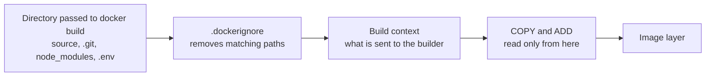

# Lesson 7. Your First Dockerfile

**Mission link:** Everything in stage 3 starts from a Dockerfile you can read line by line and say what each instruction adds to the image and what it sends to the builder. Without that, a slow, huge or leaky image is a mystery instead of a diff.
**Primary source:** [Docs: Dockerfile reference, Docker](https://docs.docker.com/reference/dockerfile/)
**Prerequisites:** [Lesson 4](0004-images-and-layers.md), [Lesson 6](0006-registries-tags-and-digests.md), [Image](../GLOSSARY.md), [Layer](../GLOSSARY.md), [Base image](../GLOSSARY.md), [Build context](../GLOSSARY.md), [BuildKit](../GLOSSARY.md)

## Warm-up

1. ▢ An image is a manifest, a config and a stack of layers. What does a layer contain, and why does deleting a file in a later layer not make the image smaller?

<details markdown="1"><summary>Check</summary>

A layer is a tarball of filesystem changes: files added, changed or deleted. A deletion is recorded as a whiteout entry in the later layer, and the earlier layer that holds the file's bytes is still part of the image and still pulled (lesson 4).

</details>

2. ▢ `FROM python:3.13-slim` names a tag. What can happen to what that tag points at between Monday and Friday, and what names the content exactly?

<details markdown="1"><summary>Check</summary>

A tag is a movable name, so the publisher can repoint it at different content at any time. A digest, `sha256:` plus a hash of the manifest, always names the same content (lesson 6).

</details>

## Know this

### A Dockerfile is a list of steps for the builder

A Dockerfile is a text file of instructions that [BuildKit](https://docs.docker.com/build/buildkit/) runs in order to produce an image. This is the one the rest of stage 3 builds on, for a small Python service:

```dockerfile
# syntax=docker/dockerfile:1
FROM python:3.13-slim
WORKDIR /app
COPY requirements.txt .
RUN pip install --no-cache-dir -r requirements.txt
COPY . .
EXPOSE 8000
CMD ["python", "app.py"]
```

Build it and run it:

```console
$ docker build -t demo .
$ docker run --rm -p 8000:8000 demo
```

The `# syntax=docker/dockerfile:1` line on top selects the Dockerfile frontend and is how current syntax reaches an older Docker. The trailing `.` in `docker build -t demo .` is not decoration. It is the build context, explained below.

### The instructions you need first

|Instruction|What it does|Adds a filesystem layer?|
|---|---|---|
|`FROM image`|Starts a stage from a [base image](../GLOSSARY.md). Every Dockerfile begins with one (an `ARG` may precede it)|Brings in the base image's layers|
|`WORKDIR /app`|Sets the directory later instructions and the container start in, creating it if missing|Config, plus the directory if it had to create it|
|`COPY src dest`|Copies files from the build context into the image|Yes|
|`RUN command`|Runs a command in the image so far and commits the filesystem changes|Yes|
|`ENV KEY=value`|Sets an environment variable in the image config, visible at build time and at run time|No, config only|
|`ARG NAME`|Declares a build-time variable passed with `--build-arg`. Not kept as an environment variable in the running container|No, config only|
|`EXPOSE 8000`|Documents a port the service listens on. It publishes nothing|No, config only|
|`CMD ["python", "app.py"]`|The default command, in [exec form](../GLOSSARY.md). Overridden by arguments to `docker run`|No, config only|
|`ENTRYPOINT [...]`|The [entrypoint](../GLOSSARY.md), the executable a container always runs, with `CMD` supplying its default arguments|No, config only|

The reference gives `RUN`'s behaviour as executing "any commands to create a new layer on top of the current image" ([Dockerfile reference, RUN](https://docs.docker.com/reference/dockerfile/#run)). The last column is the working rule: instructions that change files (`RUN`, `COPY`, `ADD`) produce [layers](../GLOSSARY.md) that cost bytes and cache entries, and the rest change the [image config](../GLOSSARY.md). Two traps follow from it.

- `EXPOSE` is documentation. The service is reachable from the host only if the container is run with `-p`, which is [port publishing](../GLOSSARY.md) and a lesson 14 topic.
- A `RUN rm` after a `RUN` or `COPY` that added the file hides it from the container and leaves its bytes in the image. If a file must not ship, it must never be copied in. Anything secret that is copied in and deleted later is still in a layer (lesson 19).

`COPY` is the instruction for putting files from the context into an image. `ADD` does the same and also fetches remote URLs and unpacks local tar archives, which makes it surprising. Docker's guidance is to prefer `COPY` and to keep `ADD` for downloading a remote artifact, where it gives a more precise build cache and can check a checksum ([Building best practices, ADD or COPY](https://docs.docker.com/build/building/best-practices/#add-or-copy)).

`CMD` and `ENTRYPOINT` accept a JSON array (exec form) or a plain string ([shell form](../GLOSSARY.md)). Write the array. Why that matters is lesson 11.

### The build context

`docker build` does not read the Dockerfile's directory directly. The client packages a set of files, the [build context](../GLOSSARY.md), and hands it to the builder, and `COPY` can read only from that set. In `docker build -t demo .` the context is the current directory.



Two consequences. First, a large directory in the context, such as `node_modules` or `.git`, is sent on every build and slows it down, especially to a remote builder. Second, whatever `COPY . .` can see, it copies, including a `.env` file, so what is not excluded can end up in an image.

A `.dockerignore` file in the root of the context lists what to remove before the context is sent ([Build context, .dockerignore files](https://docs.docker.com/build/concepts/context/#dockerignore-files)). Its patterns are like shell globs, `**` matches any number of directories, a line starting with `#` is a comment, and a `!` line makes an exception to an earlier exclusion.

```text
.git
node_modules
.env
*.md
!README.md
```

With the last two lines, the docs state that markdown files right under the context directory are excluded except `README.md`, and markdown files in subdirectories are still included. The `Dockerfile` and `.dockerignore` themselves are always sent, since the build needs them, but if you exclude them they cannot be copied into the image.

To see what the context costs, read the build output. BuildKit prints a `transferring context:` line with the size, and an unexpectedly large number is almost always a missing `.dockerignore` entry.

## Practice

1. ▢ What does the final `.` mean in `docker build -t demo .`?

    - a) The directory sent to the builder
    - b) The directory storing the finished image
    - c) The directory holding the copied Dockerfile
    - d) The directory the container starts in

<details markdown="1"><summary>Check</summary>

**a)** The `.` is the build context, the set of files the builder receives and `COPY` can read. (b) is wrong because images are stored by the builder, not in a directory you name. (c) confuses the context with the image's filesystem, where the Dockerfile is not copied unless a `COPY` says so. (d) describes `WORKDIR`, which is set inside the Dockerfile.

</details>

2. ▢ A teammate says `EXPOSE 8000` in the Dockerfile means `curl localhost:8000` on the host will reach the service. Which statement is correct?

    - a) It only records the port as documentation
    - b) It opens that port in the firewall
    - c) It maps that port onto host port 8000
    - d) It starts the service on that port

<details markdown="1"><summary>Check</summary>

**a)** `EXPOSE` adds the port to the image config as documentation. Reaching it from the host needs `-p` on `docker run` (lesson 14). (b) and (c) credit `EXPOSE` with publishing, which it does not do. (d) is wrong because only the process itself opens a listening socket.

</details>

3. ▢ Predict, then run. The context holds `Dockerfile`, `.dockerignore`, `app.py`, `notes.md`, `README.md` and `docs/guide.md`. The `.dockerignore` contains the two lines `*.md` and `!README.md`. Which paths does the `find` print?

    ```dockerfile
    FROM alpine:3.23
    COPY . /ctx
    RUN find /ctx | sort
    ```

    ```console
    $ docker build --progress=plain --no-cache .
    ```

<details markdown="1"><summary>Hint</summary>

Which markdown files does `*.md` match, and does it reach into `docs/`? Then remember that the `Dockerfile` and `.dockerignore` are part of the context unless excluded.

</details>

<details markdown="1"><summary>Check</summary>

```text
/ctx
/ctx/.dockerignore
/ctx/Dockerfile
/ctx/README.md
/ctx/app.py
/ctx/docs
/ctx/docs/guide.md
```

`notes.md` is excluded by `*.md`. `README.md` comes back through the `!` exception. `docs/guide.md` stays because `*.md` matches only at the root of the context, which is what the Docker documentation states. The `Dockerfile` and `.dockerignore` are in the context, so `COPY . /ctx` copies them too. In the plain progress output each line carries a step prefix such as `#6`, but the paths and their order are these.

</details>

4. ▢ Predict, then run. What does the final command print, and which layers of the image hold `token.txt`?

    ```dockerfile
    FROM alpine:3.23
    COPY token.txt /token.txt
    RUN rm /token.txt
    ```

    ```console
    $ docker build -t leak .
    $ docker run --rm leak ls /token.txt
    ```

<details markdown="1"><summary>Hint</summary>

Run `docker history leak` and look at what each layer adds. Then think about what `docker save leak` puts in the tarball.

</details>

<details markdown="1"><summary>Check</summary>

The `ls` fails with `ls: /token.txt: No such file or directory`, because the container's merged filesystem hides the file. The `COPY` layer still contains `token.txt`, and anyone who pulls the image can extract that layer and read it. A later `RUN rm` records a whiteout and never edits the earlier layer (lesson 4). The fix is to never copy the file in, and for credentials needed during a build, to use a build secret (lesson 19).

</details>

5. ▢ Write a `.dockerignore` for a project whose directory holds `.git/`, `node_modules/`, `.env`, `dist/`, `*.log` files anywhere, and a `README.md` the image does need, and say which of those the `COPY . .` in your Dockerfile would otherwise have copied.

<details markdown="1"><summary>Check</summary>

```text
.git
node_modules
.env
dist
**/*.log
*.md
!README.md
```

Without it, `COPY . .` copies every one of them: the history in `.git`, the host's `node_modules`, the `.env` credentials, the build output and the logs. The `**/*.log` form matches log files at any depth, while `*.log` alone matches only at the root. Whether `dist` belongs in the ignore list depends on whether the image build produces it itself, and the `*.md` pair is only needed if you want to exclude other markdown while keeping the README.

</details>

6. ▢ A build prints `transferring context: 912.40MB` for a service whose source is 3 MB, and every rebuild is slow before the first step runs. Name the likely cause, the fix, and what else the fix improves besides build time.

<details markdown="1"><summary>Check</summary>

The context includes large directories that the image does not need, typically `.git`, `node_modules`, build output or data files. The fix is a `.dockerignore` that excludes them. Besides build time, it keeps host-built artifacts and credentials out of `COPY . .`, which is both a size and a security gain, and it stops a change to an ignored file from invalidating a `COPY` layer in the build cache (lesson 8).

</details>

## Real-world reps

- [ ] Take a project you have, write its Dockerfile from memory using only `FROM`, `WORKDIR`, `COPY`, `RUN` and `CMD`, build it, and read the `transferring context:` line in the output.
- [ ] Add a `.dockerignore` to that project, rebuild, and note the change in the context size. Then run `docker history` on the image and match each layer to the instruction that produced it.
- [ ] Tomorrow: without notes, name the three instructions that add a filesystem layer, and say what `EXPOSE` does and does not do.

## Going further

- [Dockerfile](../reference/dockerfile.md)
- [Docs: Dockerfile reference, Docker](https://docs.docker.com/reference/dockerfile/)
- [Docs: Build context, Docker](https://docs.docker.com/build/concepts/context/), the section on `.dockerignore` files
- [Docs: "Building best practices", Docker](https://docs.docker.com/build/building/best-practices/)
- [Resources](../RESOURCES.md)

---

Not landing? Reread the primary source at the top, since this lesson compresses it and compression is where understanding leaks. Check the [glossary](../GLOSSARY.md) for any term that felt slippery.

If the lesson itself is unclear rather than the material, that is a defect: [open an issue](https://github.com/TokenCemetery/teach/issues).
