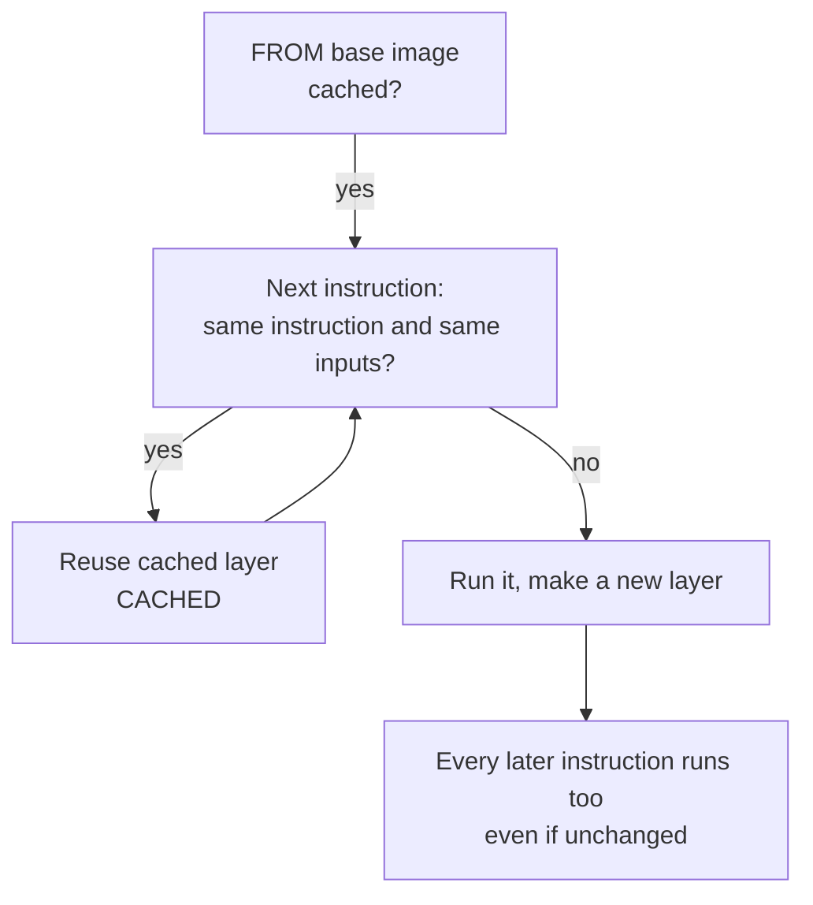

# Lesson 8. The Build Cache

**Mission link:** A Dockerfile that rebuilds in seconds instead of minutes is one whose instructions are ordered by how often their inputs change. This lesson gives you the rule the builder applies, so you can predict which steps rerun before you run them.
**Primary source:** [Docs: "Build cache invalidation", Docker](https://docs.docker.com/build/cache/invalidation/)
**Prerequisites:** [Lesson 7](0007-your-first-dockerfile.md), [Build cache](../GLOSSARY.md), [Build context](../GLOSSARY.md), [Layer](../GLOSSARY.md)

## Warm-up

1. ▢ What is the build context, and what does a `.dockerignore` line change about it?

<details markdown="1"><summary>Check</summary>

The build context is the set of files the client sends to the builder, and `COPY` can read only from it. A `.dockerignore` line removes matching paths before the context is sent, so they cannot be copied and are not sent (lesson 7).

</details>

2. ▢ Which Dockerfile instructions add a filesystem layer, and which only change the image config?

<details markdown="1"><summary>Check</summary>

`RUN`, `COPY` and `ADD` add layers that hold file changes. `ENV`, `ARG`, `EXPOSE`, `CMD` and `ENTRYPOINT` change only the image config (lesson 7).

</details>

3. ▢ A layer is a tarball of changes with a digest. Why is it safe for a builder to reuse a layer it built yesterday?

<details markdown="1"><summary>Check</summary>

Layers are content-addressed and immutable, so a stored layer never changes under the same digest. Reuse is safe only if the builder is right that its inputs are the same, which is the question this lesson is about (lesson 4).

</details>

## Know this

### The rule

The [build cache](../GLOSSARY.md) lets the builder skip an instruction it has already run. Docker states how it decides: it begins by checking whether the base image is cached, and each following instruction "is compared against the cached layers"; if no cached layer matches exactly, "the cache is invalidated" ([build cache invalidation, general rules](https://docs.docker.com/build/cache/invalidation/#general-rules)). It then adds the rule that matters most: once the cache is invalidated, all subsequent Dockerfile commands generate new layers and the cache is not used.



A miss at one step is therefore never local. It costs the step and everything below it. That is the whole game, and it turns Dockerfile ordering into a question of what changes least.

### What counts as "the same inputs"

|Instruction|What the builder compares|
|---|---|
|`RUN`|Only the command string, plus the layers before it. The files the command changed are not examined|
|`COPY`, `ADD`|A checksum of the copied files' metadata. A changed file, name or permission misses. The modification time (`mtime`) alone does not|
|`RUN` with a bind mount|The same file checksum as `COPY`, for the mounted files|
|`ARG`|The value. A different value is a miss at its first use, and every later `RUN` uses it implicitly, so it can miss all of them|
|`ENV`, `CMD`, `WORKDIR`|The instruction itself|

All of this is from the Docker documentation: the file checksum, the exemption for `mtime`, and the point that, aside from `ADD` and `COPY`, cache checking does not look at the files in the container ([general rules](https://docs.docker.com/build/cache/invalidation/#general-rules)). The `ARG` behaviour is in [Dockerfile reference, impact on build caching](https://docs.docker.com/reference/dockerfile/#impact-on-build-caching).

Two consequences are worth keeping in your head.

- A `RUN apk add curl` is not rerun next week just because `curl` has a new release. The command string is unchanged, so the old layer is reused and the packages are the old ones. Docker says this directly for `RUN` and lists the ways to force a rerun: change a layer before it, run `docker builder prune`, or pass `--no-cache` or `--no-cache-filter` ([RUN instructions](https://docs.docker.com/build/cache/invalidation/#run-instructions)).
- Splitting `RUN apt-get update` from `RUN apt-get install` is a trap. The install line can change while the cached update layer is reused, so the build installs from stale package lists. The best-practices page says to combine them in one `RUN`, which makes any change to the package list a change to the whole instruction ([apt-get](https://docs.docker.com/build/building/best-practices/#apt-get)).

### Ordering by how often things change

Docker's advice is to order instructions from least to most frequently changed ([cache invalidation](https://docs.docker.com/build/cache/invalidation/#general-rules), [optimize cache usage](https://docs.docker.com/build/cache/optimize/#order-your-layers)). Compare two Dockerfiles for the service from lesson 7:

```dockerfile
# slow: any source edit reinstalls every dependency
FROM python:3.13-slim
WORKDIR /app
COPY . .
RUN pip install --no-cache-dir -r requirements.txt
CMD ["python", "app.py"]
```

```dockerfile
# fast: dependencies reinstall only when requirements.txt changes
FROM python:3.13-slim
WORKDIR /app
COPY requirements.txt .
RUN pip install --no-cache-dir -r requirements.txt
COPY . .
CMD ["python", "app.py"]
```

In the first, `COPY . .` includes `app.py`, which changes on nearly every commit, so the `pip install` below it reruns every time. In the second, the dependency list is copied alone: an edit to `app.py` misses only the second `COPY` and anything after it. The pattern is the same in every language: copy the dependency manifest, install, then copy the source. How a language fetches its dependencies belongs to its own track, for example [Python: Project and Packaging](../../../programming/python/reference/project-and-packaging.md).

`.dockerignore` feeds the same rule. A `COPY . .` checksums every file in the context, so an edit to a file that the image does not need, such as a log or a notes file, still misses that `COPY` unless the file is excluded.

### When the layer is stale on purpose, and other tools

Sometimes you want a rebuild: to pick up new OS packages, or after a base image moved. `docker build --no-cache .` skips the cache for the whole build and `--pull` fetches a newer base first. `--no-cache-filter install` invalidates only the stage named `install`. Lesson 10 returns to this, because rebuilding at will is exactly what makes two builds differ.

A cache mount is a second mechanism. `RUN --mount=type=cache,target=/root/.cache/pip pip install -r requirements.txt` keeps a package download cache outside the image across builds, so even when the layer must rebuild, only new or changed packages are fetched ([optimize cache usage, cache mounts](https://docs.docker.com/build/cache/optimize/#use-cache-mounts)). It does not replace good ordering. It makes the misses cheaper.

## Practice

1. ▢ Using the fast Dockerfile above, you edit only `app.py` and rebuild. Which statement is correct?

    - a) Dependencies reinstall, then the copy is reused
    - b) Dependencies are reused, then the copy reruns
    - c) Everything reruns because the source file changed
    - d) Everything is reused as nothing really changed

<details markdown="1"><summary>Check</summary>

**b)** The base image, `WORKDIR`, the `requirements.txt` copy and the `pip install` are all unchanged, so they come from the cache. `COPY . .` sees a changed file and reruns, and `CMD` after it reruns as well. (a) has the order backwards. (c) ignores that a miss affects only the steps below it. (d) ignores that the second `COPY` checksums `app.py`.

</details>

2. ▢ Predict, then run. After a first build, you change the contents of `a.txt` and rebuild. Which of the five numbered steps are marked `CACHED`?

    ```dockerfile
    FROM alpine:3.23
    RUN echo "step one" > /one
    COPY a.txt /a.txt
    RUN echo "step three" > /three
    COPY b.txt /b.txt
    ```

    ```console
    $ docker build --progress=plain .
    ```

<details markdown="1"><summary>Hint</summary>

Find the first step whose inputs changed, then apply the rule about everything after it.

</details>

<details markdown="1"><summary>Check</summary>

Steps 1 and 2 only, the `FROM` and the first `RUN`. In the plain output they appear as `CACHED [2/5] RUN echo "step one" > /one` and the `FROM` line likewise. Step 3, `COPY a.txt`, misses because its input changed. Steps 4 and 5 rerun even though `echo "step three"` and `b.txt` did not change, because the cache is invalidated for everything after the first miss.

</details>

3. ▢ Predict, then run. After a first build with `COPY . .` as the last step before `CMD`, you run `touch app.py`, which changes the file's modification time and nothing else, then rebuild. Does the `COPY` step rerun?

<details markdown="1"><summary>Hint</summary>

The documentation says what file information goes into the checksum, and one piece of metadata is excluded.

</details>

<details markdown="1"><summary>Check</summary>

No, it is `CACHED`. The cache checksum for `COPY` is computed from file metadata, and the documentation says that the modification time is not taken into account, so a change to `mtime` alone does not invalidate it. Change one byte of content, rename the file or change its permissions, and the step reruns.

</details>

4. ▢ A Dockerfile has `RUN apt-get update` on one line and `RUN apt-get install -y --no-install-recommends curl` on the next. Months later someone appends `nginx` to the install line and the build fails with a package not found error, or installs old versions. Explain why, and give two fixes.

<details markdown="1"><summary>Check</summary>

The `RUN apt-get update` line has not changed, so its layer, with months-old package lists, comes from the cache. Only the install line is new, and it runs against the stale lists. The documented fix is one `RUN`, as in `RUN apt-get update && apt-get install -y --no-install-recommends curl nginx`, so any edit changes the whole command. Alternatively, force a rerun with `docker build --no-cache`, or `--no-cache-filter` for the stage, or pin package versions so the instruction text changes when the version does.

</details>

5. ▢ Reorder this Dockerfile so that editing `main.go` does not re-download modules, and say what you changed and what stayed.

    ```dockerfile
    FROM golang:1.26
    WORKDIR /src
    COPY . .
    RUN go mod download
    RUN go build -o /bin/app ./...
    ```

<details markdown="1"><summary>Check</summary>

```dockerfile
FROM golang:1.26
WORKDIR /src
COPY go.mod go.sum ./
RUN go mod download
COPY . .
RUN go build -o /bin/app ./...
```

The module files are copied alone and downloaded before the source arrives, so a source edit misses only the second `COPY` and the build step. The build instruction itself is unchanged. The Go toolchain details are in [Go: Toolchain Commands](../../../programming/golang/reference/toolchain-commands.md).

</details>

6. ▢ A CI pipeline passes `--build-arg GIT_SHA=$(git rev-parse HEAD)` and every build reinstalls all dependencies, even when only a comment changed. The Dockerfile starts with `ARG GIT_SHA`, then `COPY requirements.txt .` and `RUN pip install -r requirements.txt`. Explain the cause and give the fix.

<details markdown="1"><summary>Check</summary>

An `ARG` value that differs from the previous build causes a cache miss at its first use, and every `RUN` after an `ARG` uses it implicitly as an environment variable, so the commit hash changes the input of the `pip install` on every commit. Docker documents this under the impact of `ARG` on build caching. Move `ARG GIT_SHA` to after the dependency install, just before the instruction that needs it, so only that step and the ones below it miss.

</details>

## Real-world reps

- [ ] Build one of your Dockerfiles twice with `docker build --progress=plain .` and confirm that every step on the second run is marked `CACHED`.
- [ ] Edit one source file and rebuild. Find the first step that reran, and decide whether anything below it needed to. Reorder instructions if it did not.
- [ ] Tomorrow: without notes, state the rule for what happens to the instructions after a cache miss, and name two things the cache does not notice that a rebuild could pick up.

## Going further

- [Dockerfile](../reference/dockerfile.md)
- [Docs: "Build cache invalidation", Docker](https://docs.docker.com/build/cache/invalidation/)
- [Docs: "Docker build cache", Docker](https://docs.docker.com/build/cache/)
- [Docs: "Optimize cache usage in builds", Docker](https://docs.docker.com/build/cache/optimize/), for ordering, a small context and cache mounts
- [Resources](../RESOURCES.md)

---

Not landing? Reread the primary source at the top, since this lesson compresses it and compression is where understanding leaks. Check the [glossary](../GLOSSARY.md) for any term that felt slippery.

If the lesson itself is unclear rather than the material, that is a defect: [open an issue](https://github.com/TokenCemetery/teach/issues).
