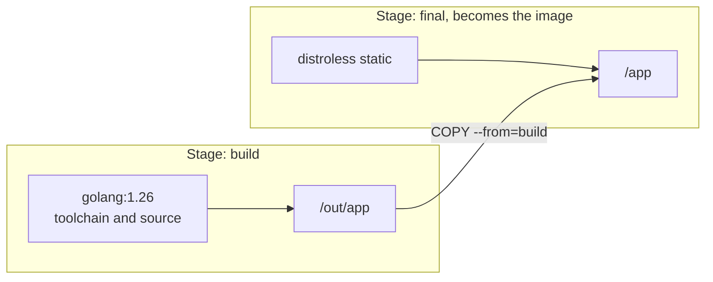

# Lesson 9. Multi-Stage Builds

**Mission link:** The image you ship should hold the program and what it needs to run, not the compiler, the package manager and the source tree that made it. A multi-stage build is how one Dockerfile builds with everything and ships with almost nothing, and the base image of the final stage decides what that nothing costs you.
**Primary source:** [Docs: "Multi-stage builds", Docker](https://docs.docker.com/build/building/multi-stage/)
**Prerequisites:** [Lesson 7](0007-your-first-dockerfile.md), [Lesson 8](0008-the-build-cache.md), [Multi-stage build](../GLOSSARY.md), [Base image](../GLOSSARY.md), [Distroless image](../GLOSSARY.md), [Layer](../GLOSSARY.md)

## Warm-up

1. ▢ A `RUN` instruction changes one early layer's inputs. Which later instructions run again, and why is that true even if their own inputs are unchanged?

<details markdown="1"><summary>Check</summary>

Every later instruction runs again. The cache is invalidated at the first miss, and the builder does not reuse any cached layer after it (lesson 8).

</details>

2. ▢ A `RUN rm -rf /usr/local/go` follows the step that installed the toolchain. Does it shrink the image?

<details markdown="1"><summary>Check</summary>

No. The delete is recorded in a new layer as a whiteout, and the earlier layer holding the toolchain's bytes is still in the image (lessons 4 and 7). Leaving the toolchain behind has to happen by never copying it into the final image.

</details>

3. ▢ Name the three things that are in an image's config rather than in a layer.

<details markdown="1"><summary>Check</summary>

Any three of: the entrypoint and command, the environment variables, the user, the working directory, the exposed ports. The config also lists the layers' uncompressed digests (lesson 4).

</details>

## Know this

### Two images in one file

A [multi-stage build](../GLOSSARY.md) has more than one `FROM`. Each `FROM` begins a stage with its own base, and a later stage copies chosen files out of an earlier one. Docker describes it this way: each `FROM` instruction "begins a new stage of the build", and you can selectively copy artifacts from one stage to another, "leaving behind everything you don't want in the final image" ([Docker, multi-stage builds](https://docs.docker.com/build/building/multi-stage/)).

```dockerfile
# syntax=docker/dockerfile:1
FROM golang:1.26 AS build
WORKDIR /src
COPY go.mod go.sum ./
RUN go mod download
COPY . .
RUN CGO_ENABLED=0 go build -o /out/app ./cmd/app

FROM gcr.io/distroless/static-debian13:nonroot
COPY --from=build /out/app /app
ENTRYPOINT ["/app"]
```

The first stage is named `build` with `AS`. The second starts from a different base and takes one file with `COPY --from=build`. Only the last stage becomes the image you tag. Everything else in `build`, the Go toolchain, the module cache and the source, stays in the build cache and is not part of the image. The reference states that each `FROM` clears any state created by previous instructions ([Dockerfile reference, FROM](https://docs.docker.com/reference/dockerfile/#from)), which is why an `ENV` or `WORKDIR` from the build stage does not carry over, and why only files you copy travel.



The build step for a language is the language's concern: Go's `CGO_ENABLED=0` makes a static binary, covered in [Go: Toolchain Commands](../../../programming/golang/reference/toolchain-commands.md). The same pattern fits the other tracks: [Java: Testing and Build](../../../programming/java/reference/testing-and-build.md) and [The Module System](../../../programming/java/reference/the-module-system.md) for a runnable artifact and `jlink`, [C#: Shipping the Service](../../../programming/csharp/reference/shipping-the-service.md), and [Python: Project and Packaging](../../../programming/python/reference/project-and-packaging.md) for wheels. This lesson is about the Dockerfile around them.

### What BuildKit does with stages

- `docker build --target build -t app:build .` stops at the named stage, useful for debugging it or for a `test` stage next to a lean `production` one.
- [BuildKit](../GLOSSARY.md) builds only the stages the target depends on. The legacy builder processes every stage up to the target, even independent ones. The Docker documentation shows `--target stage2` skipping `stage1` when `stage2` does not depend on it.
- A stage can start from another: `FROM build AS test` continues where `build` left off.
- `COPY --from=nginx:latest /etc/nginx/nginx.conf /nginx.conf` copies from an image rather than a stage.

### The base image of the final stage

Multi-stage removes the build tools. The final stage's [base image](../GLOSSARY.md) decides everything else that ships: its libraries, its shell and its package manager, and so its size and its attack surface.

|Final base|What is in it|Shell and package manager|What you pay|
|---|---|---|---|
|`scratch`|Nothing at all. An empty image|None|No CA certificates, no timezone data, no user database, no libc. Only a static binary runs|
|distroless `static`|CA certificates, a `/etc/passwd` entry for root, `/tmp`, tzdata ([distroless static](https://github.com/GoogleContainerTools/distroless/blob/main/base/README.md))|None|Only static binaries. No shell to debug with|
|distroless `base`|Everything in `static` plus glibc and libssl|None|A bigger image than `static`, still no shell|
|Alpine|The musl C library, BusyBox and the `apk` package manager|Yes|Software built for glibc may behave differently on musl ([musl wiki, differences from glibc](https://wiki.musl-libc.org/functional-differences-from-glibc.html)), such as DNS resolution and default thread stack size|
|Debian slim, such as `python:3.13-slim`|Debian's glibc userland, trimmed|Yes, and `apt`|Larger than Alpine, but the same libc most software is tested against|

The distroless project reports the smallest distroless image, `static-debian13`, at about 2 MiB, against about 5 MiB for `alpine` and 124 MiB for `debian` ([distroless README](https://github.com/GoogleContainerTools/distroless#readme)). Those figures belong to its README at the time of writing, so measure your own with `docker image ls`. The point is the order of magnitude, and what you give up: with no shell, `docker exec` has nothing to run. Distroless publishes `debug` tags that add a BusyBox shell, which lesson 21 uses.

One more consequence follows from having no shell. In a distroless or scratch image, a Dockerfile `ENTRYPOINT` or `CMD` must be in exec form, because there is no `/bin/sh` for shell form to run through. The distroless README makes the same point about entrypoints.

Which base is right is a trade between size, compatibility and debuggability, not a rule. Lesson 18 covers what a smaller base does for scanning and lesson 24 when Alpine or distroless is the wrong call.

## Practice

1. ▢ In the example Dockerfile, which items are in the final image?

    - a) The binary plus the base image
    - b) The binary plus the Go toolchain
    - c) The binary plus the source tree
    - d) The binary plus the stage's environment

<details markdown="1"><summary>Check</summary>

**a)** Only the file copied with `COPY --from=build` plus the base image's own contents reaches the final image. (b) and (c) assume the first stage's filesystem comes along, which it does not, and only the files copied across travel. (d) is wrong because each `FROM` clears the state from the previous stage, so environment variables and working directory set in `build` are not inherited.

</details>

2. ▢ Predict, then run. Which of the echoed words appear in the build output?

    ```dockerfile
    FROM alpine:3.23 AS base
    RUN echo base
    FROM base AS stage1
    RUN echo stage1
    FROM base AS stage2
    RUN echo stage2
    ```

    ```console
    $ docker build --progress=plain --no-cache --target stage2 .
    ```

<details markdown="1"><summary>Hint</summary>

The target is `stage2`. Which stages does it depend on?

</details>

<details markdown="1"><summary>Check</summary>

`base` and `stage2` appear. `stage1` does not, because BuildKit builds only the stages the target depends on and `stage2` has no dependency on `stage1`. With the legacy builder (`DOCKER_BUILDKIT=0`), all three would run, which the Docker documentation points out.

</details>

3. ▢ A Go service builds fine, but the container made from the `FROM scratch` image exits at once with `exec /app: no such file or directory`, though `/app` exists. The build stage runs `go build -o /out/app ./cmd/app` with no other settings. Explain it and give the fix.

<details markdown="1"><summary>Hint</summary>

Run `file /out/app` or `ldd /out/app` in the build stage. What does a dynamically linked program need from the filesystem to start?

</details>

<details markdown="1"><summary>Check</summary>

The binary was linked dynamically, probably because cgo was enabled by default on the build image, so the kernel needs the dynamic loader named in the binary and the shared libraries. `scratch` has none of them, and the error names the missing loader, not the file you typed. The fix is a static build, `CGO_ENABLED=0 go build`, or a final base that provides libc such as distroless `base`. The Go flags are in [Go: Toolchain Commands](../../../programming/golang/reference/toolchain-commands.md).

</details>

4. ▢ A static Go binary built correctly in `FROM scratch` makes HTTPS calls to an API and fails every one with a certificate error. What is the most likely cause?

    - a) The image has no trusted CA certificate store
    - b) The binary was linked against the wrong libc
    - c) The multi-stage copy dropped the executable bit
    - d) The build stage cached an expired certificate bundle

<details markdown="1"><summary>Check</summary>

**a)** `scratch` is empty, so the root certificates a TLS client uses to verify a server are not there. Fix it by copying a certificate bundle in from the build stage or by switching to distroless `static`, which includes CA certificates. (b) cannot be, since a static binary links no libc. (c) would stop the program from starting at all. (d) invents a cache of certificates that the build does not keep.

</details>

5. ▢ Turn this single-stage Dockerfile into two stages so that `build-essential` stays out of the final image. State which stage installs the compiler and what gets copied.

    ```dockerfile
    FROM python:3.13-slim
    RUN apt-get update && apt-get install -y --no-install-recommends build-essential
    WORKDIR /app
    COPY requirements.txt .
    RUN pip install --no-cache-dir -r requirements.txt
    COPY . .
    CMD ["python", "app.py"]
    ```

<details markdown="1"><summary>Check</summary>

```dockerfile
FROM python:3.13-slim AS build
RUN apt-get update && apt-get install -y --no-install-recommends build-essential
RUN python -m venv /opt/venv
ENV PATH=/opt/venv/bin:$PATH
COPY requirements.txt .
RUN pip install --no-cache-dir -r requirements.txt

FROM python:3.13-slim
COPY --from=build /opt/venv /opt/venv
ENV PATH=/opt/venv/bin:$PATH
WORKDIR /app
COPY . .
CMD ["python", "app.py"]
```

The first stage installs the compiler and builds the packages into a virtual environment. Only `/opt/venv` is copied across, so the compiler and the apt package lists stay behind. It works because both stages use the same base image and the same path, since a virtual environment records the interpreter it was created with. A Debian-based final stage is also needed for a package built against glibc.

</details>

6. ▢ A teammate proposes moving a Python service from `python:3.13-slim` to an Alpine-based image to save space. Everything passes in CI, and in production some requests intermittently fail DNS lookups. What would you check, and what would you tell the team about choosing a base?

<details markdown="1"><summary>Check</summary>

Alpine's C library is musl, and the musl project documents behaviours that differ from glibc, DNS resolution among them. Reproduce the failures against the Alpine image with the same resolver configuration and compare with the slim image before blaming the network. The general lesson is that a smaller base trades size for compatibility and tooling, so decide with a measurement of image size and a test of the behaviours the service relies on, not on size alone. If the saving is modest, Debian slim is the safer default. Lesson 24 returns to when Alpine is the wrong call.

</details>

## Real-world reps

- [ ] Convert one of your Dockerfiles to two stages, build it, and compare `docker image ls` before and after. Run `docker history` on both to see what left.
- [ ] Add `--target` to build only the first stage of your Dockerfile and look at what is in it with `docker run --rm -it <image> sh`.
- [ ] Tomorrow: without notes, name four final-stage base images in order from emptiest to largest and say what each one lacks that the next one has.

## Going further

- [Dockerfile](../reference/dockerfile.md)
- [Docs: "Multi-stage builds", Docker](https://docs.docker.com/build/building/multi-stage/)
- [Repo: distroless, GoogleContainerTools](https://github.com/GoogleContainerTools/distroless)
- [Docs: "Functional differences from glibc", musl wiki](https://wiki.musl-libc.org/functional-differences-from-glibc.html)
- [Docs: "Building best practices", Docker](https://docs.docker.com/build/building/best-practices/)
- [Resources](../RESOURCES.md)

---

Not landing? Reread the primary source at the top, since this lesson compresses it and compression is where understanding leaks. Check the [glossary](../GLOSSARY.md) for any term that felt slippery.

If the lesson itself is unclear rather than the material, that is a defect: [open an issue](https://github.com/TokenCemetery/teach/issues).
