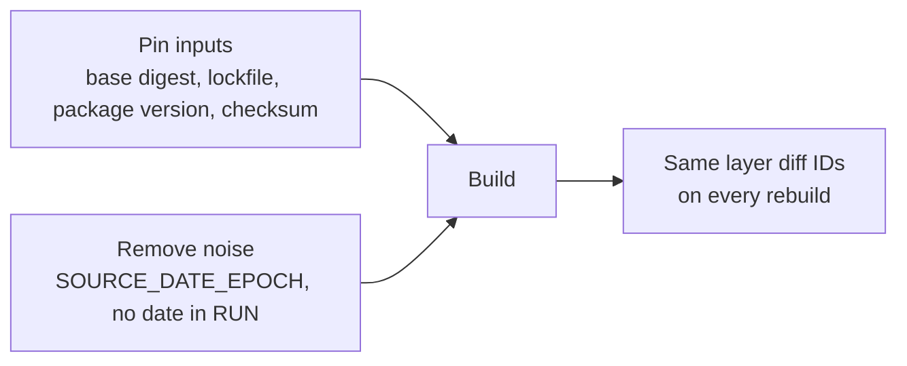

# Lesson 10. Reproducible Builds

**Mission link:** The mission is an image you can build twice and get the same bytes from, so that the digest you tested is the digest you ship. This lesson names what makes a build drift and the pin that removes each cause, so a rebuild changes only what you meant it to.
**Primary source:** [Docs: "SOURCE_DATE_EPOCH", Reproducible Builds project](https://reproducible-builds.org/docs/source-date-epoch/)
**Prerequisites:** [Lesson 6](0006-registries-tags-and-digests.md), [Lesson 8](0008-the-build-cache.md), [Lesson 9](0009-multi-stage-builds.md), [Reproducible build](../GLOSSARY.md), [Digest](../GLOSSARY.md), [Tag](../GLOSSARY.md), [Build cache](../GLOSSARY.md)

## Warm-up

1. ▢ What is the difference between pulling `alpine:3.23` and pulling `alpine@sha256:` plus a hash, and which one can return different bytes next month?

<details markdown="1"><summary>Check</summary>

A tag is a movable name, so `alpine:3.23` can be repointed at a rebuilt image. A digest is the hash of the content, so a pull by digest returns exactly the same bytes or fails verification (lesson 6).

</details>

2. ▢ A `RUN apk add curl` was built last week and is `CACHED` today. Do you get today's `curl`?

<details markdown="1"><summary>Check</summary>

No. The builder compares the command string and the layers before it, not the repository contents, so the layer from last week is reused with last week's package (lesson 8).

</details>

3. ▢ What does the final stage of a multi-stage build contribute to the image, and what does it leave out?

<details markdown="1"><summary>Check</summary>

Its base image's layers plus whatever it copies in, such as a built binary. Everything else in earlier stages, the toolchain and the source, stays out (lesson 9).

</details>

## Know this

### What reproducible means here

A [reproducible build](../GLOSSARY.md) produces byte-identical output, and so the same [digest](../GLOSSARY.md), from the same source and inputs whenever and wherever it runs. It is a stronger claim than "the build works": two builds can both work and still differ in a timestamp or in one package. You pursue it because a digest you can regenerate is a digest you can verify (stage 6) and because "it built differently on Tuesday" stops being a mystery.

Reproducibility has two halves that fail for different reasons: the inputs must be the same, and the build must not add its own noise.

### What makes two builds differ

|Cause|Where it comes from|The pin|
|---|---|---|
|A moving base|`FROM python:3.13-slim` is a tag, and a publisher can repoint it|Pin the base by digest|
|Unpinned OS packages|`apt-get install curl` takes whatever the repository holds today|Pin the version, or install from a fixed snapshot|
|Unpinned language dependencies|`pip install flask` or `npm install` resolves to the latest matching versions|Install from a lockfile, with hashes where the tool supports them|
|Unchecked downloads|`ADD https://...` or `curl` fetches whatever the URL serves now|Verify a checksum|
|Timestamps|File modification times, and the image's own `created` field, record when you built|Set `SOURCE_DATE_EPOCH`|
|Noise you wrote|`RUN date > /build-info` or a random ID in a layer|Remove it, or pass the value in at build time|

The first four make the inputs differ. The last two make the output differ even with identical inputs. The Reproducible Builds project explains why timestamps are the usual culprit: a build records the time it ran, and that alone changes the bytes.

### Pinning the base by digest

Docker's best-practices page makes the tag-against-digest point and shows the form: `FROM alpine:3.21@sha256:` followed by the 64-hex digest. By pinning to a digest "you're guaranteed to always use the same image version, even if a publisher replaces the tag with a new image" ([best practices, pin base image versions](https://docs.docker.com/build/building/best-practices/#pin-base-image-versions)). Keep the tag in front of the digest. The builder uses the digest, and a person reading the file still sees the version.

Find the digest of the image you have tested with `docker buildx imagetools inspect python:3.13-slim`, which prints the top-level `Digest:` of the image index (lesson 6). A digest of the index keeps working on every architecture. The cost is the same page's warning: pinning is "more tedious" and "you're opting out of automated security fixes". A pinned base never improves on its own, so pair the pin with a tool that proposes bumps, which Docker's page suggests, such as GitHub Dependabot. Lesson 23 covers rolling a base forward.

### Pinning packages and dependencies

For language dependencies, install from the lockfile your tool provides rather than resolving ranges: `pip install --require-hashes -r requirements.txt` for hashed Python requirements, `npm ci` for a `package-lock.json`, `go mod download` against `go.sum`. Each language's lockfile story belongs to its track, for example [Python: Project and Packaging](../../../programming/python/reference/project-and-packaging.md).

For OS packages, `apt-get install curl=` followed by an exact version pins one package, and `apt-cache policy curl` prints the versions available. It fails when the repository drops that version, so a build from a pinned version stays reproducible only as long as the repository keeps it. A snapshot archive such as snapshot.debian.org, which serves the repository as it was on a date, is the stronger form.

For files fetched during a build, `ADD` can check a hash itself:

```dockerfile
ARG TOOL_SHA256
ADD --checksum=sha256:${TOOL_SHA256} https://example.com/tool.tar.gz /opt/
```

Docker recommends `ADD` for remote artifacts because it keeps a more precise build cache and supports checksum validation ([best practices, ADD or COPY](https://docs.docker.com/build/building/best-practices/#add-or-copy)). The build fails if the download's hash does not match, so the server cannot change what you ship without your noticing.

### Timestamps

BuildKit supports the `SOURCE_DATE_EPOCH` convention. Set it, and the timestamps in the image index, the config and the file metadata reflect that Unix time ([Docker, reproducible builds](https://docs.docker.com/build/ci/github-actions/reproducible-builds/)). Two details come from BuildKit's own reproducibility notes ([BuildKit, build reproducibility](https://github.com/moby/buildkit/blob/master/docs/build-repro.md#source_date_epoch)).

- `SOURCE_DATE_EPOCH` as a build argument sets the `created` timestamps in the image config and its history. The timestamps of the files inside layers are rewritten only if you also ask the image exporter for it with `rewrite-timestamp=true`, available since BuildKit v0.13.
- Docker Buildx also takes `SOURCE_DATE_EPOCH` from the environment of the client, so exporting it is enough.

```console
$ SOURCE_DATE_EPOCH=0 docker buildx build \
    --output type=image,name=registry.example.com/demo:repro,push=true,rewrite-timestamp=true .
```

A fixed number such as 0 gives the same timestamps forever. Many teams instead use the commit time, `$(git log -1 --pretty=%ct)`, so the image says when the source was made. That choice has a cost the Docker documentation spells out: `WORKDIR` and every instruction after it respect `SOURCE_DATE_EPOCH` for cache validity, so a value that changes on every commit breaks the cache on every commit ([cache invalidation, WORKDIR and SOURCE_DATE_EPOCH](https://docs.docker.com/build/cache/invalidation/#workdir-and-source_date_epoch)). For reproducibility without a cache miss per build, use a fixed value.

### How to check it

Build twice without the cache and compare. Compare what the build produced, the layer digests, rather than an image ID that also covers the config:

```console
$ docker build --no-cache -t demo:one .
$ docker build --no-cache -t demo:two .
$ docker image inspect --format '{{json .RootFS.Layers}}' demo:one
$ docker image inspect --format '{{json .RootFS.Layers}}' demo:two
```

`RootFS.Layers` lists each layer's uncompressed digest, its `diff_id` ([OCI image configuration](https://github.com/opencontainers/image-spec/blob/main/config.md)). Identical lists mean the layers match. A difference in one position names the instruction to look at, which is the nearest thing to a diff for a build.

Pass `--no-cache` for this test. Without it, the second build is a cache hit, returns the very layers the first one made, and "reproduces" nothing. Reproducibility is about the builder doing the work again and getting the same result.



Reproducible does not mean up to date. Everything you pin stops moving, including security fixes, and that is a decision you make by rebuilding on purpose: change the pin, rebuild, test, ship the new digest.

## Practice

1. ▢ Which pin makes `FROM python:3.13-slim` reproducible?

    - a) Appending the image digest after the tag
    - b) Passing --no-cache to every build command
    - c) Switching to a newer tag like 3.14-slim
    - d) Appending a latest tag after the name

<details markdown="1"><summary>Check</summary>

**a)** Only a digest names fixed content. (b) forces a rebuild but still pulls whatever the tag points at today. (c) is another movable tag. (d) is the least stable name there is.

</details>

2. ▢ Predict, then run. You build this twice with `--no-cache`, then print `RootFS.Layers` for both images. Which positions in the two lists match?

    ```dockerfile
    FROM alpine:3.23
    RUN date +%s > /built
    ```

    ```console
    $ docker build --no-cache -t demo:one .
    $ docker build --no-cache -t demo:two .
    ```

<details markdown="1"><summary>Hint</summary>

Count the layers: one from the base and one from the `RUN`. Which of them depends on the clock?

</details>

<details markdown="1"><summary>Check</summary>

The first matches and the second differs. The base layer is the same content in both builds. The `RUN` layer contains `/built`, a different number each time, so its `diff_id` differs, and so does the image. Setting `SOURCE_DATE_EPOCH` would not fix this one, because the date is written by your own command.

</details>

3. ▢ Predict, then run. Now you remove `--no-cache` and run the same two `docker build` commands in a row. Are the layer lists equal, and does it show the build is reproducible?

<details markdown="1"><summary>Hint</summary>

Think about what the second build actually executes.

</details>

<details markdown="1"><summary>Check</summary>

The lists are equal, and it shows nothing. The second build finds every step in the cache, runs no instruction, and reuses the first build's layers. A reproducibility test has to bypass the cache, as in the previous item.

</details>

4. ▢ After setting `SOURCE_DATE_EPOCH` to the commit timestamp in CI, every build now misses the cache from the `WORKDIR` instruction onward. Explain why, and say what you would change if cache hits matter more than a commit time in the image.

<details markdown="1"><summary>Check</summary>

`WORKDIR` respects `SOURCE_DATE_EPOCH` when deciding cache validity, so a different value on each commit invalidates `WORKDIR` and every later instruction. The Docker documentation names this as expected behaviour. Use a fixed value such as `SOURCE_DATE_EPOCH=0`, which keeps the output reproducible and the cache valid, and give up having the commit time in the image timestamps.

</details>

5. ▢ List what in this Dockerfile makes two builds differ, and the pin for each.

    ```dockerfile
    FROM node:lts
    RUN apt-get update && apt-get install -y curl
    ADD https://example.com/tool.tar.gz /opt/
    COPY . .
    RUN npm install
    RUN echo "built at $(date)" > /build-info
    ```

<details markdown="1"><summary>Check</summary>

1. `node:lts` is a moving tag: pin a specific version tag and its digest.
2. `apt-get install -y curl` takes whatever the repository holds: pin the package version or use a dated snapshot.
3. `ADD` of a URL with no check: add `--checksum=sha256:` and the hash.
4. `npm install` resolves ranges: use `npm ci` against the lockfile.

5. The `date` line writes the build time into a layer: drop it, or take the value from a build argument you control.

Separately, `COPY . .` before the install is a cache-order problem from lesson 8, not a drift problem.

</details>

6. ▢ A team pins every base by digest. Six months later a scanner reports known vulnerabilities in a base they never updated. Was pinning a mistake, and what should the process be?

<details markdown="1"><summary>Check</summary>

No, but pinning without a process for bumping it is. A digest never changes, so it also never picks up fixes. Docker's guidance is the same: pinning opts you out of automated security fixes, so pair it with an automated tool that proposes a new digest, such as Dependabot, and treat the bump as a normal change: rebuild, test, ship the new digest. Lesson 23 covers doing this for a base other teams depend on.

</details>

## Real-world reps

- [ ] Build one of your images twice with `--no-cache`, print `RootFS.Layers` for both, and find the first layer that differs. Say which instruction made it differ.
- [ ] Pin the base of that Dockerfile to a digest found with `docker buildx imagetools inspect`, keeping the tag in front of it, and rebuild.
- [ ] Tomorrow: without notes, list the six causes of a drifting build from the table and the pin for each.

## Going further

- [Dockerfile](../reference/dockerfile.md)
- [Docs: "SOURCE_DATE_EPOCH", Reproducible Builds project](https://reproducible-builds.org/docs/source-date-epoch/)
- [Docs: "Reproducible builds with GitHub Actions", Docker](https://docs.docker.com/build/ci/github-actions/reproducible-builds/)
- [Docs: "Build reproducibility", BuildKit](https://github.com/moby/buildkit/blob/master/docs/build-repro.md), for `SOURCE_DATE_EPOCH` and `rewrite-timestamp` in full
- [Docs: "Building best practices", Docker](https://docs.docker.com/build/building/best-practices/)
- [Resources](../RESOURCES.md)

---

Not landing? Reread the primary source at the top, since this lesson compresses it and compression is where understanding leaks. Check the [glossary](../GLOSSARY.md) for any term that felt slippery.

If the lesson itself is unclear rather than the material, that is a defect: [open an issue](https://github.com/TokenCemetery/teach/issues).
