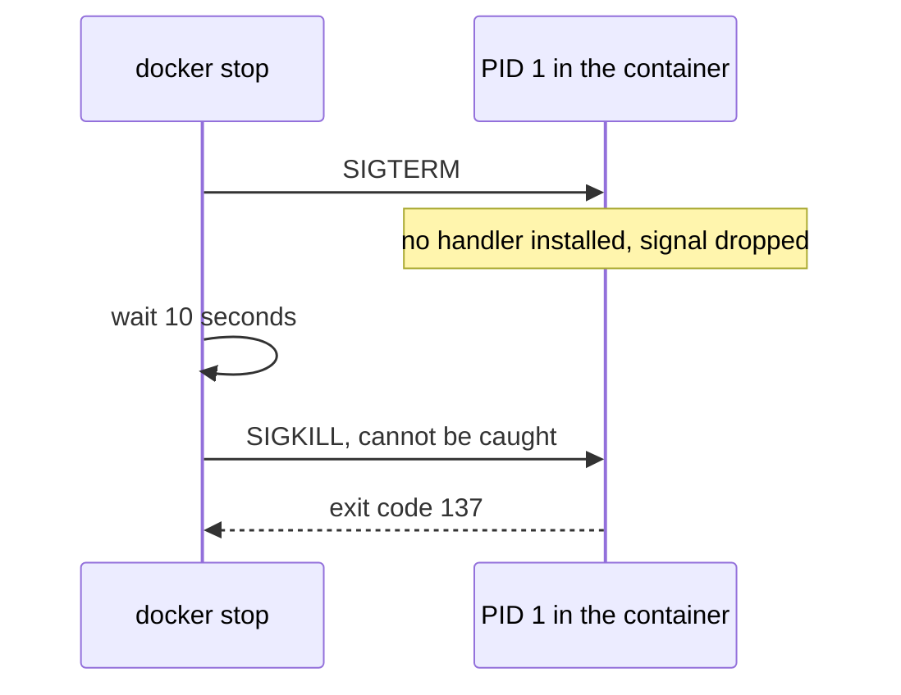

# Lesson 11. PID 1 and Signals

**Mission link:** The mission says a container must shut down cleanly on a signal. Every stop, redeploy and scale-down starts with one `SIGTERM`, and a process that ignores it is killed ten seconds later with no chance to finish its work.
**Primary source:** [Docs: "docker container stop", Docker CLI reference](https://docs.docker.com/reference/cli/docker/container/stop/)
**Prerequisites:** [Lesson 2](0002-namespaces.md), [Lesson 7](0007-your-first-dockerfile.md), [PID 1](../GLOSSARY.md), [Exec form](../GLOSSARY.md), [Shell form](../GLOSSARY.md), [Exit code](../GLOSSARY.md)

## Warm-up

1. ▢ What PID does the first process in a new PID namespace see for itself, and why does that matter for a container?

<details markdown="1"><summary>Check</summary>

It sees PID 1. A container's main process is the first process in the container's PID namespace, so it is that namespace's PID 1 and the kernel treats it differently from every other process (lesson 2).

</details>

2. ▢ What is the difference between `CMD ["app", "--port", "8080"]` and `CMD app --port 8080`, and which one starts `app` directly?

<details markdown="1"><summary>Check</summary>

The first is exec form: the runtime starts `app` itself. The second is shell form: the runtime starts `/bin/sh -c "app --port 8080"`, so the shell is the process the runtime started and `app` is its child (lesson 7).

</details>

3. ▢ A container's exit code is 137. Which signal ended it, and how do you know?

<details markdown="1"><summary>Check</summary>

`SIGKILL`. Codes above 128 mean the process was killed by signal number code minus 128, and 137 - 128 = 9, which is `SIGKILL` (lessons 3 and 5).

</details>

## Know this

### What docker stop does

`docker stop` sends the container's stop signal to the main process, then waits. If the process has not exited when the grace period ends, it sends `SIGKILL`. The default stop signal is `SIGTERM`, the image can change it with `STOPSIGNAL`, and `docker run --stop-signal` changes it for one container. The grace period defaults to 10 seconds on Linux and `docker stop -t` or `docker run --stop-timeout` changes it ([docker container stop](https://docs.docker.com/reference/cli/docker/container/stop/)).

`SIGTERM` is a request. A well-behaved service catches it, stops accepting new work, finishes what is in flight, flushes its buffers and exits with code 0. `SIGKILL` cannot be caught, so a process killed by it gets no chance to do any of that. A stop that always ends in `SIGKILL` costs ten seconds on every deploy and risks dropped requests and half-written files.

### Why PID 1 is special

The kernel treats the first process of a PID namespace as that namespace's init. One consequence is that a signal sent from inside the namespace, or from an ancestor namespace such as the host, is delivered to it only if it has installed a handler for that signal. `SIGKILL` and `SIGSTOP` are the exceptions: they are forcibly delivered when sent from an ancestor namespace ([pid_namespaces(7)](https://man7.org/linux/man-pages/man7/pid_namespaces.7.html)).

A process that is not PID 1 and has no `SIGTERM` handler gets the default action, which is to terminate. As PID 1 the same program has the default action withheld, so `SIGTERM` is silently dropped. A program that works under `kill` on a normal host can therefore ignore `docker stop`, because on the host it was never PID 1.



### The shell in the way

In shell form the process the runtime starts is `/bin/sh -c "..."`. That shell is PID 1, your program is its child, and the shell does not forward `SIGTERM` to the child. Some shells replace themselves with a lone final command and some do not, so do not rely on it. The [Dockerfile reference](https://docs.docker.com/reference/dockerfile/) says this directly for `ENTRYPOINT`: the executable is not PID 1 and does not receive Unix signals, so it does not get `SIGTERM` from `docker stop`.

The same happens when `ENTRYPOINT` is an exec-form shell script that ends by running the program as a plain command. The script stays PID 1 and the program is a child. The fix is the shell builtin `exec`, which replaces the shell with the program so the program becomes PID 1 and gets the signals itself:

```sh
#!/bin/sh
set -eu
# set up config, wait for files, run migrations ...
exec "$@"
```

### Fixing it, in order of preference

1. **Use exec form** so there is no wrapper shell, and `exec` in any entrypoint script.
2. **Handle `SIGTERM` in the program.** Most servers and frameworks have a graceful shutdown hook. This is the right fix, because it is where the in-flight work is known.
3. **Run a tiny init as PID 1** with `docker run --init`. It injects [tini](https://github.com/krallin/tini), which spawns your program as its child, forwards signals to it and exits with the child's exit code. The program is no longer PID 1, so the default `SIGTERM` action works even without a handler. In an image, `ENTRYPOINT ["tini", "--", "app"]` does the same once tini is installed.

### Reaping children

The second duty of PID 1 is to reap. When a process dies, it stays in the process table as a zombie until its parent collects its exit status. When a parent dies first, its children are re-parented to PID 1, which must collect them. A PID 1 that never calls `wait` accumulates zombies, which tini's README warns can over time starve the host of PIDs. If your service spawns subprocesses and does not wait for them, an init also fixes that.

### What this does not mean

`--init` does not make a program shut down gracefully. It makes the default `SIGTERM` action (terminate at once) work, and that is graceful only for a program that has nothing to finish. A tini-wrapped program killed by `SIGTERM` exits with 143, 128 + 15, and Tini's README notes that `tini -e 143` remaps it to 0 for a program such as a Java application whose normal shutdown reports that code. The Docker docs also say one process per container is the default and give init-style options when you need more ([Run multiple processes in a container](https://docs.docker.com/engine/containers/multi-service_container/)).

## Practice

1. ▢ A container's `docker stop` always takes just over 10 seconds and the container then shows exit code 137. Which is the most likely cause?

    - a) The image is too large to stop
    - b) The main process ignores SIGTERM until killed
    - c) The daemon has run out of memory
    - d) The container ran out of disk space

<details markdown="1"><summary>Check</summary>

**b)** `SIGTERM` was dropped, the grace period expired and `SIGKILL` ended the process, which is exit code 137. (a) is wrong because stopping a process does not depend on image size. (c) would show as an `OOMKilled` state and is about the container's own limit, not the stop sequence. (d) would break writes, not signal delivery.

</details>

2. ▢ Predict, then run. Which process is PID 1 in each container, and what does `docker stop` do to each?

    ```dockerfile
    # A
    FROM python:3.13-slim
    CMD python -c "import time; time.sleep(600)" && echo finished

    # B
    FROM python:3.13-slim
    CMD ["python", "-c", "import time; time.sleep(600)"]
    ```

<details markdown="1"><summary>Hint</summary>

Run `docker top <container>` or `docker exec <container> cat /proc/1/cmdline` after starting each. Which form puts a shell in front?

</details>

<details markdown="1"><summary>Check</summary>

In A, PID 1 is `/bin/sh -c python -c ... && echo finished` and Python is its child. The `&&` makes sure the shell stays, since some shells replace themselves with a lone simple command and some do not. The shell does not forward `SIGTERM`, so `docker stop` waits the full 10 seconds and then kills it. In B, `python` is PID 1 itself and has no `SIGTERM` handler, so the kernel withholds the default action and `docker stop` still takes 10 seconds. Both end in exit code 137. Exec form removes the shell, not the PID 1 rule. A handler, or `--init`, is what ends it at once.

</details>

3. ▢ Predict, then run. Run both lines. How long does each `docker stop` take, and what exit code does each container have?

    ```console
    $ docker run -d --name plain python:3.13-slim python -c "import time; time.sleep(600)"
    $ docker run -d --name withinit --init python:3.13-slim python -c "import time; time.sleep(600)"
    $ time docker stop plain
    $ time docker stop withinit
    $ docker inspect --format '{{.Name}} {{.State.ExitCode}}' plain withinit
    ```

<details markdown="1"><summary>Hint</summary>

With `--init` Python is a child of tini, not PID 1. What does a child with no handler do with `SIGTERM`?

</details>

<details markdown="1"><summary>Check</summary>

`plain` takes about 10 seconds and ends with 137. `withinit` takes well under a second and ends with 143: tini forwards `SIGTERM`, Python is not PID 1 so the default action terminates it, and tini exits with the child's status, 128 + 15. The second container did not become graceful. It just died on the signal instead of being killed.

</details>

4. ▢ Write a `Dockerfile` ending and an entrypoint script so that `./server` receives `SIGTERM` from `docker stop`, runs a setup step first, and takes its arguments from `CMD`.

<details markdown="1"><summary>Check</summary>

```dockerfile
COPY entrypoint.sh /entrypoint.sh
ENTRYPOINT ["/entrypoint.sh"]
CMD ["./server", "--port", "8080"]
```

```sh
#!/bin/sh
set -eu
./migrate
exec "$@"
```

The script is exec form, so it is PID 1 while it runs the setup, and `exec "$@"` then replaces it with the `CMD` so `./server` becomes PID 1 and receives the signal. Without `exec` the script stays PID 1 and `./server` never sees `SIGTERM`.

</details>

5. ▢ Why is a PID 1 that never reaps children a problem even if it handles `SIGTERM` perfectly?

<details markdown="1"><summary>Check</summary>

Orphaned processes are re-parented to PID 1, and a finished process stays in the process table as a zombie until its parent collects it. A PID 1 that never waits leaves them there, and a long-running container that spawns short-lived subprocesses slowly fills the PID table. Signal handling and reaping are separate duties.

</details>

6. ▢ A team adds `--init` to every service "to fix shutdown". One service, a queue consumer, still loses messages when stopped. Explain why and what has to change.

<details markdown="1"><summary>Check</summary>

`--init` only makes `SIGTERM` terminate the program through its default action. A consumer that is mid-message is terminated mid-message. The program has to catch `SIGTERM`, stop taking new messages, finish or hand back the current one, then exit 0, and the stop grace period has to be longer than its longest message takes (`--stop-timeout` or `docker stop -t`). The init fixed delivery, not the shutdown logic.

</details>

## Real-world reps

- [ ] Run `docker exec <container> cat /proc/1/cmdline` for three containers you already have and write down what PID 1 is for each. Note any that is `/bin/sh -c`.
- [ ] Open a Dockerfile of your own and check each `CMD` and `ENTRYPOINT` for shell form. Change one to exec form and time `docker stop` before and after.
- [ ] Tomorrow: without notes, state what the kernel does differently for PID 1, give two ways to make a program receive `SIGTERM`, and say what exit code `docker stop` produces when it has to kill.

## Going further

- [Running Containers](../reference/running-containers.md)
- [Docs: "docker container stop", Docker CLI reference](https://docs.docker.com/reference/cli/docker/container/stop/)
- [Repo: tini, Thomas Orozco](https://github.com/krallin/tini), the README sections on why to use it and on exit codes
- [Man page: pid_namespaces(7), Linux man-pages project](https://man7.org/linux/man-pages/man7/pid_namespaces.7.html), the section on signals to the init process
- [Resources](../RESOURCES.md)

---

Not landing? Reread the primary source at the top, since this lesson compresses it and compression is where understanding leaks. Check the [glossary](../GLOSSARY.md) for any term that felt slippery.

If the lesson itself is unclear rather than the material, that is a defect: [open an issue](https://github.com/TokenCemetery/teach/issues).
