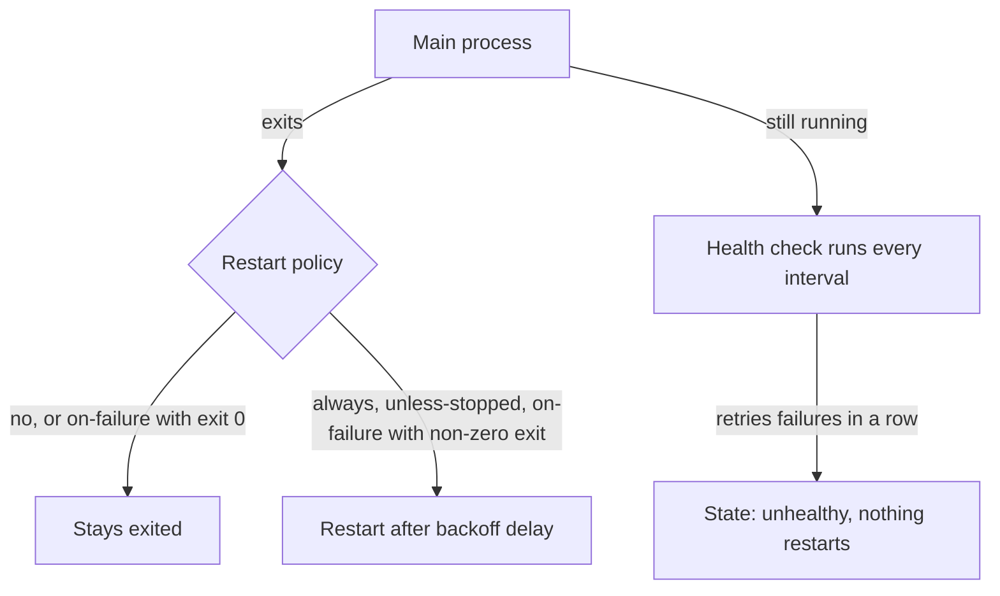

# Lesson 12. Health Checks and Restart Policies

**Mission link:** The mission says a container must report its health. A process can be running and useless, and a process can crash at 3 a.m. with nobody awake. A health check says whether the service works, a restart policy says what the runtime does when it exits, and the two answer different questions.
**Primary source:** [Docs: Dockerfile reference, Docker](https://docs.docker.com/reference/dockerfile/), the `HEALTHCHECK` section
**Prerequisites:** [Lesson 5](0005-from-image-to-running-container.md), [Lesson 11](0011-pid-1-and-signals.md), [Health check](../GLOSSARY.md), [Restart policy](../GLOSSARY.md), [Exit code](../GLOSSARY.md)

## Warm-up

1. ▢ Name the states a container passes through from `docker create` to removal, and say which state a stopped container is in.

<details markdown="1"><summary>Check</summary>

Created, running, exited (and paused or restarting in between), then removed. A stopped container is in the exited state: its process is gone but its writable layer and metadata remain until `docker rm` (lesson 5).

</details>

2. ▢ `docker stop` on a container takes 10 seconds and the container exits with 137. What happened, and what does that tell you about the process?

<details markdown="1"><summary>Check</summary>

`SIGTERM` was ignored for the whole grace period and `SIGKILL` ended it. The process is probably PID 1 without a `SIGTERM` handler, or sits behind a shell (lesson 11).

</details>

3. ▢ Where do you read the exit code of a container that has already stopped?

<details markdown="1"><summary>Check</summary>

`docker inspect --format '{{.State.ExitCode}}' <container>`, or the `Exited (N)` text in `docker ps -a`. The runtime records it when the main process ends (lesson 5).

</details>

## Know this

### Running is not working

The runtime knows whether the main process exists. It does not know whether the service answers requests. A web server whose worker pool is deadlocked, an application that lost its database connection for good, and a process stuck in an infinite loop are all running. A **health check** is a command the runtime runs inside the container on an interval, and its result is the second signal.

```dockerfile
HEALTHCHECK --interval=10s --timeout=3s --start-period=20s --retries=3 \
  CMD ["/app/healthcheck"]
```

The command's exit status is the verdict: 0 means healthy, 1 means unhealthy, and 2 is reserved and must not be used ([Dockerfile reference](https://docs.docker.com/reference/dockerfile/)). The options and their defaults:

|Option|Default|Meaning|
|---|---|---|
|`--interval`|30s|Time between checks|
|`--timeout`|30s|A check running longer than this counts as a failure|
|`--start-period`|0s|Grace time at startup during which failures do not count toward unhealthy|
|`--start-interval`|5s|Check frequency during the start period|
|`--retries`|3|Consecutive failures needed to become unhealthy|

A container is `starting` until its first success, `healthy` after one, and `unhealthy` after `retries` consecutive failures. A single success at any time makes it healthy again. You can also set the check at run time with `--health-cmd`, `--health-interval`, `--health-retries`, `--health-timeout`, `--health-start-period` and `--no-healthcheck`, or in a Compose file.

The state shows in `docker ps` as `(healthy)` or `(unhealthy)` beside the status, and in full in the inspect output:

```console
$ docker inspect --format '{{json .State.Health}}' web
{"Status":"unhealthy","FailingStreak":3,"Log":[{"Start":"...","End":"...","ExitCode":1,"Output":"curl: (7) Failed to connect"}]}
```

### What Docker does with the result, which is nothing

**Docker reports health and does not restart on it.** An unhealthy container keeps running, `docker ps` says so, and nothing is stopped or replaced. Something else has to act: a person reading `docker ps`, a script, or Compose, which can hold a dependent service back until a dependency is healthy (lesson 16). Clusters have their own probes with their own behaviour. They belong to the Kubernetes track, whose [Running Reliably](../../kubernetes/reference/running-reliably.md) sheet covers them, and this lesson mentions them only as the boundary.

The check runs inside the container, as a process in the container's namespaces, so what it uses must be in the image. A `curl` check fails on an image without `curl`, which is exactly what a distroless or minimal image has (lesson 9). The usual fix is a small `healthcheck` mode in your own binary, or a static binary copied in.

Keep a check cheap and honest. It should test the thing a request needs (the listening port answering, or a lightweight internal endpoint) and should not call the services it depends on, or one dependency outage turns every service unhealthy at once.

### Restart policies

A **restart policy** decides what the runtime does when the main process exits. It is set with `--restart` on `docker run`, and looks only at whether the container stopped, never at health.

|Policy|Restarts when|
|---|---|
|`no` (default)|Never|
|`on-failure[:max]`|The process exits with a non-zero code, up to `max` times if given|
|`always`|It exits for any reason, and again when the daemon starts|
|`unless-stopped`|Like `always`, but not after you stopped it yourself, even across a daemon restart|

The [Docker docs](https://docs.docker.com/engine/containers/start-containers-automatically/) add the details that bite. They describe a container as started successfully once it has been up for at least 10 seconds and Docker is monitoring it. A container that crashes sooner is still restarted, but each restart waits longer, so a crash on startup shows up as a container stuck in `Restarting` with a growing delay rather than a tight loop. If you stop a container by hand, the policy is ignored until the daemon restarts or you start it again. Restart policies and `--rm` conflict, so use one or the other. The [run reference](https://docs.docker.com/reference/cli/docker/container/run/) documents the delay between restarts: it starts at 100 milliseconds and doubles each time, up to a maximum of one minute, and resets after the container runs for at least 10 seconds.

### How the two fit together

A restart policy handles a process that exits. A health check handles one that does not. Neither covers the other's case: an `always` policy never fires on a deadlocked process because the process never exits, and a health check never restarts anything. Most single-host setups use `unless-stopped` or `on-failure` so a crash recovers, plus a health check so `docker ps` and Compose can see a hang.



## Practice

1. ▢ A container has `--restart always`, and its process deadlocks but keeps running. What does the runtime do?

    - a) It restarts the container after the timeout
    - b) It does nothing because the process lives
    - c) It restarts the container once marked unhealthy
    - d) It stops the container and removes it

<details markdown="1"><summary>Check</summary>

**b)** A restart policy only reacts to the process exiting. (a) and (c) assume that health or a timeout drives restarts, which it does not in Docker: health is reported, not acted on. (d) is wrong because nothing removes a container unless `--rm` was set and the process exited.

</details>

2. ▢ Predict, then run. What does the status print at each of the three points, and does the container ever stop?

    ```console
    $ docker run -d --name hc --restart always --health-cmd 'test -f /tmp/ok' --health-interval 2s --health-retries 2 alpine sleep 600
    $ sleep 1; docker inspect --format '{{.State.Health.Status}}' hc
    $ sleep 6; docker inspect --format '{{.State.Health.Status}}' hc
    $ docker exec hc touch /tmp/ok; sleep 3; docker inspect --format '{{.State.Health.Status}}' hc
    ```

<details markdown="1"><summary>Hint</summary>

The first check runs one interval after start. With two retries, how many failures does it take to turn unhealthy, and when does a success happen?

</details>

<details markdown="1"><summary>Check</summary>

```text
starting
unhealthy
healthy
```

After 1 second no check has run, so the state is `starting`. Checks at about 2 and 4 seconds fail because `/tmp/ok` does not exist, and two consecutive failures make it `unhealthy` by about second 4. After the file exists, the next check passes and the state returns to `healthy`. The container was running the whole time, `docker ps` shows `Up`, and `RestartCount` stays 0 even with `--restart always`, since the process never exited.

</details>

3. ▢ Which policy restarts a container that exits with code 0, and which does not?

    ```console
    $ docker run -d --restart on-failure:3 alpine true
    $ docker run -d --restart unless-stopped alpine true
    ```

<details markdown="1"><summary>Check</summary>

`on-failure:3` does not restart it: exit code 0 is success, so the policy does not apply. `unless-stopped` is eligible for a restart whatever the exit code, because the policy looks only at the fact that it stopped, and each restart is delayed by the doubling backoff. A container meant to run once and exit should not use `always` or `unless-stopped`.

</details>

4. ▢ A distroless image has no shell and no `curl`. Write a `HEALTHCHECK` that works for a Go service listening on port 8080 and say what has to exist in the image.

<details markdown="1"><summary>Check</summary>

```dockerfile
HEALTHCHECK --interval=10s --timeout=3s --start-period=10s CMD ["/app/server", "-healthcheck"]
```

The check must be an exec-form command, because there is no shell, and the binary has to implement the mode itself: for example, a `-healthcheck` flag that connects to `localhost:8080`, requests a lightweight endpoint, and exits 0 or 1. A `CMD-SHELL` or `curl` check would fail on every run and mark a healthy service unhealthy.

</details>

5. ▢ Predict, then run. A service takes 25 seconds to warm up. With the check below, what is the status 12 seconds after start, and what would it have been without `--start-period`?

    ```console
    $ docker run -d --name slow --health-cmd 'test -f /tmp/ready' --health-interval 5s --health-retries 2 --health-start-period 30s alpine sh -c 'sleep 25; touch /tmp/ready; sleep 600'
    $ sleep 12; docker inspect --format '{{.State.Health.Status}}' slow
    ```

<details markdown="1"><summary>Check</summary>

With the start period, `starting`. Failures during the first 30 seconds do not count toward the retries, and the first success ends the start period. Without it, the checks at 5 and 10 seconds would be two consecutive failures, so it would already be `unhealthy`, even though the service was warming up normally. The start period is for exactly this.

</details>

6. ▢ Your team wants Docker to restart any container that goes unhealthy and proposes `--restart always` plus a stricter health check. Explain why that will not work and what the options are.

<details markdown="1"><summary>Check</summary>

Docker reports health and does not act on it, and `--restart` reacts only to the process exiting, so the combination restarts nothing on a hang. Options: make the application exit when it detects it is broken, so the restart policy applies; run something that watches health and restarts containers; or move to an orchestrator, whose probes are built to act on health (outside this track, see the Kubernetes track's [Running Reliably](../../kubernetes/reference/running-reliably.md) sheet). Making the process exit on a fatal error is the cheapest and usually the right first move.

</details>

## Real-world reps

- [ ] Add a `HEALTHCHECK` to a service you run, using a command that already exists in its image. Break the service on purpose and watch the state change in `docker ps`.
- [ ] Run `docker inspect --format '{{json .State.Health}}' <container>` on any container that has a check and read the `Log` entries to see what the check printed.
- [ ] Tomorrow: without notes, say what a health check does and what a restart policy does, name the four restart policies, and say which one handles a process that hangs without exiting.

## Going further

- [Running Containers](../reference/running-containers.md)
- [Docs: Dockerfile reference, Docker](https://docs.docker.com/reference/dockerfile/), the `HEALTHCHECK` section
- [Docs: "Start containers automatically", Docker](https://docs.docker.com/engine/containers/start-containers-automatically/)
- [Docs: "docker container run", Docker CLI reference](https://docs.docker.com/reference/cli/docker/container/run/), the restart policy section for the delay between restarts
- [Resources](../RESOURCES.md)

---

Not landing? Reread the primary source at the top, since this lesson compresses it and compression is where understanding leaks. Check the [glossary](../GLOSSARY.md) for any term that felt slippery.

If the lesson itself is unclear rather than the material, that is a defect: [open an issue](https://github.com/TokenCemetery/teach/issues).
