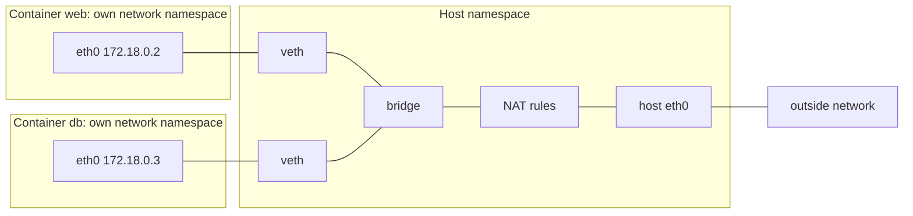

# Lesson 14. Container Networking

**Mission link:** The mission says to connect containers on one host. Almost every "it works on my machine, not in the container" networking bug is one of three things: the wrong network, a name that does not resolve, or a port that is not where you think it is.
**Primary source:** [Docs: "Bridge network driver", Docker](https://docs.docker.com/engine/network/drivers/bridge/)
**Prerequisites:** [Lesson 2](0002-namespaces.md), [Lesson 5](0005-from-image-to-running-container.md), [Namespace](../GLOSSARY.md), [Bridge network](../GLOSSARY.md), [Veth pair](../GLOSSARY.md), [Port publishing](../GLOSSARY.md)

## Warm-up

1. ▢ What does a network namespace give a process, and what does a new one contain when it is created?

<details markdown="1"><summary>Check</summary>

Its own network stack: interfaces, addresses, routing table and firewall rules. A new one starts with only a loopback interface, down, so nothing in it can reach anything until something connects it (lesson 2).

</details>

2. ▢ Which part of the runtime stack creates a container's namespaces, and who tells it what to create?

<details markdown="1"><summary>Check</summary>

The low-level runtime, runc, creates the namespaces and cgroups and starts the process. The high-level runtime hands it an OCI bundle whose `config.json` lists them. Docker's network setup, the veth pair and bridge attachment, is done around that start (lesson 5).

</details>

3. ▢ Which health state does a container report while it is still starting up, and does that stop other containers from connecting to it?

<details markdown="1"><summary>Check</summary>

`starting`. Nothing stops other containers from connecting, because health is only reported and does not gate network traffic (lesson 12). Compose can hold a dependent service back until a dependency is healthy, and lesson 16 covers that.

</details>

## Know this

### What the network is made of

A container gets its own network namespace. To reach anything, the runtime connects it to the host with a **veth pair**: two virtual interfaces joined like the ends of a cable. One end is placed inside the container's namespace, usually as `eth0`, and the other stays on the host and is attached to a **bridge network**, a Linux bridge device that acts as a software switch. Containers on the same bridge reach each other directly. Traffic that leaves the host is address-translated (masqueraded) so it appears to come from the host ([Bridge network driver](https://docs.docker.com/engine/network/drivers/bridge/)).



You can see the pieces on a Linux host: `ip link show type bridge` lists the bridge devices and `ip link show type veth` the host ends of the pairs. The exact addresses depend on the subnet Docker picked.

### The default bridge and user-defined bridges

Docker creates a default network called `bridge`, and a container joins it unless told otherwise. A network you create yourself with `docker network create` is also a bridge, with one difference that decides most design: on the default bridge containers reach each other only by IP address, and on a user-defined bridge they resolve each other by name or alias ([Bridge network driver](https://docs.docker.com/engine/network/drivers/bridge/)). The names come from an embedded DNS server at `127.0.0.11` that every container on a custom network uses and that forwards other lookups to the host's DNS servers ([Networking overview](https://docs.docker.com/engine/network/)).

```console
$ docker network create appnet
$ docker run -d --name web --network appnet nginx
$ docker run --rm --network appnet alpine wget -qO- http://web
<!DOCTYPE html>
<html>
<head>
<title>Welcome to nginx!</title>
...
```

Container IPs change each time a container is created, so never hard-code one. Use the name. Containers on different user-defined networks cannot reach each other by default, which is a cheap, useful isolation: put a database on a network that only the application joins. A container can join several networks.

### Publishing a port

Containers on a bridge can reach each other's ports without any publishing. All ports of containers on bridge networks are accessible from the Docker host and from other containers on the same network, and they are not accessible from outside the host. `-p` or `--publish` makes a port available outside the host ([Networking overview](https://docs.docker.com/engine/network/)).

```console
$ docker run -d -p 8080:80 nginx
$ docker run -d -p 127.0.0.1:8081:80 nginx
```

`-p HOST:CONTAINER` adds a NAT rule on the host: traffic arriving at the host's port 8080 is rewritten and forwarded to the container's port 80. With no address it listens on every host address, so anyone who can reach the host can reach the service. `-p 127.0.0.1:8081:80` binds only the loopback address and is the right default for a development database or an admin port ([Bridge network driver](https://docs.docker.com/engine/network/drivers/bridge/) describes the default binding address and the address form). The Dockerfile `EXPOSE` instruction documents a port and publishes nothing, and `docker run -P` publishes every exposed port to random host ports.

### The three common mistakes

- **Listening on localhost inside the container.** `localhost` in a container is the container's own loopback. A server bound to `127.0.0.1` inside answers only to processes in that container. Traffic from a published port or another container arrives on `eth0`, so it never reaches the server. Bind to `0.0.0.0` inside, and restrict who can reach it with the publish address, not the bind address.
- **Using `localhost` to reach another container.** It reaches the container itself. Use the other container's name on a shared user-defined network.
- **Publishing everything.** A published port is reachable from outside the host. Containers that only talk to each other need no `-p` at all.

## Practice

1. ▢ Why can `web` reach `db` as `http://db:5432` on one network and not on another?

    - a) Names resolve only on user-defined networks
    - b) Names resolve only on default bridge networks
    - c) Names resolve only for published ports
    - d) Names resolve only for exposed ports

<details markdown="1"><summary>Check</summary>

**a)** User-defined bridge networks provide name resolution through Docker's embedded DNS, and the default bridge does not. (b) has it backwards. (c) confuses reaching a port from the host with reaching it from a container on the same network. (d) is wrong because `EXPOSE` documents a port and changes nothing about reachability or names.

</details>

2. ▢ Predict, then run. What happens to each `ping` and why?

    ```console
    $ docker run -d --name one alpine sleep 600
    $ docker run --rm alpine ping -c 1 one
    $ docker network create lab
    $ docker run -d --name two --network lab alpine sleep 600
    $ docker run --rm --network lab alpine ping -c 1 two
    ```

<details markdown="1"><summary>Hint</summary>

Which network does each `ping` container join, and is the target on it with a name that resolves?

</details>

<details markdown="1"><summary>Check</summary>

The first prints `ping: bad address 'one'` and fails: both containers are on the default bridge, where names do not resolve. The second succeeds with one reply, because `lab` is a user-defined bridge and `two` resolves through the embedded DNS. The Docker bridge-driver page shows the same `bad address` failure on the default network.

</details>

3. ▢ Predict, then run. Which of these can a laptop on the same Wi-Fi reach, assuming the host's firewall allows it?

    ```console
    $ docker run -d -p 8080:80 nginx
    $ docker run -d -p 127.0.0.1:8081:80 nginx
    $ docker run -d nginx
    ```

<details markdown="1"><summary>Check</summary>

Only the first one, at the host's address on port 8080. The second is bound to the host's loopback, so only the host itself can use it. The third publishes nothing, so it is reachable from the host and from containers on the same network, but not from outside the host. `EXPOSE 80` in the image would not change any of this.

</details>

4. ▢ A Flask or Node server inside a container is started with its default settings, and `curl localhost:8080` on the host with `-p 8080:8080` gets "connection reset" or an empty reply. The same app works when run directly on the host. Why, and what are the two fixes?

<details markdown="1"><summary>Check</summary>

The server listens on `127.0.0.1` inside the container, which only that container's own loopback reaches. Forwarded traffic arrives on the container's `eth0`, where nothing is listening. Fix one: tell the server to bind to `0.0.0.0` (the command-line flag or setting for the host or listen address). Fix two, a workaround for a program you cannot change: on Linux run it with `--network host`, where it shares the host's network namespace and the problem disappears, at the cost of isolation and with no port publishing. The first is the right answer.

</details>

5. ▢ Draw, then check. A web app, a database and a cache. Only the web app needs to be reachable from the host. Say which networks exist, which containers join each, and which ports are published.

<details markdown="1"><summary>Check</summary>

One user-defined network, `appnet`, joined by all three containers, with one publish: `-p 8080:80` on the web app. The database and the cache publish nothing, because the web app reaches them by name on `appnet` and nothing outside the host can. If the proxy and the app should not see the database, use two networks, with the database and the web app on a `backend` network and the web app also on a `frontend` one. A container can join several networks.

</details>

6. ▢ A teammate says "just use `docker network inspect bridge` and put the container's IP in the config". Give two reasons that breaks, and the replacement.

<details markdown="1"><summary>Check</summary>

IPs are assigned when a container is created and change when it is recreated, so the config rots the next time the container is replaced. And the same config does not carry to another host or another Compose project, where the subnet differs. On the default bridge names do not resolve, which is why the habit exists. Put both containers on a user-defined network and address the peer by container name or service name, which Docker's DNS resolves each time.

</details>

## Real-world reps

- [ ] Create a user-defined network, start two containers on it, and resolve one from the other by name. Then run `docker network inspect` on it and find the subnet and both addresses.
- [ ] On a Linux host, find the bridge and veth devices with `ip link show type bridge` and `ip link show type veth` while a container runs, and match one veth to the container.
- [ ] Tomorrow: without notes, say what `-p 8080:80` and `-p 127.0.0.1:8080:80` each allow, and why a server inside a container must not bind to `127.0.0.1`.

## Going further

- [Running Containers](../reference/running-containers.md)
- [Docs: "Bridge network driver", Docker](https://docs.docker.com/engine/network/drivers/bridge/)
- [Docs: "Networking overview", Docker](https://docs.docker.com/engine/network/)
- [Article series: "Learning Containers From the Bottom Up", Ivan Velichko](https://iximiuz.com/en/posts/container-learning-path/), the networking posts for the veth and iptables detail
- [Resources](../RESOURCES.md)

---

Not landing? Reread the primary source at the top, since this lesson compresses it and compression is where understanding leaks. Check the [glossary](../GLOSSARY.md) for any term that felt slippery.

If the lesson itself is unclear rather than the material, that is a defect: [open an issue](https://github.com/TokenCemetery/teach/issues).
