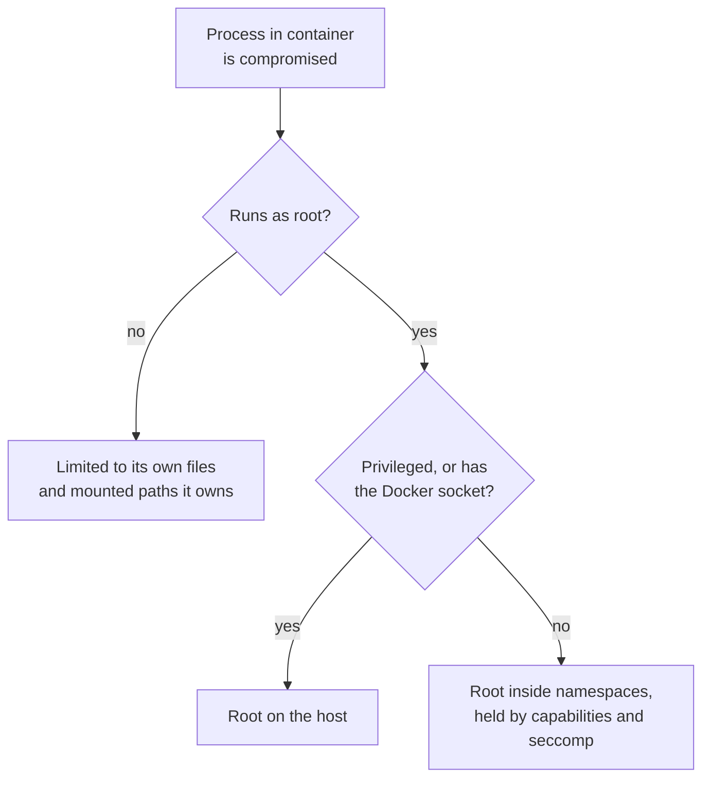

# Lesson 17. Least Privilege

**Mission link:** A container shares the host's kernel, so every privilege the process inside keeps is a privilege an attacker who breaks into it inherits. Hardening an image starts with giving that process only what it needs.
**Primary source:** [Docs: "Docker Engine security", Docker](https://docs.docker.com/engine/security/)
**Prerequisites:** [Lesson 2](0002-namespaces.md), [Lesson 7](0007-your-first-dockerfile.md), [Capability](../GLOSSARY.md), [User namespace](../GLOSSARY.md), [Privileged container](../GLOSSARY.md)

## Warm-up

1. ▢ Which namespace would make UID 0 inside a container a different, unprivileged UID on the host, and is it on by default in Docker?

<details markdown="1"><summary>Check</summary>

The user namespace. Docker does not enable it by default: unless the daemon runs in rootless mode or with `userns-remap`, UID 0 in a container is UID 0 on the host, held back only by capabilities, seccomp and the other namespaces (lesson 2).

</details>

2. ▢ In a Dockerfile, which instruction sets the user the container's process runs as, and what does the image config record when it is missing?

<details markdown="1"><summary>Check</summary>

`USER`. Without it the config's `User` field is empty, which means root (lessons 4 and 7).

</details>

3. ▢ A container is killed and exits with code 137. What sent the signal, most likely, and which number is the signal?

<details markdown="1"><summary>Check</summary>

137 is 128 + 9, so `SIGKILL`. The usual senders are the kernel's OOM killer when the cgroup hit its memory limit, or `docker stop` after the grace period ran out (lessons 11 and 13).

</details>

## Know this

### Root in a container is still root

Docker's own security page states the consequence plainly: "only trusted users should be allowed to control your Docker daemon", because the daemon can share any host directory with a container "without limiting the access rights of the container" ([Docker Engine security](https://docs.docker.com/engine/security/)). Without a user namespace, a process running as UID 0 in a container is UID 0 on the host. What stands between it and the host is the set of namespaces, a reduced set of capabilities, and the default seccomp and AppArmor or SELinux profiles. Each privilege you remove shrinks what an escape, or a mistake such as a careless bind mount, can do.

Four controls, in order of how often they apply:

| Control | How | What it removes |
|---|---|---|
| Non-root user | `USER 10001` in the Dockerfile, or `docker run --user 10001:10001` | File access as root, both inside the container and on anything mounted from the host |
| Fewer capabilities | `--cap-drop=ALL --cap-add=NET_BIND_SERVICE` | Kernel operations root could still perform, such as changing file ownership or crafting raw packets |
| Read-only root filesystem | `--read-only --tmpfs /tmp` | Writing new binaries or changing existing ones inside the container |
| No privilege escalation | `--security-opt no-new-privileges` | Gaining privileges through a setuid binary such as `su` |

### Running as a non-root user

Create a user in the image and switch to it. Use a numeric UID so the runtime does not need the image's `/etc/passwd` to resolve it, and make sure the files the process must write are owned by that user:

```dockerfile
FROM debian:bookworm-slim
RUN useradd --uid 10001 --no-create-home --shell /usr/sbin/nologin app
COPY --chown=10001:10001 app /app/app
USER 10001
ENTRYPOINT ["/app/app"]
```

Everything after `USER` runs as that user, including `RUN` steps, so put package installs before it. Distroless images ship a `nonroot` user (UID 65532) and `:nonroot` tags for exactly this ([distroless](https://github.com/GoogleContainerTools/distroless)).

The common breakage is file ownership: a volume or bind mount created by root, or an application that writes into its own install directory. Lesson 15 covers the host side of that trap.

### Capabilities

The kernel splits root's power into capabilities ([capabilities(7)](https://man7.org/linux/man-pages/man7/capabilities.7.html)). Docker keeps a default list, including `CHOWN`, `DAC_OVERRIDE`, `FOWNER`, `SETUID`, `SETGID`, `NET_RAW` and `NET_BIND_SERVICE`, and drops the rest, such as `SYS_ADMIN` and `SYS_MODULE` ([Running containers](https://docs.docker.com/engine/containers/run/)). Most services need none of the defaults. Start from nothing and add back only what fails:

```bash
docker run --rm --cap-drop=ALL --cap-add=NET_BIND_SERVICE --user 10001 myapp
```

A process started as a non-root user has no effective capabilities, but the container's set still bounds what it could regain, for example through a setuid binary. So dropping capabilities matters most for images that still run as root, and is a second layer for those that do not.

### What `--privileged` and the socket hand over

`--privileged` "gives all capabilities to the container", enables access to all host devices, and relaxes AppArmor or SELinux so the container has "nearly all the same access to the host as processes running outside containers" ([Running containers](https://docs.docker.com/engine/containers/run/)). A privileged container can mount the host's disk and read or change anything on it. Treat a request for it as a request for root on the host, and ask which single capability or device the workload actually needs.

Mounting the Docker socket, `-v /var/run/docker.sock:/var/run/docker.sock`, is the same grant by another route. Whoever can talk to the daemon can start a privileged container with the host's root filesystem mounted, so a container with the socket is root on the host whatever its own user is. The same applies to membership of the `docker` group on the host.



### Rootless mode and user namespaces

Two features remove root from the host side as well. **Rootless mode** runs the daemon and its containers as an ordinary user inside a user namespace, so even a container escape lands as that user ([Rootless mode](https://docs.docker.com/engine/security/rootless/)). Podman runs rootless by default. `userns-remap` keeps a root daemon but maps every container's UID 0 to an unprivileged range on the host ([userns-remap](https://docs.docker.com/engine/security/userns-remap/)). Both have costs, listed in their docs: some storage drivers, networking modes and bind-mount ownership behave differently. Use them when the host runs containers you do not fully trust.

## Practice

1. ▢ Name the four controls in this lesson and the flag or instruction for each.

<details markdown="1"><summary>Check</summary>

Non-root user (`USER` or `--user`), fewer capabilities (`--cap-drop=ALL` plus `--cap-add` for what is needed), read-only root filesystem (`--read-only`, with `--tmpfs` for scratch paths), and no privilege escalation (`--security-opt no-new-privileges`).

</details>

2. ▢ Predict, then run. Start `docker run --rm --read-only alpine touch /x`, then the same with `--tmpfs /tmp` and `touch /tmp/x`. What happens in each case?

<details markdown="1"><summary>Hint</summary>

`--read-only` covers the root filesystem, including the writable layer. A tmpfs is a separate mount.

</details>

<details markdown="1"><summary>Check</summary>

The first fails with `touch: /x: Read-only file system`, because `--read-only` mounts the root filesystem read-only. The second succeeds, because `/tmp` is now an in-memory tmpfs mounted on top. Paths an application must write to get their own tmpfs or volume; everything else stays read-only.

</details>

3. ▢ A CI job's container mounts `/var/run/docker.sock` so it can build images, and runs as UID 1000. A reviewer says "it is non-root, so it is fine". Which statement is right?

    - a) It is fine, because UID 1000 cannot reach host files
    - b) It is root on the host, because the daemon obeys it
    - c) It is fine, as long as capabilities are also dropped
    - d) It is risky only if the container is also privileged

<details markdown="1"><summary>Check</summary>

**b)** Anyone who can talk to the daemon can ask it to start a privileged container with the host's filesystem mounted, and the daemon runs as root. (a) is wrong because the process does not need host file access itself, it asks the daemon. (c) is wrong because capabilities limit the container's own process, not what the daemon does on its behalf. (d) is wrong because the socket is enough on its own: it can create a privileged container.

</details>

4. ▢ A service runs as root and binds port 80. You change it to `USER 10001` and it now fails to start with "permission denied" on bind. Name two fixes and say which you prefer.

<details markdown="1"><summary>Hint</summary>

The kernel guards ports below a threshold. Either stop needing the low port, or grant the one capability that permits it.

</details>

<details markdown="1"><summary>Check</summary>

Listen on an unprivileged port such as 8080 inside the container and publish it as 80 on the host (`-p 80:8080`), or grant `CAP_NET_BIND_SERVICE` to the binary or the container. The first is usually better: it needs no capability, and the port inside a container is invisible to clients anyway because publishing maps it.

</details>

5. ▢ Your colleague asks for `--privileged` because their container "needs to access a USB device". What do you ask, and what do you offer instead?

<details markdown="1"><summary>Check</summary>

Ask which device and which operations. Offer `--device /dev/<that device>` to pass just that device through, plus a single `--cap-add` if one operation needs it. `--privileged` would hand over every device and capability, and relax AppArmor or SELinux, to solve a one-device problem.

</details>

## Real-world reps

- [ ] Run `docker run --rm alpine id` and then `docker run --rm --user 10001 alpine id`. Then run `docker inspect --format '{{.Config.User}}'` on three images you use. How many run as root?
- [ ] Take one of your own images and run it with `--cap-drop=ALL --read-only --tmpfs /tmp --security-opt no-new-privileges`. Note what breaks, and add back only what the error asks for.
- [ ] Tomorrow: without notes, explain to someone why mounting the Docker socket into a container is equivalent to root on the host.

## Going further

- [Container Security](../reference/container-security.md)
- [Docs: "Docker Engine security", Docker](https://docs.docker.com/engine/security/)
- [Docs: Docker Security Cheat Sheet, OWASP](https://cheatsheetseries.owasp.org/cheatsheets/Docker_Security_Cheat_Sheet.html)
- [Docs: "Rootless mode", Docker](https://docs.docker.com/engine/security/rootless/)
- [Resources](../RESOURCES.md)

---

Not landing? Reread the primary source at the top, since this lesson compresses it and compression is where understanding leaks. Check the [glossary](../GLOSSARY.md) for any term that felt slippery.

If the lesson itself is unclear rather than the material, that is a defect: [open an issue](https://github.com/TokenCemetery/teach/issues).
