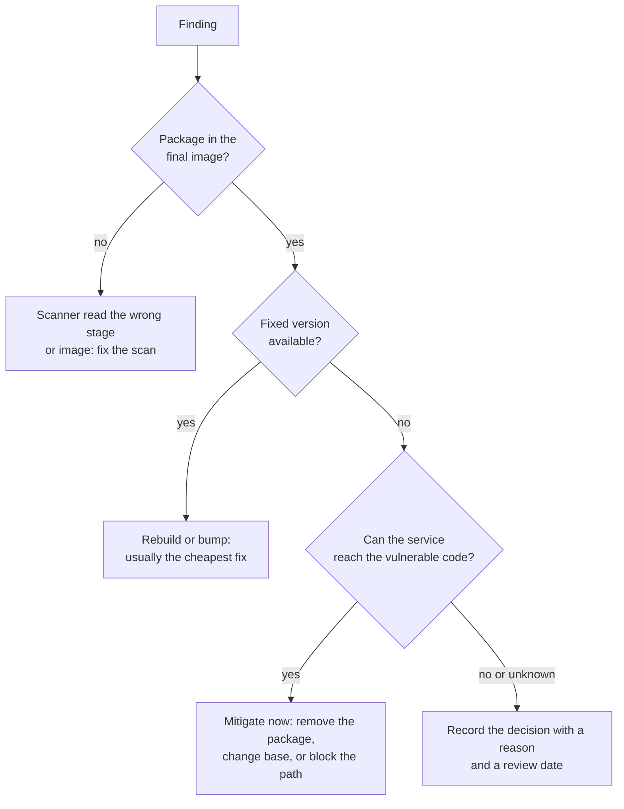

# Lesson 18. Minimal Bases and Scanning

**Mission link:** Every package in an image is code someone can attack and a line in someone's scan report. Hardening an image means shipping less, then reading the scan of what is left well enough to act on it.
**Primary source:** [Standard: NIST SP 800-190, "Application Container Security Guide", 2017](https://csrc.nist.gov/pubs/sp/800/190/final), sections 3.1 and 4.1 on image risks and countermeasures
**Prerequisites:** [Lesson 9](0009-multi-stage-builds.md), [Lesson 17](0017-least-privilege.md), [Base image](../GLOSSARY.md), [Distroless image](../GLOSSARY.md), [SBOM](../GLOSSARY.md)

## Warm-up

1. ▢ In a multi-stage build, which stage's contents end up in the pushed image, and what happens to the compiler installed in the build stage?

<details markdown="1"><summary>Check</summary>

Only the final stage's layers, plus whatever it copies with `COPY --from`. The compiler stays in the build stage, which is not part of the final image (lesson 9).

</details>

2. ▢ A Dockerfile installs a package in one `RUN` and deletes it in a later `RUN`. Is the package in the image?

<details markdown="1"><summary>Check</summary>

Yes. Each `RUN` produces a layer, and the deletion only adds a whiteout in a later layer. The files are still in the earlier layer, still downloaded, and still visible to a scanner reading the layers (lesson 4).

</details>

3. ▢ Name two of the four least-privilege controls and the flag for each.

<details markdown="1"><summary>Check</summary>

Any two of: a non-root user (`USER` or `--user`), dropped capabilities (`--cap-drop=ALL`), a read-only root filesystem (`--read-only`), and no privilege escalation (`--security-opt no-new-privileges`) (lesson 17).

</details>

## Know this

### Less in the image, less to attack

NIST SP 800-190 lists image vulnerabilities as the first image risk and recommends images that contain only what the application needs ([NIST SP 800-190](https://csrc.nist.gov/pubs/sp/800/190/final)). A shell, a package manager and a C compiler are useful to an attacker who gets in and useless to a service that is running. Each also adds findings to every scan.

The base image decides most of what ships. From most to least content:

| Base | What is in it | Trade-off |
|---|---|---|
| Full distribution (`debian:bookworm`) | Shell, package manager, many libraries and tools | Easy to debug, largest and most findings |
| Slim distribution (`debian:bookworm-slim`) | Shell and package manager, fewer packages | A common default for interpreted languages |
| Alpine (`alpine`) | BusyBox shell, `apk`, musl instead of glibc | Very small, but musl behaves differently (lesson 24) |
| Distroless (`gcr.io/distroless/static`, `.../base`, language images) | A runtime or just libc, certificates and timezone data, no shell or package manager | Small and few findings, harder to debug (lesson 21) |
| `scratch` | Nothing at all | Only for fully static binaries, and you supply certificates yourself |

Distroless images say what they hold: `static` for statically linked binaries, `base` adding glibc and OpenSSL, and per-language images ([distroless](https://github.com/GoogleContainerTools/distroless)). Pair a minimal base with a multi-stage build so build tools never reach it.

### What a scanner does

A scanner such as Trivy or Grype reads the image's layers, builds a list of the packages it finds (OS packages from the package database, language packages from lockfiles and installed metadata), and matches each name and version against vulnerability databases ([Trivy](https://trivy.dev/docs/latest/), [Grype](https://github.com/anchore/grype)). That list is an SBOM. BuildKit can generate one at build time and attach it to the image ([SBOM attestations](https://docs.docker.com/build/metadata/attestations/sbom/)).

```bash
trivy image --severity HIGH,CRITICAL myapp:1.4.2
grype myapp:1.4.2 --only-fixed
```

Each finding names the package, the installed version, the vulnerability ID, a severity, and the version that fixes it if one exists. Two limits matter: a scanner only sees packages it can identify, so a binary copied in by hand with no metadata is invisible to it, and a match means the vulnerable version is present, not that the vulnerable code can be reached.

### Triage, not a zero count

A typical slim image produces dozens of findings. Chasing zero turns into suppressing them blindly or into never shipping. Ask four questions of each finding, in order:



- **Fixed upstream?** Most findings in a base image are fixed by rebuilding against the current base, which is why images should be rebuilt on a schedule, not only when the code changes. `--ignore-unfixed` in Trivy and `--only-fixed` in Grype show the actionable part first.
- **Is the package needed?** A finding in a package the service never uses is best fixed by removing the package, often by moving to a smaller base.
- **Reachable?** A vulnerability in an image-parsing library does not matter to a service that never parses images. This is judgment: write down the reasoning, because nothing in the scan output proves it.
- **Recorded?** A suppression with no reason and no date becomes permanent. Both scanners accept an ignore list, and Trivy reads VEX documents, which record "not affected" with a justification per vulnerability ([Trivy](https://trivy.dev/docs/latest/)).

Severity alone is a poor order. A critical finding in an unreachable package matters less than a medium one in the HTTP parser every request goes through.

## Practice

1. ▢ Rank `debian:bookworm`, `distroless/static`, `debian:bookworm-slim` and `alpine` from most to least content, and name the one that changes the C library.

<details markdown="1"><summary>Check</summary>

`debian:bookworm`, `debian:bookworm-slim`, `alpine`, `distroless/static`. Alpine uses musl instead of glibc, which is the source of most "works on Debian, breaks on Alpine" surprises. Distroless `static` carries no libc at all, which is why it suits only static binaries.

</details>

2. ▢ Predict, then run. Scan `debian:bookworm` and `gcr.io/distroless/static-debian12` with `trivy image`. Predict the order of magnitude of findings for each, then compare.

<details markdown="1"><summary>Hint</summary>

Count the packages first: a scanner can only report findings for packages it found.

</details>

<details markdown="1"><summary>Check</summary>

The full Debian image reports far more findings, typically dozens or more, because it has well over a hundred packages. The distroless static image reports few or none, because it contains a handful of packages. The exact numbers change daily as databases update and images are rebuilt, which is itself the lesson: a scan count is a snapshot.

</details>

3. ▢ A scan reports a high-severity CVE in `curl`, with a fixed version available. Your Dockerfile never mentions `curl`. What is the most likely cause, and the first fix to try?

    - a) A dependency of your code, so upgrade the library
    - b) The base image ships it, so rebuild on a newer base
    - c) A false positive, so add it to the ignore list
    - d) The build stage leaked it, so add a multi-stage

<details markdown="1"><summary>Check</summary>

**b)** Packages you did not install came from the base image, and a fixed version upstream usually means a newer base tag or digest already has it. Rebuild with a pulled, current base. If the service does not need curl at all, a smaller base removes it for good. (a) is wrong because `curl` is an OS package, not a library your code declared. (c) is wrong because a fixed version exists, so ignoring it skips the cheapest fix. (d) is wrong because a build-stage leak needs a `COPY --from` that brought it across, and the Dockerfile has none.

</details>

4. ▢ Your team's policy is "no image ships with any HIGH or CRITICAL finding". A finding with no fix upstream blocks a release. What do you propose, instead of suppressing it silently or rewriting the policy away?

<details markdown="1"><summary>Check</summary>

Triage the finding: check whether the package is needed (remove it or change base if not) and whether the vulnerable code is reachable. If it stays, record a time-limited exception with the reasoning, ideally as a VEX statement or an ignore entry with a comment and an expiry, and rescan when a fix appears. Propose amending the policy to "no fixable HIGH or CRITICAL, and every exception recorded", which keeps the pressure where it works.

</details>

## Real-world reps

- [ ] Run `trivy image` on an image your team ships. Sort the findings into: fixed by rebuilding, fixed by removing a package, needs a decision.
- [ ] Rebuild that image with `docker build --pull` and scan again. How many findings did a rebuild alone remove?
- [ ] Tomorrow: without notes, write the four triage questions in order, and the scanner flag that shows only fixable findings.

## Going further

- [Container Security](../reference/container-security.md)
- [Standard: NIST SP 800-190, "Application Container Security Guide", 2017](https://csrc.nist.gov/pubs/sp/800/190/final)
- [Repo: distroless, GoogleContainerTools](https://github.com/GoogleContainerTools/distroless)
- [Docs: Trivy, Aqua Security](https://trivy.dev/docs/latest/)
- [Resources](../RESOURCES.md)

---

Not landing? Reread the primary source at the top, since this lesson compresses it and compression is where understanding leaks. Check the [glossary](../GLOSSARY.md) for any term that felt slippery.

If the lesson itself is unclear rather than the material, that is a defect: [open an issue](https://github.com/TokenCemetery/teach/issues).
