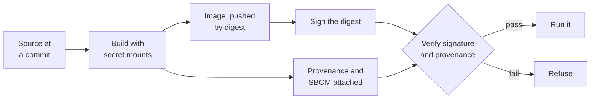

# Lesson 19. Secrets, Signing and Provenance

**Mission link:** An image is shipped to registries and hosts you do not control, so two questions follow it everywhere: what did the build leave inside it, and is this really the image that was built from your source. This lesson answers both by hand.
**Primary source:** [Docs: "Build secrets", Docker](https://docs.docker.com/build/building/secrets/)
**Prerequisites:** [Lesson 4](0004-images-and-layers.md), [Lesson 6](0006-registries-tags-and-digests.md), [Lesson 8](0008-the-build-cache.md), [Digest](../GLOSSARY.md), [Provenance attestation](../GLOSSARY.md)

## Warm-up

1. ▢ Why does pulling `myapp:1.4` twice not guarantee the same bytes, and what does?

<details markdown="1"><summary>Check</summary>

A tag is a movable name: anyone with push access can point it at a new manifest. Pulling by digest, `myapp@sha256:...`, guarantees the same content, because the digest is a hash of it (lesson 6).

</details>

2. ▢ Where does the value of an `ENV` instruction end up in a built image?

<details markdown="1"><summary>Check</summary>

In the image config's `Env` list, readable by anyone who can pull the image, for example with `docker inspect` (lesson 4).

</details>

3. ▢ A scan finds a fixable CVE in a package you never installed. What is the cheapest first fix?

<details markdown="1"><summary>Check</summary>

Rebuild against a current base image, with `docker build --pull`, because the package almost certainly came from the base and the fix is upstream already (lesson 18).

</details>

## Know this

### Where secrets leak into an image

A build often needs a credential: a token for a private package registry, an SSH key for a private repository. Every obvious way of passing one leaves it in the image:

| Attempt | Where the secret ends up |
|---|---|
| `ENV NPM_TOKEN=...` | The image config, visible to `docker inspect` |
| `ARG NPM_TOKEN` then `docker build --build-arg` | The build history, and the provenance when it is recorded with `mode=max`; Docker's `SecretsUsedInArgOrEnv` build check warns about it ([Build checks](https://docs.docker.com/reference/build-checks/)) |
| `COPY .npmrc .` then `RUN rm .npmrc` | The layer created by `COPY`; the `rm` only adds a whiteout in a later layer ([OCI layer spec](https://github.com/opencontainers/image-spec/blob/main/layer.md)) |

Anyone who can pull the image can unpack its layers with `docker save` and read every file every layer ever contained. "We delete it afterwards" protects nothing.

### Secret mounts

BuildKit's secret mount gives one `RUN` step the secret as a file, or an environment variable, for the duration of that step only, and writes it into no layer ([Build secrets](https://docs.docker.com/build/building/secrets/)):

```dockerfile
# syntax=docker/dockerfile:1
FROM node:22-slim
WORKDIR /app
COPY package.json package-lock.json ./
RUN --mount=type=secret,id=npmrc,target=/root/.npmrc npm ci
```

```bash
docker build --secret id=npmrc,src=$HOME/.npmrc -t myapp .
```

Without `target`, the file appears at `/run/secrets/<id>`. SSH keys have their own mount, `--mount=type=ssh` with `docker build --ssh default`, which forwards the agent instead of copying a key.

Runtime secrets are a different question: the image should not contain them at all. Pass them at run time, as mounted files or environment variables from whatever runs the container.

### Signing an image by digest

A signature answers "who vouches for this image". Sign the digest, never the tag: the tag can move after you sign, and a verifier would then check the signature against content you never saw. Sigstore's cosign stores the signature in the registry next to the image ([Signing containers](https://docs.sigstore.dev/cosign/signing/signing_with_containers/)):

```bash
cosign generate-key-pair
cosign sign --key cosign.key registry.example.com/myapp@sha256:4f3c...
cosign verify --key cosign.pub registry.example.com/myapp@sha256:4f3c...
```

Cosign also supports keyless signing, where a short-lived certificate is issued for an identity such as an email address or a CI workload, and the verifier checks that identity and its issuer instead of a public key. Keyless suits pipelines, which the CI/CD track's [Pipeline Security](../../ci-cd/reference/pipeline-security.md) sheet covers, provenance included.

### Provenance

A signature says who; it does not say how. A **provenance attestation** records how the image was built: the builder, the source, the build arguments and the base images used. SLSA defines the format and the levels of assurance a build can claim ([SLSA v1.0](https://slsa.dev/spec/v1.0/)). BuildKit can attach provenance to an image, with `mode=min` by default and `mode=max` adding the full build details ([Provenance attestations](https://docs.docker.com/build/metadata/attestations/slsa-provenance/)):

```bash
docker buildx build --provenance=mode=max --sbom=true -t registry.example.com/myapp:1.4.2 --push .
docker buildx imagetools inspect registry.example.com/myapp:1.4.2 --format '{{ json .Provenance.SLSA }}'
```

Docker's documentation warns that `mode=max` "exposes the values of build arguments", which is one more reason secrets never go in `ARG`.



Verification is the half that is easy to skip. A signature nobody checks is decoration: the host or pipeline that runs the image must verify it, against the expected key or identity, before running.

## Practice

1. ▢ List three ways of passing a build credential that leave it in the image, and the one that does not.

<details markdown="1"><summary>Check</summary>

`ENV` (image config), `ARG` with `--build-arg` (history and possibly provenance), and `COPY` followed by `RUN rm` (the earlier layer keeps the file). A BuildKit secret mount, `RUN --mount=type=secret`, does not: the secret exists only during that step.

</details>

2. ▢ Predict, then run. Build an image with `COPY token.txt /token.txt` then `RUN rm /token.txt`. Predict whether you can recover the token from the image, then try with `docker save myimg -o img.tar` and look inside the layer tarballs.

<details markdown="1"><summary>Hint</summary>

Each instruction's layer is its own tarball inside the saved archive. Which layer was written before the `rm`?

</details>

<details markdown="1"><summary>Check</summary>

You can. The `COPY` layer's tarball still contains `token.txt`; the `rm` layer contains only a whiteout file marking it deleted. The merged filesystem hides it, the layers do not. If a real secret ever shipped this way, rotate it: rebuilding does not unpublish the old layer.

</details>

3. ▢ Your release process signs `myapp:1.4.2` right after the build, by tag. Which risk does that leave open?

    - a) The signature expires before the image is deployed anywhere
    - b) The tag can move, so verification may check other content
    - c) Cosign cannot store a signature for an image that has tags
    - d) The registry rejects pulls of tagged images once they are signed

<details markdown="1"><summary>Check</summary>

**b)** Cosign resolves the tag to a digest when it signs, but a verifier given only the tag resolves it again later, and if someone moved the tag in between, the check runs against different content from what the release actually built. Pinning deployment and verification to the digest closes that gap. (a) is wrong because key-based signatures do not expire, and keyless ones are checked against the time recorded when the image was signed. (c) is wrong because signatures attach to digests and tags do not prevent it. (d) is wrong because registries do not change pull behaviour for signed images.

</details>

4. ▢ A colleague says "we sign our images, so we know they were built from our main branch". What does the signature prove, what does it not, and what would close the gap?

<details markdown="1"><summary>Check</summary>

The signature proves that the holder of the key, or the signing identity, vouched for that digest. It does not record what source or build produced the image: a key holder could sign an image built from anywhere. A provenance attestation records the source repository, commit and builder. Verifying it, along with the signature, closes the gap, and its strength depends on how trustworthy the builder that produced it is, which is what the SLSA levels grade.

</details>

## Real-world reps

- [ ] Run `docker history --no-trunc` on an image you build. Look for any build argument or file that looks like a credential, and check the Dockerfile for `ARG`, `ENV` and `COPY` of secrets.
- [ ] Convert one build that needs a private registry token to a secret mount, then confirm with `docker history` and `docker inspect` that the token is gone.
- [ ] Tomorrow: without notes, explain the difference between a signature and a provenance attestation, and why both are checked against a digest.

## Going further

- [Container Security](../reference/container-security.md)
- [Docs: "Build secrets", Docker](https://docs.docker.com/build/building/secrets/)
- [Docs: "Signing containers", Sigstore](https://docs.sigstore.dev/cosign/signing/signing_with_containers/)
- [Spec: SLSA v1.0](https://slsa.dev/spec/v1.0/)
- [Docs: "Provenance attestations", Docker](https://docs.docker.com/build/metadata/attestations/slsa-provenance/)
- [Resources](../RESOURCES.md)

---

Not landing? Reread the primary source at the top, since this lesson compresses it and compression is where understanding leaks. Check the [glossary](../GLOSSARY.md) for any term that felt slippery.

If the lesson itself is unclear rather than the material, that is a defect: [open an issue](https://github.com/TokenCemetery/teach/issues).
