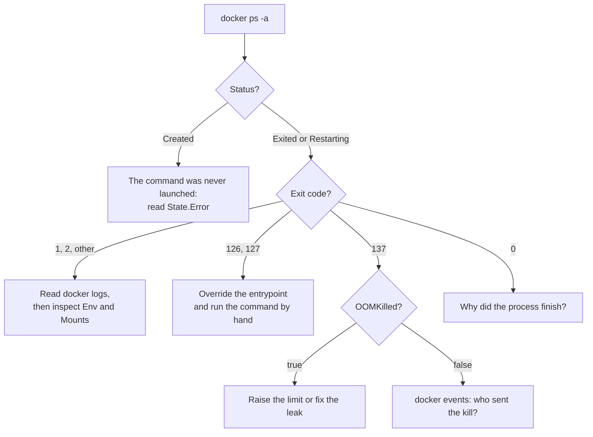

# Lesson 20. A Container That Will Not Start

**Mission link:** The mission ends with debugging a container that will not start or misbehaves. Most failures at the start are small and leave evidence, but only if you read the evidence in the right order before you delete the container.
**Primary source:** [Docs: "docker container run", Docker CLI reference](https://docs.docker.com/reference/cli/docker/container/run/), the `--entrypoint` and restart sections
**Prerequisites:** [Lesson 11](0011-pid-1-and-signals.md), [Lesson 12](0012-health-checks-and-restart-policies.md), [Lesson 13](0013-resource-limits-in-practice.md), [Exit code](../GLOSSARY.md), [Entrypoint](../GLOSSARY.md), [OOM kill](../GLOSSARY.md), [Restart policy](../GLOSSARY.md)

## Warm-up

1. ▢ A container exits with code 137 about ten seconds after `docker stop`. Which signal ended it, and what does that say about the container's process?

<details markdown="1"><summary>Check</summary>

`SIGKILL`, because 137 minus 128 is 9. The runtime sent `SIGTERM` first and the process did not exit within the grace period, usually because it is PID 1 without a handler or sits behind a shell (lesson 11).

</details>

2. ▢ A container is started with `--restart=on-failure:3` and its process exits with code 0. What does the runtime do?

<details markdown="1"><summary>Check</summary>

Nothing: `on-failure` restarts only on a non-zero exit code, and 0 is success. The container stays stopped, so a service that exits cleanly the moment it starts looks like "it never started" without ever failing (lesson 12).

</details>

3. ▢ What is the kernel's reaction when a container's cgroup reaches `memory.max` and nothing can be reclaimed, and what does the container's exit code show?

<details markdown="1"><summary>Check</summary>

It ends a process in the cgroup with `SIGKILL`, an OOM kill, so the exit code is 137. The process never sees an error, so the application logs may end mid-line with no message about memory (lesson 13).

</details>

## Know this

### Do not use --rm while you debug

A stopped container is not gone. The daemon keeps its state, its logs and its writable layer until you remove it, and that is the evidence. `docker run --rm` deletes all of it the moment the process exits, so a failing start leaves nothing to read. Run the failing container without `--rm`, or give it a name, read the evidence, then remove it.

### Read the evidence in this order

Start from what the daemon recorded and go inward. Each step narrows the next.

1. **State.** `docker ps -a --filter name=api` lists the container with its status. `Exited (1)` means the process ran and failed. `Restarting (1)` means the [restart policy](../GLOSSARY.md) keeps starting it. A container whose command could not be launched at all is typically listed as `Created`, because the runtime never reached a process.
2. **Exit code and error.** `docker inspect` reads the same record in full. A format string keeps the output to one line.
3. **Logs.** `docker logs` replays what the process wrote to standard output and standard error.
4. **Events.** `docker events` replays what the daemon did: create, start, die, kill, oom.

```console
$ docker inspect -f 'status={{.State.Status}} exit={{.State.ExitCode}} oom={{.State.OOMKilled}} restarts={{.RestartCount}} error={{.State.Error}}' api
status=exited exit=137 oom=true restarts=0 error=

$ docker logs --tail 20 -t api
2026-03-01T10:14:02.114Z loading model shards
2026-03-01T10:14:09.870Z allocating cache

$ docker events --since 30m --until "$(date +%s)" --filter container=api
2026-03-01T10:14:00.512 container create 9c1f...e2 (image=api:1.4, name=api)
2026-03-01T10:14:00.790 container start 9c1f...e2 (image=api:1.4, name=api)
2026-03-01T10:14:10.331 container oom 9c1f...e2 (image=api:1.4, name=api)
2026-03-01T10:14:10.402 container die 9c1f...e2 (exitCode=137, image=api:1.4, name=api)
```

`State.OOMKilled` is the field that separates an OOM kill from every other cause of code 137. The `--since` and `--until` flags take timestamps or durations, and without `--until` the command keeps streaming new events instead of returning ([docker system events](https://docs.docker.com/reference/cli/docker/system/events/)). The container events the daemon reports include `create`, `start`, `die`, `kill`, `oom` and `health_status`, and a `die` event carries the exit code. `docker logs` takes `--tail`, `--since`, `--until` and `-t` for timestamps ([docker container logs](https://docs.docker.com/reference/cli/docker/container/logs/)).

Empty logs are evidence too. They mean the process wrote nothing before it ended: it never started, it died instantly, or it logs to a file inside the container instead of to standard output. Which logging drivers `docker logs` can read back is set by the logging driver, which the logs page links to.

### What the exit code says

The glossary rule is the key: above 128, the process was killed by signal number minus 128. The rest is a short table.

| Exit code | Meaning | Where to look next |
|---|---|---|
| 0 | The process finished normally | Why does a service end at all? The command may be a shell with no terminal, or a script that starts a daemon and returns |
| 1, 2 and other small numbers | The process's own error | `docker logs` |
| 125 | The Docker daemon itself failed, for example a bad flag. No container ran | The error on your terminal |
| 126 | The command was found and could not be invoked | File permission bit, or the path is a directory |
| 127 | The command could not be found | The entrypoint path, a binary left out of the final stage, a missing interpreter |
| 137 | `SIGKILL`, which is 128 plus 9 | `State.OOMKilled`, then `docker events` for a `kill` |
| 139 | `SIGSEGV`, which is 128 plus 11 | The process crashed in native code |
| 143 | `SIGTERM`, which is 128 plus 15 | The process was asked to stop and did not catch the signal |

The Docker documentation defines 125, 126 and 127 for `docker run` and says any other code is the exit code of the container's own command ([Running containers, Exit status](https://docs.docker.com/engine/containers/run/)). The `die` event for a container stopped by `SIGTERM` shows `exitCode=143` in the events documentation. Treat the number as a pointer and the message as the evidence: where a failure to launch the command is reported can change between runtime versions, so read `State.Error` and the logs before you trust the digit.



### Common causes and how each looks

| What you see | Usual cause | Confirm with |
|---|---|---|
| `exec /app/start.sh: no such file or directory` although the file is in the image | The script's first line names an interpreter the image lacks, such as `#!/bin/bash` on Alpine, or a Windows line ending makes it `bash` followed by a carriage return | `od -c` on the script's first line, and `ls /bin/bash` (the command is in practice item 4) |
| The same message for a compiled program that you copied in | A dynamically linked binary whose loader is missing from the base, such as a glibc binary on musl-based Alpine | The builder's `file` output names the loader, then check that path in the image |
| Command not found, code 127 | `ENTRYPOINT` path is wrong, or the binary was not copied into the final stage of a multi-stage build (lesson 9) | `docker run --entrypoint sh IMAGE -c 'ls -l /app'` |
| Permission denied, code 126 | The file lacks the executable bit, or it is a directory | `ls -l` in the same shell |
| Code 1 and a message about a variable or host | Missing configuration, or a dependency that is not reachable yet | `docker inspect -f '{{json .Config.Env}}' api`, then lessons 14 and 16 |
| Permission denied writing a path | A non-root `USER` cannot write a volume or bind mount owned by root (lessons 15 and 17) | `docker inspect -f '{{json .Mounts}}' api` and `ls -ln` on the path |
| Code 137, `OOMKilled` true | The memory limit (lesson 13) | `docker stats --no-stream`, the limit in `docker inspect` |
| Code 0 straight away | The command finished, usually because the image's `CMD` is a shell and no terminal is attached | `docker inspect -f '{{.Config.Entrypoint}} {{.Config.Cmd}}' api` |

The first two rows share one trap. When the kernel cannot find the interpreter or the loader that a file asks for, it reports "no such file or directory", and the message names the file that does exist. Looking for the script and finding it proves nothing.

### Override the entrypoint

When the evidence points at the image and not at the process, stop running the process. `--entrypoint` replaces the image's [entrypoint](../GLOSSARY.md), so the same image, with the same user, working directory and environment from its config, starts a shell instead of the application.

```console
$ docker run --rm -it --entrypoint sh api:1.4
/ # ls -l /app
-rw-r--r-- 1 root root 8421376 Mar  1 10:11 server
/ # /app/server
sh: /app/server: Permission denied
```

In that shell run the real command by hand and read its own error. That works because the failure now happens in front of you, with no restart loop and no log driver in between.

Three details matter. The flag takes only an executable name or path, and arguments go after the image name, as in `--entrypoint ls api:1.4 -l /app`. Passing `--entrypoint` also clears any `CMD` the image sets ([Running containers, entrypoint](https://docs.docker.com/engine/containers/run/)), so the application's arguments are not passed to the shell. And `--entrypoint` carries nothing over from your original `docker run`: repeat the environment variables, mounts and network from `docker inspect` when the failure depends on them.

`docker cp` reads files out of a container with no shell at all, and it works on a stopped one: `docker cp api:/app/config.json .` ([docker container cp](https://docs.docker.com/reference/cli/docker/container/cp/)). When the image has no shell, `--entrypoint sh` fails with its own 127. A [distroless image](../GLOSSARY.md) provides `:debug` tags with a busybox shell for this ([distroless](https://github.com/GoogleContainerTools/distroless)), so you rebuild the final stage on `:debug`, then run `docker run --entrypoint=sh -ti` on it. That reproduces the filesystem, not a live instance, which is the job of lesson 21.

## Practice

1. ▢ A container shows `Exited (137)`. Name two different causes, and the one field of `docker inspect` that separates them.

<details markdown="1"><summary>Check</summary>

137 is `SIGKILL`. It is either an OOM kill by the kernel when the cgroup hit its memory limit, or a `kill` from outside: `docker kill`, or a `docker stop` whose grace period ran out. `State.OOMKilled` is `true` for the first. When it is `false`, `docker events` shows a `kill` event for the second.

</details>

2. ▢ Predict the three lines of output, then run them. Which of the three numbers comes from the Docker daemon instead of from a process in the container?

    ```sh
    docker run --rm alpine sh -c 'exit 3'; echo "exit=$?"
    docker run --rm alpine nosuchcmd; echo "exit=$?"
    docker run --rm alpine sh -c 'kill -9 $$'; echo "exit=$?"
    ```

<details markdown="1"><summary>Hint</summary>

One command never starts a process in the container, so the daemon prints an error before the `echo`.

</details>

<details markdown="1"><summary>Check</summary>

```text
exit=3
docker: Error response from daemon: ... executable file not found in $PATH
exit=127
exit=137
```

The first number is the shell's own `exit 3`. The second is the daemon's: the command could not be found, so no process ran and 127 comes from Docker, with an error message in front of it. The third is `128 + 9`, because the shell killed itself with `SIGKILL`. The exact wording of the daemon's error varies by release, and the 127 is what the documentation defines.

</details>

3. ▢ A service image's `docker run` fails with a daemon error saying the command could not be invoked, and `docker inspect` shows exit code 126. Which cause fits?

    - a) The file at /app/server lacks the executable permission bit
    - b) The process ran out of memory and was killed
    - c) The application exited early because of a missing setting
    - d) The daemon rejected an invalid flag from the client

<details markdown="1"><summary>Check</summary>

**a)** 126 means the command was found and could not be invoked, which includes a missing executable bit and a path that is a directory. (b) is code 137 with `OOMKilled` true. (c) is code 1 or another small number, with the application's message in `docker logs`. (d) is code 125, and no container exists at all.

</details>

4. ▢ A container is in a restart loop. `docker logs` prints `exec /app/start.sh: no such file or directory` on every start, and `docker run --rm --entrypoint ls api:1.4 -l /app/start.sh` shows the file exists and is executable. What are two causes, and what one command shows which?

<details markdown="1"><summary>Hint</summary>

The message names the script, but the kernel reports a missing file for anything the script depends on to start.

</details>

<details markdown="1"><summary>Check</summary>

Either the script's first line names an interpreter that is not in the image, such as `#!/bin/bash` on Alpine, or the first line ends with a Windows carriage return, so the interpreter's name is `bash` followed by a carriage return and no such file exists. `docker run --rm --entrypoint sh api:1.4 -c 'head -1 /app/start.sh | od -c; ls /bin/bash'` shows both: `od -c` prints `\r` before the newline for the second cause, and `ls` fails for the first.

</details>

5. ▢ This Dockerfile builds without error. The container then prints `exec /server: no such file or directory`, and `/server` is there. Why, how do you confirm it from the builder, and what are two fixes?

    ```dockerfile
    FROM golang:1.23 AS build
    WORKDIR /src
    COPY . .
    RUN go build -o /server .

    FROM alpine:3.20
    COPY --from=build /server /server
    ENTRYPOINT ["/server"]
    ```

<details markdown="1"><summary>Hint</summary>

Think about what the binary asks the kernel for before it can run, and what the final stage's C library is.

</details>

<details markdown="1"><summary>Check</summary>

The Go program was linked dynamically, so it names a glibc loader such as `/lib64/ld-linux-x86-64.so.2`, which Alpine, based on musl, does not have. The kernel cannot find the loader and reports "no such file or directory" for `/server`. Run `file /server` in the build stage: it says "dynamically linked, interpreter /lib64/ld-linux-x86-64.so.2". Fix one: build a static binary with `CGO_ENABLED=0` (see the [Go toolchain sheet](../../../programming/golang/reference/toolchain-commands.md)), which needs no loader. Fix two: use a final-stage base that matches the builder's C library, such as a Debian slim or distroless base image built on glibc.

</details>

## Real-world reps

- [ ] Take any container you run, stop it, and write down its exit code, its `State.Error`, and the last three lines of its logs without removing it. Then decide from those three what you would check next.
- [ ] Break one on purpose: remove the executable bit from a script used as an `ENTRYPOINT`, build, run without `--rm`, and read the exit code and `docker inspect` output. Then start a shell with `--entrypoint sh` and fix it.
- [ ] Tomorrow: without looking, write the four things to read in order after a container fails (state, exit code and error, logs, events), what each answers, and what code 127 and code 137 mean.

## Going further

- [Debugging Containers](../reference/debugging-containers.md)
- [Docs: "docker container run", Docker CLI reference](https://docs.docker.com/reference/cli/docker/container/run/)
- [Docs: "Running containers", Docker](https://docs.docker.com/engine/containers/run/)
- [Docs: "docker system events", Docker CLI reference](https://docs.docker.com/reference/cli/docker/system/events/)
- [Repo: distroless, GoogleContainerTools](https://github.com/GoogleContainerTools/distroless)
- [Resources](../RESOURCES.md)

---

Not landing? Reread the primary source at the top, since this lesson compresses it and compression is where understanding leaks. Check the [glossary](../GLOSSARY.md) for any term that felt slippery.

If the lesson itself is unclear rather than the material, that is a defect: [open an issue](https://github.com/TokenCemetery/teach/issues).
