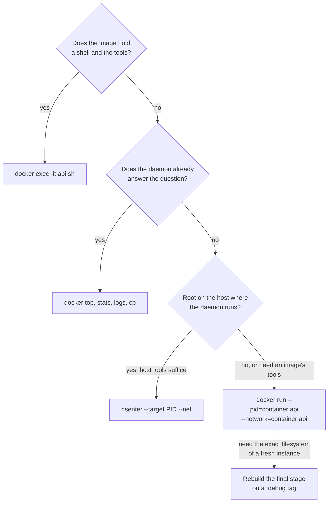

# Lesson 21. Debugging a Running Container

**Mission link:** The mission ends with debugging a container that misbehaves, including one with no shell. A hardened image has no shell, no `ps` and no `curl`, so the skill is bringing the tools to the container's namespaces instead of putting them in the image.
**Primary source:** [Man page: nsenter(1), Linux man-pages project](https://man7.org/linux/man-pages/man1/nsenter.1.html)
**Prerequisites:** [Lesson 2](0002-namespaces.md), [Lesson 17](0017-least-privilege.md), [Lesson 20](0020-a-container-that-will-not-start.md), [Namespace](../GLOSSARY.md), [Distroless image](../GLOSSARY.md), [Capability](../GLOSSARY.md), [Container runtime](../GLOSSARY.md)

## Warm-up

1. ▢ Which namespace type is the reason a container sees only its image's files, and which other namespace types does a container get?

<details markdown="1"><summary>Check</summary>

The mount namespace gives the container its own set of mounts, with the image's layers as the root. A container also gets PID, network, UTS and IPC namespaces, and a user namespace only when the runtime is configured for one (lesson 2).

</details>

2. ▢ A teammate wants to mount the Docker socket into a container so it can "just look at the other containers". What does that hand over?

<details markdown="1"><summary>Check</summary>

Root on the host. Whoever can talk to the daemon can start a privileged container, mount any host path or read any other container, so socket access is as strong as root and is not a read-only view (lesson 17).

</details>

3. ▢ What does `docker run --entrypoint sh IMAGE` do, and why does it stop being an option for a distroless image?

<details markdown="1"><summary>Check</summary>

It runs a shell from the image's filesystem instead of the application, and it also clears the image's `CMD`. A distroless image ships no shell, so the runtime cannot find `sh` and fails with a not-found error, which is why the `:debug` tags exist (lesson 20).

</details>

## Know this

### Why exec is not enough

`docker exec -it api sh` runs a second command inside the running container ([docker container exec](https://docs.docker.com/reference/cli/docker/container/exec/)). It works only when the image holds the program you name. On a [distroless image](../GLOSSARY.md) there is no `sh` to start, and the same holds for `ps`, `ss` and `curl`.

The missing piece is the filesystem, not the isolation. A container is an ordinary process in a set of namespaces (lesson 1), and the mount namespace is the one that makes the image's files the only files it can see. That separation is useful here: a second process can join the application's PID and network namespaces and keep a mount namespace of its own, so it carries its own tools and still sees what the application sees.

### Ask the daemon first

Four commands need nothing inside the image. They come before any debug container.

| Command | Shows |
|---|---|
| `docker top api` | The container's processes as the host sees them, with host PIDs ([docker container top](https://docs.docker.com/reference/cli/docker/container/top/)) |
| `docker stats --no-stream api` | CPU, memory against its limit, network and block I/O right now |
| `docker cp api:/app/config.json .` | A file out of the container, running or stopped ([docker container cp](https://docs.docker.com/reference/cli/docker/container/cp/)) |
| `docker inspect -f '{{.State.Pid}}' api` | The PID of the container's process in the host's PID namespace |

### A debug container that joins the namespaces

`docker run` can place a new container in another container's PID namespace and network stack. The Docker documentation calls joining another container's PID namespace "useful for debugging that container", and its example attaches `strace` to PID 1 of an `nginx` container ([docker container run, PID settings](https://docs.docker.com/reference/cli/docker/container/run/)). The network equivalent is `--network container:<name|id>`, which attaches a container to another container's network stack ([Networking overview](https://docs.docker.com/engine/network/)).

```console
$ docker run --rm -it --pid=container:api --network=container:api \
    --cap-add SYS_PTRACE alpine sh
/ # ps
PID   USER     TIME  COMMAND
    1 65532    0:03  /app/server
   17 root      0:00  sh
   24 root      0:00  ps
/ # netstat -ltn
Active Internet connections (only servers)
Proto Recv-Q Send-Q Local Address           Foreign Address         State
tcp        0      0 127.0.0.1:8080          0.0.0.0:*               LISTEN
/ # wget -qO- http://127.0.0.1:8080/healthz
ok
/ # ls /proc/1/root/app
config.json  server
```

Everything above ran from the `alpine` image, so nothing was added to the application's image. `ps` lists the application as PID 1 because the debug container is in its PID namespace. `netstat` and `wget` use the application's network stack, so `127.0.0.1` is the application's loopback. And `/proc/1/root` is the application's root directory: the kernel documents it as giving the same view of the filesystem, including the process's mounts, as the process itself ([proc_pid_root(5)](https://man7.org/linux/man-pages/man5/proc_pid_root.5.html)), which is how you read its files without a shell in its image.

| Namespace or resource | In the debug container | Consequence |
|---|---|---|
| PID | Joined with `--pid` | You see the application's processes, and PID 1 is the application |
| Network | Joined with `--network` | Same interfaces, same `localhost`, same listening ports |
| Mount | Its own | You see `alpine`'s files, and the application's through `/proc/1/root` |
| Cgroup | Its own | The debug tools are not charged to the application's memory limit |
| UTS and IPC | Its own | A different hostname, and no shared IPC objects |

Some flags cannot be combined with joining a network. The documentation lists `--publish`, `--hostname`, `--dns`, `--add-host`, `--mac-address` and `--expose` as unsupported there, because the joined container's stack already carries those settings. If reading `/proc/1/root` or tracing returns "permission denied", the application probably runs as a different user than the debug container, and `--cap-add SYS_PTRACE` is what lets the debug container act on it. The documentation's `strace` example adds both `--cap-add SYS_PTRACE` and `--security-opt seccomp=unconfined`.

### nsenter from the host

`nsenter` does the same from outside Docker. It runs a program in the namespaces of an existing process, and `--target` names the process whose `/proc/PID/ns/*` files it uses ([nsenter(1)](https://man7.org/linux/man-pages/man1/nsenter.1.html)). Find the container's host PID with `docker inspect`, then pick the namespaces you want.

```console
$ PID=$(docker inspect -f '{{.State.Pid}}' api)
$ sudo nsenter --target "$PID" --net ss -ltnp
State  Recv-Q Send-Q Local Address:Port Peer Address:Port Process
LISTEN 0      4096       127.0.0.1:8080      0.0.0.0:*     users:(("server",pid=4821,fd=7))
```

Here `--net` enters only the network namespace. The program is the host's own `ss`, so the container needs no tools at all, and `ss` reads the host's `/proc`, which is why the process appears with its host PID. `--mount` and `--pid` are the options that change this. Entering the container's mount namespace replaces your filesystem with the container's, so the host's tools are no longer there and you are back to what the image holds. Entering the PID namespace alone is a trap: `ps` reads whichever `/proc` your mount namespace holds, and the host's `/proc` describes the host's PIDs. `--all` enters every namespace, so you see the container exactly as its process does, and you are limited to the tools its image holds.

Two limits apply. `nsenter` needs root on the machine where the container's process actually runs. And on Docker Desktop the daemon runs inside a Linux virtual machine, so the PID that `docker inspect` prints belongs to that machine, not to your laptop: run `nsenter` there.

You can prove two processes share a namespace. The kernel gives each namespace an inode number, and two processes in the same namespace have the same number in their `/proc/PID/ns/` links ([namespaces(7)](https://man7.org/linux/man-pages/man7/namespaces.7.html)).

```console
$ readlink /proc/$PID/ns/net
net:[4026532761]
$ docker run --rm --network=container:api alpine readlink /proc/self/ns/net
net:[4026532761]
```

The number is different on every machine. What matters is that the two lines match.

### Choosing the way in



| Way in | Needs | What it gives | Leaves behind |
|---|---|---|---|
| `docker exec` | A shell or tool in the image | The application's own filesystem and cgroup | Nothing |
| Debug container | Access to the daemon, and an image with tools | The application's processes and network, plus `/proc/1/root` | Nothing with `--rm` |
| `nsenter` | Root where the daemon runs | The host's tools inside chosen namespaces | Nothing |
| `:debug` image | A rebuild and a restart | A busybox shell in a fresh instance ([distroless](https://github.com/GoogleContainerTools/distroless)) | A different instance, so the bug may not recur |

### What it costs

A debug container with `SYS_PTRACE` can read the application's memory and files, and starting it needs the same access to the daemon that lesson 17 called equivalent to root. Give it the trust you would give the Docker socket: do it deliberately, remove the container with `--rm` when you finish, and do not leave the extra capability on anything that stays running. Attaching `strace` also slows the process it traces, so a live service under load feels it.

## Practice

1. ▢ Why does `docker exec -it api sh` fail on a distroless image, and which of the container's isolation features is the actual obstacle?

<details markdown="1"><summary>Check</summary>

The image has no `sh` binary, so there is nothing for the runtime to start. The obstacle is the mount namespace: the container's filesystem is the only one it can see, and that filesystem holds no shell. The PID and network namespaces are fine, which is why joining them from a container that carries its own tools works.

</details>

2. ▢ Predict what each command prints, then run them. Whose `127.0.0.1` is each `wget` using?

    ```sh
    docker run -d --name web nginx:alpine
    docker run --rm --network=container:web alpine wget -qO- http://127.0.0.1
    docker run --rm alpine wget -qO- http://127.0.0.1
    docker run --rm --pid=container:web alpine ps
    docker rm -f web
    ```

<details markdown="1"><summary>Hint</summary>

A container's loopback address belongs to its network namespace, and only one of the two `wget` containers shares `web`'s.

</details>

<details markdown="1"><summary>Check</summary>

The first `wget` prints the nginx welcome page, because it joined `web`'s network namespace, so `127.0.0.1` is nginx's own loopback. The second fails with a connection refused error, because that container has its own empty loopback with nothing listening. `ps` lists `nginx: master process nginx -g daemon off;` as PID 1, followed by worker processes and the `ps` itself, because it shares `web`'s PID namespace. The exact worker count depends on your CPUs.

</details>

3. ▢ You start a debug container with `--pid=container:api --network=container:api`. Which statement about it is true?

    - a) Its root filesystem is the application's own filesystem tree
    - b) PID 1 is the application and localhost is shared
    - c) Its memory use counts against the application's cgroup limit
    - d) Its hostname and IPC objects are the application's own

<details markdown="1"><summary>Check</summary>

**b)** Joining the PID and network namespaces puts the application at PID 1 and gives both containers one `localhost`. (a) is wrong because the mount namespace is the debug container's own, and the application's files are reachable only through `/proc/1/root`. (c) is wrong because each container has its own cgroup. (d) is wrong because only the PID and network namespaces were joined, so UTS and IPC stay separate.

</details>

4. ▢ Other containers get connection timeouts from `api`, a distroless image that logs `listening on port 8080` and is healthy by its own check. Which commands show whether the application listens on an address other containers can reach, and what would you conclude from `127.0.0.1:8080`?

<details markdown="1"><summary>Hint</summary>

Other containers reach it through the container's own network interface, not through its loopback.

</details>

<details markdown="1"><summary>Check</summary>

`docker run --rm -it --network=container:api alpine netstat -ltn` lists the listening sockets in the application's network namespace. A local address of `127.0.0.1:8080` means the server bound only to loopback, so a peer on the bridge network cannot connect even though the process is up and its own health check, which runs inside, passes. The fix is in the application's configuration: bind to `0.0.0.0`, then check again with the same command (lesson 14).

</details>

5. ▢ You have root on the Linux host running the daemon, and a distroless container `api`. Write the commands to list its listening sockets with the host's `ss`, then explain why `nsenter --target "$PID" --pid ps` prints a confusing list and what changes if you add `--mount`.

<details markdown="1"><summary>Hint</summary>

`ps` reads `/proc`, and there is one `/proc` per mount namespace.

</details>

<details markdown="1"><summary>Check</summary>

`PID=$(docker inspect -f '{{.State.Pid}}' api)` then `sudo nsenter --target "$PID" --net ss -ltnp`. Entering only the PID namespace leaves you in the host's mount namespace, so `ps` reads the host's `/proc`, which describes the host's PIDs, and the list does not match the container's. Adding `--mount` makes `ps` read the container's `/proc`, but it also replaces your filesystem with the container's, which has no `ps` on a distroless image, so the command fails. For a process list, use `docker top api` or a debug container with `--pid=container:api`.

</details>

## Real-world reps

- [ ] On a Linux shell with root, start any container, get its PID from `docker inspect`, and list `/proc/PID/ns/`. Compare its `net` entry with `readlink /proc/self/ns/net` in a second container started with `--network=container:` the first, and with one started without it.
- [ ] Build or pick an image with no shell, such as a Go binary in `FROM scratch` or a distroless image. Show that `docker exec -it NAME sh` fails, then use a debug container to list its listening sockets and read one of its files through `/proc/1/root`.
- [ ] Tomorrow: without looking, list four ways to look inside a container that has no shell, and write the one thing each needs (access to the daemon, root on the host, a rebuild or nothing at all).

## Going further

- [Debugging Containers](../reference/debugging-containers.md)
- [Man page: nsenter(1), Linux man-pages project](https://man7.org/linux/man-pages/man1/nsenter.1.html)
- [Docs: "docker container exec", Docker CLI reference](https://docs.docker.com/reference/cli/docker/container/exec/)
- [Docs: "docker container run", Docker CLI reference](https://docs.docker.com/reference/cli/docker/container/run/)
- [Repo: distroless, GoogleContainerTools](https://github.com/GoogleContainerTools/distroless)
- [Man page: namespaces(7), Linux man-pages project](https://man7.org/linux/man-pages/man7/namespaces.7.html)
- [Resources](../RESOURCES.md)

---

Not landing? Reread the primary source at the top, since this lesson compresses it and compression is where understanding leaks. Check the [glossary](../GLOSSARY.md) for any term that felt slippery.

If the lesson itself is unclear rather than the material, that is a defect: [open an issue](https://github.com/TokenCemetery/teach/issues).
