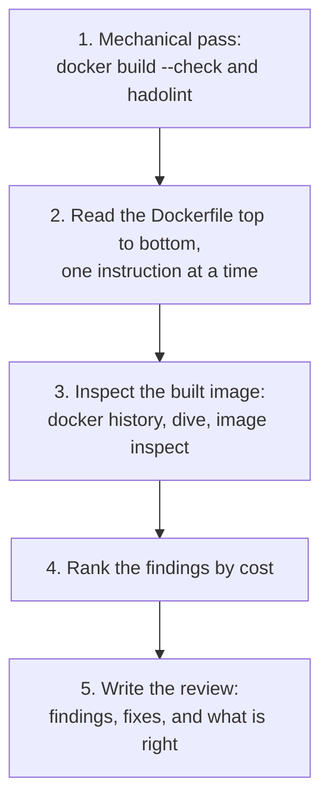

# Lesson 22. Reviewing a Dockerfile

**Mission link:** The track ends with trusting you to review someone else's Dockerfile and image and to defend the verdict. "This feels wrong" cannot be defended and cannot be acted on, so this lesson turns what stages 3 to 7 taught into one method: find the choice, name what it costs, and say what to change.
**Primary source:** [Docs: "Building best practices", Docker](https://docs.docker.com/build/building/best-practices/)
**Prerequisites:** [Lesson 8](0008-the-build-cache.md), [Lesson 9](0009-multi-stage-builds.md), [Lesson 11](0011-pid-1-and-signals.md), [Lesson 17](0017-least-privilege.md), [Lesson 19](0019-secrets-signing-and-provenance.md), [Build cache](../GLOSSARY.md), [Shell form](../GLOSSARY.md), [Image config](../GLOSSARY.md)

## Warm-up

1. ▢ A Dockerfile copies the whole source tree and then runs the dependency install. Why does editing one source file make the install run again?

<details markdown="1"><summary>Check</summary>

The build cache keys a layer on its instruction and on everything before it. The `COPY` layer changes when any copied file changes, and a miss at one instruction rebuilds every instruction after it, including the install (lesson 8). Copying the dependency manifest, installing, and only then copying the source keeps the install cached.

</details>

2. ▢ `CMD python server.py` is in shell form. What is PID 1 in the container, and what does `docker stop` therefore risk?

<details markdown="1"><summary>Check</summary>

The shell, started as `/bin/sh -c`, is the process the runtime signals. A shell does not forward `SIGTERM` to its child by default, so the service may never see it and the runtime waits out the grace period and sends `SIGKILL`. Exec form, `CMD ["python", "server.py"]`, makes the program itself the process that receives signals (lesson 11).

</details>

3. ▢ Two teams run `FROM python:3.12-slim` and `FROM python@sha256:...` with a full digest. Months later one of them gets different bytes from a rebuild. Which, and why?

<details markdown="1"><summary>Check</summary>

The tag one. A tag is a movable name and its publisher can point it at new content at any time, while a digest is the hash of the content and always names the same bytes (lesson 6).

</details>

## Know this

### What a review is

A review is a list of findings. Each finding has three parts: the choice you can point at, what it costs, and what you would change. "Do not use latest" is a rule. "`FROM python:latest` means a rebuild next month can pull a new major version with nobody having chosen it, so pin a version" is a finding, and the author can agree, disagree or answer it.

The costs fall in four classes. Every Dockerfile instruction you have met since lesson 7 can be read against them.

| Class | The question | Where it was taught |
|---|---|---|
| Size | What ships in the final image that the process does not need? | Lessons 4, 9, 18 |
| Rebuild time | What does a one-line change make the builder redo? | Lesson 8 |
| Security | What does a process in this image, or anyone who pulls it, get? | Lessons 17 to 19 |
| Reliability | Will it start the same way every time, stop cleanly and report its health? | Lessons 10 to 13 |

### The order of a review



**1. The mechanical pass.** BuildKit checks a Dockerfile against a fixed rule list when you run `docker build --check .` ([Build checks](https://docs.docker.com/reference/build-checks/)). The list is mostly about form: casing, duplicate stage names, `JSONArgsRecommended` for a shell-form `ENTRYPOINT` or `CMD`, `SecretsUsedInArgOrEnv`, `CopyIgnoredFile`. [hadolint](https://github.com/hadolint/hadolint) is a second linter and also checks the shell inside `RUN` with ShellCheck. A linter does not know your service, so it cannot say whether a root user is acceptable or whether a base image is the right one. That is what the rest of the review is for.

**2. Read in layer order.** Read as the builder runs: `FROM`, then each instruction, asking the four questions of every line. The order of instructions is itself a finding when it costs rebuild time.

**3. Inspect the image, not only the file.** The Dockerfile is the source and the image is the result (see [Image config](../GLOSSARY.md)). `docker history --no-trunc IMAGE` lists the instruction behind each layer and its size, `docker image inspect IMAGE` shows the config (user, entrypoint, environment, exposed ports), and [dive](https://github.com/wagoodman/dive) shows what each layer added. A secret in `ENV` is in the config even though no file contains it.

**4. Rank.** A review with fourteen equal bullets gets one fix and thirteen ignored. Put findings in order of cost: a secret in a layer or a root user on an internet-facing service first, a missing `.dockerignore` later, instruction casing last.

**5. Say what is right.** A review that only lists faults is half done. It also tells the author which choices to keep, so a later cleanup does not remove them.

### A worked review

```dockerfile
FROM python:latest
WORKDIR /app
COPY . .
RUN pip install -r requirements.txt
ENV API_TOKEN=sk-test-123
EXPOSE 8000
CMD python server.py
```

|Line|Finding|Cost|Change|
|---|---|---|---|
|`ENV API_TOKEN=...`|A credential in the image config|Security: anyone who can pull the image reads it with `docker image inspect` (lesson 19)|Remove it, pass the secret at run time, use a build secret mount if the build needs one|
|`FROM python:latest`|A moving tag on a full distribution base|Reliability: the next rebuild can change the interpreter version. Size: a full base ships tools the service does not use|Pin a version tag, consider a slim base, see [Pin base image versions](https://docs.docker.com/build/building/best-practices/)|
|`COPY . .` before `RUN pip install`|The install depends on every source file|Rebuild time: any source edit reinstalls every dependency. Size and security: with no `.dockerignore`, `.git` and local files go into the layer|Copy `requirements.txt`, install, then copy the source, and add a `.dockerignore`|
|no `USER`|The process runs as root|Security: a flaw in the service starts with full privileges in the container (lesson 17)|Create a user and add `USER` before `CMD`|
|`CMD python server.py`|Shell form|Reliability: the shell receives `SIGTERM` (lesson 11), and BuildKit's `JSONArgsRecommended` check exists for it|`CMD ["python", "server.py"]`|

What is fine: `WORKDIR` makes the path explicit, and `EXPOSE` only documents the port, which is what it is for (see [Port publishing](../GLOSSARY.md)). Whether the missing `HEALTHCHECK` is a finding depends on who runs the image, so write it as a question to the author, not as a defect: does the platform that runs this probe the service itself?

### A fix that does not fix

A common reviewer comment is "this `apt-get install` leaves a cache, add `RUN rm -rf /var/lib/apt/lists/*` on the next line". It does not shrink the image. A layer is a changeset, and a removal is recorded as a whiteout file that hides the path from lower layers ([OCI Image Layer Filesystem Changeset, Whiteouts](https://github.com/opencontainers/image-spec/blob/main/layer.md#whiteouts)). The bytes stay in the earlier layer, which the image still contains. Delete in the same `RUN` that created the files, or keep them out with a multi-stage build.

## Practice

1. ▢ A teammate's review says "this Dockerfile is bad, please rewrite it". Rewrite the comment as a finding about `COPY . .` placed before the dependency install.

<details markdown="1"><summary>Check</summary>

For example: "`COPY . .` comes before `RUN npm ci`, so any source edit invalidates the install layer and every dependency downloads again on each build. Copy `package.json` and the lock file, run the install, then copy the rest." It names the choice, the cost (rebuild time) and the change. Any version with those three parts is right.

</details>

2. ▢ A reviewer proposes adding `RUN rm -rf /var/lib/apt/lists/*` as a separate instruction after the install to shrink the image. What does the specification say will happen?

    - a) A whiteout hides the files, the image stays the same size
    - b) The files are removed from the earlier layer, so it shrinks
    - c) The builder merges both layers, so the files are never stored
    - d) The build fails because a layer cannot delete a lower path

<details markdown="1"><summary>Check</summary>

**a)** A removal is recorded as a whiteout entry in the new layer, and the earlier layer still holds the bytes. (b) is wrong because layers are never edited after they are built. (c) is wrong because the builder keeps one layer per instruction. (d) is wrong because deleting a lower path is exactly what a whiteout is for.

</details>

3. ▢ Predict, then run. The worked review's `ENV API_TOKEN=sk-test-123` line is built into an image `app:review`. Predict what this prints, and whether it needs the container to be running.

    ```console
    $ docker image inspect app:review --format '{{range .Config.Env}}{{println .}}{{end}}' | grep API_TOKEN
    ```

<details markdown="1"><summary>Hint</summary>

The command asks the image, not a container. Where does an image record the environment it will start a process with?

</details>

<details markdown="1"><summary>Check</summary>

```text
API_TOKEN=sk-test-123
```

No container is needed. `ENV` is stored in the image config (the `Env` list), so anyone who can pull the image can read the value, and `docker history` also shows the `ENV` instruction. Deleting the line in a later commit does not help anyone who already pulled the old image, so the credential must also be revoked.

</details>

4. ▢ You run `docker build --check .` on the worked Dockerfile and it reports nothing that matters to you. Which of these findings could the check miss, and which would no linter find?

<details markdown="1"><summary>Check</summary>

The build check's rules are about form and a few known mistakes, so it can miss a moving `latest` tag, a missing `USER`, and the order of `COPY` against the install. No linter finds the question of whether this service should be root-free at all, whether the platform probes health itself, or whether the base is the right one for this workload, because that needs knowledge of the service. A clean linter run is the start of a review.

</details>

5. ▢ A final stage reads `FROM gcr.io/distroless/static-debian13`, then `COPY --from=build /out/app /app`, `USER nonroot` and `ENTRYPOINT ["/app"]`. List what you would keep and one question you would ask before approving.

<details markdown="1"><summary>Check</summary>

Keep: the multi-stage build (the compiler stays out of the final image), the minimal base with no shell or package manager, the non-root user, and the exec-form entrypoint, which a shell-less image requires ([distroless README](https://github.com/GoogleContainerTools/distroless)). Questions worth asking: is the binary static, since the `static` base has no C library to load; is the base pinned by digest with something that bumps it; and how will the team debug a container with no shell (lesson 21)? Saying what to keep is part of the review.

</details>

## Real-world reps

- [ ] Take a Dockerfile from a repository you work in and run `docker build --check .` and hadolint on it. Write the findings as three-part comments (choice, cost, change), and add one thing you would keep.
- [ ] Build that image, run `docker history --no-trunc` on it, and find the largest layer. Write down which instruction made it and whether anything in it is unneeded at run time.
- [ ] Run `docker image inspect` on the same image and read its `User`, `Entrypoint` and `Env`. Find one fact that the Dockerfile alone did not make obvious.
- [ ] Tomorrow: without looking, write the four cost classes and one lesson from stages 3 to 6 that belongs to each.

## Going further

- [Dockerfile Review Checklist](../reference/dockerfile-review-checklist.md)
- [Docs: "Building best practices", Docker](https://docs.docker.com/build/building/best-practices/)
- [Docs: Build checks, Docker](https://docs.docker.com/reference/build-checks/)
- [Repo: hadolint](https://github.com/hadolint/hadolint)
- [Repo: dive, Alex Goodman](https://github.com/wagoodman/dive)
- [Docs: Docker Security Cheat Sheet, OWASP](https://cheatsheetseries.owasp.org/cheatsheets/Docker_Security_Cheat_Sheet.html)
- [Resources](../RESOURCES.md)

---

Not landing? Reread the primary source at the top, since this lesson compresses it and compression is where understanding leaks. Check the [glossary](../GLOSSARY.md) for any term that felt slippery.

If the lesson itself is unclear rather than the material, that is a defect: [open an issue](https://github.com/TokenCemetery/teach/issues).
