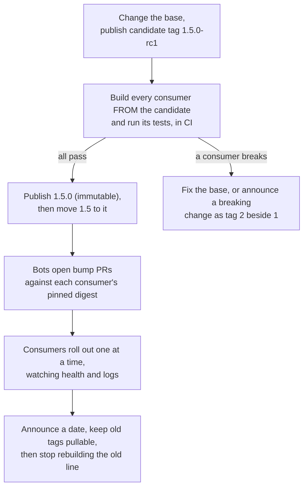

# Lesson 23. Changing a Base Image Others Depend On

**Mission link:** The track ends with trusting you to carry a change through something other people depend on. A shared base image is that: one edit reaches every service built on it at its next rebuild. This lesson is how to make the edit so nobody learns about it from a failed deploy.
**Primary source:** [Docs: "Building best practices", Docker](https://docs.docker.com/build/building/best-practices/), the "Rebuild your images often" and "Pin base image versions" sections
**Prerequisites:** [Lesson 6](0006-registries-tags-and-digests.md), [Lesson 8](0008-the-build-cache.md), [Lesson 10](0010-reproducible-builds.md), [Lesson 22](0022-reviewing-a-dockerfile.md), [Base image](../GLOSSARY.md), [Tag](../GLOSSARY.md), [Digest](../GLOSSARY.md)

## Warm-up

1. ▢ A build cache hit needs the instruction and everything before it to be unchanged. What does that imply for the instructions after a `FROM` whose base image changed?

<details markdown="1"><summary>Check</summary>

They all miss. The base image's layers are the start of the chain, so a different base changes the input of every later instruction and each one rebuilds (lesson 8).

</details>

2. ▢ A registry shows one tag pointing at a manifest. Name two ways the content that tag resolves to can change without anyone editing a Dockerfile.

<details markdown="1"><summary>Check</summary>

The publisher can move the tag to a different manifest, and a tag that points at an image index resolves to a different per-platform manifest on a different architecture (lesson 6). A digest does neither: it is the hash of the content.

</details>

3. ▢ Name one input besides the base image that makes two builds of the same Dockerfile produce different digests, and one fix.

<details markdown="1"><summary>Check</summary>

Examples from lesson 10: an unpinned package install that fetches whatever version is current, fixed by pinning versions, or timestamps written into the image, fixed with `SOURCE_DATE_EPOCH`. Either one is enough.

</details>

## Know this

### What consumers depend on

A base image's contract is everything a service built on it can observe: the operating system and C library, the packages present, the user it runs as, its paths, whether it has a shell, its `ENTRYPOINT` and `ENV`, and its labels. A change is breaking when any of that changes in a way a consumer used, whatever number the new tag carries. Removing `curl` from a base is breaking for every service whose `HEALTHCHECK` calls it. Changing the default user can break writes to a volume (lesson 15). Switching a base from one C library to another can break binaries that were not rebuilt (lesson 24).

Write the contract down before you change it. Without a list, "did we break anyone" has no answer.

### Tags that mean something

Registry tags are mutable, and publishers rely on that: Docker's own example is that `alpine:3.21` resolves to the latest patch release of 3.21, so a rebuild three months later can silently get 3.21.4 where it had 3.21.1 ([Pin base image versions](https://docs.docker.com/build/building/best-practices/)). The OCI distribution specification defines a tag as "a custom, human-readable pointer to a manifest" and says one manifest digest may have zero, one or many tags ([OCI Distribution Specification](https://github.com/opencontainers/distribution-spec/blob/main/spec.md)). So a tag scheme is a convention you publish, not something the registry enforces. A workable one for an internal base image:

|Tag|Moves?|Means|Who uses it|
|---|---|---|---|
|`1.4.2`|Never|This exact build|Rollbacks, bug reports|
|`1.4`|On each patch|The latest 1.4.x, no breaking change|Services that want patches|
|`1`|On each minor|The latest 1.x.y, no breaking change|Rare, loosely coupled services|

A breaking change gets a new major tag, `2`, beside the old one, and `1` stops moving. Never re-push an immutable tag such as `1.4.2`, because every service that rebuilds against it changes without a review, which is the problem pinning exists to solve.

### What consumers should do

A consumer chooses where to stand on the same trade. Pinning a tag takes patches with no review. Pinning a digest, as in `FROM alpine:3.21@sha256:...`, guarantees the same bytes even if the tag moves, and Docker's page names the cost: you opt out of automated security fixes, and updating the digest by hand is tedious. Its recommendation is to keep the digest and let a bot raise the update, using GitHub Dependabot with `package-ecosystem: "docker"`, which opens a pull request for new tags and digests on a schedule. That gives control and an audit trail of when and how the base changed ([Pin base image versions](https://docs.docker.com/build/building/best-practices/)).

Two build details matter during a rollout. First, a local copy of a tag is reused: `docker build --pull` forces a check for a newer base, while `--no-cache` re-runs the steps without fetching a fresh base ([Rebuild your images often](https://docs.docker.com/build/building/best-practices/)). Second, the cache cost in the warm-up is real: when a service's base digest changes, every one of its instructions rebuilds, so a base change multiplies by the number of services and by each one's build time.

### The rollout



1. **Candidate first.** Publish under a tag nobody consumes. The `rc` suffix is a convention, not a registry feature.
2. **Test the consumers, not only the base.** The base's own tests prove it starts. Only a consumer's build and test run prove the consumer still works. Keep a list of consumers, which is what lets you do this and what tells you whom to notify.
3. **Publish the immutable tag, then move the floating one.** In that order, so a mistake caught late leaves the floating tag where it was.
4. **Roll consumers out one at a time.** A bump pull request per service, each deployed with its health check watched (lesson 12), starting with the least critical. Because the base is pinned by digest, each service moves when its owner merges, not when the registry changes.
5. **Deprecate with a date.** Say which tag line ends and when, keep the old tags pullable so a rollback still works, and keep patching it for the announced window. A base removed from a registry breaks every build that still names it.
6. **Verify the digest that shipped.** Compare what the service runs with what was tested: `docker image inspect --format '{{index .RepoDigests 0}}' IMAGE` prints the `name@sha256:...` reference of a pulled image.

### When the base itself has a security fix

Patching is the same rollout, faster: a patch tag such as `1.4.3` moves `1.4`, bots raise the bumps, and the services rebuild. A consumer pinned by a digest that nobody bumps never gets the fix, which is the cost of pinning stated above. A review (lesson 22) that approves a digest pin should ask who or what bumps it.

## Practice

1. ▢ A base-image owner fixes a typo in a label and re-pushes the existing tag `1.4.2`. Who is affected, and what should have been done?

<details markdown="1"><summary>Check</summary>

Every service that rebuilds with `FROM base:1.4.2` and no digest changes silently, and a service pinned by digest does not move at all, so the fleet is now split with nobody having decided it. Publish `1.4.3` and let `1.4` move to it. An immutable tag stays immutable.

</details>

2. ▢ You maintain a base image and remove `curl` from it. Which consumers break, and which one check before publishing would have shown you?

    - a) Services whose health check runs curl, found by building them
    - b) None, since consumers pin their own tags and digests
    - c) Only services that installed curl again in their own Dockerfile
    - d) Services that publish a port, found by scanning the base

<details markdown="1"><summary>Check</summary>

**a)** A `HEALTHCHECK` command runs inside the container, so it needs the binary the base used to provide, and building and testing each consumer against the candidate shows the failure before anyone deploys. (b) is wrong because pinning delays the break to the day they bump, it does not prevent it. (c) is wrong because those services are the ones that already survive. (d) is wrong because published ports do not depend on a base's tools.

</details>

3. ▢ Predict, then run. A service's Dockerfile is `FROM alpine:3.20`, then `RUN echo built > /marker`. You build it, change only the first line to `FROM alpine:3.21`, and build again. How many steps show `CACHED` in the second build, and why?

    ```console
    $ docker build --progress=plain -t svc:a .
    $ printf 'FROM alpine:3.21\nRUN echo built > /marker\n' > Dockerfile
    $ docker build --progress=plain -t svc:b .
    ```

<details markdown="1"><summary>Hint</summary>

The cache key of an instruction includes the layers beneath it. Which layers beneath the `RUN` are different now?

</details>

<details markdown="1"><summary>Check</summary>

None of the instruction steps print `CACHED`. The `RUN` ran against a different base, so its cache entry does not match, and the digests of `svc:a` and `svc:b` differ. In a fleet this is the multiplier: one base change rebuilds every instruction of every consumer, so schedule the rollout and its CI load, rather than letting every repository rebuild at once.

</details>

4. ▢ A consumer writes `FROM registry.example.com/base/python:1.4@sha256:...`. The owner then publishes a security fix and moves `1.4` to it. What does this consumer's next build use, what does it need in order to get the fix, and why is that the right default?

<details markdown="1"><summary>Check</summary>

It keeps using the old bytes, because the digest names content and ignores where the tag points. To get the fix it needs the digest bumped, by a bot pull request or by hand. It is the right default because the change then arrives as a reviewed commit with an audit trail, with the cost that a pin nobody bumps is a pin that never patches ([Pin base image versions](https://docs.docker.com/build/building/best-practices/)).

</details>

5. ▢ You own a base used by thirty services and must change the default user from root to a non-root one, which is a security improvement. Write the rollout plan in five lines, naming the tag you publish.

<details markdown="1"><summary>Check</summary>

A good plan: this breaks any service that writes to a path it does not own, so it is a breaking change and gets a new major tag, `2.0.0`, with `1.x` still patched. Build and test all thirty consumers against `2.0.0-rc1` and list the ones that fail on permissions (lesson 15). Fix the bases or the services. Publish `2.0.0` and move `2`. Bots raise bump pull requests, the least critical services first. Announce a date on which `1.x` stops being patched and keep its tags pullable until then.

</details>

## Real-world reps

- [ ] Find the `FROM` lines across the repositories you can read. Write which pin a tag, which pin a digest, and which use `latest` or no tag, and name one service where you would change the choice.
- [ ] Run the three commands from the predict item with two Alpine versions and read the second build's output, then compare the two image digests with `docker image inspect --format '{{.Id}}' svc:a svc:b`.
- [ ] Write the contract of a base image you own or use: the user, shell, paths, packages and entrypoint a consumer could be relying on.
- [ ] Tomorrow: from memory, write the order of a base rollout (candidate, consumer tests, immutable tag, floating tag, bumps, deprecation) and say which step protects consumers pinned by digest.

## Going further

- [Dockerfile Review Checklist](../reference/dockerfile-review-checklist.md)
- [Docs: "Building best practices", Docker](https://docs.docker.com/build/building/best-practices/)
- [Spec: OCI Distribution Specification](https://github.com/opencontainers/distribution-spec/blob/main/spec.md)
- [Spec: OCI Image Index](https://github.com/opencontainers/image-spec/blob/main/image-index.md)
- [Resources](../RESOURCES.md)

---

Not landing? Reread the primary source at the top, since this lesson compresses it and compression is where understanding leaks. Check the [glossary](../GLOSSARY.md) for any term that felt slippery.

If the lesson itself is unclear rather than the material, that is a defect: [open an issue](https://github.com/TokenCemetery/teach/issues).
