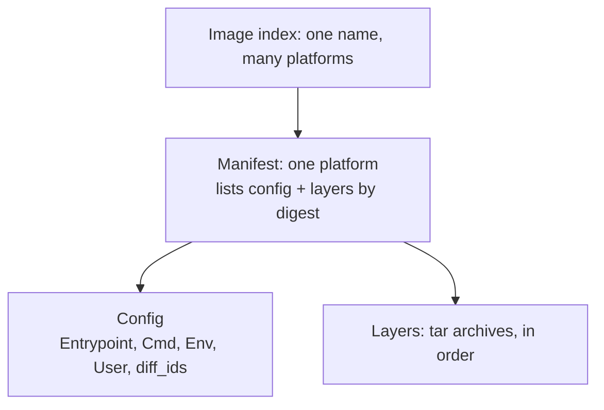
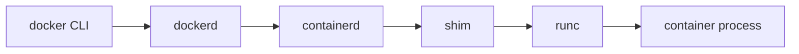
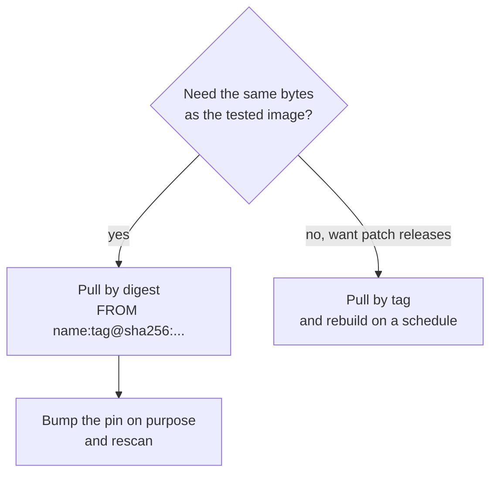

# Container Primitives: Namespaces, Cgroups, Images and Digests

Stages 1 and 2 compressed for lookup. [Lesson 1](../lessons/0001-a-container-is-a-process.md) covers a container as a process, [lesson 2](../lessons/0002-namespaces.md) namespaces, [lesson 3](../lessons/0003-cgroups.md) cgroups, [lesson 4](../lessons/0004-images-and-layers.md) images and layers, [lesson 5](../lessons/0005-from-image-to-running-container.md) the path from image to running container, and [lesson 6](../lessons/0006-registries-tags-and-digests.md) registries, tags and digests.

## What a container is

A process, or process tree, on the host kernel, given three things:

| Ingredient | Changes | Mechanism |
|---|---|---|
| Namespaces | What the process sees | `clone`, `unshare`, `setns`; links in `/proc/<pid>/ns/` |
| Cgroups | What it can use | Files under `/sys/fs/cgroup` |
| Root filesystem | Which files it sees at `/` | Image layers merged by overlayfs, plus a writable layer |

There is no guest kernel. `uname -r` in a container prints the host's kernel. On a Mac, Docker Desktop runs the containers in a Linux virtual machine, so it prints that machine's kernel.

## Namespaces

| Type | `unshare` flag | Isolates |
|---|---|---|
| Mount | `--mount` | Mount table |
| PID | `--pid` | Process IDs |
| Network | `--net` | Devices, stacks, ports |
| UTS | `--uts` | Hostname |
| IPC | `--ipc` | System V IPC, POSIX message queues |
| User | `--user` | User and group IDs |
| Cgroup | `--cgroup` | Cgroup root directory |
| Time | `--time` | Boot and monotonic clocks |

Commands to build a view by hand (root, Linux):

| Goal | Command | Shows |
|---|---|---|
| Own hostname | `unshare --uts sh -c 'hostname x; hostname'` | `x`; host unchanged |
| Empty network | `unshare --net ip link` | Only `lo`, down |
| Own PIDs | `unshare --pid --fork --mount-proc sh -c 'echo $$; ps -e; true'` | `1`, then two rows |
| Private mounts | `unshare --mount sh -c 'mount -t tmpfs none /mnt && ls /mnt'` | Mount invisible to the host |
| Root without root | `unshare --user --map-root-user id -u` | `0` |

- `--fork` is needed for the PID namespace: the new namespace holds the children of `unshare`, not `unshare` itself.
- `--mount-proc` is needed for `ps` to match: `ps` reads `/proc`, so the PID namespace alone does not change its output.
- Compare namespaces with `readlink /proc/<pid>/ns/<type>`. Equal numbers mean the same namespace.
- A namespace lives while a process, an open file descriptor or a bind mount refers to it.
- A container has its own mount, PID, network, UTS and IPC namespaces, and by default shares the host's user namespace, so root inside is UID 0 outside unless `userns-remap` or rootless mode is on.

## Cgroups (v2)

Check the version with `stat -fc %T /sys/fs/cgroup`: `cgroup2fs` is v2.

| File | Meaning | At the limit |
|---|---|---|
| `memory.max` | Hard memory limit, default `max` | OOM killer runs in the cgroup, `SIGKILL`, exit 137 |
| `memory.high` | Throttle limit | Throttled and reclaimed, never OOM killed |
| `memory.current` | Memory in use | |
| `memory.events` | `high`, `max`, `oom`, `oom_kill` counters | |
| `cpu.max` | `$MAX $PERIOD` in microseconds, default `max 100000` | Paused until the next period (throttling) |
| `cpu.stat` | `usage_usec`, `nr_throttled`, `throttled_usec` | |
| `pids.max` | Hard limit on processes | `fork` fails |
| `cgroup.procs` | PIDs in the cgroup, write to move one in | |
| `cgroup.subtree_control` | Controllers enabled for children | |

Rules:

- A directory is a cgroup. Controllers must be enabled in the parent's `cgroup.subtree_control` for a child to have their files.
- A non-root cgroup with processes of its own cannot enable controllers for its children (no internal process constraint).
- `cpu.max` is a quota for the whole group, not per thread: `50000 100000` is half of one CPU in total.
- A cgroup hides nothing. Isolation is namespaces, and limits are cgroups.

Docker flags to files:

| Flag | File | Value |
|---|---|---|
| `--memory 256m` | `memory.max` | `268435456` |
| `--cpus 0.5` | `cpu.max` | `50000 100000` |
| `--pids-limit 100` | `pids.max` | `100` |

Exit 137 is 128 plus signal 9. An OOM kill is one cause, and `memory.events` shows `oom_kill` when it was.

## The image layout



| Document | Holds | Digest is the hash of |
|---|---|---|
| Image index | A list of manifests with `platform` | The index bytes |
| Manifest | Digest and size of the config and each layer | The manifest bytes |
| Config | `Entrypoint`, `Cmd`, `Env`, `User`, `WorkingDir`, `rootfs.diff_ids`, `history` | The config bytes |
| Layer | Files added, changed or deleted | The stored blob (usually compressed), while `diff_id` is the uncompressed tar |

- Deleting a file in a later layer adds a whiteout (`.wh.<name>`). The earlier layer still holds the bytes, so the image does not shrink.
- Overlayfs: lower directories are the read-only layers, the upper is writable. Writing a lower file copies it up. Deleting one creates a whiteout in the upper (a character device 0/0).
- `docker image inspect <image> --format '{{json .RootFS}}'` lists the `diff_ids`. `docker history <image>` lists the steps and sizes.
- Docker's storage backend is `overlay2` on the classic store and a snapshotter on the containerd image store. `docker image inspect --format '{{.GraphDriver.Name}}' <image>` shows it.

## From image to running container



| Layer | Job |
|---|---|
| docker CLI | Sends the request, prints the answer |
| dockerd | Images, networks, volumes, merges image config with flags |
| containerd | High-level runtime: image storage, snapshots, lifecycle |
| shim | Parent of the process after `runc` exits, keeps streams and status |
| runc | Low-level runtime: namespaces, cgroup, mounts, starts the process |

| OCI state | Meaning |
|---|---|
| `creating` | Environment being built |
| `created` | Environment exists, program not run |
| `running` | Program executed, not exited |
| `stopped` | Process exited |

| Command | Effect |
|---|---|
| `docker create` | Container and writable layer made, nothing runs |
| `docker start` | Runs the entrypoint |
| `docker run` | Pull if missing, `create`, `start` |
| `docker stop` | Stop signal, then `SIGKILL` after the grace period |
| `docker rm` | Deletes the container and its writable layer |
| `docker diff <c>` | `A` added, `C` changed, `D` deleted in the writable layer |

The writable layer survives `stop` and `start` and not `rm`. Data that must outlive a container goes in a volume.

## Tags and digests

| | Tag | Digest |
|---|---|---|
| Form | `1.27`, `latest` | `sha256:` and 64 hex digits |
| Names | A pointer to a manifest | The content itself |
| Can move | Yes, to any content | No |
| Use for | Reading, and following patch releases | Running exactly what was tested |

```text
registry.example.com/team/web:1.4.2@sha256:<digest>
```

- A tag is at most 128 characters and matches `[a-zA-Z0-9_][a-zA-Z0-9._-]{0,127}`.
- A registry serves `GET /v2/<name>/manifests/<tag-or-digest>` and `GET /v2/<name>/blobs/<digest>`.
- A client that asks by digest should verify that the manifest it gets hashes to it.
- A tag usually resolves to an image index. The index digest is the same on every host, and each host then takes the manifest for its platform.
- Find a digest: `docker pull` prints `Digest:`, and `docker image inspect <image> --format '{{index .RepoDigests 0}}'` prints `name@sha256:...`. The image ID from `docker images` is local and is not a pin.
- Inspect an index: `docker buildx imagetools inspect <image>`.
- A pinned digest never gets fixes until someone moves the pin, so pinning needs a bump routine.



## Sources

- [Man page: namespaces(7)](https://man7.org/linux/man-pages/man7/namespaces.7.html)
- [Docs: "Control Group v2"](https://docs.kernel.org/admin-guide/cgroup-v2.html)
- [Spec: OCI Image Manifest](https://github.com/opencontainers/image-spec/blob/main/manifest.md)
- [Spec: OCI Runtime Specification](https://github.com/opencontainers/runtime-spec/blob/main/spec.md)
- [Spec: OCI Distribution Specification](https://github.com/opencontainers/distribution-spec/blob/main/spec.md)
- [Resources](../RESOURCES.md)
