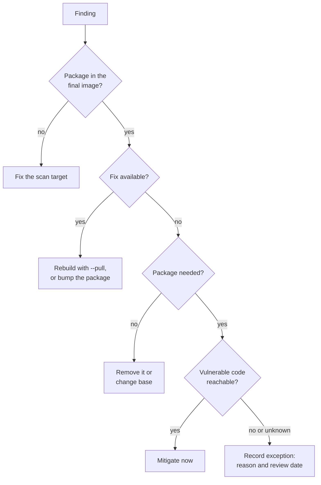

# Container Security: Privileges, Contents and Trust

Stage 6 compressed for lookup. [Lesson 17](../lessons/0017-least-privilege.md) covers privileges, [lesson 18](../lessons/0018-minimal-bases-and-scanning.md) covers minimal bases and scan triage, and [lesson 19](../lessons/0019-secrets-signing-and-provenance.md) covers build secrets, signing and provenance.

## Least privilege

| Control | Dockerfile | `docker run` | Removes |
|---|---|---|---|
| Non-root user | `USER 10001` | `--user 10001:10001` | Root file access inside and on mounts |
| Fewer capabilities | | `--cap-drop=ALL --cap-add=<one>` | Kernel operations root could still do |
| Read-only root filesystem | | `--read-only --tmpfs /tmp` | Writing or replacing binaries |
| No privilege escalation | | `--security-opt no-new-privileges` | Gaining privileges through setuid binaries |
| Pass one device | | `--device /dev/<name>` | The need for `--privileged` |

Equivalent to root on the host, whatever the container's user:

- `--privileged`: every capability, every host device, AppArmor or SELinux relaxed.
- The Docker socket mounted in (`-v /var/run/docker.sock:...`), or membership of the host's `docker` group.

Root on the host side removed entirely: rootless mode (daemon and containers as a normal user), or `userns-remap` (container UID 0 mapped to an unprivileged host range).

## Base images

| Base | Shell | Package manager | C library | Fits |
|---|---|---|---|---|
| Full distribution | yes | yes | glibc | Debugging, build stages |
| Slim distribution | yes | yes | glibc | Interpreted languages, a safe default |
| Alpine | BusyBox | `apk` | musl | Small images when musl is known to work |
| Distroless | no | no | glibc or none | Compiled services and supported runtimes |
| `scratch` | no | no | none | Fully static binaries only |

## Scan triage



| Tool | Scan | Fixable only | Severity filter |
|---|---|---|---|
| Trivy | `trivy image <ref>` | `--ignore-unfixed` | `--severity HIGH,CRITICAL` |
| Grype | `grype <ref>` | `--only-fixed` | `--fail-on high` |

- A scanner sees only packages it can identify. A binary copied in without metadata is invisible.
- A match means the version is present, not that the code is reachable.
- Rebuild on a schedule: most base-image findings are fixed upstream already.

## Build secrets

| Never | Because |
|---|---|
| `ENV TOKEN=...` | Stored in the image config |
| `ARG TOKEN` with `--build-arg` | Build history, and provenance with `mode=max` |
| `COPY` then `RUN rm` | The earlier layer keeps the file |

Instead:

```dockerfile
# syntax=docker/dockerfile:1
RUN --mount=type=secret,id=npmrc,target=/root/.npmrc npm ci
RUN --mount=type=ssh git clone git@example.com:org/private.git
```

```bash
docker build --secret id=npmrc,src=$HOME/.npmrc --ssh default .
```

A secret that shipped in a layer must be rotated. Rebuilding does not unpublish the old layer.

## Signing and provenance

| | Answers | Tool |
|---|---|---|
| Signature | Who vouches for this digest | `cosign sign` and `cosign verify` |
| Provenance attestation | How and from what source it was built | `docker buildx build --provenance=mode=max` |
| SBOM | What packages it contains | `docker buildx build --sbom=true` |

```bash
cosign sign --key cosign.key registry.example.com/myapp@sha256:<digest>
cosign verify --key cosign.pub registry.example.com/myapp@sha256:<digest>
docker buildx imagetools inspect registry.example.com/myapp:1.4.2 --format '{{ json .Provenance.SLSA }}'
```

- Sign and verify the digest, never the tag.
- A signature nobody verifies before running protects nothing.
- Provenance is only as trustworthy as the builder that wrote it.
