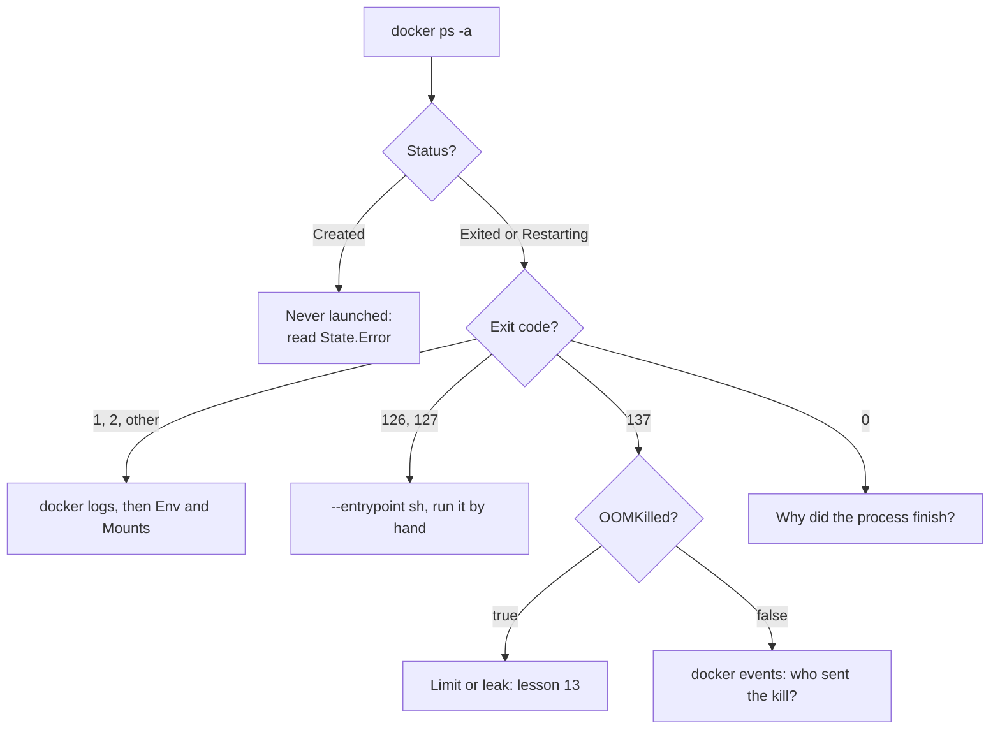
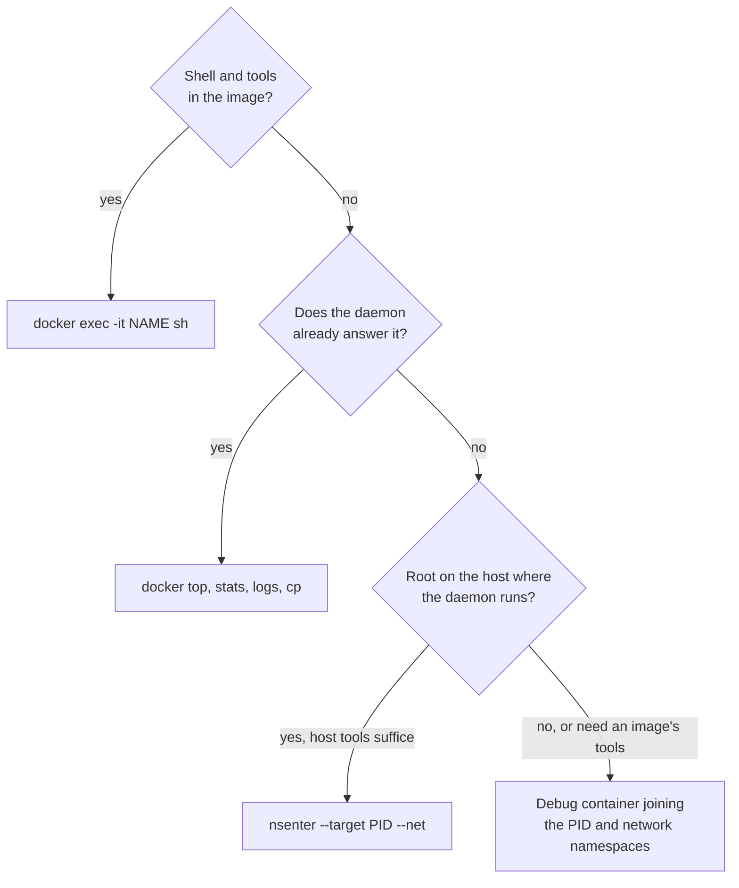

# Debugging Containers: Evidence, Exit Codes and Ways In

Stage 7 compressed for lookup. [Lesson 20](../lessons/0020-a-container-that-will-not-start.md) covers reading the exit code, the logs and the inspect output, and overriding the entrypoint, and [lesson 21](../lessons/0021-debugging-a-running-container.md) covers getting inside a container that has no shell by joining its namespaces.

## The commands, in order

Do not use `--rm` on a container you are debugging: it deletes the evidence when the process exits.

| # | Command | Answers |
|---|---|---|
| 1 | `docker ps -a --filter name=NAME` | Is it `Created`, `Exited (N)`, `Restarting (N)` or running |
| 2 | `docker inspect -f 'status={{.State.Status}} exit={{.State.ExitCode}} oom={{.State.OOMKilled}} restarts={{.RestartCount}} error={{.State.Error}}' NAME` | Exit code, whether the kernel killed it for memory, restart count, the runtime's error |
| 3 | `docker logs --tail 50 -t NAME` | What the process wrote before it ended. Empty means it never started, died at once, or logs to a file |
| 4 | `docker events --since 30m --until "$(date +%s)" --filter container=NAME` | What the daemon did: `create`, `start`, `die` with `exitCode`, `kill` with `signal`, `oom` |
| 5 | `docker inspect -f '{{json .Config.Env}}' NAME` | The environment the process received. Also `.Mounts`, `.Config.Entrypoint`, `.Config.Cmd` and `.Config.User` |
| 6 | `docker run --rm -it --entrypoint sh IMAGE` | A shell in the same image, to run the real command by hand |

`--until` is what makes `docker events` return. Without it the command keeps streaming.

## Exit codes

Above 128 the process was killed by signal number minus 128.

| Code | Meaning | First check |
|---|---|---|
| 0 | Finished normally | Why does a service end? Shell as `CMD` with no terminal, or a script that daemonizes |
| 1, 2, other small | The process's own error | `docker logs`, then the environment and mounts |
| 125 | The Docker daemon itself failed, no container ran | The error printed by `docker run` |
| 126 | Command found, cannot be invoked | Executable bit, or the path is a directory |
| 127 | Command not found | `ENTRYPOINT` path, binary missing from the final stage, missing interpreter |
| 137 | `SIGKILL` (128 + 9) | `State.OOMKilled`, then `docker events` for a `kill` |
| 139 | `SIGSEGV` (128 + 11) | Native-code crash |
| 143 | `SIGTERM` (128 + 15) | Stopped by the signal, process did not catch it |

125, 126 and 127 are defined for `docker run` by the [Docker documentation](https://docs.docker.com/engine/containers/run/). Any other code is the container command's own. Where a failure to launch is reported can differ between runtime versions, so trust `State.Error` and the logs over the digit.



## Causes that look alike

| What you see | Cause | Confirm |
|---|---|---|
| `exec /x.sh: no such file or directory`, file exists | Interpreter in the shebang missing, or a Windows line ending after it | `od -c` on the first line, `ls /bin/bash` |
| The same for a compiled program | Dynamically linked binary, loader missing (glibc binary on Alpine) | `file` in the build stage, check the loader path in the image |
| 127, command not found | Wrong `ENTRYPOINT` path, or the artifact was not copied into the final stage | `--entrypoint sh IMAGE -c 'ls -l /app'` |
| 126, permission denied | No executable bit, or a directory | `ls -l` in the same shell |
| 1, message about a variable or host | Missing configuration or an unready dependency | `.Config.Env`, then lessons 14 and 16 |
| Permission denied writing a path | Non-root `USER` against a root-owned mount | `.Mounts`, `ls -ln` |
| 137, `OOMKilled` true | Memory limit | `docker stats --no-stream`, lesson 13 |
| 137, `OOMKilled` false | An outside `kill`, or a `docker stop` that ran out of grace period | `docker events`, lesson 11 |
| 0 at once | The command finished | `.Config.Entrypoint`, `.Config.Cmd` |

When the kernel cannot find an interpreter or loader, the message names the file that does exist.

## Overriding the entrypoint

| Fact | Detail |
|---|---|
| Replaces the entrypoint | Same image config otherwise: user, workdir and environment stay |
| Clears the image's `CMD` | Per the [run docs](https://docs.docker.com/engine/containers/run/), so the application's arguments are not passed |
| Takes only an executable | Arguments go after the image: `--entrypoint ls IMAGE -l /app` |
| Carries nothing from the original run | Repeat environment, mounts and network from `docker inspect` |
| Fails on a distroless image | No `sh`. Rebuild on the `:debug` tag, then `docker run --entrypoint=sh -ti` |
| `docker cp NAME:/path .` | Needs no shell, works on a stopped container |

## Getting inside a container without a shell



| Way in | Needs | Gives | Leaves behind |
|---|---|---|---|
| `docker exec` | A shell or tool in the image | The application's own filesystem and cgroup | Nothing |
| Debug container | Daemon access, an image with tools | Its processes and network, files through `/proc/1/root` | Nothing with `--rm` |
| `nsenter` | Root where the daemon runs | Host tools inside chosen namespaces | Nothing |
| `:debug` image | A rebuild and restart | A busybox shell in a fresh instance | A different instance |

### The debug container

```sh
docker run --rm -it --pid=container:NAME --network=container:NAME \
    --cap-add SYS_PTRACE alpine sh
```

| Namespace or resource | In the debug container |
|---|---|
| PID | Joined: the application is PID 1 |
| Network | Joined: same `localhost`, same listening ports |
| Mount | Its own: the application's files are at `/proc/1/root` |
| Cgroup | Its own: tools are not charged to the application |
| UTS and IPC | Its own |

`--publish`, `--hostname`, `--dns`, `--add-host`, `--mac-address` and `--expose` are not supported with `--network container:` ([Networking overview](https://docs.docker.com/engine/network/)). Add `--cap-add SYS_PTRACE` for `strace` or for reading another user's `/proc/1/root`.

### nsenter from the host

```sh
PID=$(docker inspect -f '{{.State.Pid}}' NAME)
sudo nsenter --target "$PID" --net ss -ltnp
```

| Flag | Enters | Note |
|---|---|---|
| `-n`, `--net` | Network namespace | The most useful: host tools, container's network |
| `-p`, `--pid` | PID namespace | Alone it misleads: `ps` still reads the host's `/proc` |
| `-m`, `--mount` | Mount namespace | Replaces your filesystem with the container's, so host tools vanish |
| `-a`, `--all` | Every namespace | You see what the process sees, with only the image's tools |
| `-t`, `--target PID` | Which process | Take the PID from `.State.Pid` |

The PID from `docker inspect` is in the namespace of the machine where the daemon runs. On Docker Desktop that is its Linux virtual machine, so run `nsenter` there. Same namespace, same inode: compare `readlink /proc/PID/ns/net` between processes ([namespaces(7)](https://man7.org/linux/man-pages/man7/namespaces.7.html)).

## Costs

- A debug container with `SYS_PTRACE` reads the application's memory and files. Treat the access like the Docker socket (lesson 17): deliberate, then `--rm`.
- `strace` slows the process it traces.
- A `:debug` rebuild is a different instance, so a bug that depends on live state may not recur.
