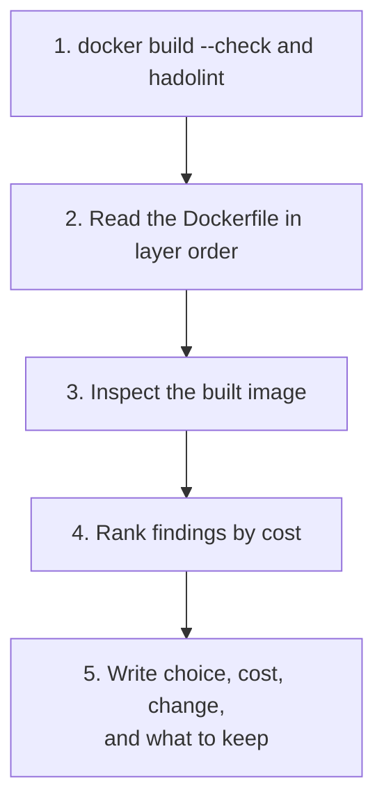
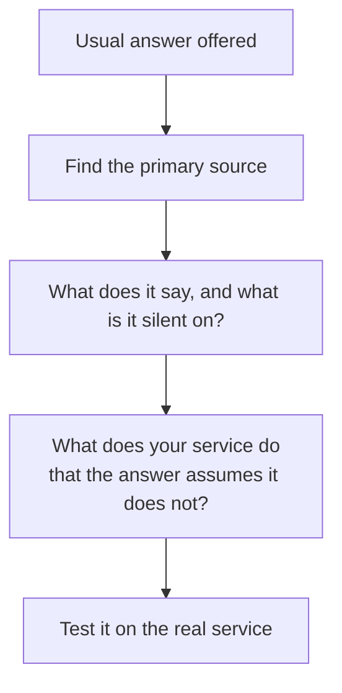

# Dockerfile Review Checklist: Reviewing, Changing and Doubting

Stage 8 compressed for lookup. [Lesson 22](../lessons/0022-reviewing-a-dockerfile.md) covers reviewing a Dockerfile and its image, [lesson 23](../lessons/0023-changing-a-base-image-others-depend-on.md) covers rolling a shared base image forward, and [lesson 24](../lessons/0024-when-the-usual-answer-is-wrong.md) covers when the usual answer is wrong and settling a dispute from the source.

## The order of a review

A finding has three parts: the choice, what it costs, and the change. "This is wrong" is not a finding.

## Questions by cost class

| Class | Ask of the Dockerfile | Ask of the image |
|---|---|---|
| Size | Is there a multi-stage build? Does the final stage hold only what runs? Does a later `RUN rm` pretend to shrink an earlier layer? | `docker history --no-trunc` for the largest layer, dive for what it added |
| Rebuild time | Do dependency manifests copy and install before the source copies? Is there a `.dockerignore`? | Does a one-line change redo the install? |
| Security | `USER` set? Secret in `ENV`, `ARG` or a `COPY`? Base pinned and bumped? | `docker image inspect` for `User` and `Env`, a scan triaged, a signature and provenance to verify |
| Reliability | Exec form for `ENTRYPOINT` and `CMD`? Base and packages pinned? `HEALTHCHECK` or a platform probe? | Entrypoint and `STOPSIGNAL` in the config, shutdown on `docker stop` |

## What the tools find

| Tool | Finds | Does not find |
|---|---|---|
| `docker build --check` | Form problems and a few known mistakes: `JSONArgsRecommended`, `SecretsUsedInArgOrEnv`, `CopyIgnoredFile`, casing, duplicate stage names | Moving tags, a missing `USER`, instruction order |
| hadolint | The same family, plus ShellCheck on the shell inside `RUN` | Whether this service should be root-free |
| `docker history`, dive | What each layer added and how big | Why it was added |
| A reviewer | Whether a choice fits the service | Nothing mechanical |

## Reading the worked example

| Smell | Cost class | Change |
|---|---|---|
| Credential in `ENV` | Security | Remove, pass at run time, build secret mount; revoke what leaked |
| `FROM image:latest` | Reliability, size | Pin a version, consider a slim base, pin a digest and automate the bump |
| `COPY . .` before the install | Rebuild time, size, security | Manifest first, install, then source, add `.dockerignore` |
| No `USER` | Security | Add a non-root user before `CMD` |
| Shell-form `CMD` | Reliability | Exec form |
| `RUN rm` in its own layer | Size (no effect) | Delete in the creating `RUN`, or use a multi-stage build |

## Changing a base image others depend on

| Step | What to do |
|---|---|
| Write the contract | OS and C library, user, shell, paths, packages, entrypoint, `ENV`, labels |
| Publish a candidate | A tag nobody consumes, such as `1.5.0-rc1` |
| Test the consumers | Build each one `FROM` the candidate and run its tests |
| Publish, then move | Immutable `1.5.0` first, then move `1.5` |
| Roll out | Bumps by digest, one service at a time, health checks watched |
| Deprecate | A date, old tags stay pullable and patched until then |

| Tag | Moves? | Change allowed |
|---|---|---|
| `1.4.2` | Never | None, never re-push |
| `1.4` | On patch | No breaking change |
| `1` | On minor | No breaking change |
| `2` | New line | Breaking change beside `1` |

A pinned digest never moves by itself, and never patches by itself. Ask who or what bumps it. Any change of base rebuilds every instruction of every consumer. `docker build --pull` fetches a newer base and `--no-cache` re-runs the steps without fetching one.

## When the usual answer is wrong

| Usual answer | Wrong when | Source |
|---|---|---|
| Alpine, because it is small | The service or a native dependency relies on glibc behaviour: DNS across several nameservers, large thread stacks (128k default on musl), locale | musl wiki, functional differences from glibc |
| Distroless, because it has no shell | A health check or entrypoint script needs a tool, or nobody can debug without a shell | distroless README |
| Pin the digest | Nothing bumps it, so security fixes never arrive | Docker, best practices |
| One process per container | Two processes share a lifecycle or a socket and cannot work apart | Docker, best practices and multi-service pages |
| A container at all | The workload must not share a kernel with neighbours, or one binary on a managed host needs no image lifecycle (reasoned from lesson 1, not quoted) | Lesson 1, your threat model |

## Settling a dispute from the source

| Claim | The sentence that settles it |
|---|---|
| A tag always names the same image | A tag is "a custom, human-readable pointer to a manifest" and a digest may have many tags (OCI distribution spec) |
| Deleting files in a later layer shrinks the image | A removal is a whiteout that only hides lower layers' paths (OCI layer spec) |
| One tag gives the same image everywhere | An image index lists a manifest per `platform` (OCI image index spec) |
