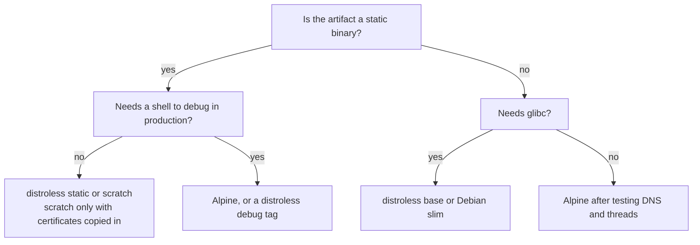

# Dockerfile: Instructions, Cache Rules, Multi-Stage Patterns and Reproducibility

Stage 3 compressed for lookup. [Lesson 7](../lessons/0007-your-first-dockerfile.md) covers the instructions, the build context and `.dockerignore`, [lesson 8](../lessons/0008-the-build-cache.md) the build cache and instruction order, [lesson 9](../lessons/0009-multi-stage-builds.md) multi-stage builds and base images, and [lesson 10](../lessons/0010-reproducible-builds.md) what makes builds differ and the pins that stop it.

## Instructions

|Instruction|Does|Layer?|Notes|
|---|---|---|---|
|`FROM image[:tag][@digest] [AS name]`|Starts a stage from a base image|Base layers|Clears state from earlier stages. Only `ARG` may come before the first `FROM`|
|`WORKDIR /path`|Sets the working directory, creating it|Config (plus the directory)|Use an absolute path, not `RUN cd`|
|`COPY [--from=stage] src dest`|Copies from the build context, a stage or an image|Yes|Preferred over `ADD`|
|`ADD [--checksum=sha256:...] src dest`|`COPY` plus remote URLs, Git URLs and tar unpacking|Yes|Use for downloads, with a checksum|
|`RUN command`|Runs a command, commits the changes|Yes|One `RUN` for `apt-get update && apt-get install`|
|`ENV KEY=value`|Variable for build and run time|Config|Persists in the image|
|`ARG NAME[=default]`|Build-time variable, `--build-arg`|Config|Not in the running container. A changed value is a cache miss at first use|
|`EXPOSE port`|Documents a listening port|Config|Publishes nothing|
|`USER name`|Sets the user for later instructions and the container|Config|Lesson 17|
|`CMD ["exe", "arg"]`|Default command or default arguments|Config|Exec form|
|`ENTRYPOINT ["exe"]`|The executable a container always runs|Config|Exec form|

- Exec form is a JSON array, `["app", "--port", "8080"]`, and runs the program directly. Shell form is a plain string, run through `/bin/sh -c`. An image with no shell needs exec form (lesson 11).
- `RUN` options include `--mount=type=cache`, `--mount=type=bind` and `--mount=type=secret` (lesson 19).
- Heredocs work for multi-line `RUN` and `COPY`.
- Deleting a file in a later layer hides it and does not remove its bytes.

## Build context and .dockerignore

- The context is what `docker build <path>` sends to the builder, and `COPY` reads only from it.
- `.dockerignore` sits at the root of the context and removes matching paths before they are sent.
- Per-Dockerfile ignore file: `<Dockerfile name>.dockerignore` next to the Dockerfile, taking precedence over the root file.

|Pattern|Matches|
|---|---|
|`node_modules`|That path at the context root|
|`*.md`|Markdown files at the root only|
|`**/*.log`|Log files at any depth|
|`!README.md`|Exception: keeps the file despite an earlier exclusion|
|`# note`|Comment, `#` in column 1|

- The `Dockerfile` and `.dockerignore` are always sent, and excluding them only stops `COPY` from reading them.
- Read the size in the build output: `transferring context: <size>`.

Typical entries: `.git`, `node_modules`, `.env`, build output, logs, local virtual environments.

## Cache rules

|Instruction|Cache key|
|---|---|
|`RUN`|The command string and the layers before it. Not the repository contents|
|`COPY`, `ADD`|A checksum of file metadata. `mtime` alone does not miss|
|`RUN --mount=type=bind`|The same checksum for the mounted files|
|`ARG`|The value, at its first use. Every `RUN` after an `ARG` uses it implicitly|
|`WORKDIR`|Respects `SOURCE_DATE_EPOCH`|
|Build secrets|Contents are not part of the key. Properties like id and path are|

- The first miss invalidates every instruction after it.
- Order from least to most frequently changed.
- The dependency pattern: copy the manifest, install, then copy the source.
- `RUN` is not rerun for newer packages. Force with a changed earlier layer, `docker builder prune`, `--no-cache`, `--no-cache-filter <stage>`, or `--pull` for a newer base.
- `RUN apt-get update && apt-get install -y --no-install-recommends ...` in one instruction, then `rm -rf /var/lib/apt/lists/*`.
- Cache mounts keep a download cache across builds: `RUN --mount=type=cache,target=/root/.cache/pip pip install ...`. They make a miss cheaper, not rarer.

```dockerfile
COPY requirements.txt .
RUN pip install --no-cache-dir -r requirements.txt
COPY . .
```

## Multi-stage patterns

```dockerfile
# syntax=docker/dockerfile:1
FROM golang:1.26 AS build
WORKDIR /src
COPY go.mod go.sum ./
RUN go mod download
COPY . .
RUN CGO_ENABLED=0 go build -o /out/app ./cmd/app

FROM gcr.io/distroless/static-debian13:nonroot
COPY --from=build /out/app /app
ENTRYPOINT ["/app"]
```

|Pattern|Syntax|
|---|---|
|Name a stage|`FROM image AS name`|
|Copy from a stage|`COPY --from=name /path /path`|
|Copy from an image|`COPY --from=nginx:latest /etc/nginx/nginx.conf /nginx.conf`|
|Continue a stage|`FROM build AS test`|
|Stop at a stage|`docker build --target build -t app:build .`|

- BuildKit builds only the stages the target depends on. The legacy builder builds every stage up to the target.
- Only copied files travel between stages. `ENV`, `WORKDIR` and `USER` do not.
- Language build steps live in the language tracks: [Go](../../../programming/golang/reference/toolchain-commands.md), [Java build](../../../programming/java/reference/testing-and-build.md), [Java modules and jlink](../../../programming/java/reference/the-module-system.md), [C#](../../../programming/csharp/reference/shipping-the-service.md), [Python wheels](../../../programming/python/reference/project-and-packaging.md).

## Base images

|Final base|Contains|Shell|Watch for|
|---|---|---|---|
|`scratch`|Nothing|No|No CA certificates, tzdata or user database. Static binary only|
|distroless `static`|CA certificates, a root `/etc/passwd` entry, `/tmp`, tzdata|No|Static binaries only. Use a `debug` tag to get a shell|
|distroless `base`|`static` plus glibc and libssl|No|Larger than `static`|
|Alpine|musl, BusyBox, `apk`|Yes|musl differs from glibc: DNS resolution, thread stack size|
|Debian slim|glibc userland, `apt`|Yes|Largest of these|

- With no shell, `ENTRYPOINT` and `CMD` must be in exec form, and `docker exec ... sh` has nothing to run.
- The distroless README reports `static-debian13` at about 2 MiB, `alpine` at about 5 MiB and `debian` at 124 MiB, at the time of writing. Measure yours with `docker image ls`.
- Smaller bases mean fewer packages to scan and patch (lesson 18).



## Reproducibility

|Drift cause|Pin|
|---|---|
|Moving base tag|`FROM alpine:3.21@sha256:<digest>`, tag kept in front|
|Unpinned OS packages|`apt-get install pkg=<version>`, or a dated snapshot archive|
|Unpinned language dependencies|Lockfile: `pip install --require-hashes`, `npm ci`, `go.sum`|
|Unchecked download|`ADD --checksum=sha256:<hash> url dest`|
|Timestamps|`SOURCE_DATE_EPOCH` and `rewrite-timestamp=true` on the image exporter|
|Noise you wrote|No `date` or random IDs in `RUN`|

```console
$ SOURCE_DATE_EPOCH=0 docker buildx build \
    --output type=image,name=registry.example.com/demo:repro,push=true,rewrite-timestamp=true .
```

Check by building twice with the cache off and comparing layer diff IDs:

```console
$ docker build --no-cache -t demo:one .
$ docker build --no-cache -t demo:two .
$ docker image inspect --format '{{json .RootFS.Layers}}' demo:one
$ docker image inspect --format '{{json .RootFS.Layers}}' demo:two
```

- Without `--no-cache` the second build reuses the first and proves nothing.
- A `SOURCE_DATE_EPOCH` that changes per commit breaks the cache from `WORKDIR` on. A fixed value does not.
- Find a digest with `docker buildx imagetools inspect <image:tag>`.
- Pinned means frozen: add a process that proposes digest bumps, such as Dependabot (lesson 23).

## Sources

- [Docs: Dockerfile reference, Docker](https://docs.docker.com/reference/dockerfile/)
- [Docs: "Build cache invalidation", Docker](https://docs.docker.com/build/cache/invalidation/)
- [Docs: "Multi-stage builds", Docker](https://docs.docker.com/build/building/multi-stage/)
- [Docs: "Building best practices", Docker](https://docs.docker.com/build/building/best-practices/)
- [Docs: "SOURCE_DATE_EPOCH", Reproducible Builds project](https://reproducible-builds.org/docs/source-date-epoch/)
- [Resources](../RESOURCES.md)
