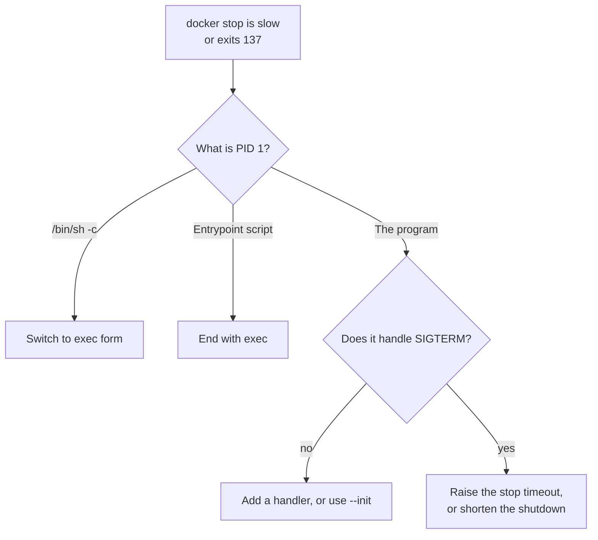
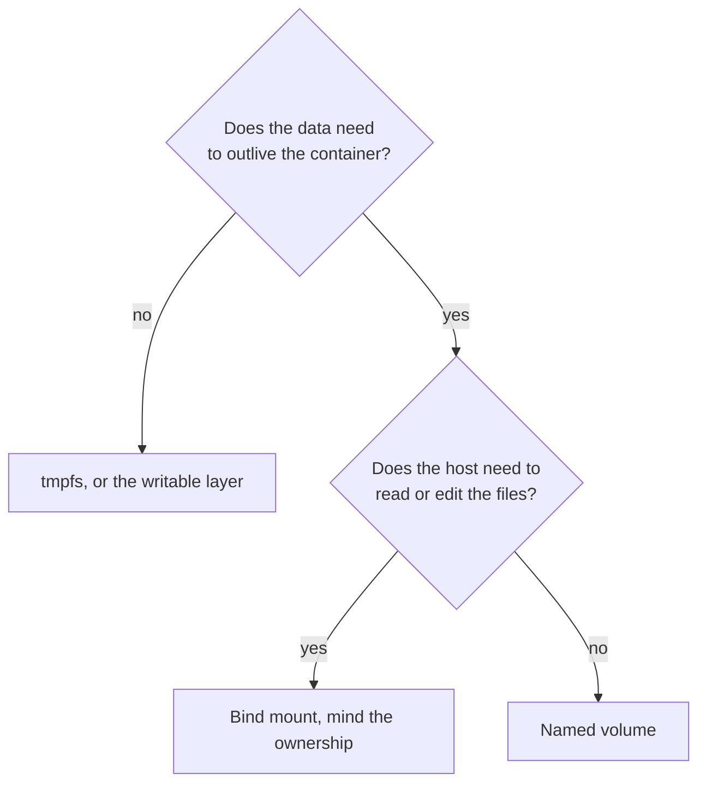

# Running Containers: Signals, Health, Limits, Networks, Volumes and Compose

Stages 4 and 5 compressed for lookup. [Lesson 11](../lessons/0011-pid-1-and-signals.md) covers PID 1 and signals, [lesson 12](../lessons/0012-health-checks-and-restart-policies.md) health checks and restart policies, [lesson 13](../lessons/0013-resource-limits-in-practice.md) resource limits, [lesson 14](../lessons/0014-container-networking.md) networking, [lesson 15](../lessons/0015-volumes-and-state.md) volumes and state, and [lesson 16](../lessons/0016-compose-for-local-development.md) Compose.

## Stopping cleanly

`docker stop` sends the stop signal (default `SIGTERM`, set by `STOPSIGNAL` or `--stop-signal`), waits the grace period (10 seconds on Linux, set by `docker stop -t` or `--stop-timeout`), then sends `SIGKILL`.

|Symptom|Cause|Fix|
|---|---|---|
|`docker stop` takes 10 seconds, exit code 137|PID 1 has no `SIGTERM` handler, so the kernel drops the signal|Handle `SIGTERM` in the program, or run with `--init`|
|Same, and PID 1 is `/bin/sh -c ...`|Shell form: the shell is PID 1 and does not forward|Exec form, `exec "$@"` in entrypoint scripts|
|Same, with an entrypoint script|The script stays PID 1 and the program is its child|End the script with `exec "$@"`|
|Zombie processes pile up|PID 1 never reaps orphaned children|`--init` (tini), or reap in the program|
|Stops at once, exit code 143|`--init` forwarded `SIGTERM` and the default action ended it, nothing was drained|Add a handler that finishes in-flight work|

- Check PID 1: `docker exec <c> cat /proc/1/cmdline` or `docker top <c>`.
- Exit code over 128 is a signal: 137 is `SIGKILL` (128 + 9), 143 is `SIGTERM` (128 + 15).
- `--init` does not make a program graceful. It makes delivery work.
- The grace period must exceed the longest in-flight unit of work.



## Health checks

```dockerfile
HEALTHCHECK --interval=10s --timeout=3s --start-period=20s --retries=3 \
  CMD ["/app/healthcheck"]
```

|Option|Default|Run-time flag|
|---|---|---|
|`--interval`|30s|`--health-interval`|
|`--timeout`|30s|`--health-timeout`|
|`--start-period`|0s|`--health-start-period`|
|`--start-interval`|5s|`--health-start-interval`|
|`--retries`|3|`--health-retries`|

- Exit status 0 is healthy, 1 is unhealthy, 2 is reserved.
- States: `starting`, then `healthy`, then `unhealthy` after `retries` consecutive failures. One success returns it to `healthy`.
- Read it: `docker ps` (status text) or `docker inspect --format '{{json .State.Health}}' <c>`.
- **Docker reports health and does not restart on it.** Compose can wait on it with `service_healthy`. Cluster probes are outside this track, see the Kubernetes track's [Running Reliably](../../kubernetes/reference/running-reliably.md) sheet.
- The check runs inside the container, so its tool must be in the image. A minimal image needs a check in your own binary.
- Check what a request needs, not the services behind it.

## Restart policies

|Policy|Restarts when|
|---|---|
|`no` (default)|Never|
|`on-failure[:max]`|Non-zero exit code, up to `max` times|
|`always`|Any exit, and when the daemon starts|
|`unless-stopped`|Like `always`, but not if you stopped it yourself|

- The delay starts at 100 ms and doubles, up to 1 minute, and resets after the container ran for 10 seconds.
- A restart policy never reacts to health, and a hung process that does not exit is never restarted.
- `--restart` and `--rm` conflict.
- A restart reuses the container and its writable layer. A new `docker run` does not.

## Resource limits

|Flag|Writes|Notes|
|---|---|---|
|`--memory 256m`|`memory.max` = 268435456|Hard limit, at least 6 MB|
|`--memory-swap 256m`|Total of RAM plus swap|Equal to `--memory` means no swap|
|`--memory-reservation`|Soft limit|Applies under host memory pressure only|
|`--cpus 1.5`|`cpu.max` = `150000 100000`|Quota per 100,000 us period|
|`--cpu-quota` and `--cpu-period`|`cpu.max`|Same, set directly|
|`--cpu-shares`|`cpu.weight`|Relative weight, matters only under contention|

|Evidence|Where|Means|
|---|---|---|
|`docker inspect --format '{{.State.OOMKilled}}' <c>`|Container state|`true`: the kernel OOM-killed it. Exit code is 137|
|`oom_kill` in `memory.events`|The container's cgroup|Processes killed by an OOM killer|
|`nr_throttled`, `throttled_usec` in `cpu.stat`|The container's cgroup|Periods and time spent paused at the quota|
|`/sys/fs/cgroup/memory.max`, `cpu.max` inside the container|The container|The limit the runtime can read|

- Exit code 137 alone is ambiguous: `OOMKilled` separates an OOM kill from a stop timeout.
- A CPU limit throttles and never kills. It shows as latency, not an error.
- A quota does not change the CPUs a process sees. A runtime that sizes pools from the CPU count needs to read the cgroup. Go 1.25 and later sets `GOMAXPROCS` from the cgroup CPU limit.
- A limit equal to current usage leaves no room. Measure the peak, add headroom.

## Networking

|Network|Name resolution|Notes|
|---|---|---|
|Default `bridge`|No, by IP only|Every container joins it unless told otherwise|
|User-defined bridge|Yes, by name or alias, through DNS at `127.0.0.11`|Create with `docker network create`|
|`--network host`|Not applicable|Shares the host's network namespace, Linux only, no isolation|
|`--network none`|Not applicable|Loopback only|

|Flag|Reachable from|
|---|---|
|None|The host and containers on the same network|
|`-p 8080:80`|Anything that can reach the host, on every host address|
|`-p 127.0.0.1:8080:80`|The host only|
|`-P`|Every `EXPOSE`d port, on random host ports|

- Containers on the same user-defined bridge reach every port of each other without publishing.
- `EXPOSE` documents a port and publishes nothing.
- A server inside a container must listen on `0.0.0.0`. On `127.0.0.1` it is unreachable from outside the container.
- `localhost` inside a container is that container. Use the peer's name.
- Put a database on a network only its clients join.


## Volumes and bind mounts

|Type|Flag|Owner|Survives the container|Use for|
|---|---|---|---|---|
|Named volume|`-v name:/path` or `--mount type=volume`|Docker|Yes|Database data|
|Bind mount|`-v /host:/path` or `--mount type=bind`|The host|Yes, it is the host's|Source in development, config|
|tmpfs|`--tmpfs /path`|Nobody, RAM|No|Scratch, secrets|
|Writable layer|No flag|The container|No, deleted with it|Nothing you need to keep|

- An empty named volume mounted over a directory with files gets those files copied in. A volume with content, and any bind mount, hides them.
- `--mount` with a missing bind source is an error. `-v` creates it as a directory.
- `docker volume prune` removes unused anonymous volumes. `--all` removes named ones too.
- Back up: `docker run --rm -v vol:/data -v "$PWD":/backup alpine tar czf /backup/vol.tgz -C /data .`
- Ownership is by number: root in the container writes root-owned files to a host bind mount, and a non-root container cannot write to a directory its UID does not own.

|Ownership problem|Fix|
|---|---|
|Root-owned files appear in the project|`--user "$(id -u):$(id -g)"`|
|Non-root container gets `Permission denied` on a bind mount|`chown` the host directory, or share a group|
|Same, on a named volume|Create and `chown` the mount point in the Dockerfile before `USER`|



## Compose

```yaml
services:
  db:
    image: postgres:17
    volumes:
      - pgdata:/var/lib/postgresql/data
    healthcheck:
      test: ["CMD-SHELL", "pg_isready -U postgres"]
      interval: 5s
      retries: 5
  app:
    build: .
    ports:
      - "127.0.0.1:8080:8080"
    depends_on:
      db:
        condition: service_healthy
volumes:
  pgdata:
```

|`depends_on` condition|Waits until the dependency|
|---|---|
|`service_started`|Has started, which is the short form|
|`service_healthy`|Passes its health check|
|`service_completed_successfully`|Exited with code 0|

|Command|Does|
|---|---|
|`docker compose up -d`|Create and start in the background|
|`docker compose up -d --wait`|Same, return when running or healthy|
|`docker compose up -d --build`|Rebuild images first|
|`docker compose ps`|Service state, health and ports|
|`docker compose logs -f <svc>`|Follow one service|
|`docker compose exec <svc> <cmd>`|Run in a running service|
|`docker compose config`|Print the resolved file|
|`docker compose down`|Remove containers and the network, keep volumes|
|`docker compose down -v`|Also remove the named volumes in the file|

- One network per project, and each service is reachable by its service name.
- The project name defaults to the directory name and prefixes volumes and networks.
- Make the application retry its first connection as well as using `service_healthy`.
- Compose is for one host. Scheduling, rollouts and probes belong to the [Kubernetes track](../../kubernetes/README.md).
