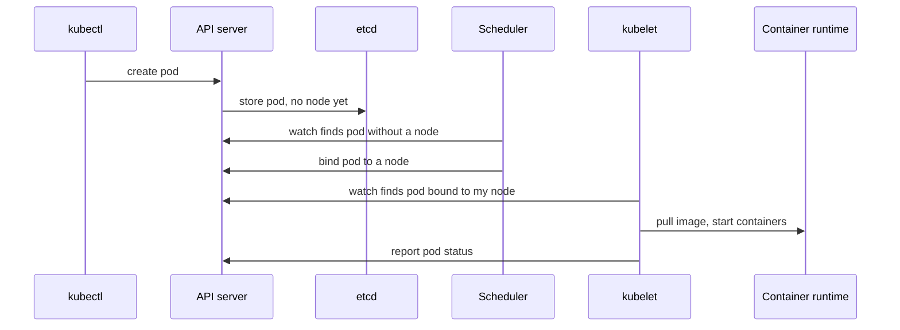

# Lesson 1. What Kubernetes Is For

**Mission link:** The mission is to own a service once it runs on a cluster, and you cannot own what you cannot place on a map. This lesson names the machines and components involved and which of them does what, so every later failure has a place to be looked for.
**Primary source:** [Docs: "Kubernetes Components", Kubernetes](https://kubernetes.io/docs/concepts/overview/components/)
**Prerequisites:** This track assumes the [containers track](../../containers/README.md) or equivalent: you can build an image and run one container on one host. No Kubernetes knowledge is assumed. Terms: [Control plane](../GLOSSARY.md), [Node](../GLOSSARY.md), [Pod](../GLOSSARY.md), [API server](../GLOSSARY.md), [Scheduler](../GLOSSARY.md), [kubelet](../GLOSSARY.md), [Container runtime](../GLOSSARY.md)

## Know this

### The problem a cluster solves

One container on one host is easy: `docker run` and you are done. The trouble starts when the service must survive the host dying, when there are several services that must find each other, when a new version has to replace the old one without a gap, and when "which machine has room for this?" is a question you are tired of answering by hand. The [Overview](https://kubernetes.io/docs/concepts/overview/) puts the idea in one sentence: if a container goes down, another container needs to start, and it would be easier if a system handled that.

Kubernetes is that system. It takes a set of machines and presents them as **one place to run containers**. You describe what you want running, and the cluster decides where and keeps it that way. The Overview lists what it provides: service discovery and load balancing, storage orchestration, automated rollouts and rollbacks, automatic bin packing (fitting containers onto nodes by the CPU and memory you declare), self-healing, secret and configuration management, batch execution and horizontal scaling. Later lessons take each in turn.

### Two halves: the control plane and the nodes

A cluster is a **control plane** plus one or more **nodes** ([Components](https://kubernetes.io/docs/concepts/overview/components/)). Pods, which hold your containers, run on the nodes. The control plane decides, records and watches.

|Where|Component|What it does|
|---|---|---|
|Control plane|API server (`kube-apiserver`)|Serves the Kubernetes HTTP API. Everything else, including `kubectl`, talks to the cluster through it|
|Control plane|etcd|Consistent, highly available key-value store for all API server data|
|Control plane|Scheduler (`kube-scheduler`)|Watches for pods with no node and assigns each to a suitable one|
|Control plane|Controller manager (`kube-controller-manager`)|Runs the controllers that implement Kubernetes behavior|
|Every node|kubelet|Makes sure the pods bound to its node, and their containers, are running|
|Every node|Container runtime|Pulls images and runs containers, for example containerd or CRI-O|
|Every node|kube-proxy (optional)|Maintains network rules that implement Services|

Two points that matter later. First, the API server is the front end of the control plane and the only component that talks to etcd (see the [glossary](../GLOSSARY.md)). The scheduler, the controllers and the kubelets never touch etcd; they read and write objects through the API server. Second, the control plane is usually run across several machines in production, but nothing requires a separate machine: for simplicity, setup scripts typically start all control plane components on one machine and do not run user containers on it ([Cluster Architecture](https://kubernetes.io/docs/concepts/architecture/)).

### What happens when you ask for a pod

Here is the shortest honest story of one pod, with each step done by a different component:

1. You send a manifest with `kubectl apply`. `kubectl` turns it into an API request.
2. The API server validates it and stores the object in etcd. The pod now exists as a record with no node.
3. The scheduler sees a pod with no node, picks one, and records the choice by writing the node name onto the pod through the API server.
4. The kubelet on that node sees a pod bound to it, asks the container runtime to pull the image and start the containers, and writes the pod's status back.



Nobody calls anybody directly. Each component watches the API server for the objects it cares about and acts on them. That is the design that lesson 2 turns into a rule.

### What Kubernetes is not

The Overview is just as direct about the limits. Kubernetes does not build your application or deploy source code, so your CI/CD sits outside it. It does not provide databases, message buses or caches as built-in services (such things can run on it), and it does not dictate logging, monitoring or alerting. It is not an all-inclusive platform as a service; it provides the building blocks for one. Keep this list in mind: lesson 28 uses it to decide when a service does not need a cluster at all.

### Your cluster for this track: kind

Every rep in this track runs on a local cluster created with [kind](https://kind.sigs.k8s.io/docs/user/quick-start/), which runs each Kubernetes node as a container. A node is therefore a container on your machine: real components, no cloud account, and `kubectl` talks to it like any cluster. By default `kind create cluster` makes one control plane node named `kind`, and `--name` gives the cluster a different context name; the `kubectl` context is the cluster name prefixed with `kind-`. This track uses a cluster named `lab` with one control plane node and two workers, so the node-level lessons have something to spread across. Create the cluster in the first rep below.

## Practice

1. ▢ Which component picks the node a new pod runs on?

    - a) The kubelet running on every node
    - b) The scheduler inside the control plane
    - c) The API server when admitting it
    - d) The container runtime on that node

<details markdown="1"><summary>Check</summary>

**b)** The scheduler watches for pods with no node and assigns one. (a) is wrong because the kubelet runs the pods already bound to its node and does not choose nodes. (c) is wrong because the API server validates and stores the object and does not place it. (d) is wrong because the runtime only starts containers when the kubelet asks.

</details>

2. ▢ Predict, then run. On the `lab` cluster, which `kube-system` pods carry a node name at the end of their own name, and which node is each on?

    ```console
    $ kubectl get pods -n kube-system -o custom-columns=NAME:.metadata.name,NODE:.spec.nodeName
    ```

<details markdown="1"><summary>Hint</summary>

Think about which components are described as control plane components, and where a cluster built for one control plane node runs them. The scheduler and the others are not placed by the scheduler.

</details>

<details markdown="1"><summary>Check</summary>

```text
NAME                                        NODE
coredns-6f6b679f8f-7wq2k                    lab-control-plane
coredns-6f6b679f8f-kd9x4                    lab-control-plane
etcd-lab-control-plane                      lab-control-plane
kindnet-4dvz8                               lab-worker2
kindnet-hm2tc                               lab-control-plane
kindnet-r8p5n                               lab-worker
kube-apiserver-lab-control-plane            lab-control-plane
kube-controller-manager-lab-control-plane   lab-control-plane
kube-proxy-2bnl7                            lab-worker
kube-proxy-5xk9w                            lab-control-plane
kube-proxy-pt6gd                            lab-worker2
kube-scheduler-lab-control-plane            lab-control-plane
```

`etcd`, `kube-apiserver`, `kube-controller-manager` and `kube-scheduler` each end in the name of the control plane node. They are the control plane itself, run by the kubelet of that node from manifest files in a directory on the node rather than placed by the scheduler. The [Pods](https://kubernetes.io/docs/concepts/workloads/pods/) page calls these static pods and names running a self-hosted control plane as their main use, and the [static pods task](https://kubernetes.io/docs/tasks/configure-pod-container/static-pod/) shows the API server listing one under the pod name with the node name appended. The random suffixes will differ on your cluster, and `coredns` may land on other nodes. `kube-proxy` and `kindnet` (kind's network plugin) have one pod per node, a pattern lesson 7 names.

</details>

3. ▢ The scheduler stops running. A pod that was already running on a worker node keeps serving. You then create a new pod. What happens to each, and why?

<details markdown="1"><summary>Check</summary>

The running pod keeps running, because the kubelet on its node runs pods bound to that node and does not need the scheduler to continue. The new pod is created and stored with no node, so nothing picks one and it stays `Pending` until a scheduler returns. The roles explain it: the scheduler only chooses nodes for pods that have none.

</details>

4. ▢ A teammate says: "We move to Kubernetes, and it will build our code from Git and run our PostgreSQL for us." Name what is wrong with each half.

<details markdown="1"><summary>Check</summary>

The [Overview](https://kubernetes.io/docs/concepts/overview/) says Kubernetes does not deploy source code and does not build your application, so building images stays in your CI/CD. It also says it does not provide databases as built-in services. PostgreSQL can run on Kubernetes, and the cluster will schedule and restart its pods, but you still have to run it as a database: backups, replication and upgrades are not provided by the platform. Lessons 16 and 17 return to this.

</details>

5. ▢ A team runs one stateless service as two copies behind a load balancer on two VMs, and releases once a month. Using only the list of what Kubernetes provides, which of those features do they already have, and which would they be adopting?

<details markdown="1"><summary>Check</summary>

They already have load balancing and a crude form of self-healing and horizontal scaling (two copies, by hand). They would be adopting automated rollouts and rollbacks, bin packing, declarative configuration of all of it, and a control plane to operate. Whether that pays off is a judgment about how much of the list they need and what running a cluster costs them, and the Overview does not decide it for them. Lesson 28 returns to the question. A team that needs none of the list beyond what two VMs already give has a real argument for staying where it is.

</details>

## Real-world reps

- [ ] Install `kind` and `kubectl` from their official pages, save the config below as `kind-lab.yaml`, and create the cluster with `kind create cluster --name lab --config kind-lab.yaml`. Then run `kubectl get nodes` and `kubectl cluster-info --context kind-lab`.
- [ ] With the cluster up, run `docker ps` and find the three containers that are the three nodes. Run `kubectl get pods -A` and, for each pod, say which component of the table it is.
- [ ] Tomorrow: without notes, draw the cluster from memory: the control plane components, what runs on every node, and the path of one pod from `kubectl apply` to a running container. Then compare with the table above.

```yaml
kind: Cluster
apiVersion: kind.x-k8s.io/v1alpha4
nodes:
  - role: control-plane
  - role: worker
  - role: worker
```

## Going further

- [kubectl](../reference/kubectl.md)
- [Docs: "Kubernetes Components", Kubernetes](https://kubernetes.io/docs/concepts/overview/components/)
- [Docs: "Overview", Kubernetes](https://kubernetes.io/docs/concepts/overview/), the lists of what Kubernetes provides and what it is not
- [Docs: "Quick Start", kind](https://kind.sigs.k8s.io/docs/user/quick-start/)
- [Resources](../RESOURCES.md)

---

Not landing? Reread the primary source at the top, since this lesson compresses it and compression is where understanding leaks. Check the [glossary](../GLOSSARY.md) for any term that felt slippery.

If the lesson itself is unclear rather than the material, that is a defect: [open an issue](https://github.com/TokenCemetery/teach/issues).
