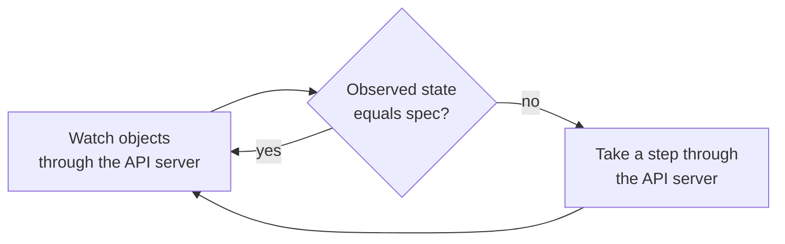
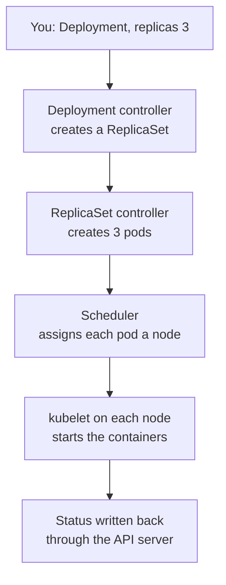

# Lesson 2. The Reconciliation Loop

**Mission link:** The mission starts with explaining the declarative model, because every behavior you will see later, a pod that comes back after you delete it, a node that dies and a service that heals, is the same loop applied to a different object. Learn the loop once and you can predict the cluster instead of memorizing it.
**Primary source:** [Docs: "Controllers", Kubernetes](https://kubernetes.io/docs/concepts/architecture/controller/)
**Prerequisites:** [Lesson 1](0001-what-kubernetes-is-for.md), [Controller](../GLOSSARY.md), [Desired state](../GLOSSARY.md), [Reconciliation](../GLOSSARY.md), [API server](../GLOSSARY.md), [etcd](../GLOSSARY.md)

## Warm-up

1. ▢ Which component do `kubectl`, the scheduler and every kubelet all talk to, and which component stores the cluster's data?

<details markdown="1"><summary>Check</summary>

The API server is the one everything talks to, and etcd stores the data. The API server is the only component that reads and writes etcd (lesson 1).

</details>

2. ▢ Name the components that run on every node, and the four that make up the control plane.

<details markdown="1"><summary>Check</summary>

Every node runs a kubelet and a container runtime, and usually kube-proxy. The control plane is the API server, etcd, the scheduler and the controller manager (lesson 1).

</details>

3. ▢ Who decides which node a new pod runs on, and who actually starts its containers?

<details markdown="1"><summary>Check</summary>

The scheduler picks the node by assigning the pod to it. The kubelet on that node then asks the container runtime to start the containers (lesson 1).

</details>

## Know this

### Declare, do not command

On one host you give orders: `docker run` starts this container now. If it dies, nothing starts it again unless you set a restart policy. Kubernetes objects work the other way. The [Objects](https://kubernetes.io/docs/concepts/overview/working-with-objects/) page calls an object a "record of intent": once you create it, the system works constantly to make sure it exists. You do not say "start three copies". You write an object whose spec says there should be three, and the cluster keeps it true.

Almost every object has two parts. The **spec** is the **desired state**, set by you. The **status** is the observed state, written by the cluster's components. The difference between them is the work left to do.

### A controller is a loop

The [Controllers](https://kubernetes.io/docs/concepts/architecture/controller/) page starts from a thermostat. You set a temperature, which is the desired state. The thermostat measures the room, which is the current state, and switches equipment on or off to close the gap. A **controller** is that, for the cluster: a non-terminating loop that watches objects and acts to move the current state closer to the desired state in their spec. The act of comparing and closing the gap, repeatedly and whatever caused it, is **reconciliation**.



Two details define how a built-in controller behaves. First, it normally does not do the work itself. The page uses the Job controller as the example: it does not run pods or containers, it tells the API server to create or remove pods, and other components act on the new pods. Second, it writes results back: when the work is done, the Job controller updates the Job object to mark it finished. Each controller tracks one kind of object as its desired state and manages another kind to achieve it, so a Job controller watches Jobs and pods, and something else creates the Jobs.

To learn about changes without polling, controllers use the API's `watch` verb, which streams changes to an object or a collection ([API Concepts](https://kubernetes.io/docs/reference/using-api/api-concepts/)). The built-in controllers run together inside the `kube-controller-manager`, and you can run your own controller elsewhere.

### One request, several loops

Nothing in the cluster runs "the deployment". Each step below is a different controller, kubelet or scheduler reacting to an object that the step before wrote through the API server.



This is why the design uses many small controllers. The page says it is useful to have simple controllers rather than one monolithic set of interlinked loops, because controllers can fail and the system is designed to allow for that. Several controllers can create objects of the same kind: Deployments and Jobs both create pods, and the Job controller leaves a Deployment's pods alone because labels tell them apart.

### Why a missed event is not a problem

The [design principles](https://github.com/kubernetes/design-proposals-archive/blob/main/architecture/principles.md) say control logic must be level-based: the system has to operate correctly given only the desired state and the observed state, however many intermediate updates were missed. Events are an optimization. So a controller that restarts, or a watch that drops, does not lose its place: it reads the world, compares it to the spec and carries on. The same document says that components should keep doing what they were last told when new instructions stop arriving, for example during a partition or an outage. That is why existing pods keep running when the control plane is unreachable, even though nothing new can be changed.

The Controllers page adds a consequence: because controllers are always reacting to change, the cluster potentially never reaches a stable state, and that does not matter as long as the controllers run and can make useful changes.

### Where the desired state lives

When you create an object, the API server validates it and stores it in etcd. etcd is a replicated key-value store that uses the Raft consensus algorithm, so a majority of its members must agree on every write; the [consensus sheet](../../../architecture/distributed-systems/reference/consensus.md) explains what it is doing underneath. For someone running workloads, three consequences follow. If the API server is down, you cannot change anything, because it is the only way in. If etcd loses its data, the cluster loses its objects, which the [components page](https://kubernetes.io/docs/concepts/overview/components/) reminds you to plan a backup for. And every `kubectl get` reads what the API server holds, which is the cluster's record and not necessarily what is happening on a machine this second.

### When a node dies

A kubelet reports on its node by updating the Node's status and a Lease object in the `kube-node-lease` namespace ([Nodes](https://kubernetes.io/docs/concepts/architecture/nodes/)). When those stop, the node controller sets the node's `Ready` condition to `Unknown`, and the node gets the `node.kubernetes.io/unreachable` taint. Kubernetes automatically adds a toleration for that taint with `tolerationSeconds=300` to pods, so a pod stays bound to the node for five minutes after the problem is detected ([Taints and Tolerations](https://kubernetes.io/docs/concepts/scheduling-eviction/taint-and-toleration/)). The Nodes page gives the same default: five minutes between marking the node `Unknown` and the first eviction request. Then the pod is evicted, the ReplicaSet controller sees fewer pods than the spec asks for, creates a replacement, and the scheduler places it on a healthy node.

Two cautions. During that wait the old pods may still be running on the partitioned node, since the API server cannot tell the kubelet to stop them. And a pod nobody manages is never replaced: the controller above is what does the replacing, which lesson 4 returns to.

## Practice

1. ▢ You run `kubectl delete pod` on one of the three pods a Deployment with `replicas: 3` manages. What happens?

    - a) The kubelet restarts the deleted pod object
    - b) The Deployment quietly shrinks to two replicas
    - c) The scheduler recreates it on another node
    - d) A controller notices and creates a replacement

<details markdown="1"><summary>Check</summary>

**d)** The ReplicaSet controller sees two pods where the spec asks for three and creates one. (a) is wrong because the kubelet restarts containers inside a pod it runs, and does not recreate a pod object that was deleted. (b) is wrong because deleting a pod changes the observed state, not the spec, and the spec still says three. (c) is wrong because the scheduler only assigns nodes to pods that exist and have none, and creating pods is the controller's job.

</details>

2. ▢ Predict, then run. After the last command, how many pods are listed, and how do you tell which one is the replacement?

    ```console
    $ kubectl create deployment web --image=nginx:1.27 --replicas=3
    $ kubectl rollout status deployment/web
    $ kubectl get pods -l app=web
    $ kubectl delete pod web-7c5ddbdf54-x8m2q
    $ kubectl get pods -l app=web
    ```

<details markdown="1"><summary>Hint</summary>

What does `replicas` in the spec say, and what is the one column in `kubectl get pods` that is different for a pod created a moment ago?

</details>

<details markdown="1"><summary>Check</summary>

```text
NAME                   READY   STATUS    RESTARTS   AGE
web-7c5ddbdf54-mk4zp   1/1     Running   0          3m12s
web-7c5ddbdf54-r6tdw   1/1     Running   0          4s
web-7c5ddbdf54-tq8hn   1/1     Running   0          3m12s
```

Three pods, as the spec says. The replacement has a new random suffix (`r6tdw`) and an age of seconds, and the deleted `x8m2q` is gone. It is a new pod with a new name and a new IP, not the old one restarted. If you run the second `get` in another terminal while the delete is still working, you may also see the old pod as `Terminating`, because it is shut down gracefully while its replacement already exists.

</details>

3. ▢ An application keeps coming back after you `kubectl delete pod` it, over and over. You want it gone. What do you change, and why does deleting pods never work?

<details markdown="1"><summary>Hint</summary>

Find out what owns the pod, then think about which object holds the desired state that the loop is enforcing.

</details>

<details markdown="1"><summary>Check</summary>

Change the desired state, not the observed state: delete the Deployment that owns the pods, or scale it to zero (`kubectl scale deployment/web --replicas=0`), which keeps the object for later. Deleting pods changes the observed state, and a controller then does exactly its job and restores it to match the spec. The pod is a symptom and the Deployment's spec is the cause.

</details>

4. ▢ Every API server instance becomes unreachable for ten minutes. Which of these keeps working: a pod already serving traffic, `kubectl scale`, creating a new pod, or replacing a pod that crashes at minute three? Explain each.

<details markdown="1"><summary>Check</summary>

The pod already serving traffic keeps working, because components keep doing what they were last told when instructions stop. `kubectl scale` fails, because the API server is the only way to change the cluster. A new pod cannot be created for the same reason. A pod that disappears is not replaced during the outage, because replacing it is done by a controller, and controllers read and write objects through the API server. When it returns, the controllers compare the world to the spec and catch up, which is the level-based design at work.

</details>

5. ▢ A worker node loses power. A Deployment pod was running on it. With defaults, what do you see in `kubectl get nodes` and `kubectl get pods`, and when is a replacement created?

<details markdown="1"><summary>Check</summary>

The node soon shows `NotReady`, since its `Ready` condition is no longer true. Nothing is replaced at first: by default a pod tolerates the `unreachable` taint for 300 seconds, and the node controller waits five minutes between marking the node `Unknown` and submitting the first eviction. After that the pod is evicted, the ReplicaSet controller creates a replacement, and the scheduler places it on a healthy node. If you needed faster recovery, the lever is the toleration, set on the pod template, and not the controller.

</details>

## Real-world reps

- [ ] On the `lab` cluster, run `kubectl get pods -l app=web -w` in one terminal and `kubectl delete pod` on one of them in another. Watch the old pod terminate and the new one appear, and write down the order of events.
- [ ] Run `kubectl get deployment web -o yaml` and find `spec.replicas` and `status.replicas`. Say which one you may edit, which one the cluster writes, and what a difference between them would mean.
- [ ] Optional, about ten minutes: stop a worker with `docker stop lab-worker2`, run `kubectl get nodes -w` and `kubectl get pods -l app=web -o wide`, and note when the node turns `NotReady` and when the pods on it are replaced. Start it again with `docker start lab-worker2`. If the node does not come back `Ready`, delete the cluster with `kind delete cluster --name lab` and create it again.
- [ ] Tomorrow: without notes, explain the reconciliation loop in three sentences, using "desired state", "observed state" and "controller", and say what it predicts happens when you delete a pod that a Deployment owns.

## Going further

- [kubectl](../reference/kubectl.md)
- [Docs: "Controllers", Kubernetes](https://kubernetes.io/docs/concepts/architecture/controller/)
- [Docs: "Nodes", Kubernetes](https://kubernetes.io/docs/concepts/architecture/nodes/), the section on the node controller
- [Design doc: "Design Principles", Kubernetes design proposals archive](https://github.com/kubernetes/design-proposals-archive/blob/main/architecture/principles.md)
- [Resources](../RESOURCES.md)

---

Not landing? Reread the primary source at the top, since this lesson compresses it and compression is where understanding leaks. Check the [glossary](../GLOSSARY.md) for any term that felt slippery.

If the lesson itself is unclear rather than the material, that is a defect: [open an issue](https://github.com/TokenCemetery/teach/issues).
