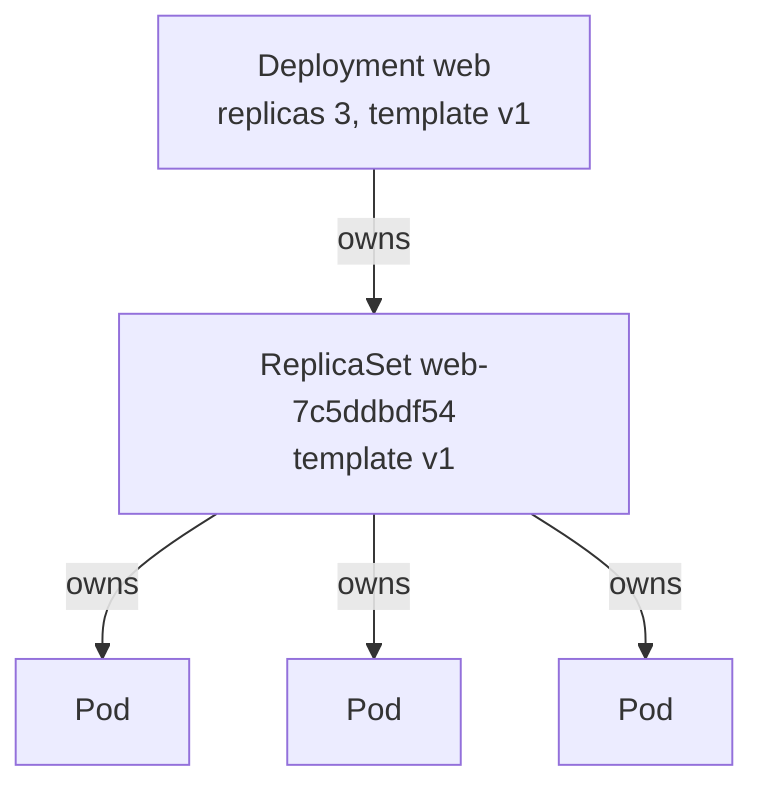

# Lesson 5. Deployments and ReplicaSets

**Mission link:** The mission is to run a stateless service and keep it running. A Deployment is how, and its two layers, the ReplicaSet below it and the pods below that, are what you will actually see when something is wrong, so you need to know which layer does what.
**Primary source:** [Docs: "Deployments", Kubernetes](https://kubernetes.io/docs/concepts/workloads/controllers/deployment/)
**Prerequisites:** [Lesson 2](0002-the-reconciliation-loop.md), [Lesson 3](0003-objects-and-manifests.md), [Lesson 4](0004-pods.md), [Deployment](../GLOSSARY.md), [ReplicaSet](../GLOSSARY.md), [Selector](../GLOSSARY.md), [Label](../GLOSSARY.md)

## Warm-up

1. ▢ Why is a pod you create directly not replaced when its node fails?

<details markdown="1"><summary>Check</summary>

No controller owns it, and a pod is never rescheduled to another node. Only a controller that holds a pod template can create a replacement (lesson 4).

</details>

2. ▢ Two containers in one pod: how does one reach the other, and what can they not do?

<details markdown="1"><summary>Check</summary>

They share a network namespace, so one reaches the other on `localhost`, and two cannot listen on the same port. They do not share an image or a root filesystem, only the volumes the pod declares (lesson 4).

</details>

3. ▢ What does the selector `tier in (frontend, cache),env!=dev` mean, and what is the comma?

<details markdown="1"><summary>Check</summary>

The label `tier` is `frontend` or `cache`, and `env` is anything other than `dev`, including absent. The comma is AND (lesson 3).

</details>

## Know this

### Three layers

You almost never create a pod or a ReplicaSet yourself. You create a **Deployment**, which manages ReplicaSets to keep a number of identical, interchangeable pods running and to move them from one template to the next. Here is one:

```yaml
apiVersion: apps/v1
kind: Deployment
metadata:
  name: web
spec:
  replicas: 3
  selector:
    matchLabels:
      app: web
  template:
    metadata:
      labels:
        app: web
    spec:
      containers:
        - name: nginx
          image: nginx:1.27
          ports:
            - containerPort: 80
```

`spec.replicas` is optional and defaults to 1. `spec.template` is the pod template from lesson 4, an ordinary pod's metadata and spec with no name. `spec.selector` says which pods belong to this Deployment, and the [Deployments page](https://kubernetes.io/docs/concepts/workloads/controllers/deployment/) states two rules about it. In `apps/v1` the selector and the template labels are not defaulted from each other, so you must write both, and they must match or the API server rejects the object. And the selector is immutable after creation: to change it you must delete and recreate the Deployment.



Each arrow is an owner reference, a field in the child's metadata naming its owner. The Deployment controller creates a ReplicaSet from the template, the ReplicaSet controller creates the pods, and the scheduler and kubelets run them (lesson 2). A **ReplicaSet** keeps a number of pods that match its selector running, and replaces any that are deleted or terminated for any reason, including node failure ([ReplicaSet](https://kubernetes.io/docs/concepts/workloads/controllers/replicaset/)). That is the layer that answers the question of lesson 4: the replacement of a lost pod is the ReplicaSet creating a new one from its template.

### What the names tell you

```console
$ kubectl get deployment,replicaset,pod -l app=web
NAME                  READY   UP-TO-DATE   AVAILABLE   AGE
deployment.apps/web   3/3     3            3           41s

NAME                             DESIRED   CURRENT   READY   AGE
replicaset.apps/web-7c5ddbdf54   3         3         3       41s

NAME                       READY   STATUS    RESTARTS   AGE
pod/web-7c5ddbdf54-4fzvh   1/1     Running   0          41s
pod/web-7c5ddbdf54-9jx2c   1/1     Running   0          41s
pod/web-7c5ddbdf54-vq7tm   1/1     Running   0          41s
```

A ReplicaSet is named `<deployment>-<hash>` and a pod `<replicaset>-<random>`. The hash is the `pod-template-hash` label, which the Deployment controller adds to every ReplicaSet it creates, to the ReplicaSet's selector and to its pods, and which it makes by hashing the pod template. Do not change it. The page gives its purpose: it keeps a Deployment's child ReplicaSets from overlapping. Two ReplicaSets of one Deployment select different pods because their hashes differ.

The Deployment's columns: `READY` is ready replicas over desired, `UP-TO-DATE` is the number of replicas on the latest template, and `AVAILABLE` is the number available to users. During a rollout the first and the second can differ, which lesson 6 uses.

### Scaling and changing are different edits

Two kinds of edit to a Deployment do different things.

|You change|The Deployment does|ReplicaSets|
|---|---|---|
|`spec.replicas`|Scales the current ReplicaSet|Same one, new count|
|Anything in `spec.template`|Starts a rollout|A new ReplicaSet is created, the old one is scaled down|

The page says a rollout is triggered if and only if the pod template changes, for example its labels or a container image; scaling does not trigger one and does not create a revision. The old ReplicaSet is kept at zero replicas so it can be rolled back to, which is lesson 6. Scale with `kubectl scale deployment/web --replicas=5`, or edit the field and `apply`. The Deployment page says not to manage ReplicaSets owned by a Deployment: the Deployment controller treats its own spec as the truth, so a hand edit to a child is the wrong lever.

### Ownership and selectors

A ReplicaSet finds its pods by selector, and the ownership link, `metadata.ownerReferences`, is how it keeps track of the ones it has. The consequences are in the ReplicaSet page. A pod with no controller owner that matches a ReplicaSet's selector is acquired immediately. If that takes the count over `replicas`, the ReplicaSet deletes surplus pods; when it scales down it prefers pods that are pending and unschedulable, then pods on nodes with more replicas, then more recently created pods. So never give a bare pod labels that match a ReplicaSet's selector, and never give two controllers overlapping selectors: Kubernetes does not stop you, and they can fight. A Deployment's ReplicaSets are protected from each other by the template hash in their selectors.

### Deleting a Deployment

By default `kubectl delete deployment web` deletes the ReplicaSets and pods too. The garbage collector does that through the owner references, in the background ([Garbage Collection](https://kubernetes.io/docs/concepts/architecture/garbage-collection/)). `kubectl delete deployment web --cascade=orphan` deletes only the Deployment and leaves the ReplicaSets, and with them the pods, in place. That is the escape hatch the page names for recreating a Deployment with a different selector without taking the service down.

### What a Deployment fits

A Deployment is for pods that are interchangeable: any replica can serve any request, a replacement has no memory of the one it replaced, and which node it lands on does not matter. That is a stateless service. A single pod you care about still belongs in a Deployment with `replicas: 1`, because only a controller replaces it, but one replica is not high availability: while that pod is lost, nothing serves until its replacement is running. Workloads that need stable names or their own disk are a different controller (lesson 17), and work that should finish is a Job (lesson 7).

## Practice

1. ▢ You change `spec.replicas` of a Deployment from 3 to 5. What happens to its ReplicaSets?

    - a) A new ReplicaSet starts with five pods
    - b) The old ReplicaSet is deleted and recreated
    - c) A second ReplicaSet adds the extra two
    - d) The current ReplicaSet is scaled to five

<details markdown="1"><summary>Check</summary>

**d)** Scaling is not a template change, so the existing ReplicaSet gets a new count and no revision is created. (a) and (b) describe a rollout, which only a change to `spec.template` starts. (c) is wrong because the Deployment never splits a revision across two ReplicaSets at rest.

</details>

2. ▢ Predict, then run. From the output of `kubectl get deployment,replicaset,pod -l app=web`, which parts of each name come from where, and what does this print?

    ```console
    $ kubectl apply -f web.yaml
    $ kubectl get pod -l app=web -o jsonpath='{.items[0].metadata.ownerReferences[0].kind}{"\n"}'
    $ kubectl get pod -l app=web --show-labels
    ```

<details markdown="1"><summary>Hint</summary>

Read the owner of a pod, then compare the middle part of a pod name with the label that the Deployment controller adds.

</details>

<details markdown="1"><summary>Check</summary>

```text
ReplicaSet
NAME                   READY   STATUS    RESTARTS   AGE   LABELS
web-7c5ddbdf54-4fzvh   1/1     Running   0          20s   app=web,pod-template-hash=7c5ddbdf54
web-7c5ddbdf54-9jx2c   1/1     Running   0          20s   app=web,pod-template-hash=7c5ddbdf54
web-7c5ddbdf54-vq7tm   1/1     Running   0          20s   app=web,pod-template-hash=7c5ddbdf54
```

The owner of a pod is a ReplicaSet, never the Deployment: the Deployment owns the ReplicaSet, which owns the pod. The middle of the pod name, `7c5ddbdf54`, is the `pod-template-hash`, shown in the labels. The random hash on your cluster will differ.

</details>

3. ▢ Predict, then run. A standalone ReplicaSet wants two pods with the label `tier=frontend`. You then create a bare pod with that label. What happens to the bare pod?

    ```yaml
    apiVersion: apps/v1
    kind: ReplicaSet
    metadata:
      name: frontend
    spec:
      replicas: 2
      selector:
        matchLabels:
          tier: frontend
      template:
        metadata:
          labels:
            tier: frontend
        spec:
          containers:
            - name: nginx
              image: nginx:1.27
    ```

    ```console
    $ kubectl apply -f frontend.yaml
    $ kubectl run stray --image=nginx:1.27 --labels=tier=frontend
    $ kubectl get pods
    ```

<details markdown="1"><summary>Hint</summary>

Does the bare pod have an owner, and does it match the ReplicaSet's selector? What does the ReplicaSet do if it finds more pods than it wants?

</details>

<details markdown="1"><summary>Check</summary>

```text
NAME             READY   STATUS        RESTARTS   AGE
frontend-5r9kd   1/1     Running       0          48s
frontend-xj7wq   1/1     Running       0          48s
stray            1/1     Terminating   0          2s
```

The bare pod has no controller owner and matches the selector, so the ReplicaSet acquires it. That makes three pods for a desired two, so the ReplicaSet deletes one by the scale-down order in Know this. Pods on a node that holds more replicas go before others, and among equals the newest goes first, so it is usually `stray`, as in the ReplicaSet page's own example, but the choice is by that order and not by who was labelled wrongly. The listing may already be missing it, since an nginx pod terminates quickly. Delete the ReplicaSet afterwards with `kubectl delete rs frontend`.

</details>

4. ▢ Applying a Deployment fails with this error. What is wrong, and where do you fix it?

    ```console
    $ kubectl apply -f web.yaml
    The Deployment "web" is invalid: spec.template.metadata.labels: Invalid value: map[string]string{"app":"web2"}: `selector` does not match template `labels`
    ```

<details markdown="1"><summary>Hint</summary>

The message names two fields that must agree. Compare `spec.selector.matchLabels` with `spec.template.metadata.labels` in your file.

</details>

<details markdown="1"><summary>Check</summary>

The template gives pods the label `app: web2`, and the selector asks for something else, so the Deployment would create pods it could never count as its own. Make the template labels satisfy the selector. Do it in the file: in `apps/v1` neither is defaulted from the other. On an existing Deployment you cannot fix this by changing the selector, which is immutable, so changing it means delete and recreate (with `--cascade=orphan` if the pods must stay up).

</details>

5. ▢ `kubectl delete deployment web` is run twice, once with `--cascade=orphan` and once without. After each, which of the Deployment, the ReplicaSet and the pods remain?

<details markdown="1"><summary>Check</summary>

Without the flag, none: the garbage collector deletes the ReplicaSet and then its pods through the owner references. With `--cascade=orphan`, only the Deployment goes, and the ReplicaSet and pods remain, now with no Deployment above them. The flag is what you use to recreate a Deployment without downtime; otherwise deleting a Deployment takes the service down.

</details>

6. ▢ A team runs one important pod as a bare pod and says a Deployment with `replicas: 1` adds nothing. Disagree, and say what a Deployment still does not give them.

<details markdown="1"><summary>Check</summary>

A Deployment's ReplicaSet replaces the pod if it is deleted or its node fails, and a bare pod is never replaced. It also gives them rollouts, rollbacks and one place to change the template. What it does not give them is availability: with one replica the service is down from the loss of the pod until the replacement is running. High availability needs more than one replica, and lesson 6 shows what a rollout of one replica does.

</details>

## Real-world reps

- [ ] Apply `web.yaml` on the `lab` cluster and run `kubectl get deployment,replicaset,pod -l app=web`. Then `kubectl scale deployment/web --replicas=5` and confirm no new ReplicaSet appeared. Delete one pod and watch the ReplicaSet replace it.
- [ ] Run `kubectl get pod -l app=web -o yaml` for one pod and find `ownerReferences`, then `kubectl get rs -l app=web -o yaml` and find the same on the ReplicaSet. Write the chain from pod to Deployment.
- [ ] Tomorrow: without notes, draw the Deployment, ReplicaSet and pod chain, say which edit starts a rollout and which does not, and say what `--cascade=orphan` does.

## Going further

- [Workloads](../reference/workloads.md)
- [kubectl](../reference/kubectl.md)
- [Docs: "Deployments", Kubernetes](https://kubernetes.io/docs/concepts/workloads/controllers/deployment/)
- [Docs: "ReplicaSet", Kubernetes](https://kubernetes.io/docs/concepts/workloads/controllers/replicaset/)
- [Docs: "Garbage Collection", Kubernetes](https://kubernetes.io/docs/concepts/architecture/garbage-collection/)
- [Resources](../RESOURCES.md)

---

Not landing? Reread the primary source at the top, since this lesson compresses it and compression is where understanding leaks. Check the [glossary](../GLOSSARY.md) for any term that felt slippery.

If the lesson itself is unclear rather than the material, that is a defect: [open an issue](https://github.com/TokenCemetery/teach/issues).
