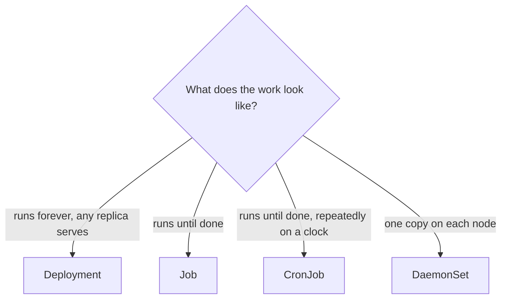

# Lesson 7. Jobs, CronJobs and DaemonSets

**Mission link:** The mission lists batch work and per-node agents next to services, and a Deployment is the wrong tool for both. This lesson gives you the controller for work that ends, for work that repeats and for something that must run on every node, and names how each one goes wrong, so you pick by the failure you can live with.
**Primary source:** [Docs: "Jobs", Kubernetes](https://kubernetes.io/docs/concepts/workloads/controllers/job/)
**Prerequisites:** [Lesson 4](0004-pods.md), [Lesson 5](0005-deployments-and-replicasets.md), [Lesson 6](0006-rollouts-and-rollbacks.md), [Job](../GLOSSARY.md), [CronJob](../GLOSSARY.md), [DaemonSet](../GLOSSARY.md), [Taint and toleration](../GLOSSARY.md)

## Warm-up

1. ▢ A Deployment has 3 replicas and the default strategy. During a rollout, how many pods may exist at most, and how many must stay available?

<details markdown="1"><summary>Check</summary>

At most 4 and at least 3. The default `maxSurge` of 25% rounds up to 1 and `maxUnavailable` of 25% rounds down to 0 (lesson 6).

</details>

2. ▢ A rollout is stuck on a bad image and nobody notices. Does Kubernetes roll it back after the deadline?

<details markdown="1"><summary>Check</summary>

No. After `progressDeadlineSeconds` (default 600) it only reports `Progressing` as `False` with reason `ProgressDeadlineExceeded`. The old pods keep serving, and a person or a pipeline must run `kubectl rollout undo` (lesson 6).

</details>

3. ▢ A pod's restart policy is `Always`. Why can a Job's pods not use it?

<details markdown="1"><summary>Check</summary>

`Always` restarts a container whatever its exit code, so the pod would never finish. A Job's pods must be able to complete, so only `Never` or `OnFailure` is allowed (lesson 4, and the rules below).

</details>

## Know this

### Jobs: work that finishes

A **Job** runs pods until a number of them complete successfully, retrying failed ones up to a backoff limit ([Jobs](https://kubernetes.io/docs/concepts/workloads/controllers/job/)). When the required completions are reached the Job is complete and stops. The same loop from lesson 2 applies, with a different goal: a Deployment keeps pods running forever, a Job keeps making pods until the work is done.

```yaml
apiVersion: batch/v1
kind: Job
metadata:
  name: report
spec:
  backoffLimit: 4
  activeDeadlineSeconds: 600
  ttlSecondsAfterFinished: 3600
  template:
    spec:
      restartPolicy: Never
      containers:
        - name: report
          image: busybox:1.37
          command: ["sh", "-c", "echo building report; sleep 5"]
```

The pod template must set `restartPolicy` to `Never` or `OnFailure`; `Always` is rejected. What each choice means when a container fails:

|`restartPolicy`|On a failed container|What you see|
|---|---|---|
|`OnFailure`|The pod stays and the kubelet re-runs the container in place|One pod, with a growing restart count. When the Job gives up, the pod is terminated, so its logs go with it|
|`Never`|The pod fails, and the Job controller starts a new pod|A new pod per attempt, each failed one kept, so every attempt's logs stay readable|

The page suggests `Never` when debugging for that last reason.

Three limits shape how a Job fails:

|Field|Default|Does|
|---|---|---|
|`backoffLimit`|6|Number of retries before the Job is failed. Failed pods are recreated with an exponential delay (10s, 20s, 40s, and so on) capped at ten minutes|
|`activeDeadlineSeconds`|none|Total time for the Job whatever the retries. At the deadline all running pods are terminated and the Job fails with reason `DeadlineExceeded`. It takes precedence over `backoffLimit`|
|`ttlSecondsAfterFinished`|none|Deletes the finished Job, whether complete or failed, and its pods, that many seconds later|

A Job ends in one of two conditions, `Complete` or `Failed`. `completions` and `parallelism` default to 1 for a single task, and setting `completions` above 1 runs that many pods to success, `parallelism` at a time. An Indexed Job gives each pod a number from 0 to `completions - 1`.

The failure modes follow from the page. **A Job may run more than once.** Even with `parallelism` and `completions` of 1 and `restartPolicy: Never`, the same program can sometimes be started twice, and any retry runs in a fresh pod, so work must handle leftover files, locks and half-written output. **Finished Jobs pile up** if nothing removes them. The page recommends `ttlSecondsAfterFinished` for a Job you create directly, since unlike a Job made by a CronJob it has a default deletion policy that can leave its pods around after the Job itself is deleted through the API. `kubectl delete job` does delete the pods.

### CronJobs: work on a schedule

A **CronJob** creates a Job on a schedule written in cron syntax, one line of a crontab ([CronJob](https://kubernetes.io/docs/concepts/workloads/controllers/cron-jobs/)). It holds a `jobTemplate`, the Job spec, and does nothing else: the Job then manages the pods.

```yaml
apiVersion: batch/v1
kind: CronJob
metadata:
  name: tick
spec:
  schedule: "* * * * *"
  concurrencyPolicy: Forbid
  successfulJobsHistoryLimit: 3
  failedJobsHistoryLimit: 1
  jobTemplate:
    spec:
      template:
        spec:
          restartPolicy: OnFailure
          containers:
            - name: tick
              image: busybox:1.37
              command: ["sh", "-c", "date; echo tick"]
```

The five fields are minute, hour, day of month, month and day of week, so `0 3 * * 1` is Monday at 3 AM, and macros such as `@daily` work. Without `spec.timeZone` a schedule is read in the time zone of the kube-controller-manager, so name the zone, for example `timeZone: "Etc/UTC"` (stable since v1.27). The fields that decide its behavior:

|Field|Default|Does|
|---|---|---|
|`concurrencyPolicy`|`Allow`|`Allow` runs overlapping Jobs, `Forbid` skips a run if the previous one is still going, `Replace` stops the running Job for the new one|
|`startingDeadlineSeconds`|none|How late a run may start before it is skipped. Under 10 seconds the CronJob may not be scheduled at all|
|`suspend`|false|Stops new runs, and not Jobs already started. Runs missed while suspended count as missed|
|`successfulJobsHistoryLimit`|3|Finished Jobs to keep|
|`failedJobsHistoryLimit`|1|Failed Jobs to keep|

Its failure modes are a different set. A CronJob creates a Job approximately once per scheduled time: in some circumstances two Jobs may be created, or none, so the Job must be idempotent. With the default `Allow`, a run that takes longer than the interval overlaps with the next one. If the controller counts more than 100 missed schedules since the last one, it logs `too many missed start times` and does not start the Job; setting `startingDeadlineSeconds` changes the window it counts over. Editing a CronJob changes only Jobs created afterwards. To run one now, use `kubectl create job manual-1 --from=cronjob/tick`.

### DaemonSets: one pod per node

A **DaemonSet** ensures that all, or some, nodes run a copy of a pod. As nodes join, pods are added; as they leave, those pods are garbage collected ([DaemonSet](https://kubernetes.io/docs/concepts/workloads/controllers/daemonset/)). Typical uses: a log collector, a node monitoring agent, a storage daemon, and the network plumbing of the cluster itself. In the lesson 1 cluster, `kube-proxy` and `kindnet` are DaemonSets.

The manifest has the usual `selector` and `template`, with `restartPolicy: Always`, the only allowed value. Without a `nodeSelector` or `affinity` in the template it targets every node. The DaemonSet controller creates a pod for each eligible node and the default scheduler then binds it. The controller also adds tolerations for the `not-ready`, `unreachable`, `disk-pressure`, `memory-pressure`, `pid-pressure` and `unschedulable` taints, so these pods are not evicted when a node is unhealthy and can start on a node before it is ready. It does not add a toleration for the control plane's taint. The page's example adds one for `node-role.kubernetes.io/control-plane` with `NoSchedule`, and says to remove it if control plane nodes should not run pods.

The update strategy is `RollingUpdate` by default, with `maxUnavailable` of 1, or `OnDelete`, which replaces a pod only when you delete it ([Perform a Rolling Update on a DaemonSet](https://kubernetes.io/docs/tasks/manage-daemon/update-daemon-set/)). The failure modes: a pod that does not fit, or that a taint repels, leaves that node without the agent while the DaemonSet shows fewer ready than nodes; a bad template rolls out to every node, one at a time; and every pod's requests are paid once per node, so the cost scales with the cluster.



## Practice

1. ▢ Which object should run a log collector on every node?

    - a) A Deployment with many replicas
    - b) A CronJob firing every minute
    - c) A DaemonSet covering every node
    - d) A Job with high parallelism

<details markdown="1"><summary>Check</summary>

**c)** A DaemonSet places one pod per eligible node and adds one when a node joins. (a) is wrong because a Deployment's replicas are placed wherever the scheduler likes, can stack on one node, and do not follow node count. (b) and (d) are for work that finishes, and a collector is meant to run for as long as the node does.

</details>

2. ▢ Predict, then run. What do the last two commands show, roughly how long does the Job take to end, and how many pods exist?

    ```yaml
    apiVersion: batch/v1
    kind: Job
    metadata:
      name: flaky
    spec:
      backoffLimit: 2
      template:
        spec:
          restartPolicy: Never
          containers:
            - name: flaky
              image: busybox:1.37
              command: ["sh", "-c", "echo attempt failed; exit 1"]
    ```

    ```console
    $ kubectl apply -f flaky.yaml
    $ kubectl get job flaky
    $ kubectl get pods -l batch.kubernetes.io/job-name=flaky
    ```

<details markdown="1"><summary>Hint</summary>

`backoffLimit` is a number of retries. The delay between attempts grows each time, and each failed attempt leaves its pod behind when the restart policy is `Never`.

</details>

<details markdown="1"><summary>Check</summary>

```text
NAME    STATUS   COMPLETIONS   DURATION   AGE
flaky   Failed   0/1           41s        41s

NAME          READY   STATUS   RESTARTS   AGE
flaky-4kq2x   0/1     Error    0          41s
flaky-7vzdm   0/1     Error    0          28s
flaky-xr9bj   0/1     Error    0          8s
```

Run the first command a few times: the Job is `Running` until the last retry fails. There are three pods, the first attempt plus two retries, and each stays as `Error` so you can read its logs (`kubectl logs flaky-4kq2x`). The retry delays grow (10 seconds, then 20), so expect the Job to end well under a minute. The exact times will differ. Clean up with `kubectl delete job flaky`.

</details>

3. ▢ Predict, then run. On the `lab` cluster (one control plane node, two workers), how many pods does this DaemonSet want, and where do they run? Then add the toleration below to the pod template and apply again.

    ```yaml
    apiVersion: apps/v1
    kind: DaemonSet
    metadata:
      name: node-agent
    spec:
      selector:
        matchLabels:
          app: node-agent
      template:
        metadata:
          labels:
            app: node-agent
        spec:
          containers:
            - name: agent
              image: busybox:1.37
              command: ["sh", "-c", "sleep 3600"]
    ```

    ```yaml
          tolerations:
            - key: node-role.kubernetes.io/control-plane
              operator: Exists
              effect: NoSchedule
    ```

    ```console
    $ kubectl apply -f node-agent.yaml
    $ kubectl get ds node-agent
    $ kubectl get pods -l app=node-agent -o wide
    ```

<details markdown="1"><summary>Hint</summary>

The control plane node is tainted so ordinary pods stay off it. Which tolerations does the DaemonSet controller add on its own, and is that taint among them?

</details>

<details markdown="1"><summary>Check</summary>

```text
NAME         DESIRED   CURRENT   READY   UP-TO-DATE   AVAILABLE   NODE SELECTOR   AGE
node-agent   2         2         2       2            2           <none>          12s
```

Two pods, one on each worker (`lab-worker` and `lab-worker2`), none on `lab-control-plane`, because that node carries the `node-role.kubernetes.io/control-plane:NoSchedule` taint and the DaemonSet does not tolerate it. After you add the toleration and apply, `DESIRED` becomes 3 and a pod starts on the control plane node too. This is the failure mode of "an agent missing from some nodes": `DESIRED` is smaller than the node count, or `READY` is smaller than `DESIRED`. Delete a pod and the DaemonSet creates a new one on the same node.

</details>

4. ▢ A CronJob runs `*/5 * * * *` and each run takes 7 minutes. With the defaults, what happens, and what do you change?

<details markdown="1"><summary>Check</summary>

`concurrencyPolicy` defaults to `Allow`, so a new Job starts every 5 minutes while the previous one is still running, and runs overlap. If the work must not overlap, set `concurrencyPolicy: Forbid`, which skips the new run while one is going (or `Replace` to stop the old one for the new). Skipped runs under `Forbid` count as missed. Either way the program must tolerate being started twice, because a CronJob can occasionally create two Jobs or none.

</details>

5. ▢ A Job with `restartPolicy: OnFailure` and `backoffLimit: 3` ends `Failed`, and the pod is gone, so `kubectl logs` has nothing. How do you get the logs next time?

<details markdown="1"><summary>Hint</summary>

Look at what the Job does with the pod when the backoff limit is reached, and which restart policy keeps every attempt's pod.

</details>

<details markdown="1"><summary>Check</summary>

With `OnFailure` the same pod is re-run in place, and the Job terminates it once the backoff limit is reached, which removes the logs you wanted. Use `restartPolicy: Never` while debugging, so each failed attempt leaves its own pod, or ship logs off the node. `kubectl logs --previous` helps only while the pod still exists.

</details>

6. ▢ A pipeline creates a Job every hour with `kubectl create`. A month later `kubectl get pods` is full of `Completed` pods. What is missing, and why would a CronJob not have the problem?

<details markdown="1"><summary>Check</summary>

Nothing deletes a finished Job, so it and its pods stay. Set `ttlSecondsAfterFinished` in the Job's spec so the TTL controller removes finished Jobs, and their pods, after that long. A CronJob keeps only `successfulJobsHistoryLimit` (default 3) finished Jobs and `failedJobsHistoryLimit` (default 1) failed ones and deletes older ones, so it cleans up after itself.

</details>

## Real-world reps

- [ ] On the `lab` cluster apply `flaky.yaml`, watch `kubectl get pods -l batch.kubernetes.io/job-name=flaky -w` until the Job fails, then read the logs of one failed pod and run `kubectl describe job flaky` for the events. Delete the Job.
- [ ] Apply the `tick` CronJob, watch `kubectl get jobs -w` for two runs, then run `kubectl patch cronjob tick -p '{"spec":{"suspend":true}}'` and confirm no new Job appears. Start one by hand with `kubectl create job tick-manual --from=cronjob/tick`.
- [ ] Tomorrow: without notes, pick the controller for a nightly backup, a log shipper on every node and a one-off data migration, and for each name one way it can go wrong and the field that limits it.

## Going further

- [Workloads](../reference/workloads.md)
- [kubectl](../reference/kubectl.md)
- [Docs: "Jobs", Kubernetes](https://kubernetes.io/docs/concepts/workloads/controllers/job/)
- [Docs: "CronJob", Kubernetes](https://kubernetes.io/docs/concepts/workloads/controllers/cron-jobs/)
- [Docs: "DaemonSet", Kubernetes](https://kubernetes.io/docs/concepts/workloads/controllers/daemonset/)
- [Docs: "Automatic Cleanup for Finished Jobs", Kubernetes](https://kubernetes.io/docs/concepts/workloads/controllers/ttlafterfinished/)
- [Resources](../RESOURCES.md)

---

Not landing? Reread the primary source at the top, since this lesson compresses it and compression is where understanding leaks. Check the [glossary](../GLOSSARY.md) for any term that felt slippery.

If the lesson itself is unclear rather than the material, that is a defect: [open an issue](https://github.com/TokenCemetery/teach/issues).
