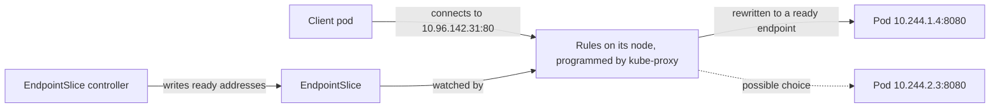

# Lesson 8. Services

**Mission link:** The mission is to expose a service inside the cluster and outside it. Pods come and go and each new one gets a new IP, so nothing can depend on a pod address. A Service is the stable name and virtual IP in front of them, and knowing how it picks backends is how you say which hop failed when a workload is unreachable.
**Primary source:** [Docs: "Service", Kubernetes](https://kubernetes.io/docs/concepts/services-networking/service/)
**Prerequisites:** [Lesson 3](0003-objects-and-manifests.md), [Lesson 5](0005-deployments-and-replicasets.md), [Service](../GLOSSARY.md), [Selector](../GLOSSARY.md), [Label](../GLOSSARY.md), [EndpointSlice](../GLOSSARY.md), [kube-proxy](../GLOSSARY.md)

## Warm-up

1. ▢ You delete one pod of a three-replica Deployment. What happens, and is the replacement guaranteed to have the same name or IP?

<details markdown="1"><summary>Check</summary>

The ReplicaSet controller sees two pods where the spec says three and creates a new one (lessons 2 and 5). The replacement is a new pod with a new generated name, and it gets a new IP. A pod is never restored, only replaced.

</details>

2. ▢ A Deployment's `spec.selector` is `app: web` but its pod template has the label `app: webapp`. What does the API server do?

<details markdown="1"><summary>Check</summary>

It rejects the Deployment: the selector must match the labels of the pod template, or the controller could never own the pods it creates (lessons 3 and 5). A selector is a query on labels, and a query that matches nothing it creates is invalid.

</details>

3. ▢ Which of `kubectl apply` and `kubectl create` can you run twice on the same manifest without an error, and why?

<details markdown="1"><summary>Check</summary>

`kubectl apply`. It compares the file with the live object and sends only the difference, so a repeat is a no-op. `kubectl create` fails the second time because the object already exists (lesson 3).

</details>

## Know this

### The problem a Service solves

Every pod gets its own IP, but the pods behind a Deployment change from one moment to the next, so a frontend cannot keep a list of backend addresses. A **Service** is the answer: one stable name and virtual IP in front of a set of pods chosen by a selector ([Service](https://kubernetes.io/docs/concepts/services-networking/service/)).

```yaml
apiVersion: v1
kind: Service
metadata:
  name: web
spec:
  selector:
    app: web
  ports:
    - port: 80
      targetPort: 8080
```

`selector` is a label query. `port` is the port clients use on the Service, and `targetPort` is the port on the pod, which defaults to the value of `port`. The pod port can be a name, `targetPort: http`, so the pod can change its port number without breaking clients. The default protocol is TCP, and a Service with several ports must name each one.

### Four types

|Type|What it adds|Reachable from|
|---|---|---|
|`ClusterIP` (default)|A virtual IP from the cluster's reserved range|Inside the cluster only|
|`NodePort`|Everything `ClusterIP` has, plus the same port opened on every node (30000 to 32767 by default)|Anything that can reach a node IP|
|`LoadBalancer`|Everything `NodePort` has, plus an external load balancer pointed at the node ports|The load balancer's address|
|`ExternalName`|Nothing proxied: a DNS `CNAME` to the name in `externalName`|Inside the cluster, through DNS|

The types nest: each adds to the one before, which is why a `LoadBalancer` Service also has a cluster IP and node ports ([Service type](https://kubernetes.io/docs/concepts/services-networking/service/#publishing-services-service-types)).

**Kubernetes does not ship a load balancer.** A `LoadBalancer` Service works when a cloud provider integration, running as the cloud-controller-manager, provisions one and writes its address to the Service's status. **A kind cluster has no such integration**, so the Service is created but its `EXTERNAL-IP` stays `<pending>` forever. kind documents an add-on, Cloud Provider KIND, that runs beside the cluster and provisions load balancer containers ([kind: LoadBalancer](https://kind.sigs.k8s.io/docs/user/loadbalancer/)), and every rep in this lesson works without it.

`ExternalName` is a DNS trick, not a proxy. The doc warns that it misbehaves for protocols that carry the hostname: an HTTP `Host` header the origin does not recognise, and a TLS certificate that does not match the name the client connected to.

### EndpointSlices: who is behind the Service

A Service holds no pod addresses itself. A controller watches pods matching the selector and writes their addresses into **EndpointSlice** objects labelled `kubernetes.io/service-name`. By default a slice holds at most 100 endpoints, and a new one is created when the existing ones are full ([EndpointSlices](https://kubernetes.io/docs/concepts/services-networking/endpoint-slices/)). The older `Endpoints` object is deprecated in favour of them ([Service](https://kubernetes.io/docs/concepts/services-networking/service/#endpoints-deprecated)).

```console
$ kubectl get endpointslices -l kubernetes.io/service-name=web
NAME        ADDRESSTYPE   PORTS   ENDPOINTS                 AGE
web-k7x2p   IPv4          8080    10.244.1.4,10.244.2.3     41s
```

Each endpoint carries conditions: `ready`, `serving` and `terminating`. For a pod, `serving` follows the pod's Ready condition, and `ready` is roughly "serving and not terminating". Service proxies skip endpoints that are not ready, with one exception: if every remaining endpoint is terminating but still serving, they may use those so traffic is not lost during a rolling update.

So a pod receives Service traffic only when its **readiness probe** passes (lesson 13 covers probes in full). That is how a rollout from lesson 6 avoids sending requests to a pod that has not finished starting.

A Service with no `selector` gets no EndpointSlices automatically. You create them yourself, which is how a Service can point at an address outside the cluster.

### kube-proxy: how the virtual IP works

The cluster IP belongs to no interface and no pod. **kube-proxy**, running on every node, watches Services and EndpointSlices and programs the node's packet rules so that traffic sent to the virtual IP is rewritten to the address of one ready endpoint ([Virtual IPs and Service Proxies](https://kubernetes.io/docs/reference/networking/virtual-ips/)). It runs in one of several modes (`iptables`, `ipvs`, `nftables` on Linux), and in the iptables and nftables modes the rules select a backend at random by default. The choice happens when a connection is made, so a client that keeps one connection open keeps hitting one pod.



Headless Services (`clusterIP: None`) skip this machinery: no virtual IP, no kube-proxy, and DNS returns the pod addresses. Lesson 9 covers them.

## Practice

1. ▢ Your Service selects `app: web` and `kubectl get endpointslices -l kubernetes.io/service-name=web` shows `ENDPOINTS` as `<none>`, while `kubectl get pods` shows three Running pods. What is the most likely cause?

    - a) The pod labels do not match the Service selector
    - b) The cluster ran out of virtual IPs for Services
    - c) The kube-proxy mode must be changed to nftables
    - d) The Service type must be changed to NodePort

<details markdown="1"><summary>Check</summary>

**a)** The EndpointSlice controller adds only pods whose labels match the selector, and a typo in either side gives an empty list while the pods stay healthy. (b) would stop the Service from being created at all. (c) changes how rules are written, not which pods are selected. (d) changes who can reach the Service, not what it selects.

</details>

2. ▢ A Service has `port: 80` and `targetPort: 8080`. The container listens on 8080. A client pod in the same namespace runs `curl http://web:8080`. Does it connect?

<details markdown="1"><summary>Check</summary>

No. Clients use the Service's `port`, so the right call is `http://web:80`, or just `http://web` because 80 is the HTTP default. The Service listens on 80 and forwards to 8080 on the pod. Port 8080 on the Service's virtual IP is not open.

</details>

3. ▢ Predict, then run. A two-replica Deployment has a readiness probe that passes only when `/tmp/ready` exists. What does `kubectl get pods` show for `READY`, and what does each of the two `jsonpath` commands print?

    Save this as `web.yaml`:

    ```yaml
    apiVersion: apps/v1
    kind: Deployment
    metadata:
      name: web
    spec:
      replicas: 2
      selector:
        matchLabels:
          app: web
      template:
        metadata:
          labels:
            app: web
        spec:
          containers:
            - name: nginx
              image: nginx:stable
              readinessProbe:
                exec:
                  command: ["cat", "/tmp/ready"]
                periodSeconds: 2
    ---
    apiVersion: v1
    kind: Service
    metadata:
      name: web
    spec:
      selector:
        app: web
      ports:
        - port: 80
    ```

    ```console
    $ kubectl apply -f web.yaml
    $ kubectl rollout status deployment/web --timeout=30s; kubectl get pods -l app=web
    $ kubectl get endpointslices -l kubernetes.io/service-name=web -o jsonpath='{.items[*].endpoints[?(@.conditions.ready==true)].addresses[0]}'
    $ kubectl exec deploy/web -- touch /tmp/ready; sleep 5
    $ kubectl get endpointslices -l kubernetes.io/service-name=web -o jsonpath='{.items[*].endpoints[?(@.conditions.ready==true)].addresses[0]}'
    ```

<details markdown="1"><summary>Hint</summary>

`kubectl exec deploy/web` picks one pod of the Deployment. How many of the two pods have the file after the `touch`, and which condition does a pod need before its address counts as ready?

</details>

<details markdown="1"><summary>Check</summary>

After the first apply the rollout does not finish (`rollout status` times out) and both pods show `0/1` in `READY`. The first `jsonpath` prints nothing, because no endpoint is ready. After the `touch` in one pod, the next probe in that pod passes, so the second `jsonpath` prints exactly one address, for example `10.244.1.4`. The other pod is still running but not in the ready list, so the Service sends it nothing. A running pod is not the same as a pod that takes traffic.

</details>

4. ▢ On a kind cluster you apply a `LoadBalancer` Service and `kubectl get svc` shows the following. Nothing is wrong with the pods. What is going on, and name two ways to reach the Service from your machine.

    ```console
    $ kubectl get svc web
    NAME   TYPE           CLUSTER-IP     EXTERNAL-IP   PORT(S)        AGE
    web    LoadBalancer   10.96.142.31   <pending>     80:31044/TCP   2m
    ```

<details markdown="1"><summary>Hint</summary>

Read the `PORT(S)` column: `80:31044` is a Service port and a second port. Which Service type nests inside `LoadBalancer`, and which command tunnels to a Service without any load balancer?

</details>

<details markdown="1"><summary>Check</summary>

Nothing in a kind cluster provisions external load balancers, so the address is never filled in and stays `<pending>`. The `31044` is the node port that `LoadBalancer` includes. Two ways in: `kubectl port-forward service/web 8080:80` and then `curl localhost:8080`, or install Cloud Provider KIND so a load balancer is created for the Service. Changing the type to `NodePort` also opens that port on every node, but a kind node is a container, so whether its address is reachable from your machine depends on your container setup.

</details>

5. ▢ A team creates an `ExternalName` Service `payments` pointing at `api.payments.example.com` and their HTTPS clients inside the cluster, calling `https://payments`, start failing certificate checks. Why?

<details markdown="1"><summary>Check</summary>

An `ExternalName` Service only returns a DNS `CNAME`: nothing proxies the traffic, and the client still believes it is talking to `payments`. It sends `payments` as the TLS server name and as the `Host` header, but the server's certificate is issued for `api.payments.example.com`, so verification fails. The fix is to call the real hostname, or to put a real proxy in front.

</details>

6. ▢ A Service has three ready pods. A client opens one keep-alive connection and sends 300 requests over it. Roughly how are they spread, and what does that say about using a Service as a load balancer?

<details markdown="1"><summary>Check</summary>

All 300 go to the same pod. kube-proxy's rules choose a backend when a connection is made, not per request. A Service balances connections, so long-lived connections (HTTP keep-alive, HTTP/2, gRPC) can pile onto a few pods, and a request-level balancer is a different tool (lesson 10 and the Gateway API).

</details>

## Real-world reps

- [ ] On a kind cluster, apply the manifest from Practice item 3, then run `kubectl get endpointslices -l kubernetes.io/service-name=web -o yaml` and find each endpoint's `conditions`. Make the second pod ready as well and watch its address appear.
- [ ] Run `kubectl port-forward service/web 8080:80` against that Service and `curl localhost:8080`. Then `kubectl delete pod` the pod you are forwarded to and note what the forward does. Port-forward picks one pod when it starts, so it is a debugging tool, not a load balancer.
- [ ] Tomorrow: without notes, name the four Service types and what each adds, say who writes the EndpointSlices and what decides whether a pod's address is used, and say why a `LoadBalancer` Service stays `<pending>` on kind.

## Going further

- [Networking](../reference/networking.md)
- [Docs: "Service", Kubernetes](https://kubernetes.io/docs/concepts/services-networking/service/)
- [Docs: "EndpointSlices", Kubernetes](https://kubernetes.io/docs/concepts/services-networking/endpoint-slices/)
- [Docs: "Virtual IPs and Service Proxies", Kubernetes](https://kubernetes.io/docs/reference/networking/virtual-ips/)
- [Docs: "Debug Services", Kubernetes](https://kubernetes.io/docs/tasks/debug/debug-application/debug-service/)
- [Resources](../RESOURCES.md)

---

Not landing? Reread the primary source at the top, since this lesson compresses it and compression is where understanding leaks. Check the [glossary](../GLOSSARY.md) for any term that felt slippery.

If the lesson itself is unclear rather than the material, that is a defect: [open an issue](https://github.com/TokenCemetery/teach/issues).
